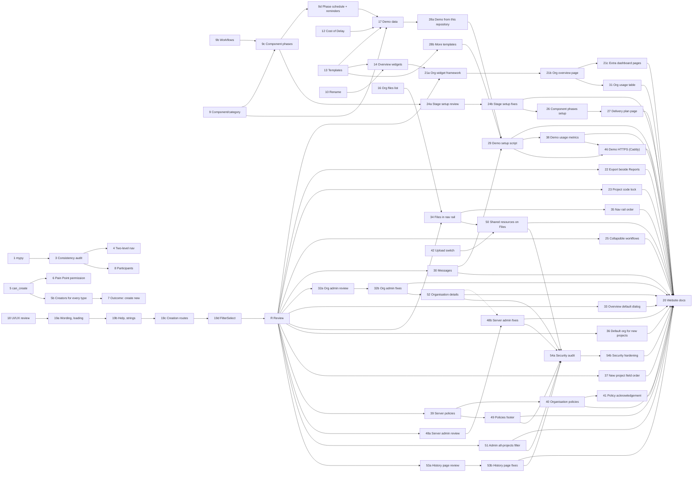

# Platform Review November 2026 — Plan

**Status:** planned 2026-11-06; phases 1 to 17 (including 14b, 9b, 9c and 9d), 25, 26, 27, 28a, 28b, 29, 30, 31, 32a, 32b 33, 34 35, 36, 37 38, 39, 40, 41, 42, 43, 44, 45, 46 and 47 done (47 uncommitted), 48a and 48b done 2026-11-10 (uncommitted), 49 to 53b and 20 (website documentation) not started; phase 5b added 2026-11-07; phases 18 and 19 added 2026-11-08; phase 18 done 2026-11-08; phase 19 split into 19a to 19d and 19a, 19b and 19c done 2026-11-08 and 19d done 2026-11-09; review checkpoint R and phase 20 (website documentation) added 2026-11-08; phases 21 (organisation dashboards, 21a to 21c), 22, 23 and 24 (24a, 24b) added 2026-11-09 from the first review items at R; phases 25 to 32 (25, 26, 27, 28a, 28b, 29, 30, 31, 32a, 32b) added 2026-11-09 from further review items at R, planned only (the user starts each one); phases 33 to 35 added 2026-11-09 from further review items at R (overview default in a dialog, Files in the navigation rail, navigation rail order and clean-up), planned only; phase 36 added 2026-11-09 (default organisation for new projects), planned only; phase 37 added 2026-11-09 (New project dialog field order), planned only; phase 38 added 2026-11-09 (demo usage metrics in Prometheus with a downloadable bundle), planned only; phases 39 to 41 added 2026-11-09 (server privacy and data policies, organisation policies, policy acknowledgement), planned only; phases 42 to 45 added 2026-11-10 (deployment-wide file upload switch, server roles (Platform subscription manager and Subscription removal authority), organisation upload switch and storage limit, request inbox as an organisation-only setting), planned only; phase 46 added 2026-11-10 (Caddy reverse proxy and enforced HTTPS for the demo), planned and built 2026-11-10 (uncommitted); phase 47 added 2026-11-10 (the demo pulls the latest published images on its daily reset), planned and built 2026-11-10 (uncommitted); phases 48 to 53 added 2026-11-10 from further review items at R (server administration UI/UX review, a policies footer, organisation shared resources on the Files page, the organisation administrator's all-projects filter on the project list, a dedicated organisation details page, a project history page UI/UX review), planned only; phase 54 added 2026-11-10 (security audit and hardening of the whole product, 54a to 54b), planned only. **Decision tags:** every decision says `Decided by: User` or `Decided by: Agent`. All sign-off questions were answered on 2026-11-06 (see each phase's *Decided by: User* lines). A question that arises during a phase is asked with `AskUserQuestion`; do not assume.

Source: 17 human review notes (the "Platform Review" list). Each was checked against the code before planning; several are partly built already, and three have a design objection recorded below.

## Status / Resume Here

57 / 71 phases complete.

| # | Phase | Notes | Status |
| --- | --- | --- | --- |
| 1 | mypy: remove the baseline, fix every finding | 1,042 findings (606 distinct keys) fixed, 14 existing `# type: ignore` replaced, baseline and `--update` removed; full-suite result in `docs/decisions.md` | [x] |
| 2 | Storage alert investigation | Cause was SeaweedFS preallocation (already fixed); monitor hardened: restart-safe state, 2-failure threshold, admin email fixed; see `docs/decisions.md` | [x] |
| 3 | Back link consistency + UI/UX consistency audit | Back link on all 21 `RecordHeader` pages, drawn by the header, guarded by `check_record_header_back.py`; not-found state on three core pages; findings register below | [x] |
| 4 | Two-level admin navigation | `group` on module admin sections, expandable `ResourceMenu`, `/…/admin/:group/:section` with redirects; see `docs/decisions.md` | [x] |
| 5 | Links panel: server-side "can create" | `can_create` on each `link-types` record type from `creatable_record_types`; frontend `canCreate` removed; see `docs/decisions.md` | [x] |
| 5b | Create new from the Links panel for every creatable type | 18 creators (core types extracted to shared modals), `not_creatable_from_links`, replay test of `can_create` against every create endpoint (found and fixed the Change Request divergence); see `docs/decisions.md` | [x] |
| 6 | Pain Point submission policy (project setting) | `pain_point_submission_settings` (project and organisation default, nearest-ancestor resolution; platform default Pain Point Managers only, existing organisations kept open by migration 0142), one `can_submit_pain_point` for create, import, Links panel and MCP; see `docs/decisions.md` | [x] |
| 7 | Engagement outcome: create new | Reuses the Links panel creators; `engagement-outcome-target-types` carries `can_create`; see `docs/decisions.md` | [x] |
| 8 | Engagement participants | Participants field on the create form (`stakeholder_ids`), empty-state notice in the form and on the detail page; the detail add control already worked; see `docs/decisions.md` | [x] |
| 9 | Component/category on every record | Generic table, many per record; shared field, filter, column, export/import, bundles, search, report field; adds an agent instruction; see `docs/decisions.md` | [x] |
| 9b | Customisable workflows (phases with kinds) for project stages | Organisation and project workflows with phase kinds; kind drives baseline and completion; Standard workflow replaces the fixed states; see `docs/decisions.md` | [x] |
| 9c | Component phases (per-component, per-stage workflow) | Each component follows a workflow per stage; project switch, off means the project stage governs; component lock approves its own requirements for the stage; owner may move a track; list column/filter, report field and per-component review deadlines not built (see `docs/decisions.md`) | [x] |
| 9d | Phase schedule and reminders | `stage_phase_plans`, stage owner, lead time; actual dates on every move, daily upcoming and overdue sweep, completed on the move; report fields for the expected end and start; overview metric left to phase 14; see `docs/decisions.md` | [x] |
| 10 | Rename navigation items, with organisation defaults | `nav_label_overrides` on project and organisation (per-key: project, ancestor, organisation), stable keys from the registry, looked up by route path; navigation, title and back link; see `docs/decisions.md` | [x] |
| 11 | Server and organisation messages (login pages and notification) | One `announcements` table (NULL organisation is platform-wide); login pages, banner and a one-time notification; organisation text may not contain a web address; see `docs/decisions.md` | [x] |
| 12 | Pain Point scoring on the Product Feedback model (custom criteria, Cost of Delay) | Read helper, one row per axis (migrations 0149, 0150), General row plus persona overrides, custom criteria, Cost of Delay and WSJF (weighted sum that divides); Playwright and perf scenarios not run; see `docs/decisions.md` | [x] |
| 13 | Template projects | Declared template keys on bundle hooks, fresh-draft starter records, module switches, tags, report setup; list filter, badge, explicit "None"; Playwright spec not run; see `docs/decisions.md` | [x] |
| 14 | Project overview widgets | Layout as JSON on project and organisation (own, ancestor, organisation, built-in), bounded metric catalogue with filters, one batched read-only metrics request, side-panel editor shared with the organisation default, module metric and widget extension points, bundles and templates; see `docs/decisions.md` | [x] |
| 14b | Overview widgets: on-page editing, grid size, scope and text | UX review of the overview and its editor (findings register in `docs/decisions.md`): the page is the editor, 12-column flow grid with width and height, project scope as an overview setting with a widget override, text widget; Playwright run on a rebuilt stack | [x] |
| 15 | Organisation overview settings shortcut | Settings icon link on the title row for every member who can see the overview (User: no role predicate); story, Playwright spec written and not run; see `docs/decisions.md` | [x] |
| 16 | Organisation-wide files list | `POST /orgs/{id}/files/search`, shared table and filters with the project page; only projects the caller holds a role in; Playwright spec written and not run; see `docs/decisions.md` | [x] |
| 17 | Demo seed data | Requirement statements, pictures and diagram, links, evidence layout, two templates and a project from one, WSJF scoring; scoring configuration now travels in bundles and templates; PDF equation line height fixed; see `docs/decisions.md` | [x] |
| 18 | UI/UX style guide review (whole product) | Read-only audit of every page and dialog against `docs/ux-style-guide.md`; findings register with severity; ends in a user sign-off. Register done 2026-11-08 (static scan, 16 findings in 6 groups, N5 refuted); the user approved every group at the checkpoint; see `docs/decisions.md` | [x] |
| 19a | UI/UX fixes: wording, loading, warnings, style guide | Groups C and F and E2/E3: contractions, abbreviations and colloquial phrases expanded (the group label is now "Organisation group" in the UI, exports and imports, which still read the earlier "Org group" suffix), `Spinner` for every hand-written "Loading…", one `ImportWarnings` component, the `title` rule settled in the style guide; Playwright not run; see `docs/decisions.md` | [x] |
| 19b | UI/UX fixes: help instead of permanent text, strings | Groups A (A1 to A5) and D (D1, D2): hints and muted explanations to `(?)` help, triage of the 166 `helpNotNeeded`, native `title` explanations to `Tooltip`, core nouns and filter labels into `strings` | [x] |
| 19c | UI/UX fixes: creation routes | Group B and the Nesting group: New project and New organisation offer Create and Import as separate dialogs on one field group (`SplitButtonTrigger`, `BundleImportDialog`, `ProjectIdentityFields`); Parent, Inheritance and Mirror role fold into one collapsed "Nesting" group (`ProjectNestingFields`, shared with project settings); Playwright edited, not run; see `docs/decisions.md` | [x] |
| 19d | UI/UX fixes: `FilterSelect` | Group E1: one shared select for every filter panel and all 117 raw `<select>` elements, with a guard script (empty baseline); 95 selects moved onto `FilterSelect`, `LabeledSelect` and `InlineSelect`, enum-typed options via `labelOptions`; Playwright not run; see `docs/decisions.md` | [x] |
| R | Review checkpoint after the UI/UX fixes | User review of phase 19's result; every item raised becomes a numbered phase or is fixed in place; gates phase 20. First items raised 2026-11-09 became phases 21 to 24 | [ ] |
| 22 | Organisation compliance pages: Export beside Reports | `PageActions` portals a section's Export into the title row's action group beside Reports; Playwright run on the rebuilt stack; see `docs/decisions.md` | [x] |
| 23 | Lock project codes after creation | `locked` in the project code policy; enforced in `change_project_code` (the one function every route uses); caller flag `code_change_locked`; Playwright run on the rebuilt stack; see `docs/decisions.md` | [x] |
| 24a | Component stage and phase setup: review | Register of 11 findings (W1 to W11) from a static walk; the user signed off W1 to W3 and W6 to W10 on 2026-11-09 (W11 is phase 20's) | [x] |
| 24b | Component stage and phase setup: fixes | Step list and "In use" badge removed; W1 "Workflows and phases" group, W2 Stage phases page, W3 workflow picker, W6 collapsible filtered track list, W7 phase on the requirement list, filter and overview metrics, W8 locked phases, W9 used by, W10 seed; Playwright run on the rebuilt stack; see `docs/decisions.md` | [x] |
| 21a | Organisation dashboards: widget framework | `WidgetRules`, organisation catalogue and batched figures, `org_overview_widgets` registry hook, tables and migration 0152; see `docs/decisions.md` | [x] |
| 21b | Organisation dashboards: the overview page | Overview page is a dashboard (grid and editor reused with a `dashboard` target); Compliance summary and attention widgets replace its Dashboard page and the stats-header tiles; Playwright run on the rebuilt stack | [x] |
| 21c | Organisation dashboards: extra pages | Pages with per-user and per-group visibility (404 for others), Manage dashboards dialog, audit, bundles, seeds; SOC 2 policy item 2c; Playwright run on the rebuilt stack | [x] |
| 25 | Collapsible workflows | Each workflow in the shared workflows panel is a `DisclosureRow` (name, step count, source; open for one, closed for several); the stage phase schedule uses it too; open state is one stored key per list holding only the exceptions; `ComponentTracksList` left for phase 26; Playwright written, not run; see `docs/decisions.md` | [x] |
| 26 | Component phases setup: compact switch, flat track list | The full-width On/Off/Inherit select becomes a compact control; the per-component expansion becomes a flat list (reverses 24b's W6 collapse, *Decided by: User*); `LabeledSelect` `autoWidth`, one `DirectoryTable` row per component and stage; Playwright written, not run; see `docs/decisions.md` | [x] |
| 27 | Component delivery status page | The page (renamed Delivery status at review, *Decided by: User*, not a planning tool) shows stages and component tracks with progress, expected range and overdue, as a table or a timeline, moves and dates set in place; composed in the browser from the three existing reads (*Decided by: User*), per-component dates already existed; `usePhaseMove` and `usePhaseRangeEditor` shared; Playwright written, not run; see `docs/decisions.md` | [x] |
| 28a | Demo project from this repository | Project "ReqTrackManager (this product)": 129 requirements, 480 reviewed decisions, SOC 2 standard with assessments, evidence and 33 risks, 4 principles, from a fixture generated from the documents (growth of the log is not drift); verified on a separate backend and database; see `docs/decisions.md` | [x] |
| 28b | More example template projects | Software delivery, Compliance readiness, Research and discovery and Hardware design (IoT data logger; *Decided by: User*, replacing Risk-led programme), each with modules, workflow, vocabularies, dashboard and starter drafts; `seed_template_projects.py`, API-routed test; Playwright not extended (see `docs/decisions.md`) | [x] |
| 29 | Demo setup script | `scripts/demo.sh` and `demo_setup.py`: guards (flag, mail catcher, no other organisations), reset, fixed password by default with opt-in rotation (*Decided by: User*), sign-in details message, opt-in daily `demo-scheduler`, optional Microsoft Clarity (added at review, *Decided by: User*); full seed not run end to end here; see `docs/decisions.md` | [x] |
| 30 | Messages: defaults, severity colour, non-dismissable, history | Start now and no end by default, `AnnouncementSeverityMark` (colour, icon, text) instead of a badge, `dismissible` (migration 0153), cap counts only messages not ended plus a stored ceiling, Current and Previous views with search, Duplicate; Playwright extended, not run; see `docs/decisions.md` | [x] |
| 31 | Organisation settings: usage table | `OrgUsageTable` at the top of the settings overview: users, active and archived projects, storage, from the dashboards' own stats function (`archived_project_count` added; no quota exists to show); Playwright written, not run; see `docs/decisions.md` | [x] |
| 32a | Organisation administration UI/UX review | Register of 15 findings (O1 to O15) from a static walk of the 13 groups and their panels; signed off 2026-11-09 (*Decided by: User*): platform-default pills and resets removed on organisation pages, inherited-tier pills kept; single-section groups lose the accordion, Projects and workflow splits | [x] |
| 32b | Organisation administration UI/UX fixes | O1 to O15: platform values as placeholders and Remove buttons (no Custom pill) on organisation pages, `OverridePill` `platformFallback`, one Save per settings group (the settings endpoint is now a partial update), SCIM confirmations, `InlineMessage`, help instead of permanent text, no accordion for single-section groups, Projects and Workflow split; style guide edited; Playwright edited, not run; see `docs/decisions.md` | [x] |
| 33 | Organisation overview default: edit in a dialog | The default overview section is a compact row (built-in or customised, widget count) and **Edit overview default** opens the unchanged editor in a large `Modal`; `OverviewEditor` `onDirtyChange` feeds the dialog guard; stories and Playwright edited, Playwright not run; see `docs/decisions.md` | [x] |
| 34 | Organisation Files in the navigation rail | A "Files" entry in the Global section below Projects, resolving the organisation as the Organisation Overview entry does (`/org-files`, `OrgListPage` `target="files"`), active on the page itself (`NavRailLink` `alsoActiveOn`); reverses phase 16's "no nav-rail entry"; not renamable (navigation names are project-scoped, see `docs/decisions.md`); Playwright written, not run | [x] |
| 35 | Navigation rail: order, Notifications, reviews due, Organisation Settings | Notifications entry removed (the bell's View all remains), `useHasReviewsDue` (`limit=1` probe on the 30-second poll; the endpoint pages before its lookups), one Global order, "My organisations" renamed "Organisation settings" (`orgSettings` string, key `myOrganizations` removed); Playwright written, not run; see `docs/decisions.md` | [x] |
| 36 | Default organisation for new projects | A per-person preference for the organisation the New project dialog starts on, set from Preferences and from the dialog; replaces "first organisation in the list"; `default_new_project_organization_id` in `ui_preferences`, `resolveNewProjectOrgId`, Preferences select shown for several organisations; Playwright written, not run; see `docs/decisions.md` | [x] |
| 37 | New project dialog: organisation, template, name order | Organisation alone on the first row above a divider, then the template (`beforeName` slot, create dialog only), then the name; `FormDivider` replaces the four hand-written rules; stories pass, Playwright step written, not run; see `docs/decisions.md` | [x] |
| 38 | Demo usage metrics: Prometheus collection and a downloadable bundle | Profile `demo-metrics` Prometheus (loopback, 30 days, volume kept by resets); `demo.sh --export-metrics` bundles snapshot, `series.jsonl`, manifest and README behind a label allow-list; `--view-metrics`, `--purge-metrics`, `--no-metrics`; reset history in a file rather than metrics (differs from the plan, see `docs/decisions.md`); verified against the live stack, full seed and a real reset cycle not run | [x] |
| 39 | Server policies: privacy policy and data policy | Built 2026-11-10 (uncommitted): `policy_documents` and append-only versions (migration 0154), body is validated ProseMirror JSON edited in TipTap (*Decided by: User*), public `/policies` and `/api/v1/public/policies`, working copy versus published version, the "Data policy" group renamed Personal data in exports; Playwright written, not run; see `docs/decisions.md` | [x] |
| 40 | Organisation policies | The shared policy table, service and editor with the organisation as owner (migration 0155): no built-in slots, starter titles, optional audience of users and organisation groups (mandatory reference, 404 for anyone else), links only when the organisation allows them, optional notification on publish (`policy_published`), organisation sections on the Policies page, bundle round trip that always imports drafts; Playwright written, not run; see `docs/decisions.md` | [x] |
| 41 | Policy acknowledgement | Built 2026-11-10 (uncommitted) at the user's choice: `requires_acknowledgement` is a live setting of the policy (not a per-version snapshot, so it can be switched off at once), `policy_acknowledgements` (migration 0156) with text hash and UTC time, accept only from an interactive session, writes refused (403 `policy_acknowledgement_required`) until accepted while reading, search, sign-out and the policy routes stay open, sign-in dialog and notice, accept panel, administrators' status view with CSV export and reminder, requirement travels in the organisation bundle and acceptances do not; Playwright written, not run; see `docs/decisions.md` | [x] |
| 42 | File uploads: deployment-wide switch | `file_uploads_enabled` (migration 0157) on server settings, one gate `assert_uploads_allowed` in `upload_file`, 18 callers inventoried (report outputs and the storage probe exempt, *Decided by: User*), static test for new writers; `resolve_bundle_files` at the import, merge and template entry points (`skip_files`, refused before any write); `FileUploadTrigger` unavailable with a tooltip, `UploadsDisabledPrompt`, Server Management → File uploads; Playwright written, not run; see `docs/decisions.md` | [x] |
| 43 | Server roles: Platform subscription manager and Subscription removal authority | Two independent server roles on explicit allow-lists: subscription manager takes create, import, suspend, module entitlements and usage reads; Subscription removal authority takes delete; joining as an organisation administrator excluded; counts only, never content; Built 2026-11-10 (uncommitted): `SUBSCRIPTION_MANAGER` and `SUBSCRIPTION_REMOVAL_AUTHORITY` (no migration: the `role` column is VARCHAR(30) without a constraint), `GET /system/access` drives the navigation, Organisations page, Server Management groups and Modules tab; roster `server_roles` replaces `is_module_administrator`; `role_used` in audit; route-gate snapshot test; deletion needs no prior suspension (*Decided by: User*); Playwright written, not run; see `docs/decisions.md` | [x] |
| 44 | Organisation file uploads: disable and storage limit | A Platform subscription manager or server administrator disables uploads for one organisation or sets a storage limit (usage shared with the usage table, race-safe check, read-only for the organisation); import dialogs offer Cancel or Import without files when the files do not fit; Built 2026-11-10 (uncommitted): `organizations.file_uploads_enabled`, `storage_quota_bytes`, `storage_warned` and a server default limit (*Decided by: User*) in migration 0158; one gate extended with distinct codes and a row lock; usage = files plus stored report outputs, now also the usage table's total; 90% notice once per crossing; Storage dialog, usage table rows, import choice with size and space left (refused at the request, not after a preview); Playwright written, not run; see `docs/decisions.md` | [x] |
| 45 | Request inbox: organisation level only | `ModuleSubComponentDefinition.organization_only` removes the dead project toggle for the Organisation-level request inbox (generic, no module key in core); planned 2026-11-10, built 2026-11-10 (uncommitted) | [x] |
| 46 | Demo HTTPS: Caddy reverse proxy | A `caddy` service in the demo stack terminates TLS (automatic certificates for a public hostname, Caddy's local authority for `localhost`), serves the application on one origin, redirects HTTP to HTTPS, sends HSTS, and is the only published listener; the direct HTTP ports are no longer published; built 2026-11-10 (uncommitted): `docker-compose.demo.yml` overlay loaded by `demo.sh` (the shared file keeps the direct ports, differs from the plan), forwarded headers trusted from the proxy's `edge` address only (IPv4-mapped spelling found in verification), other published ports on loopback, MCP on `mcp.<host>`, scrub allow-list extended; real certificate issuance and a browser run not done; see `docs/decisions.md` | [x] |
| 47 | Demo: pull the latest images on the daily reset | `scripts/demo.sh --pull` pulls the published project images, recreates only the services whose image changed, then resets and seeds with the new code; a host timer or cron entry runs it daily (the in-container scheduler cannot replace its own image); a separate override file keeps the developer stack on local builds; a failed pull keeps the current images, an unhealthy new image fails the run loudly with no automatic rollback; planned 2026-11-10, built 2026-11-10 (uncommitted): no `pull_policy` (explicit pull so a failed pull is survivable), `mkdir` host lock (no `flock` on macOS), displaced `:previous` image removed and, at the user's request, host-wide dangling-image and old build-cache pruning (`--no-prune` to skip) plus bounded container logs, no version label (image identifiers recorded), provenance attestation but no signature (vendor policy exception 7); a real pull and reset cycle on the demonstration host not run; see `docs/decisions.md` | [x] |
| 48a | Server administration UI/UX review | Register of 22 findings (S1 to S22) from a static walk of the ten server administration groups and the Organisations page against `docs/ux-style-guide.md`; Q1 to Q4 answered 2026-11-10 (*Decided by: User*); planned 2026-11-10, done 2026-11-10 (plan edit uncommitted) | [x] |
| 48b | Server administration UI/UX fixes | S1 to S22: platform logo and login background owned by no organisation (migration 0159) with a Remove control, `SettingsForm` (one Save per group, toast) on Server details, Platform branding, sign-up and file uploads, partial branding update, Users/Server details/Platform branding split and reordered menu, help instead of permanent text, Tier 2 token revocation, Organisations list on `DirectoryTable`, policies and messages tables on `DirectoryTable`, not-allowed state, Module administrator persona; server-side paging of the organisation list and a storage column not built (recorded); Playwright run on the rebuilt stack; see `docs/decisions.md` | [x] |
| 49 | Policies footer | Link to the published policies on every page (signed in and signed out), not only the login pages and the navigation rail footer, which disappears when the rail is collapsed or narrow; absent when no policy is published; planned 2026-11-10 | [ ] |
| 50 | Organisation shared resources on the Files page | Upload, list and delete shared resources from the organisation Files page for those who may manage them (server-decided), moved out of Organisation administration; planned 2026-11-10 | [ ] |
| 51 | Organisation administrator: all projects in the project list | The Projects section of Organisation administration is removed; the main project list gets an administrator-only filter (default off) that adds projects the person is not a member of, read-only, with a gear for Manage users; planned 2026-11-10 | [ ] |
| 52 | Organisation details page | Logo and company details (name, website, postal address) move from Branding & defaults to a dedicated Organisation details group; the branding save becomes a partial update so the two pages cannot overwrite each other; planned 2026-11-10 | [ ] |
| 53a | Project history page UI/UX review | Register of findings for the project History page (wasted space, filter layout, entry density) against the style guide, with a user sign-off before 53b builds; planned 2026-11-10 | [ ] |
| 53b | Project history page UI/UX fixes | Every signed-off finding; planned 2026-11-10 | [ ] |
| 54a | Security audit | Read-only audit of the whole product (not only this plan's changes) in ten streams, each candidate independently re-verified before it counts; dynamic probes only against the local test stack; register with severity, confidence and fix size, the documented SOC 2 gaps re-decided, and a user sign-off before 54b builds; planned 2026-11-10 | [ ] |
| 54b | Security hardening | Every signed-off finding fixed with a regression test, generic guards added where a class of defect was found, scanning gaps in CI closed as signed off, the SOC 2 policies and control matrix updated; planned 2026-11-10 | [ ] |
| 20 | Website documentation update | Reviews and updates `docs/website/` for every user-visible change in phases 1 to 19 (and the review's fixes); screenshots and steps re-captured where the UI changed | [ ] |

Phase 19 (19a to 19d) follows phase 18's sign-off (given 2026-11-08); phase R follows phase 19d; phase 20 follows phase R and phases 21 to 32, so the website describes the product as the review left it. Phases 25 to 41 are independent of one another except as drawn (40 reuses 39's table and Policies page; 41 needs 40; 29 needs 28a, 28b and 30, so its demo notice can be non-dismissable; 38 needs 29, whose command and reset it extends; 27 needs 26; 35 needs 34, so the Files entry is placed once); the user starts each one. Phases 48 to 53 are independent of one another except as drawn (48b and 52 both touch company details, so 52 goes first or 48b reuses its field group; 50 needs 42's upload gate and 34's Files entry); the user starts each one. Phase 54 goes after 48 to 53 so the audit covers the code as the review leaves it, and before 20 so the website describes the hardened behaviour.

## Phase 3 findings register

Method: a static scan of the 21 `RecordHeader` pages (header props, layout, links, activity, comments, confirmation and toast use, load-error handling). *Decided by: Agent*; it replaces the planned live walk, which needs a rebuilt stack and adds only rendered output.

| # | Finding | Outcome |
| --- | --- | --- |
| F1 | Requirement, Change request, Action and Compliance standard pages had no back link | Fixed |
| F2 | Nine module pages labelled the link with the singular record name or a typed arrow | Fixed; the header draws the arrow, callers pass the plural name |
| F3 | Requirement, Change request and Action pages showed a spinner indefinitely (and an unhandled rejection) when the record could not be loaded | Fixed; same message as the module pages |
| F4 | `ProjectComplianceDetail` back button read "← Back" | Fixed ("Compliance assignments") |
| F5 | Engagement has Delete permanently but no Archive | By design (a log entry, documented in the page); no change |
| F6 | `VersionWorkspace` has a hand-written "← Back to {standard}" button | A view switch inside a page, not a record header; no change |
| F7 | Compliance standard page has no Links panel, activity or tags | Not a registered artefact type's record page (a navigation workspace); no change |
| F8 | Report layout designer and pack editor back labels had no arrow | Fixed by F2 (same component) |

Phases 4, 9 and 10 take nothing further from this audit.

## Phase 18 findings register

Drafted 2026-11-08 by static scan (*Decided by: Agent*, the phase 3 precedent). **Checkpoint passed 2026-11-08 (*Decided by: User*):** every group (A to F) is approved; Q1 yes (name only, the guide is edited in both places); **Q2 collapse Parent, Inheritance and Mirror role into one "Nesting" group** (the recommendation was inline); **Q3 all 117 selects** move to `FilterSelect`. Every file path below is under `frontend/src/`. **Not covered:** the Playwright structural walk (needs a rebuilt stack), so rendered-only issues (spacing, overflow, focus order) are unreviewed; and permanent muted text (`className="text-muted"`, 801 sites) was triaged only on the New project dialog, because a text scan cannot tell an explanation from an empty state or a required next step.

**Clean:** the eight existing checkers pass with empty baselines (`check_field_help`, `check_required_markers`, `check_list_page_layout`, `check_textarea_autogrow`, `check_record_header_back`, `check_detail_cards`, `check_form_markup`, `check_spacing_tokens`). No hand-written tab bar, modal or portal outside the shared components, no `window.confirm`, no "(optional)", no raw enum string rendered, and every delete confirms or is a reversible one-tap toggle with a toast (`WatchingGroupsPanel`, `FavouritesPage`). Mutations go through `useMutation` or a parent that does.

**Seed findings checked:** N1, N2, N3, N4, N7 confirmed; **N5 refuted** (`FormActions` inside a `Modal` already portals into the dialog header, `components/FormActions.tsx:86-87`); N6 stays an open question (Q2 below).

| # | Group, finding and evidence | Rule | Severity | Proposed fix | Size |
| --- | --- | --- | --- | --- | --- |
| **A. Explain in help, not in the layout** | | | | | |
| A1 | Permanent `hint` explains what a setting does: `pages/OrgAdminPage.tsx` 3016, 3410, 3426, 3581, 3591, 3606, 3627, 3637, 3653; `pages/ProjectAdminPage.tsx` 1626, 1647, 1667, 1693; `pages/PreferencesPage.tsx` 504, 513; `pages/ProjectListPage.tsx` 457 (N2) | Pattern: explain in help | defect (16) | Move each to `help`, one line per option where it has options | M |
| A2 | `helpNotNeeded` plus a `hint` that says what the field is: `modules/stakeholders/EngagementFormModal.tsx` 92, 96, 103, 108, 112; `FindingFormModal.tsx` 64-65; `NeedFormModal.tsx` 49-58; `StakeholderFormModal.tsx` 192, 198; `ResearchPromptsPanel.tsx` 39; `modules/context_strategy/PainPointFormModal.tsx` 118. A warning that must be seen each time (personal data, "Required to reject.") stays visible | Pattern: explain in help; field help | defect (about 14) | Move the explanation to `help`; keep warnings | S |
| A3 | `helpNotNeeded` on fields whose purpose is not obvious from the name. 166 of 441 uses have a label that is not a plain name, title or description (an upper bound, to be triaged by hand): `OrgAdminPage` 19, `ProjectAdminPage` 13, `PreferencesPage` 7, `EvidenceFormModals` 5, `StakeholderFormModal` 5, `DecisionFormModal` 4. Examples: Component and Category `components/RequirementCreateModal.tsx` 231-282 and `ChangeRequestCreateModal.tsx` 423, 433; Owner `RequirementFields.tsx` 100; Role `NewUserFields.tsx` 54; accent colours `OrgAdminPage.tsx` 3251, 3260; SMTP port 3492; cascade `ComponentPhasesPanel.tsx` 181; Template, Organisation, Visibility on New project (N4) | Pattern: field help | defect (the checker cannot judge it) | Triage the 166; add `strings.help.*` to every non-obvious one | L |
| A4 | Permanent muted explanations on the New project dialog: `pages/ProjectListPage.tsx` 428 ("code is assigned automatically", N3) and 465 (`importIgnoresTemplate`). Other pages not triaged | Pattern: explain in help | defect (2 known) | `help` on Name; the import note disappears with B1 | S |
| A5 | Native `title` used to explain, not to name an icon: `ReportParamsForm.tsx` 133, 152; `LinkTraceModal.tsx` 62; `ReportFormatDownload.tsx` 65; `ReportPackRunner.tsx` 228; `TreeSelect.tsx` 85; `pages/OrgAdminPage.tsx` 2369; `ProjectAdminPage.tsx` 1801; `RequirementsPage.tsx` 371-381 (icons whose meaning is only in `title`); `ScoringMatrixChart.tsx` 91 | Pattern: explain in help ("never a native `title`") | defect (about 10) | Shared `Tooltip`; give the `RequirementsPage` icons an accessible name | S |
| **B. Creation routes** | | | | | |
| B1 | New project: Import is a file field inside the Create form that hides the code, report name and template fields (N1): `pages/ProjectListPage.tsx` 513-517, 417, 431, 442, 463 | Create as a layer; one door for bulk | defect | `SplitButtonTrigger` (Create is the default click; chevron offers Import project), two short dialogs on one shared field group. Alternative: `MenuButton` "New" with both. Recommend the split button, which the guide names for a primary action with one alternative | M |
| B2 | Same shape on `pages/ServerOrganisationsPage.tsx` 209-222: "Or import from an exported bundle" in the create dialog, creation choices hidden when a file is chosen | same | defect | Same fix, one component for both pages | M (with B1) |
| **C. Formal wording** | | | | | |
| C1 | Contractions in user-visible text: 27 lines in `i18n/strings.ts` (69, 104, 206, 247, 330, 337, 636, 758, 852, 951, 966, 1212, 1217, 1232, 1256, 1290, 1441, 1469, 1500, 1518, 1761, 3146, 3161, 3172, 3176, 3188, 3210) and about 48 string literals in components (`App.tsx` 120, `CsvImportWizard.tsx` 237, `OrgAdminPage.tsx` 3430, 3851, `RequirementDetailPage.tsx` 372, `ProjectAdminPage.tsx` 1597, 1599, 2393 and others) | Formal wording | defect (about 75) | Expand ("does not", "cannot") | S |
| C2 | Abbreviations: "Org-wide visibility" (`strings.ts` 568, 570), "Org group" (88), "Org Admin" (377, 378, 512, 543, 554 and others; 21 lines); N7: the Visibility options come from `admin.*` while the same word is used elsewhere as "organisation" | Formal wording; one term for one thing | inconsistency | Spell out, reuse the glossary term | S |
| C3 | Colloquial or idiomatic phrasing: `modules/product_feedback/RequestScoresPanel.tsx` 58 ("Worked out"), `RequestFields.tsx` 158 ("Worked out:"), `RequestLoopPanel.tsx` 44 ("Everyone who asked has been told"), `RequestDetailPage.tsx` 616 ("the people who asked"), `strings.ts` 2719, 3708 ("worked out from a number"), 1431 ("let in"), `components/ProposedLinkRow.tsx` 44 (comment, "greyed out") | Formal wording (the correction CLAUDE.md names) | defect (7) | "Calculated", "requesters", "unavailable", "permitted" | S |
| **D. Terminology and strings** | | | | | |
| D1 | Core nouns typed as English literals, so the organisation terminology and the deployment's organisation label are ignored (22 sites): `pages/ProjectListPage.tsx` 361 ("Organisation"), `ServerOrganisationsPage.tsx` 203, 209, 214, 220 (`New ${orgLabel}`, "Defaults to the bundle's own name", "Or import from…"), `ReportParamsForm.tsx` 60, 69, `ServerManagementPage.tsx` 717, `modules/compliance/StandardImportModal.tsx` 86, `OrgComplianceOutstandingPanel.tsx` 388, `StandardWorkspacePage.tsx` 264-268, `ComplianceOrgOverviewTiles.tsx` 58 | Terminology; one term for one thing | defect (22) | Move to `strings` with the noun placeholders | M |
| D2 | `FilterField label="…"` literals outside `strings` (51; most in compliance, product feedback, context strategy and the project, requirement and change request lists) | one term for one thing; translation | inconsistency | `strings.filters.*`; the repeated Status, Role, Organisation labels become shared | M |
| **E. Shared components** | | | | | |
| E1 | 117 raw `<select className="input">` in 55 files, mostly in filter panels (`RequirementsPage.tsx` 7, `OrgComplianceOutstandingPanel.tsx` 6, `ProjectListPage.tsx` 5, `OrgComplianceStandardsPanel.tsx` 5, `SearchPage.tsx` 4, `RequestFilterFields.tsx` 4, `FileFilterFields.tsx` 3). `FilterField` has no select partner; `LabeledSelect` is for forms | one component per pattern | inconsistency | A `FilterSelect` (value, options, "All" entry) used by every filter panel; Q3 | L |
| E2 | Hand-written "Loading…" in `modules/compliance/` (`ComplianceOrgSettingsPanel.tsx` 57, `StandardVersionsSection.tsx` 102, `ProjectComplianceDetail.tsx` 199, `MappingTypesPanel.tsx` 42, `StandardListPage.tsx` 174, `RequirementMappingsModal.tsx` 125) and `product_feedback/RequestDemandPanel.tsx` 105 | one component per pattern | inconsistency (7) | `Spinner` | S |
| E3 | The import-warnings card is written three times with a literal `#b58900` fallback: `ProjectListPage.tsx` 546, `ServerOrganisationsPage.tsx` 260, `OrgAdminPage.tsx` 2570 | one component per pattern; tokens | inconsistency | One shared warning list (`Notice`-style) on theme tokens | S |
| **F. The style guide itself** | | | | | |
| F1 | Contradiction: Principle 8 and the compact-forms and button-size sections (lines 865, 906) ask every icon-only button for an `aria-label` **and** a `title`; "explain in help" (line 1093) says never use a native `title`. About 40 icon buttons carry both | Style guide | ambiguity | Q1 | S (docs) |

Sizes: S under half a day, M about a day, L several days.

### Questions for the checkpoint

- **Q1 (F1):** may an icon-only button keep a native `title` as its name (not as an explanation)? Recommendation: yes, and the guide says so in both places.
- **Q2 (N6):** on New project, keep Parent, Inheritance and Mirror role inline, or fold them under one collapsed "Nesting" group? Recommendation: keep inline; they appear only when a parent exists, so the default dialog is short.
- **Q3 (E1):** build a shared `FilterSelect` and move all 117 selects onto it, or only the filter-panel ones (about 60)? Recommendation: filter-panel ones now, the form ones already have `LabeledSelect`.

## Phase 24a findings register

Drafted 2026-11-09 by static walk of the code (*Decided by: Agent*, the phase 3 and 18 precedent): every task was traced from the navigation to the control and the permission behind it. Every path is under `frontend/src/` unless stated. **Not covered:** a rendered walk (needs a rebuilt stack) and the owner-without-manager journey (W2), which needs one live check.

**Works today** (task, route): define a workflow (Organisation Admin → Projects & workflow → Stage workflows; Project Admin → Structure → Stage workflows; `StageWorkflowEditor`: name, ordered phases, kind, reorder, delete); hide and restore an organisation workflow (project panel); create a stage and choose its workflow, change a workflow while the stage is open, move a stage between phases with the closed-phase prompt (Project Admin → Structure → Stages); turn component phases on, off or inherit (Component phases section); move a track, set its workflow, not-applicable and owner (`ComponentTrackEditor`); set expected ranges, lead time and a stage owner (Stage schedule). The backend rules for each are tested.

| # | Finding | Severity | Proposed fix |
| --- | --- | --- | --- |
| W1 | The four related sections (Stages, Stage workflows, Component phases, Stage schedule) are separate collapsed sections on one long Structure tab; nothing tells a person that component phases exist, that they are off, or the order to set things up (workflows, then stages, then component phases, then schedule) | High | One "Workflows and phases" group in project administration (the two-level menu of phase 4) holding the four as ordered sub-pages, and the off state of component phases states what turning it on does with a link to the switch |
| W2 | Moving a track is only possible inside Project Admin → Structure. The server lets a track's owner (who need not be a manager) move it, and the website says so, but the control lives on a settings page; whether that page loads at all for a plain member is unverified | High | A "Stages and phases" view in the project's own navigation listing the tracks the caller may move (their own first) with the phase picker; a live check of Project Admin as a plain member first |
| W3 | With one workflow the stage's workflow picker is not shown (`stageWorkflows.length > 1`), so a person who wants a custom workflow is shown no sign it exists or where to create one | Medium | Always show the picker; "New workflow" beside it opens the same editor |
| W4 | The workflow list is a row of badges; the order of phases, the starting phase and the closing phase are not readable | Medium | Ordered step list (requested; built in 24b) |
| W5 | The "In use" badge states a fact nobody can act on; the server's refusal when deleting an in-use workflow already explains it | Low | Remove it (requested; built in 24b) |
| W6 | The component phases list is every component by every stage with no filter or collapse; a project with 12 components and 6 stages shows 72 rows | Medium | Collapse per component with the current phases as a summary line; filter by stage, phase and owner |
| W7 | A component's phase is visible nowhere outside that panel (no list column, filter or overview figure); phase 9c recorded this as not built | Medium | Phase column and `TagFilter`-style filter on the requirements list and a metric on the overview; needs the user's agreement on cost, since the inherited switch cannot be resolved cheaply in report SQL |
| W8 | A move into a locked phase by someone without the approver role fails with the server's message only after the choice | Low | Disable the locked phases in the picker for a person who cannot enter them, with the reason in a tooltip (needs the capability from the server) |
| W9 | Which stages and tracks follow a workflow cannot be seen, so a person editing or deleting one has to guess | Low | "Used by" list in the workflow's step list, replacing the badge's information with something useful |
| W10 | The e2e seed has no workflow or component-phase data (the demo seed does), so no Playwright spec starts from a populated state | Low | Seed one custom workflow and a project with component phases on in `seed_e2e_dataset.py` |
| W11 | The website describes the steps but under "Stage schedule" and "Component phases" as separate headings with no setup order | Low | One "Setting up stages and phases" page with the ordered steps and a Mermaid diagram (phase 20) |

**Checkpoint passed 2026-11-09 (*Decided by: User*):** W1 to W3 and W6 to W10 built in 24b (W7 including the list column, filter and overview metric); W4 and W5 were requested and built regardless; W11 is part of phase 20. Outcomes are in `docs/decisions.md`.

## Phase 32a findings register

Drafted 2026-11-09 by static walk of `pages/OrgAdminPage.tsx` (4,164 lines, 13 groups) and the panels it mounts (*Decided by: Agent*, the phase 3, 18 and 24a precedent). The nine checker scripts all exit 0, so everything below is a defect a script cannot see. Paths are under `frontend/src/` unless stated. **Not covered:** a rendered walk (spacing, overflow, focus order), and the bodies of the module-contributed sections (Compliance, Product Feedback and the others), which are each module's own panel. Phase 18's wording, help and select findings in this file are already fixed and are not repeated.

**Company settings (Branding and defaults group): what an empty value means today**

| Field | Stored when empty | Effective value | Pill and reset today | Platform value visible to the person |
| --- | --- | --- | --- | --- |
| Logo, login background | `*_file_id` null | Platform file | Pill; Remove calls `DELETE …/branding-image` | No |
| Header title | `header_title` null | Platform default header title | Pill; reset blanks the field | Placeholder is the product name, not the configured platform title |
| Email footer company name, website, address | null | Platform footer values (name falls back to the product name; website and address omitted when unset at both levels) | Pill; reset blanks the field | No |
| Accent colour, report accent | Checkbox off, null | Platform accent | None: the "use own" checkbox is the cue | Not shown |

An empty text field therefore already means "use the platform value", so removing the pill and reset loses nothing **if** the platform value is shown as the placeholder; without it a person cannot tell a blank default from a cleared field.

| # | Page and evidence | Rule | Severity | Proposed fix | Size |
| --- | --- | --- | --- | --- | --- |
| O1 | Branding: `OverridePill` on header title, three footer fields (`OrgAdminPage.tsx` 3233, 3277, 3284, 3292); Custom pill and reset link are the requested removal | Principle 2, "Pattern: platform default vs. override" (*User* instruction wins) | change requested | Remove pill and reset from the four text fields; the platform value is the placeholder (new read of the public platform branding endpoint, already used by `BrandingContext`); header title placeholder changes from the product name to the platform title | M |
| O2 | The accent colours use a different override cue (a "use own" checkbox and a colour field), the files use a pill with Remove, the text fields will use an empty field: three mechanisms for one idea | One component per pattern | inconsistency | After O1 the guide states two shapes only: a text value is "empty means the platform value (shown as the placeholder)", a file or colour has an explicit control; the accent checkboxes stay | S |
| O3 | Logo and login background have no placeholder shape (a file cannot be empty) | Principle 2 | question Q2 | Keep the pill-free **Remove** button beside the thumbnail; the platform file shows as a muted thumbnail with "Platform default" caption when none is set | S |
| O4 | One `PUT …/advanced-settings` carries SMTP, security, PAT lifetime and report configuration; four Save buttons in three groups call the same `saveAdvanced`, so an unsaved Security edit is also saved when Save is pressed under Email (and the reverse); PAT lifetime's hint reads "Saved with the Security settings above." (`OrgAdminPage.tsx` 3686, an English literal outside `strings`) | Principle 7 (an action does what its label says); formal wording | defect | Each Save sends only its own group's fields (the schema already treats most as optional, `report_*` are "sent only when set"); drop the literal | M |
| O5 | `saveSso` shows no success toast and no failure toast (`1901`); `regenerateScimToken` and `revokeScimToken` replace or destroy the live provisioning credential with no confirmation, and regenerate has no success toast (`1920`, `1931`) | Principles 6 and 7 | defect | Toast on both saves; Tier 1 `ConfirmDialog` before regenerate (invalidates the current token) and revoke (SOC 2 access-control policy: a credential change, reviewed in 32b) | S |
| O6 | English literals outside `strings`: `Export ${orgLabel} bundle` (2502), the token removal and revoke-all messages (`descopeOrgPat`, `revokeAllOrgPats`), the PAT hint above | Formal wording; one term for one thing | defect (5) | Move to `strings.orgAdmin` | S |
| O7 | Permanent muted text that explains a control (not a warning or a next step): rename (2520), bundle import (2532), resources (2605), outside-domain users (2628), new user and invite dialogs (2722, 2737), projects (3075), project statuses (3160), email footer (3273), SSO mappings moved (3427), SCIM (3438), test email (3523), modules (3776), custom roles (3842) and role assignment (3974); `ProjectCodePolicyPanel` 63, 95; `OrganizationCodePanel` 57. About 18 lines. **Stay visible:** `ssoNotConfiguredHint`, `testEmailNoSmtp` (required next step), `scimTokenShownOnce` (warning), every empty state | "Pattern: explain in help, not in the layout" | defect (about 18) | `help` on the section or control (a `(?)` beside the section heading where the text describes the whole section) | M |
| O8 | Pages whose only content is one `CollapsibleSection` titled the same as the menu entry: Email, Tags, Messages, Modules, SSO (two), Role management (two); the section heading repeats the menu and the accordion costs a click | Principle 1 ("accordion for one optional block inside a single view, never the whole page") | inconsistency | Question Q3: a group with one section renders its panel directly under the group's heading, no accordion | M |
| O9 | Projects and workflow stacks nine accordions (Projects, Project codes, Organisation code, Navigation names, Default overview, Project statuses, Stage workflows, Link types); phase 33 already moves the overview default into a dialog | Principle 1; "one group outgrows itself → split" addendum | inconsistency | Split Projects and workflow into **Projects** (project list, codes, statuses, default overview) and **Workflow** (stage workflows, link types, navigation names) as two flat menu entries | M |
| O10 | Two raw `<table>` elements: the outside-domain users list (2633) and the personal access token list (3695); the rest of the page uses `DirectoryTable` | One component per pattern; "directory table" | inconsistency | `DirectoryTable`; the PAT row actions keep their confirms | S |
| O11 | Groups: a side `FilterPanel` whose only content is search and `{null}` (2876), while Users uses `layout="top"`; a one-control side column wastes the width | "Filter panel placement: side vs. top" | inconsistency | Groups uses `layout="top"` like Users | S |
| O12 | Default template: a bare `InlineSelect` inside an accordion with no caption or help (3308), for a setting whose effect (new projects start from it) is not obvious | Principle 13 (visible label), "Pattern: field help" | defect | `LabeledSelect` with a label and `help`; the no-template choice explicit | S |
| O13 | 19 hand-written inline status lines (`style={{ color: "var(--color-danger)" }}` or accent) for errors and successes on this page; no shared component exists (the E3 import-warnings fix covered only warnings) | One component per pattern; tokens | inconsistency | One shared `InlineMessage` (tone: error, success) used by this page's 19 sites and the two other known copies; failures that already toast keep only the toast | M |
| O14 | Overview group: a dead empty `
` with a 7-line comment explaining its absence (2475-2481), and the page repeats `logo` beside the actions menu | Tidy; "documentation describes the latest state" | defect (minor) | Remove the empty block and the stale comment | S |
| O15 | Comments and strings in this file still use "greyed" (3783) | Formal wording (comments too) | defect (minor) | "unavailable" | S |

Sizes: S under half a day, M about a day. Total about five days.

### Questions for the sign-off

- **Q1 (O1, O2):** an empty text field keeps meaning "use the platform value" and the platform value shows as the placeholder. Recommended: yes, for the **organisation company settings** (header title, footer name, website, address) now.
- **Q2 (O3):** the logo and login background keep an explicit **Remove** control (a file cannot be emptied). Recommended: yes, without a pill, with the platform file shown muted when none is set.
- **Q3 (O8, O9):** a group with one section drops its accordion, and Projects and workflow splits in two. Recommended: yes to both.
- **Q4 (scope of the rule):** the same removal for every other override pill (`PersonalDataPolicyPanel`, scoring, Persona, record visibility), or the organisation company settings only. Recommended: company settings only; the guide names the exception, because the other pills name an inherited **tier** (organisation, parent project), which an empty field cannot say.

**Checkpoint passed 2026-11-09 (*Decided by: User*):** Q1 yes (the platform value is the placeholder); Q2 yes (Remove button, no pill, the platform file shown muted); Q3 yes to both (single-section groups lose their accordion; Projects and workflow splits into Projects and Workflow). **Q4 clarified by the user:** the rule is about the **platform default**, not about overrides in general. A pill or reset whose fallback is the platform or server default is removed on organisation pages ("organisations do not care about platform defaults"); a pill that says a project's value comes from its organisation or a parent project **stays** (*Decided by: User*; this is the tier cue "Pattern: scoring and inherited settings" asks for). 32b therefore lists every `OverridePill` by scope first (organisation settings with a server fallback: company settings, the personal data policy at organisation scope and any scoring or vocabulary panel whose organisation tier falls back to the module or server default: remove; project panels naming an inherited tier: keep) and edits Principle 2 and "Pattern: platform default vs. override" to say so. O1 to O15 are all approved for 32b.

## Phase 48a findings register

Drafted 2026-11-10 by static walk of `pages/ServerManagementPage.tsx` (1,065 lines, ten groups), `ServerOrganisationsPage.tsx`, `ServerModulesTab.tsx`, `ServerReportFontsTab.tsx` and the shared panels they mount (`AnnouncementsPanel`, `PoliciesPanel`, `PersonalDataPolicyPanel`, `OrgStorageDialog`) (*Decided by: Agent*, the phase 3, 18, 24a and 32a precedent). Paths are under `frontend/src/` unless stated. **Not covered:** a rendered walk (spacing, overflow, focus order), the bodies of the Policies and Messages panels beyond their outer shape (reviewed in phases 39 to 41 and 29), and a live run as each of the four server roles (the role gating was read in code only).

**Server administrator groups today (flat, in the order phases added them)**

| Menu entry | Page heading | Content | Save model | Who sees it |
| --- | --- | --- | --- | --- |
| Access review | "Users" | Directory (default view: accounts with no organisation) plus a platform-wide token revocation card | Per action | Server administrator |
| Platform branding | none | Logo (upload at once), header title, organisation terminology, accent colour, login background (upload at once), email footer | One Save, always enabled, inline "Saved" | Server administrator |
| Public sign-up | none | One select | One Save, always enabled, inline "Saved" | Server administrator |
| File uploads | none | Switch and default storage limit | One Save, disabled until changed, toast | Server administrator |
| Email | none | A test email only (platform mail settings are deployment configuration) | Action | Server administrator |
| Messages | accordion "Messages" | `AnnouncementsPanel` | Dialog | Server administrator |
| Modules | three accordions | Policy (select, saves at once), defaults (saves at once), per-organisation availability (saves at once) | At once, toast | Server administrator, Module administrator; Platform subscription manager sees the third accordion only |
| Report fonts | accordion "Report fonts" | Font list with gear, rescan, skipped files | At once, toast | Server administrator |
| Policies | accordion "Policies" | `PoliciesPanel` | Dialog | Server administrator |
| Personal data in exports | accordion "Personal data in exports" | `PersonalDataPolicyPanel` | At once, toast | Server administrator |

The checker scripts that guard the patterns (`check_field_help.py`, `check_select_components.py`, `check_required_markers.py`) all pass, so everything below is a defect a script cannot see.

| # | Page and evidence | Rule | Severity | Proposed fix | Size |
| --- | --- | --- | --- | --- | --- |
| S1 | **The platform logo and login background are stored against an arbitrary organisation** (`routers/system/branding.py` 74-103: `any_org = select(Organization)`, "No organisation exists yet to store this file against"). Deleting that organisation removes its files, and so may remove the platform's logo; a deployment with no organisation cannot upload one, and the file counts against that organisation's storage limit and upload switch (phase 44), so the platform upload can be refused or use up one customer's quota. Read from the code (`upload_file(..., organization_id=any_org.id)`); the deletion consequence is to be confirmed by a test in 48b | Tenant isolation; data integrity (SOC 2 data retention and disposal) | defect, high if confirmed | Store the platform files with no organisation owner (or an explicit platform owner) and prove with a test that deleting any organisation leaves them. Needs a migration for existing rows | M |
| S2 | Neither platform image can be removed once set (`routers/system/branding.py` docstring: "no system-level revert-to-default"), and the page shows no Remove control. An organisation's pages have one (`BrandingImageField`) | Principle 2 and "Pattern: platform default vs. override" (a file shows a Remove control); one component per pattern | defect | Remove endpoint reverting to the built-in product logo and login background; the page uses `BrandingImageField` (with the built-in picture shown muted as the platform default when none is set) | M |
| S3 | Platform branding mixes two save behaviours on one page: the logo and login background upload the moment a file is chosen (own spinner and inline success line), the text fields and colour wait for Save | Principle 7; one Save per settings group (32b) | inconsistency | Files remain at once (a file cannot be staged) with a toast, shown inside the same `BrandingImageField` as the organisation page; the rest keeps one Save with a toast | S |
| S4 | **Save models differ across the platform groups.** Branding and Public sign-up: Save always enabled, an inline "Saved" line that stays after the next edit (`brandingDirtyRef` is set, `saved` is not cleared, 596-897). File uploads: Save disabled until a change, toast (`FileUploadsTab` 907-966). Modules (policy select) saves at once although Public sign-up has the identical shape (one select) and a Save | Principle 7; one component per pattern | inconsistency | One shared settings-group form: Save disabled until a change, a toast on success, a failure beside the button (`InlineMessage`). The style guide states the rule: a group of fields has one Save; a lone toggle or per-row control saves at once. The entitlement policy select and the sign-up mode select then follow one rule (see Q3) | M |
| S5 | **Eleven hand-coloured status lines** (`style={{ color: "var(--color-danger)" }}` or accent) at `ServerManagementPage.tsx` 444, 497, 706, 707, 760, 762, 800, 804, 843, 844, 892, 896 and `ServerOrganisationsPage.tsx` 315. `InlineMessage` exists and `FileUploadsTab` already uses it. A success that also has a toast (Principle 7) is duplicated by an inline line that never clears | One component per pattern; tokens; Principle 7 | inconsistency (13) | `InlineMessage` for the failures that belong beside a control; a toast for every success and for action failures; remove the persistent success lines (`saved`, `logoUploaded`, `loginBackgroundUploaded`, `testEmailSent`, `patResult`) | M |
| S6 | Permanent muted text that explains a control rather than warns: Access review `usersHint` (442), `patRevokeAllHint` (493); Platform branding `serverSettings.hint` (698), `emailFooterHint` (769); Test email `testEmailHint` (831); Public sign-up `signupSettings.hint` (881) and `modeOrgSpecifiedHint` (890); Modules `policyHint`, `defaultsHint`, `applyHint`, `orgHint` (82, 135, 152, 216); Report fonts `intro`, `pdfNote`, `licenceNote` (106-108). About 14 lines. **Stay visible:** `notConfigured` (a required next step), `noneFound` and the empty states, `skippedHint` is a caption of a list that appears only when files were skipped (stays) | "Pattern: explain in help, not in the layout" | defect (about 14) | Move each to `help` on the section heading or the control; the sign-up select's `help` lists every option, one line each; `licenceNote` is a responsibility the person must see before providing a font, so it stays beside the rescan action as a short warning (the one judgement call) | M |
| S7 | Single-section groups wrap their only panel in an accordion titled the same as the menu entry: Messages, Policies, Personal data in exports, Report fonts (`CollapsibleSection` at 1046, 1053, 1058; `ServerReportFontsTab` 105). The 32b rule (a group with one section renders its panel directly under the group's heading) is not applied at the platform tier. Personal data in exports is named three ways: menu "Personal data in exports", section "Data policy" (`personalDataPolicy.title`), history "Data policy" | Principle 1; Q3 of 32a; one term for one thing | inconsistency (4) | Render the panel directly under the group heading; one name for the group and the heading. Branding, Public sign-up, File uploads and Email have no heading at all: every group gets the same heading row so the page reads the same everywhere | S |
| S8 | Access review: the menu says "Access review" and the page says "Users", and the group also holds the platform-wide token revocation as a second card, a different job (incident response) in the user directory's group | Wayfinding; one term for one thing | inconsistency | Name the group and its heading "Users" (the directory is what it is); move token revocation to a "Security" heading inside the same group only if Q2 says no regrouping, otherwise to the group Q2 proposes (S15) | S |
| S9 | `revokeAllPatsPlatformWide` is a Tier 1 `ConfirmDialog`, and the result is an inline success line that stays. It revokes every non-revoked token in the deployment and cannot be undone; Principle 6 gives that blast radius type-to-confirm (the Modules "apply to all" action already does) | Principle 6, confirmation tiers; SOC 2 incident response and access control policies | defect | Tier 2 (`requireTypedText`), the count in a toast | S |
| S10 | The Organisations list is a hand-written `<table>` with English literal headings "Name", "Status", "Created" and "No … yet." (`ServerOrganisationsPage.tsx` 327-376); the rest of the platform uses `DirectoryTable`. The search is a bare `<input style={{ maxWidth: 280 }}>` above the table, while the side `FilterPanel` holds only the status select (the same defect as O11). No sort, no row link, no paging, no member or project count: a deployment with hundreds of organisations loads and filters them all in the browser | One component per pattern; "Pattern: directory table", "directories at scale", "sortable column header", "filter panel placement"; formal wording; Principle 12 | inconsistency (high, because it is the list the Platform subscription manager and Subscription removal authority use all day) | `DirectoryTable` with sortable Name, Status, Created, Storage used (and limit) and the name a link to the organisation's administration for a server administrator; the search moves into the `FilterPanel` (`search` prop, side panel with Status below it); the strings move to `strings.serverOrgs`; server-side search and paging if the list endpoint already supports it, otherwise recorded as a gap | M |
| S11 | The row action "Edit" opens the organisation's administration (`navigate(/orgs/:id/admin)`), not an edit form; "Storage" opens a dialog; the label does not say where it goes | Wording; Principle 8 | defect | "Administration" (formal) and the name as a link (S10) | S |
| S12 | The New organisation dialog explains module choices with a native `title` (`CheckboxField … title={choice.description}`, 278) and marks them `helpNotNeeded`; the description is the one thing that tells a person what a choice seeds. Style guide: "Do not use a native `title` for this" | "Pattern: explain in help"; field help | defect | `help={choice.description}` and drop the `title` | S |
| S13 | Action failures show a hand-coloured line that never clears (`actionError`, Organisations 315 and Access review 444) with the literal "Something went wrong." (`ServerManagementPage` 172, `ServerOrganisationsPage` 159) outside `strings` | Principle 7; formal wording | defect | A toast through `toErrorMessage(err, strings.common.error)`, as the Modules and Report fonts groups already do | S |
| S14 | Access review: a banned or deactivated state is plain muted text in the actions cell (401-402), not a status; the "Show all N" and "Show fewer" buttons are hand-sized (`style={{ fontSize: "0.75rem", … }}`) rather than `btn btn-sm`. The Assign server roles dialog opens a second confirmation dialog for each checkbox (stacked dialogs) | "Pattern: status colour", "pills", "button sizes"; confirmation tiers | inconsistency | A Status column with the shared badge (Active, Deactivated, Banned) that is a `FilterBadge` where the status filter exists; `btn btn-sm`; the role dialog keeps its per-change Tier 1 confirmation (a role change is a credential change), but the dialog and the confirmation are checked once in a live run | S |
| S15 | **Menu: ten flat groups in the order they were built, unrelated groups adjacent.** Related ones are scattered: appearance (Platform branding, Report fonts), people and access (Access review, Public sign-up), data handling (File uploads, Policies, Personal data in exports), communication (Email, Messages). The style guide allows a second level for a **module's own** settings only (addendum 2026-11-07) and says to split a crowded group into flat groups | Principle 1; "Pattern: settings hierarchy" | inconsistency | See Q2: reorder the flat list by relatedness (no new mechanism) rather than nested headings | S |
| S16 | The page for a person with no group they may use redirects to `/` with no message (`groups.length === 0 → <Navigate to="/" />`); a deep link to a group the person may not use silently shows the first group they may with the old URL | Empty and not-allowed states | defect | A "You do not have access to server management" state with a link home; the URL replaced when the group falls back | S |
| S17 | Platform terminology (organisation label, singular and plural) is in the Branding page between the header title and the accent colour, with English literal placeholders `"organisation"` and `"Organisations"` (721-737) | Formal wording; strings in `strings`; grouping | defect (minor) | Placeholders from `strings`; the two fields grouped under a "Terminology" heading, and Q1's split decides which page holds them | S |
| S18 | Platform branding and an organisation's branding differ after 32b and 52 by design (the platform sets the defaults the organisation shows as placeholders), but the page does not say what an organisation without a value will show (the `help` on each platform field does not mention it) | Principle 2 (the platform tier keeps its own controls) | question Q1 | If Q1 is yes: a "Server details" group (logo and email footer company details) and Branding (header title, terminology, accent colour, login background), matching phase 52's organisation split; the help on each field states what an organisation without its own value shows | M |
| S19 | The Modules group is three accordions of a different length each; the per-organisation picker is a plain select over every organisation (no search) and the effective-state hint repeats on each row (`stateSummary · overridden`) | "Directories at scale"; Principle 14 | inconsistency (minor) | Keep the three accordions (they are three levers, not one panel); the organisation picker gains search once there are many (`LabeledSelect` with the shared searchable option, or a picker dialog); the row hint becomes a `StatusPill` | S |
| S20 | Report fonts: an unlabelled bulk of `ItemRowList` detail text joins state, faces, and Word name into one dot-separated sentence; Rescan sits under the list; the gear holds a field that saves on blur | Principle 14; "Pattern: item rows with a settings gear" | inconsistency (minor) | A heading action row (Rescan beside the heading); detail as separate muted segments; the Word name field saves with a visible commit (Enter or a Save in the gear), as every other popover with a text field | S |
| S21 | `PoliciesPanel` and `AnnouncementsPanel` (also mounted in organisation administration) use hand-written `<table className="table">` rather than `DirectoryTable` (`PoliciesPanel` 77, 211; `AnnouncementsPanel` 133), so they have no sort, no row link and a different look from the directories next to them | "Pattern: directory table", one component per pattern | inconsistency | `DirectoryTable` in both, which fixes the organisation tier too | M |
| S22 | The e2e seed has a server administrator only; no spec runs the groups as a Module administrator, a Platform subscription manager or a Subscription removal authority (`seed_e2e_dataset.py`) | Testing requirements; phase 43 | gap | Seed one persona for each of the three roles and one spec per role asserting the groups, the organisation row actions and the not-allowed state (S16) | S |

Sizes: S under half a day, M about a day. Total about seven days (S1 and S10 are the largest).

### Questions for the sign-off

- **Q1 (S18, S17):** does the platform Branding page get the phase 52 split (a **Server details** group holding the logo and email footer company details, leaving **Branding** with header title, terminology, accent colour and login background)? Recommended: yes, so the platform and organisation pages read the same.
- **Q2 (S15, S8):** regroup the ten groups under headings? Recommended **no headings**: the style guide limits a second level to a module's own settings, and a heading would be a new mechanism for ten entries. Instead reorder the flat list by relatedness (Users, Public sign-up, Platform branding, Server details, Report fonts, Files and storage, Policies, Personal data in exports, Email, Messages, Modules) and keep token revocation in Users.
- **Q3 (S4):** one rule for a lone select: group fields have one Save (disabled until changed, a toast), a lone toggle or per-row control saves at once. Recommended: yes. Public sign-up keeps its Save (its change affects who can create accounts and deserves an explicit commit); the entitlement policy select, which changes what every organisation may use, also gets a Tier 1 confirmation instead of saving silently.
- **Q4 (S1, S2):** the platform image files get no organisation owner and a Remove control. Recommended: yes; a migration moves the existing rows.

**Checkpoint passed 2026-11-10 (*Decided by: User*):** Q1 yes (the platform Branding page splits into **Server details** and **Branding**, as phase 52 does for an organisation); Q2 reorder the flat list by relatedness, no headings; Q3 yes (a group of fields has one Save, disabled until changed, with a toast; a lone toggle or per-row control saves at once; the entitlement policy select gets a Tier 1 confirmation); Q4 fix both (platform images owned by no organisation with a migration for existing rows, and a Remove control reverting to the built-in picture). The user answered the four questions and was not asked finding by finding, so S5 to S14, S16, S19 to S22 stand as proposed (*Decided by: Agent*) and 48b raises any that turns out to need a design choice.

## Challenges to the notes (read before approving)

| # | Note | Challenge | Outcome |
| --- | --- | --- | --- |
| 5 | "Add an optional `ModuleDefinition` hook `can_create(...)`" | `RecordTableProvider.can_create(db, user, project_id)` already exists for every registered type (`backend/app/modules/registry.py`), defaults to the fine-grained `propose_create` permission, and is documented as "the same check as the type's own create endpoint". A second hook would be a second answer to the same question and would drift. | Reuse the provider's check; add no hook. |
| 6 | "Creating/editing Pain Points should be behind a permission" | Editing is already manager-only. Creation is open to every member by recorded design. | **Settled with the user:** a project setting (not a new role atom), default unchanged, so a project that prefers Enhancement Requests can restrict direct submission. |
| 12 | "Cost of delay as a scoring method" | **Settled with the user:** do not hard-code one more model; give Pain Points the same style as Enhancement Requests (alternative models, organisation and project custom criteria, models enabled per project). The blocker is storage: Pain Point scores hold one fixed column per axis, so custom criteria are impossible until scores are stored one row per axis. Cost of Delay (WSJF) then ships as a built-in model, and the engine needs a sum-then-divide combination. | Storage change first, then `allow_custom_criteria`, then the built-in Cost of Delay model. Open question on per-persona scope. |
| 13 | "Select a template when creating a project" | Already built: `is_template`, `clone_project`, the New project picker, the organisation default template. The real gaps are that a clone copies no module configuration (module enablement, Pain Point types, scoring), templates show in the project list by default, and "None" cannot override the organisation default. | Plan only the gaps. |
| 14 | "Overview customisable with widgets" | **Settled with the user:** more than show/hide: managers add and remove widgets and configure them (for example a gauge on a metric the page does not show today). That is a small dashboard builder, so it needs a bounded metric catalogue, not an open query builder, to stay fast and safe. | Widget instances with a configured metric and visualisation. Metric source needs sign-off. |
| 10 | "Rename modules/sub-module pages" | The terminology feature is deliberately a closed key set because renaming every string is large. A rename that changes only the navigation label leaves "Decisions" in the page title, breadcrumbs, links and reports. | **Settled with the user:** the rename covers the navigation entry, page title, breadcrumb and back link only; record nouns stay as they are. |
| 26 | "Stages should be a list; expansion does not help" | Phase 24b's W6 collapse was the user-signed-off fix for 72-row lists. A flat list brings that back unless the filter stays. | Flat list **with** the existing stage, phase and owner filters (*Decided by: Agent*, to confirm at the start of 26). |
| 27 | "There maybe should be a component page (not within settings)" | One exists: the **Stage phases** page in the project navigation (`/projects/:id/stage-phases`, phase 24b W2). A third surface would split the same task again. | Extend that page into the delivery plan; rename it through navigation names if wanted. |
| 28a | "Based on this very project (decisions file, requirements, SOC details)" | `docs/decisions.md` is 16,981 lines and 1,373 headings; parsing it at seed time is brittle and loading all of it is unreadable. The SOC 2 package documents known gaps candidly, and a public demo would publish them. | Curated fixture produced by a reviewable extractor, with a drift test; known gaps excluded unless the user says otherwise (question in the phase). |
| 29 | "A script that sets the system up as a demo" | A one-command demo that creates accounts with known credentials and wipes data is dangerous on a real deployment. | Guarded: explicit demo flag, refuses a database holding non-demo organisations, random passwords by default. |
| 30 | "Messages do not need badges; the colours can be used for severity" | Colour alone fails WCAG 1.4.1 (use of colour) and is the only cue left for colour-blind readers. Separately, the 50-message cap per scope forces deleting old messages, which defeats a history. | Colour plus an icon and visually hidden text; the cap counts only messages that are not ended. |
| 34 | "Where is the org files list? … it should be in the left nav pane below projects" | It exists (phase 16) but is reached only from an icon link on the organisation overview, a recorded *Decided by: Agent* choice (no nav-rail entry) the user now vetoes. A person in several organisations has no single "the organisation" for a rail link. | Add the entry; resolve the organisation as `/org-overview` does (`OrgListPage` `target`), so the rail never needs an organisation id. |
| 35 | "Hide My reviews due when there is nothing due" | The entry is how a reviewer finds the page, and it is always visible today without a count. Hiding needs a cheap count that does not load the list on every page view, and a due review created while the person is on a page appears only on the next refresh. | A bounded count read (`limit=1` on the existing endpoint, or a count field) loaded once and refreshed with the notification poll; the page itself stays reachable by URL and from notifications. |
| 32 | "Remove the Custom badges and the reset to platform default" | The style guide's second principle and "Pattern: platform default vs. override" require exactly that pill and reset, and say why (a revert nobody can find). Also, an empty field today means "use the platform default" (the stored value is null), so "make the fields empty" cannot express "show nothing". | The user's instruction wins and the guide is edited in the same change (*Decided by: User*). Recommended replacement: the platform value shows as the field's placeholder, so an empty field is visibly "platform default". The logo and login background keep a remove control, since a file cannot be emptied. |

## Decisions

Decisions made by the user are recorded in each phase. Cross-phase decisions:

- **D1. A shared check is reused, not duplicated** (phase 5). *Decided by: Agent.* The Links panel and the record list import both ask `RecordTableProvider.can_create`.
- **D2. Each new project-scoped table states its nesting behaviour** (phases 10 and 14: rename and widget layout). *Decided by: Agent*, proposed: all resolve own rows, else the nearest ancestor's, else the organisation default, the `resolve_effective_action_types` shape. Record in `docs/decisions.md` when built.
- **D3. Every new project- or organisation-scoped table travels in its bundle** (phases 9, 9b, 9c, 9d, 10, 14). *Decided by: Agent*, required by CLAUDE.md.

## Phase specs

Every phase follows the standing checklist at the end. "Why / Risk / Outcome" is stated per phase as the requirements rules ask.

### Phase 1 — mypy: remove the baseline, fix every finding

- **Why:** `backend/mypy_baseline.json` held 606 accepted keys (1,042 findings); a ratchet that only shrinks leaves the debt in place. CLAUDE.md already says warnings are fixed, not suppressed.
- **Risk:** type fixes touch hot paths; a wrong "fix" (a cast) hides a real bug.
- **Work:** fix by file group (models, services, routers, each module) in batches; run `scripts/check_mypy.py` after each. Prefer correcting the type over `cast`/`# type: ignore`; an ignore needs a one-line reason and counts as a documented false positive only. Then delete the baseline file and the `--update` mode, make CI run plain mypy (zero findings), and update `scripts/check_mypy.py`, `ci.yml`, `docs/development.md`.
- **Agent instructions:** add to CLAUDE.md (Code Quality Rules): "mypy findings are fixed, not baselined or ignored; a change leaves `scripts/check_mypy.py` at zero." Do not edit the mypy configuration to narrow rules (existing rule); if a rule is wrong for the project, raise it.
- **Outcome:** zero findings, no baseline, CI fails on any new one.
- **Tests:** the full backend suite stays green after each batch (one `pytest` run at a time, per the shared-database rule); no new ignore comments (a grep check in the phase's close-out).
- **Do not:** use `Any` broadly to clear findings; a count of `Any` introduced is reported at the end.

### Phase 2 — Storage alert investigation

- **Why:** `services/storage_health.py` alerts a server administrator once per outage. A server administrator on the test stack sees many, so either storage is genuinely failing, or the "once" logic is defeated.
- **Hypotheses to test, in order:** (a) the SeaweedFS service on the test stack is really failing writes (recorded preallocation/disk trap); (b) `was_unhealthy` is process-local, so a restart or a leader hand-over between workers resets it and re-alerts; (c) the probe flaps (a slow first write) and each flap sends a pair; (d) `disk_monitor` and `storage_health` both alert for one condition.
- **Work:** reproduce on the stack, read the notification rows and the loop's log lines, then fix the cause. Likely fixes: persist the outage state (a row or the leader-lock store), require N consecutive failures before alerting, and de-duplicate by an outage identifier.
- **Outcome:** one notification per genuine outage, one on recovery, none for a transient blip.
- **Tests:** unit tests on `check_storage_health_once` with a scripted probe sequence (fail, fail, recover, fail) and a simulated restart; a regression test for whichever cause is found.
- **Reason for first/early:** the notification noise masks other server-administrator alerts, including those phase 11 will add.

### Phase 3 — Back link consistency and UI/UX consistency audit

- **Why:** the Pain Point page has a back link (`← Pain Point`), other record pages do not, and the label is the singular record name where the destination is a list. `RecordHeader` already accepts `back`, so the gap is in the callers.
- **Risk:** per-page drift again; the style guide is binding.
- **Work:**
  1. Add `scripts/check_record_header_back.py` (empty baseline): every record detail page passes `back` to `RecordHeader`, and the label is the destination's plural list name (`← Pain Points`). Fix every caller it finds, including core pages (requirement, change request, action) and every module.
  2. Run a scripted UI/UX consistency audit across modules: header actions, status badge placement, tabs vs side panel, empty states, toasts on mutation, confirmation tiers, form header, field help, required markers, label maps for enums. Method: a Playwright walk that visits every list and detail page and records structural facts (heading level, action buttons, back link, tabs), then compare in a findings table kept in this plan. No judgement by screenshot alone.
  3. Findings are fixed in the phase (fix, do not defer) or, where large, become a numbered sub-phase in this plan with the user's agreement.
- **Outcome:** one detail-page header shape everywhere, guarded by a check script, and a findings register.
- **Tests:** the check script plus a Playwright spec asserting the back link on one detail page per module (list position restore is already covered).
- **Docs:** `docs/ux-style-guide.md` gains the back-link rule under "Pattern: record header" if absent.

### Phase 4 — Two-level admin navigation (project and organisation)

*Decided by: User* (2026-11-06): an expandable left menu, with URL `/…/admin/:group/:section`.

- **Why:** modules contribute flat sections (Product Feedback registers five: settings, scoring, external systems, channels, plus the inbox), so the project and organisation admin menus grow with every module and similar names ("Pain Point scoring", "Request Scoring") sit side by side with no parent.
- **Design:** add a generic optional `group` (key, label) to `ProjectAdminSectionDef` and `OrgAdminSectionDef` (`frontend/src/modules/types.ts`). A module whose sections share a group renders as one menu entry with sub-pages; a module with a single section stays at one level. Core groups are unchanged. `ResourceMenu` gains an expandable group item (arrow-key navigation preserved) built as the shared component, with the Org and Project admin pages both moved onto it.
- **URL:** `/…/admin/:group/:section?`. Existing `/admin/:group` links redirect to the first section, so bookmarks and the many Playwright specs that deep-link survive; a redirect test pins each old module key.
- **Style guide:** the depth-model principle names resource-menu sub-pages for more than five groups; a second level is an addition and the guide is updated in the same change (settings hierarchy addendum).
- **Pushback:** do not add a third level, and do not group by module name alone — group by the module's own `group` declaration, so a module with two unrelated settings areas can say so.
- **Outcome:** admin menus whose length no longer grows with section count; sub-pages named by their parent.
- **Tests:** unit tests for grouping and the single-section case; story for the group item; Playwright for expand, keyboard use and the redirect; update specs whose locators assume the flat menu.
- **Boundary check:** the grouping field is a generic extension; no module is named in a core file.

### Phase 5 — Links panel: server-side "can create"

- **Why:** each module re-implements a permission check in the browser (`canCreate`), and a module that forgets shows a button that fails on save.
- **Design (Decided by: Agent, D1):** `GET …/link-types` already returns `other_types` filtered by module and sub-component state. Add `can_create: bool` to each entry, computed by the type's `RecordTableProvider.can_create(db, user, project_id)`; a type with no provider is `false` (cannot create from a link). Remove `canCreate` from `LinkedRecordCreator` and `useCreatableRecordTypes`; the panel offers "Create new" only for entries flagged true. Cost: one provider call per distinct type per request, not per record; the call must not add per-row queries (the scaling probe covers it).
- **Risk:** the provider check and the create endpoint diverging. A test per module with a registered creator asserts the flag equals the create endpoint's own result for a member with and without the gating role.
- **Outcome:** one server answer; no module re-implements it.
- **Tests:** per-module test, a role-gated type not offered to a member without the role; `docs/modules.md` §4l2 updated (remove `canCreate`, describe the flag); stories updated.
- **Prerequisite for phase 6's behaviour and phase 7.**

### Phase 5b — Create new from the Links panel for every creatable type

*Decided by: User* (2026-11-07): "Create new" in the Links panel should offer every standard type of record, not only Pain Points.

- **Why:** `linkedRecordCreators` is declared for `pain_point` only (phase 7 adds `stakeholder_need`), so a person on a Risk, Decision or Requirement cannot create the Persona, Open Question or Action they want to link without leaving the page. Phase 7 (outcomes) also picks its target types from the same registry.
- **Types in scope:** every registered artefact type a person authors in a project that has a create form: `requirement`, `requirement_action`, `change_request`, `decision`, `risk`, `enhancement_request`, `strategy`, `future_state`, `guiding_principle`, `open_question`, `persona`, `stakeholder`, `stakeholder_group`, `research_finding`, `engagement`, `compliance_evidence`, plus `stakeholder_need` (phase 7 if not done here). *Decided by: User* (2026-11-07): **Change Request is included** (a finding or an enhancement request is often a change to an existing requirement, so it is created and linked from that record), and **no path is restricted for workflow reasons**: the panel offers every type a link type reaches and the person may create. **Excluded, with the reason recorded in `docs/decisions.md`:** `compliance_requirement`, `project_compliance_requirement` and `compliance_required_action_assessment` only, because they are derived from an assigned standard and cannot be authored at all (*Decided by: Agent*). A test lists the exclusions, so a new type must be creatable or give a reason, as `not_importable` does.
- **Design:** each owning module registers `linkedRecordCreators[type]` with a dialog that wraps the type's existing form (`CreatePainPointDialog` is the pattern: load what the form needs, create through the same API, commit quick links and tags, report the id). The form is the type's own create dialog, so every edit field is present (create and edit share one field group). **`QuickLinkField` stays in every dialog** (*Decided by: User*, 2026-11-07): the new record may need links to other items beyond the page record, even if only "Related to"; the panel's own link to the page record is made in addition. The Change Request dialog takes its affected requirement from the page record when that is a requirement (pre-filled, editable), and otherwise asks as the normal form does. Core types (requirement, action, change request) need their creators declared by the core page set; where a form lives in a page file, extract it to a shared `*FormModal` first and move the page onto it (shared components first), rather than a second copy. `can_create` comes from phase 5 and needs no change.
- **Guard:** `frontend/src/modules/linkedRecordCreators.stories.tsx` (or a unit test) fails for a registered creatable type with neither a creator nor a stated exclusion; the backend lists the exclusions once so the two cannot drift.
- **Outcome:** from any record's Links panel, "Create new" offers every type a link type reaches that the person may create; a role-gated type is hidden by the server flag.
- **Done 2026-11-07.** Phase 7 needs no creator work for Need: `stakeholder_need` is registered here; it only adds the outcome link and the engagement page's "Create new" beside the picker.
- **Permission rule (*Decided by: User*, 2026-11-07):** a type the person may not create is never offered. The server flag from phase 5 is the only gate; no creator adds its own or ignores it. Several providers answer `can_create` with an unconditional "any member" (risk, decision, pain point, open question and others), so this phase audits every creatable type's provider against its create endpoint and fixes any that is looser. A parametrised backend test covers every creatable type: for a person with no role, a plain member and a role holder, the flag equals whether the create endpoint refuses (403), so a gate added to an endpoint without its provider fails the test.
- **Tests:** a story per creator (create and link), the registry-completeness test, a Playwright spec creating and linking one type per module (Requirement, Decision, Risk, Persona, Open Question), a refused case for a role-gated type, and a creator that adds a quick link besides the panel's own link.
- **Docs:** `docs/modules.md` §4l2 (the registry guard), `docs/ux-style-guide.md` if it names Pain Point as the only creator, docs website Links panel page.

### Phase 6 — Pain Point submission policy (project setting)

*Decided by: User* (2026-11-06): a project configuration, not a role the platform imposes. Mirrors Product Feedback's `ProjectFeedbackSettings.submission_policy`.

- **Why:** a project that runs Enhancement Requests usually wants people to raise those and leave Pain Points to managers; today it cannot restrict direct submission.
- **Design:** a `ProjectContextStrategySettings` row (or the module's existing settings row if one exists; check first) with `pain_point_submission_policy`: **Members** (default, today's behaviour) or **Managers only** (holders of the `pain_point_manager` role). Resolution: project, nearest ancestor, organisation default, Members (D2). Organisations set the default in their Context & Strategy settings; a project overrides it with a visible "Organisation default" indicator (style guide: platform-default override visibility). The create endpoint, the record-table `can_create` (so list import, the Links panel from phase 5 and the MCP tool agree) and the UI "New Pain Point" button all read one resolver, `can_submit_pain_point(db, user, project)`.
- **Guidance when restricted:** the refusal and the unavailable button state say that Pain Points are submitted by managers and, where Product Feedback is enabled, point to Enhancement Requests. Wording is formal.
- **Editing:** unchanged (manager-tier). Whether a submitter may edit their own untriaged Pain Point stays as today; not part of this phase.
- **Bundles and templates:** the setting travels in the project and organisation bundles and is copied by a template (phase 13).
- **Checks:** SOC 2 access-control policy (authorisation change); decisions-log entry; MCP tool description "any project member may do this" corrected and the module skill reference regenerated.
- **Outcome:** a project can restrict direct Pain Point submission; nothing changes for existing projects.
- **Tests:** both policies for a plain member and a manager across create, list import, Links panel flag and MCP; ancestor and organisation resolution; bundle round trip; story and Playwright for the setting.

### Phase 7 — Engagement outcome: create new

- **Why:** an engagement raises Pain Points, Needs and Open Questions, but `EngagementOutcomesPanel` can only pick existing records, which forces leaving the page.
- **Design:** add "Create new" beside the picker, using `linkedRecordCreators` and the phase 5 `can_create` flag so it works for every outcome target type without importing a module. If a target type declares no creator (for example Needs, which has none today), add one in its module in this phase. After creation the outcome link is made in the same flow.
- **Create-form rules:** the created record's form is the type's own dialog (`TagField` and every edit field through the shared field group); `QuickLinkField` stays (*Decided by: User*, 2026-11-07, as in phase 5b): the outcome link is made in addition to any quick links.
- **Outcome:** an engagement logged from a session can record its outcomes without leaving the page.
- **Done 2026-11-07.** Outcome links are dedicated, so `link-types` has no `can_create` for them; a read-only `engagement-outcome-target-types` endpoint supplies it. The Playwright spec is written but was not run (no compose stack).
- **Tests:** component story; Playwright creating each target type from an engagement; permission-refused case shows the type unavailable.

### Phase 8 — Engagement participants

- **Why:** the detail page has a Participants panel with an add control, yet it was not found. `EngagementFormModal` has no participants field although the create API accepts participants, which also breaks the rule that a create form takes every edit field.
- **Work:** reproduce first as a project member, a manager and a read-only user on a project with no Stakeholders (the add control may be hidden or empty then). Then fix the cause; likely changes: a participants field on the create form through the shared field group, an empty-state message that says why nobody can be added (no Stakeholders yet) with the link to create one, and the control's label.
- **Outcome:** participants can be added when logging and later, and an empty state says what to do.
- **Tests:** Playwright adding a participant on create and on the detail page; story for the empty state.

### Phase 9 — Component/category on every record

*Decided by: User* (2026-11-06): one generic assignment table; a record other than a requirement may have several assignments; requirements and change requests keep their single component. Today only those two have a component and category (columns on the record; the component prefix forms the requirement code).

- **Why:** a record of any type should be placed in the project's component/category tree so lists, reports and filters can slice by it.
- **Design:** a generic assignment table keyed by `(artefact_type, artefact_id)` with a required `component_id` and a nullable `category_id` (category must belong to the component, validated in the service), exactly like `ArtefactTag` (plain string type validated against the registry, project-scoped, cascade). Requirements keep their columns because the prefix is part of their code (a change request has none, only `proposed_*` for a new requirement, so it uses the table: `docs/decisions.md`); a read helper presents one resolved view for all types. A record may hold any number of assignments with no primary one (unique per record, component and category); the shared field is a multi-select tree picker. Lists filter on any match, and a list column shows all assignments, sorted by component order. Requirements stay single-component (*Decided by: User*), so the helper that presents one resolved view returns their one pair and a many-pair list for the rest; a filter matches either. Rejected: a column per module table (a per-module edit forever) and moving requirements onto the table (it changes codes).
- **Surfaces:** a `ComponentField` (shared, like `TagField`) in every create and edit form; a filter on every list via the shared list filter (`ComponentFilterField`); a column in `RecordTableProvider` export and import (`component`, `category` by name); a search field; report field provider entry; project and organisation bundles carry it; quick filter in the nested-project scope. Template cloning (phase 13) remaps the ids.
- **Core boundary:** the table is core and generic; a module adds no code except declaring its type, which it already does.
- **Agent instruction:** add a CLAUDE.md section "Every Item Type Is Placeable": a new registered artefact type uses the shared component/category field, filter, export column, bundle entry and report field, with a test that fails for a type without them (as `test_search.py` does for search).
- **Nested projects:** components belong to a project; a child project's assignment refers to the child's own tree. No fallback is needed (this is a reference, not a definition table); state that in the decisions log.
- **Outcome:** every record type can be placed and filtered by component/category.
- **Tests:** per-type create/edit/filter/export/import round trip; the registry-completeness test; scaling probe stays flat (assignments read in bulk).

### Phase 9b — Customisable workflows for project stages

*Decided by: User* (2026-11-07): phases are customisable within a project, for example Scoping, Technical scoping, Review board, Tendering, Paused, Awarded, In progress, Completion for outsourced work and Scoping, Implementation ready, Done for in-house work. One mechanism serves project stages and (phase 9c) component stages. Workflows are defined at project level, with organisation templates. Organisation templates are additive, like Pain Point types, and a project can hide and restore them. Moves between phases are free in either direction; only entering a locked phase needs the approver role. Progression between stages is advisory.

- **Why:** the four fixed stage states (`StageStatus`: scoping, review, approved, completed) do not fit every way of working; a project that tenders work needs different phases from one that improves a product continuously.
- **Risk addressed:** the baseline and change-request lock (C-G-10, C-G-12) are tied to the name "approved". Custom names would lose it unless behaviour is carried by something other than the name.
- **Design:**
  - A workflow is a named, ordered list of phases (`name`, `kind`, `sort_order`). `kind` is a closed vocabulary that carries behaviour: `open` (editable), `review`, `locked` (writes the baseline, edits limited to change requests), `on_hold`, `closed`. The name is free text. A workflow needs at least one phase and exactly one starting phase.
  - Project stages gain `workflow_id` and a current phase in place of the fixed status. The baseline, lock and completion cascade logic read the phase kind, never the name. Review deadlines and assumed approval keep working on the `review` kind.
  - The four existing states become the seeded default workflow (`open`, `review`, `locked`, `closed`) and a migration maps each existing stage, with no change in behaviour (migrated stages verified against the old status in a test). A migration seeds nothing else.
  - Free movement between phases; entering a `locked` phase needs the project manager, as approval does today. No declared transitions (add only if a need appears).
  - Organisation templates: an organisation tier of workflow definitions (`ProjectDefinitionSuppression` kind registered so a project can hide and restore a default, through `services/definition_suppression.py`); a project's effective set is its own workflows plus the organisation's, minus the hidden ones. A workflow in use cannot be deleted without reassigning its stages (the shared reassign-and-delete rules in `services/definitions.py`).
- **Surfaces:** workflow editor in project administration and in organisation administration (shared component, ordered phases with kind picker and `(?)` help describing every kind); stage form picks a workflow; stage badge and transitions by phase; a phase label map next to the existing label maps (no raw names or kinds); report field and filter; project and organisation bundles carry workflows, hidden defaults and each stage's phase (an imported locked phase never bypasses the approval gate); MCP stage tools updated (skill and reference regenerated).
- **Nested projects:** a project-scoped definition table, so decide and record the fallback: own workflows if any exist, else the nearest ancestor's (the `resolve_effective_action_types` shape), plus the additive organisation tier. *Decided by: Agent*, proposed; record in `docs/decisions.md`. Seed the default workflow for a root project only.
- **Core boundary:** core tables and helpers; a module adds nothing.
- **Outcome:** a project defines its own phases; today's projects behave as before.
- **Tests:** migration of each old status; baseline and lock by kind for a custom locked phase; free movement and approver gate; assumed approval on a `review` phase; hide/restore of an organisation template; in-use delete refusal; bundle round trip; nested fallback; story and Playwright for the editor.
- **Docs:** `docs/solution-architecture.md`, `docs/decisions.md`, glossary and the docs website stage pages; `seed_demo_data.py` and `seed_e2e_dataset.py` (outsourced and continuous-improvement examples).

### Phase 9c — Component phases (per-component workflow per stage)

*Decided by: User* (2026-11-07): a component follows a workflow for each project stage, chosen from the project's workflows (a stage's default if the component picks none). A component can skip a stage (not applicable). Progression is advisory: a component can start the next stage once its previous stage reaches a `closed` phase, but nothing blocks it earlier. A per-project switch turns component phases off, and the project stage then governs as today.

- **Why:** a project that plans by component (for example a product requirements document per component, outsourced work beside in-house improvement) needs each component to progress on its own workflow.
- **Risk addressed:** a second, component-level lock could contradict the project stage lock, or leave a requirement locked by one and open under the other.
- **Design:**
  - `component_stage_states(component_id, stage_id, workflow_id, phase_id, not_applicable, owner, approved_at/by, completed_at/by)`, unique per component and stage, created when a component first picks or moves; no row means the stage's default workflow at its starting phase. Reuses the transition, approval and review-deadline logic from phase 9b, not a second implementation.
  - A nullable project setting `component_phases_mode` (`on`/`off`, NULL inherits the nearest ancestor, else `off`; the `tag_mode` shape). Off: nothing is shown or stored and the project stage is the effective phase. One read helper returns the effective phase for any (component, stage) so lists, reports and filters do not branch on the switch.
  - A requirement targets a stage (`target_stage_id`) and has one component, so its governing component phase is that component's phase in that stage. Other record types have no single component and are never locked by component phases.
- **Confirmed with the user at the start of the phase (2026-11-07):** a requirement's edit lock is its approved status, so the question became what each lock approves. A component's locked phase approves and baselines only that component's requirements for that stage; the stage's own locked phase approves only components with no applicable track; a project manager or the track's owner (a user or group) may move a track, including into a locked phase. The owner field therefore ships in this phase (phase 9d reuses it).
- **Done 2026-11-07.** Not built, recorded in `docs/decisions.md` for the user to veto: the phase column and filter in lists and the report field (the inherited switch cannot be resolved cheaply in report SQL), per-component review deadlines and responses, and stage-review notifications for tracks.
- **Surfaces:** per-component stage track on the component in project administration (workflow picker per stage, current phase, not-applicable); phase column and filter in the lists using `ComponentFilterField` (phase 9); report field; stage review notifications; bundles carry the states and the setting (an imported locked state never bypasses the approval gate); template cloning (phase 13) copies the setting and workflow choices and resets every state to its starting phase.
- **Nested projects:** a state, not a definition table, so no fallback; only the switch inherits. State this in `docs/decisions.md`.
- **Outcome:** with the switch on, each component is planned and approved independently per stage; with it off nothing changes.
- **Tests:** transitions and approval per component and stage; skipped stage; advisory progression; lock rule both ways; switch off identical to today; bundle round trip; scaling probe stays flat (states read in bulk).
- **Docs:** as phase 9b, plus the website component pages and both seed scripts.

### Phase 9d — Phase schedule and reminders

*Decided by: User* (2026-11-07): the phases within a stage can carry an expected completion range, with notifications when a phase is upcoming and when it completes, so there are reminders on these events. *Decided by: Agent* (veto if unwanted): an "overdue" notification is added, since a reminder system that is silent when a date is missed is incomplete.

- **Why:** a phase with no dates cannot be planned against, and nobody is reminded to move it on. Tendering and review-board phases have external deadlines.
- **Design:**
  - `stage_phase_plans(stage_id, component_id NULL, phase_id, expected_from, expected_to, started_at, completed_at, upcoming_notified_for, overdue_notified_for)`: `component_id` NULL is the project stage's own phase (phase 9b), set is a component's phase in that stage (phase 9c). Unique per stage, component and phase (a partial index for the NULL case). A row exists only for a phase given dates or entered.
  - **Time shape:** `expected_from`/`expected_to` are plain calendar dates (a person's own day; `from` <= `to`). `started_at`/`completed_at` are past instants in UTC. A phase completes when the stage (or component stage) moves forward out of it or into a `closed` phase; moving back reopens it (clears `completed_at`). The history is also the actual-versus-expected record for reports.
  - **Sweep:** extends the daily stage sweep (`services/stages.py`, leader singleton via the lifespan's `start_singletons`), following the Risk Management review sweep: notify once per date (`*_notified_for` stores the `expected_to` that was notified, so a rescheduled phase re-arms itself), harmless to re-run. **Upcoming:** `expected_from` is within the project's lead days (default 7, `phase_reminder_lead_days`, nullable, inherits the nearest ancestor). **Overdue:** the current phase is past `expected_to`. *Decided by: Agent*, because the sweep has no caller's day: "upcoming" compares against the latest calendar day anywhere (UTC+14), so nobody is reminded late; "overdue" requires the date to have passed everywhere (UTC-12), so nobody is told a deadline was missed while it is still the day. Tests cover both boundaries.
  - **Completed** is event-driven, not a sweep: sent from the transition itself, in the same transaction, and never to the person who made it.
  - **Notification types** `stage_phase_upcoming`, `stage_phase_overdue`, `stage_phase_completed`, core (the stage code is core), so per-user preferences and the digest apply. The text carries the stage, component and phase names and dates, never a record body.
  - **Recipients** (*Decided by: User*, 2026-11-07): the owner, else the project managers. An optional owner on the stage and on a component's stage state (a user or a group, through the shared principal picker; group members are notified via `principal_recipients`); with no owner, the project's project managers, as the risk sweep does. Addressing, not authorisation. The component state's owner exists from phase 9c (where it also lets the owner move the track); this phase adds the owner on the stage itself.
- **Surfaces:** expected range fields on the phase in the stage form and on the component stage track (a date range field, `(?)` help describing lead days and overdue); date badge and "overdue" on the phase; lead-days setting in project settings; report fields (expected, actual, variance); the project overview (phase 14) gets a metric for phases upcoming and overdue through the generic metric catalogue; project and organisation bundles carry ranges and actual dates (the `*_notified_for` markers are derived and not exported, so an import re-arms); template cloning copies lead days and clears dates.
- **Nested projects:** plan rows are state, no fallback; only the lead-days setting inherits.
- **Outcome:** a manager sets when each phase is expected to complete and is reminded before, at completion and when late.
- **Tests:** upcoming/overdue once per date and re-armed by a date change; the two timezone boundaries and a leap of lead days; completion on forward, closed and back moves; recipients (user, group, no owner, actor excluded); preference opt-out; bundle round trip; story and Playwright for the date range field and badge.
- **Docs:** `docs/decisions.md`, website stage and notification pages, both seed scripts (dates on the demo phases).

### Phase 10 — Rename navigation items, with organisation defaults

*Decided by: User* (2026-11-06): scope is the navigation entry, page title, breadcrumb and back link of a module or sub-page ("Decisions" to "ADRs"), not every sentence that uses the noun. Record nouns for requirements and change requests stay with the existing terminology feature.

- **Why:** organisations use their own vocabulary; the existing terminology set is closed to six core nouns.
- **Design:** a generic `nav_label_overrides` map keyed by the stable nav key (`ModuleFrontendManifest` already gives every entry a key) on the project, with an organisation default map. Resolution order: project, nearest ancestor (D2), organisation, built-in label. Keys are validated against the registered nav keys (no free text keys); values are length-limited and plain text. `Layout.tsx` and the admin menus read one hook, `useNavLabel(key, builtIn)`, so no module is named in core. Project Admin gets a "Navigation names" panel (a table of built-in name, override, restore), the organisation admin a matching defaults panel, both on the shared shape the existing terminology panel uses.
- **Bundles:** both maps travel in the project and organisation bundles; template clone copies the project map.
- **Formal wording:** the panel and tooltips use "name", "override", "restore default".
- **Outcome:** a project or organisation shows "ADRs" wherever the module's navigation, title and back link appear.
- **Tests:** backend validation (unknown key rejected, length), resolution order incl. ancestor, round-trip bundle; Playwright rename and restore; story.
- **Risk:** accessibility names and Playwright locators that use the built-in label; tests use stable keys or `data-nav-key`.
- **Done 2026-11-07.** Resolution is per key rather than whole-map; lookup is by route path, so no module or page names a key; the administration menus of a module are not renamed. The Playwright spec ran against a rebuilt stack. See `docs/decisions.md`.

### Phase 11 — Server and organisation messages

*Decided by: User* (2026-11-06): one mechanism, two scopes. Server administrators write platform-wide messages; organisation administrators write messages for their own organisation.

- **Why:** an operator needs to announce degraded performance, a release, downtime or a demo-instance login hint; an organisation needs the same for its own people without involving the server administrator.
- **Design:** one table `announcements` with a nullable `organization_id` (NULL = server-wide), the pattern `Tag.project_id` and the organisation/server defaults already use. Fields: title, body (plain text), severity (information, warning, critical), optional start and end instants, `show_on_login`, and a `notify_users` action. Server administrators manage rows with a NULL organisation; an organisation administrator manages only rows of their organisation (checked server-side on every write; a server-wide row is read-only to them).
- **Where it shows:**
  - `/login`: active server-wide messages flagged for login.
  - `/login/:slug`: server-wide messages plus that organisation's. The slug page is already public and branded, so this adds no new exposure of the organisation's existence.
  - After sign-in: a dismissible banner with server-wide messages plus the messages of the organisation the person is currently in.
- **Notification:** "Send as notification" fans out one `SYSTEM_ANNOUNCEMENT` notification, once, at send time: to every active user (server-wide) or to the active members of the organisation (organisation scope). It is a recorded send, not a live banner; sending twice is prevented and shown in the row.
- **Security (Decided by: Agent):** the unauthenticated read endpoint is rate-limited and returns only active, login-flagged messages, never a creator, an id of another organisation or any tenant data. Text is rendered as plain text with no links, because organisation administrators are lower trust than the server administrator and the login page is the highest phishing risk. Organisation fan-out is limited to that organisation's members and audit-logged with counts, never the body. Create, change, delete and send are audit events; an organisation administrator can neither see nor affect another organisation's messages.
- **Time shape:** start and end are past/future instants stored in UTC and chosen in the browser; test the boundary hours (09:00 at UTC+10, 23:00 at UTC-8) at the start and end edges.
- **Bundles:** organisation messages travel in the organisation bundle; server-wide messages do not (a deployment setting), with a stated reason in `docs/decisions.md`.
- **UI:** a Messages page in Server Administration and in Organisation Admin (one shared component, scope passed in), under phase 4's grouped navigation; formal wording.
- **Docs:** docs-website server and organisation administration pages.
- **Outcome:** scheduled messages on the login pages and after sign-in at both scopes, with an optional one-time notification.
- **Tests:** active, expired and future filtering at the boundaries; unauthenticated read exposes only flagged active rows; an organisation administrator cannot write a server-wide row or another organisation's; fan-out recipient sets and idempotency; plain-text rendering; Playwright on both login pages and the banner.
- **Done 2026-11-08.** Migration `0148`. Beyond the plan (*Decided by: Agent*, for the user to veto): an organisation message may not contain a web address; at most 50 messages per scope; the unauthenticated read has its own rate-limit bucket. The notification fan-out runs in the request (recorded as a limit). The Playwright spec ran against a rebuilt stack. See `docs/decisions.md`.

### Phase 12 — Pain Point scoring on the Product Feedback model (custom criteria, Cost of Delay)

*Decided by: User* (2026-11-06): Pain Points follow the Enhancement Request style (alternative models, custom criteria) rather than getting one more fixed model. The decision I would otherwise have asked about (WSJF versus a monetary formula) is answered by this: WSJF ships as a built-in model and a monetary Cost of Delay can be built as a custom model.

- **Why:** teams rank Pain Points differently (severity-based, Cost of Delay, their own criteria); Enhancement Requests already allow this, so two scoring experiences exist for the same purpose.
- **What Enhancement Requests have that Pain Points lack:** `allow_custom_criteria=True`, models enabled per project, scores stored one row per axis (`EnhancementRequestVersionScore`), derived axes. Pain Point scores store `severity_level_id`, `frequency_level_id`, `confidence_level_id` columns per persona row, which cannot hold a custom axis.
- **Steps (each a separate, shippable change):**
  1. **Read helper, no behaviour change:** one function returns `{axis_key: level}` for a score; every reader (scores endpoint, scoring filter, matrix chart, report fields, export/import, bundle, MCP, perf generator, scaling probe) is moved onto it while the columns still back it.
  2. **Storage swap:** a `pain_point_score_axes` table (score, axis key, level) with a backfill from the three columns; drop the columns after a verified round trip. Migration number is the global next one (core and module directories share numbering).
  3. **Custom criteria:** set `allow_custom_criteria=True`; enable per-project model selection, hiding and the organisation and project panels as Product Feedback has them (shared panels, not copies).
  4. **Cost of Delay built-in model:** axes User/business value, Time criticality, Risk reduction/opportunity enablement and Job size (relative levels, Fibonacci weights, organisation-editable); model "Cost of Delay" is the sum of the first three and "WSJF" is that sum divided by Job size. This needs a generic engine extension: a weighted-sum model may declare `divisor_axis_keys` (`ScoringModelDefinition`, `validate_scoring_model_maths`, normalised by the best case). Other modules get it for free.
- **Axis scope and the General row (*Decided by: User*, 2026-11-06):** each criterion declares whether it is scored **per persona** or **for the whole Pain Point** (a generic `ScoringAxisDefinition` field; custom criteria choose it when created). The scoring panel opens on a **General** row holding every whole-Pain-Point value and the default for per-persona criteria; the person then adds only the personas that differ, and a persona row holds per-persona criteria only (it overrides General for that persona). The panel never lists every persona in the project, so it stays short with many personas. This replaces today's rule that an all-personas row and persona rows can never coexist: the service accepts both, validates that a persona row carries only per-persona criteria, and the score for a persona is its own value, else General's. A model mixing both kinds uses General's whole-Pain-Point value for every persona. Existing data keeps its meaning (an all-personas row becomes General; persona rows become overrides with no General values), and the migration and MCP `set_pain_point_scores` carry the change.
- **Risk:** many readers and a destructive migration. Mitigation is the step order above; step 2 ships only after step 1 is green on the full suite and the perf scenarios.
- **Outcome:** Pain Points offer the same model choice and custom criteria as Enhancement Requests, with Cost of Delay and WSJF available out of the box.
- **Tests:** model mathematics including the divisor and normalisation; backfill round trip and idempotent re-run; project and organisation bundle round trip with custom axes; report and export columns; MCP tools and skill reference regenerated (`set_pain_point_scores` takes axis keys); scaling shapes stay flat; custom criteria visible in the matrix and filters.

- **Done 2026-11-08.** All four steps. Migrations `0149` (custom axis `per_target`, core) and `0150` (`pain_point_score_axes`, module); next migration `0151`. Reports' `model_key` became a free key (custom models); the project and organisation bundles carry `pain_point_scoring_definitions` (the shared `scoring_definitions` key is Product Feedback's). The Playwright specs were updated and one added but not run, and the perf scenarios were not re-run. See `docs/decisions.md`.

### Phase 13 — Template projects

- **Why:** templates exist but clone only core configuration and are shown like any project.
- **Gaps and work:**
  1. **List visibility:** the project list endpoint gains `include_templates` (default false) and the list page a "Show templates" filter (URL-stored, `useUrlFlag`). The New project picker needs its own source, so it asks for templates explicitly (`templates_only=true`) instead of reading the default list.
  2. **"None" cannot override the default:** replace the null ambiguity with an explicit `use_template: bool` on `ProjectCreate` (the limitation is already recorded in `docs/decisions.md`).
  3. **Module configuration is not cloned:** `clone_project` copies components, categories, custom fields, action types and requirements; `snapshot_project_module_state` then applies the organisation defaults, ignoring the template. A template's modules enabled and sub-components, Pain Point types and their hiding, scoring configuration, Decision Types and every other module vocabulary are lost.
  4. **Mechanism (investigate first, then decide):** the project bundle already carries module vocabularies and module state through `project_bundle_hooks`. Preferred design is to clone a template by reusing those hooks in a configuration-only mode (no records), rather than a second per-module "clone hook". Spike: confirm every module's hooks can export vocabularies without records, and that import-into-new-project preserves hidden organisation defaults. If a module cannot, fix its hooks (that is also a bundle correctness fix).
  5. **Nested projects:** a child created from a template follows the existing rule (own rows, else ancestor's); decide and record whether a template for a child clones fallback rows.
- **Template labelling:** a template shows a "Template" badge; its name is not offered as a parent unless chosen deliberately.
- **Outcome:** a project created from a template has the template's modules, vocabularies and scoring, and templates are hidden from the default list.
- **Tests:** clone round trip comparing module state and vocabularies with the template; list default hides templates and the filter shows them; explicit "no template" overrides the organisation default; Playwright create from template.
- **Done 2026-11-08.** *Decided by: User* (2026-11-08): the mechanism is declared configuration keys on the existing bundle hooks, and module records are copied as fresh drafts (the spike found the hooks mix vocabularies and records, so a key classification replaced a records flag). *Decided by: User* (2026-11-08, reversing the first version): Stakeholders, Compliance assessments, links (requirements keep their codes) and `allow_ai_approvals` are copied too; a template is read-only below project administrator (`services/template_guard.py`, *Decided by: User*); creating from a template requires being able to view it. The Playwright spec `template-projects.spec.ts` was written but not run. See `docs/decisions.md`.

### Phase 14 — Project overview widgets

*Decided by: User* (2026-11-06): project managers show or hide, reorder and resize widgets, add and remove widgets, and configure them (for example a gauge on a metric the page does not show today). Free dragging on a grid is not part of this (*Decided by: Agent*: order and width cover the need, and a grid library, mobile layout and keyboard use cost far more than they add).

- **Why:** the overview is a fixed page (metrics, record totals, status charts, stage progress, activity). Teams want a different emphasis and their own indicators.
- **Model:** a **widget instance** is `{id, type, title, width, config}` stored as an ordered list on the project, with an organisation default list. Several instances of one type are allowed (cap of 24 per project). A project with no list falls back to the nearest ancestor's, then the organisation's, then the built-in list (D2), so existing projects look the same after upgrade. A manager edits through a "Customise overview" side panel (add, remove, reorder with keyboard buttons, width, per-widget settings) with the form header rule (Save at the top) and a restore-default action.
- **Widget types (core registry, generic):** Metric tile, Gauge (value, minimum, maximum, optional warning and critical thresholds), Status chart (pie or bar over a breakdown), Stage progress, Activity feed, Record totals, and any type a module contributes through a new generic `TierAModuleDefinition.overviewWidgets` (for example a risk heat map) without core edits. A widget for a disabled module is not offered.
- **Metrics (the bounded part):** a widget of the metric kind reads a **metric** from a catalogue, never an arbitrary query. A metric is `{key, label, unit, value(project scope, filters), optional breakdown}`; the core catalogue covers what the metrics endpoint already returns plus a **record count** metric over any registered type using the same filters the list already accepts (status, tag, component from phase 9, open only). Modules register further metrics through a generic backend `ModuleDefinition.overview_metrics`. A widget's config picks a metric and a few allowed filters; the server validates every key against the catalogue and every filter against the type's declared `filter_params`.
- **Request shape:** the page sends the visible widgets' metric specs in one batched call; the server de-duplicates identical specs, enforces the cap and a time budget, and returns values only for what the caller may see (record visibility and module gates apply, so a gauge never reveals a hidden record's count). A hidden widget issues no request.
- **Metric definition (*Decided by: User*, 2026-11-06):** catalogue plus allowed filters. Ratios and formula metrics are out of scope for this phase; they would need a safe expression evaluator and are a possible later phase.
- **Bundles and templates:** the layout (with its widget configs) travels in the project and organisation bundles and is copied by a template; metric keys are portable, ids of tags or components in a config are remapped by portable key.
- **Style guide:** a new edit surface with a side panel and per-widget settings; settings use field help, not permanent text; "Customise overview" is visible to managers only.
- **Outcome:** a manager builds the project's overview from a catalogue of widgets and metrics; everyone with access sees it.
- **Tests:** layout resolution including ancestor and organisation default; manager-only write; catalogue and filter validation (unknown key, unlisted filter, over-cap); hidden-record counts not leaked; gauge threshold rendering at the boundaries; one-batched-request and flat scaling probe; bundle round trip; Playwright add, configure, reorder, remove and restore; stories per widget type.
- **Done 2026-11-08.** *Decided by: Agent* (for the user to veto): components and categories in a filter are stored by prefix, so no id remapping is needed; no first-party module declares a metric or widget yet (Compliance's tiles keep working through a core "Module summary tiles" widget); the layout response carries `can_customise`; the template guard's read-only list names the metrics `POST`. The Playwright spec ran and passed; the perf scenarios were edited (the page now calls the layout and the batched metrics) but not re-run; `seed_demo_data.py` was extended and not run on a fresh database. See `docs/decisions.md`.

### Phase 14b — Overview widgets: on-page editing, grid size, scope and text

*Raised by: User* (2026-11-08), after using phase 14: the action buttons should sit with the project name; `This + child projects` belongs in Customise overview; the Customise dialog wastes space and should be much tighter; widgets should be placeable on a grid and made bigger or smaller (on-page edit mode, with a flow layout of width and height that stays responsive); no "Built-in layout" badge, only a way back to the default once edited; a text widget for extra notes. *Decided by: User* for each of these, including the scope as a whole-overview setting with a per-widget override. This reverses phase 14's "free dragging is not part of this" for width and height (*Decided by: User*); positions remain a flow, not absolute.

- **Why:** the first version's editor showed 11 widgets in over 1,200px, hid the effect of each change behind a dimmed page and offered four fixed widths; the findings register is in `docs/decisions.md`'s "Project overview widgets" entry.
- **Work (done 2026-11-08):** the page is the editor (`OverviewEditor`, sticky bar, handle, resize corner, per-widget buttons, settings side panel); a 12-column flow grid with width (1-12) and height (1-12 rows, a minimum) that collapses to six and two columns; layout `{scope, widgets}` with a per-widget scope and a per-reference scope in the metrics request; a text widget with a safe markdown subset; the header's actions follow the project name; Restore default only once the layout is the project's own; the organisation default uses the same editor with labelled blocks.
- **Tests:** backend (`test_overview_widgets.py`: sizes, scope, text, per-scope figures, a scope never widening to an unopenable project, the legacy list), stories for the grid, the editor, the helpers and the markdown, and Playwright (`overview-widgets.spec.ts`: edit, drag, resize, keyboard, save and restore; reflow on a phone; member; organisation default; `project-scope-filter.spec.ts` moved the scope into the editor).

### Phase 15 — Organisation overview settings shortcut

- **Why:** a person on the organisation overview who may change settings has to find the admin page by another route.
- **Work:** a "Settings" icon button in the organisation overview header linking to the organisation admin page, rendered only when the caller can open it. The visibility check must be the same predicate the admin page itself uses (extract it to one hook; do not duplicate role logic in the page). A caller who cannot see the admin page does not see the button.
- **Outcome:** a shortcut visible only to those allowed.
- **Done 2026-11-08.** *Decided by: User* (2026-11-08): shown to anyone who can visit the overview and view settings, with no new role predicate (the admin page loads for every member), so the plain-member test shows the button instead of hiding it. The Playwright spec was written but not run (no compose stack). See `docs/decisions.md`.
- **Tests:** story for both states; Playwright as an organisation administrator and as a plain member.

### Phase 16 — Organisation-wide files list

- **Why:** the project has a files page; an organisation has none, so documents spread across projects cannot be found together.
- **Design:** `GET /orgs/{id}/files` returning only files the caller may see through the existing per-file visibility (project membership, confidential flag, record ownership), never a blanket organisation read. Filters mirror the project page (uploader, type, project, search, sort) with a project column and link; a `ProjectScope`-style project filter applies. The page uses `ListPageLayout`, list position restore and the shared export where the project page has it. Reuse the project files page's components by extracting the shared table.
- **Security:** this is the multi-tenant isolation point to review: the query must apply the same visibility predicate as the per-project listing and the file download endpoint; test with a user in two projects and one in none. Restricted-classified content is not listed by content.
- **Outcome:** an organisation-level Files page showing exactly the files the caller can already reach.
- **Tests:** visibility matrix (member of project A only, org administrator, non-member, confidential file), scaling probe (a bounded number of statements), Playwright.
- **Done 2026-11-08.** *Decided by: Agent* (for the user to veto): the page is reached from an icon link on the organisation overview (no new nav-rail entry); archived projects are hidden unless a filter asks; organisation shared resources are not listed (they have their own list). The Playwright spec `org-files.spec.ts` was written but not run (no compose stack) and the perf scenarios were not re-run. See `docs/decisions.md`.

### Phase 17 — Demo seed data

- **Why:** the example Business Requirements Document renders thin because the demo organisation has too few linked requirements, and there are no pictures, diagrams or formulas in records.
- **Work:** extend `backend/scripts/seed_demo_data.py` (through the API, as it does) so the BRD starter has enough substance: requirements across components and categories, with links (Pain Points, Needs, Decisions, Risks as the enabled modules allow), attached photos and diagrams on records (small bundled images, including one SVG) and a few formulas in record text and report layouts. Add the two template projects (Product Design, Project Management) with different modules enabled and different Pain Point types (uses phase 13), the Cost of Delay model on one project (phase 12) and component/category placement on non-requirement records (phase 9). Keep `seed_e2e_dataset.py` in step with any schema change the phases make.
- **Verification (rule: a generated document is not done until read):** run the BRD for the demo project and read the output text, not only the structure; run the seed on a fresh database once (the recipe in the earlier close-out notes).
- **Tests:** the seed runs end to end on a fresh database; a test asserts the demo BRD contains links, an image and an equation.
- **Done 2026-11-08.** Reading the generated document found two defects, both fixed (the seed's status edit blanked every requirement statement; an inline fraction overlapped the next line in a PDF cell), and a gap the user chose to close: a project's scoring configuration is now carried by project bundles and templates. The seed ran on a fresh database (a second backend on its own database). The Playwright suite and the full backend suite were not run. See `docs/decisions.md`.

### Phase 18 — UI/UX style guide review (whole product)

*Raised by: User* (2026-11-08): a broad review of the interface against `docs/ux-style-guide.md`, with the fixes made in a separate phase after it. The New project dialog prompted it and is the first set of findings, not the scope.

- **Why:** the style guide is binding, yet new surfaces keep copying the nearest example. Phase 3 audited record detail headers only; forms, dialogs, settings pages, list pages and creation routes have had no systematic pass.
- **Scope:** every list page, record detail page, create and edit form, dialog, settings and administration page, in core and every module, at project, organisation and server level. Out of scope: backend behaviour, report content, and anything the style guide does not cover (raise those as a question, not a finding).
- **Method (*Decided by: Agent*):** review only, no product changes. (1) Existing checkers first (`check_field_help.py`, `check_required_markers.py`, `check_list_page_layout.py`, `check_textarea_autogrow.py`, `check_record_header_back.py`) to confirm their baselines are still empty. (2) A static scan of the frontend source for each style-guide rule: permanent muted text or `hint` that explains an option, `helpNotNeeded` on a non-obvious field, `FormActions` outside the dialog header slot, a raw enum string, a native `title` used as a tooltip, a hand-written `side-grid`, a confirm that does not match its tier, a mutation with no toast, a control with no accessible name, per-page copies of a shared component. (3) A Playwright walk through the existing spec suite, recording structural facts per page (heading, actions, filters, tabs, form header, help buttons); the Playwright MCP browser is used only for a specific rendered question. Judgement by screenshot alone is not a finding.
- **Findings register:** kept in this plan, one row per finding: id, page or component, style guide rule broken, severity (**defect**: breaks a binding rule; **inconsistency**: differs from a sibling; **suggestion**: improvement with no rule behind it), proposed fix, estimated size. Findings are grouped by rule so phase 19 can fix a class at once, and a finding that appears on several pages is one row that lists them. Where a fix needs a design choice (for example, a menu or a first dialog step), the register records the options and a recommendation.
- **Seed findings (New project dialog, `frontend/src/pages/ProjectListPage.tsx`; from a read of the code, to be confirmed in the walk):**

| # | Finding | Rule | Proposed fix |
| --- | --- | --- | --- |
| N1 | Import is a file field at the foot of the Create form; choosing a file hides the code, report name and template fields, with a permanent note (`importIgnoresTemplate`) | Explain in help; create-as-a-layer | `+ New project` offers Create and Import as separate choices (menu recommended); each a short dialog sharing one field group |
| N2 | Visibility has a permanent `hint` (`visibilityHint`) | Explain in `(?)` help, one line per option | `help` listing both options |
| N3 | "Code is assigned automatically" is permanent muted text | Same | Move to `help` on Name |
| N4 | Template, Organisation and Visibility use `helpNotNeeded` though non-obvious | Field help | Add `strings.help.*` entries |
| N5 | `FormActions` at the foot of the dialog body | Form header | Move to the header slot |
| N6 | Parent, inheritance mode and mirror role laid out inline in a create form | Settings depth model | Decide: keep inline or collapse; ask the user |
| N7 | Labels and Visibility options come from different string groups | One term for one thing | Reuse the glossary term |

- **Checkpoint (*Decided by: User*, required):** the phase ends with the register presented to the user, who approves, rejects or reprioritises each group. Phase 19 implements only what is approved. Open design questions in the register are asked with `AskUserQuestion`.
- **Outcome:** a complete, ranked, evidence-backed list of style-guide gaps and an approved fix list; no product code changed.
- **Tests:** none for the review itself (nothing ships); the register cites the file and line for each finding so it can be re-checked.
- **Docs:** the register in this plan; `docs/ux-style-guide.md` only if the review finds a rule that is ambiguous or missing (proposed to the user, not edited silently).

### Phase 19 — UI/UX fixes from the review (19a to 19d)

*Split by finding group (*Decided by: Agent*, as the phase allowed):* 19a C, F, E2, E3; 19b A and D; 19c B and Nesting; 19d E1. Each sub-phase is one shippable change with its own stories, Playwright updates and decisions entry. **19a, 19b and 19c done 2026-11-08, 19d done 2026-11-09:** see `docs/decisions.md`.

- **Why:** a review with no fixes leaves the debt in place; the fix-don't-defer rule applies to every approved finding.
- **Work:** implement the findings approved at the phase 18 checkpoint, grouped by rule (for example, "permanent hints to help", "form header", "creation routes"), each group a separate shippable change. Extract shared components rather than patch each page, and move every call site onto them. Where a class of defect can be detected reliably, add a `scripts/check_*.py` guard with an empty baseline, as the existing checkers have. Update the style guide where a pattern was missing (for example, two creation routes: create and import as sibling choices).
- **Risk:** broad UI edits break Playwright locators that use visible text; specs are updated in the same change, preferring stable roles and `data-` attributes.
- **Outcome:** every approved finding fixed or recorded with a user-agreed reason; the register in phase 18 marked with each finding's outcome.
- **Tests:** stories for every changed or new component; Playwright for each changed flow (the New project entry choices, create, template, import, keyboard use); the checkers pass; `check_doc_links.py` passes.
- **Docs:** docs website pages whose screenshots or steps change, `docs/ux-style-guide.md`, `docs/decisions.md` with `Decided by` tags.

### Phase R — Review checkpoint after the UI/UX fixes

*Raised by: User* (2026-11-08).

- **Why:** phase 19 changes many screens at once; the user's own use is the check that the fixes read and behave as intended, and anything raised there must be settled before the website is documented.
- **Work:** the agent hands back phase 19's result with a short list of what changed and where to look (the New project and New organisation entry choices, the moved hints and tooltips, the wording changes, `FilterSelect` on every filter panel). The user reviews and raises items. Each item is fixed in place or becomes a numbered phase with the user's agreement (*Decided by: User*); nothing is dismissed as out of scope.
- **Outcome:** a user sign-off recorded in `docs/decisions.md`, with the items raised and their outcomes.
- **Tests:** none of its own; each item fixed carries the stories and Playwright coverage its change needs.

### Phase 21 — Organisation dashboards (21a to 21c)

*Raised by: User* (2026-11-09), at review checkpoint R. The organisation overview is a fixed stat bar plus module sections, while the project overview is a widget dashboard (phases 14 and 14b). The user wants the organisation overview to be a dashboard too, to which modules contribute widgets, so Compliance needs no separate dashboard page, and wants organisations able to add further dashboard pages to organise their widgets. *Decided by: User* (2026-11-09): organisation administrators manage the pages, and each page can be limited to chosen people or groups.

- **Why:** two overview pages with different mechanics make every module build its organisation tiles twice, and a fixed page cannot show an organisation's own emphasis. Compliance's organisation Dashboard page duplicates the tile idea it already registers (`orgOverviewTiles`).
- **Risk addressed:** (1) an organisation figure that counts records in projects the caller cannot open reveals that they exist; (2) a per-page visibility check that is only a hidden link lets a person read the page by its URL or request its figures directly; (3) a module's organisation widget hand-edited into the core page breaks the module boundary; (4) a second layout editor and grid drift from the project one.
- **Outcome:** every member sees organisation dashboards built from the same widget grid, editor and catalogue as the project overview; modules contribute organisation widgets generically; an administrator adds, reorders, renames, deletes and restricts pages.

#### Phase 21a — Widget framework at organisation scope

- **Design:** reuse, not copy, phase 14's pieces. The widget instance, size, text widget, grid, `OverviewEditor` and settings panel are already tier-neutral; what changes is the data source. A dashboard's `scope` is the organisation: a metric is evaluated over **the projects of the organisation the caller can open** (the same set `ProjectScope.collect` and `link_nesting.can_open_project` already define), optionally narrowed by the widget's project filter, and a figure the caller may not read is `unavailable`, never zero.
- **Backend:** `POST /orgs/{id}/overview-metrics` (membership, not administrator, to read), validating each reference against the same catalogue. Core organisation metrics: projects, requirements, members, file storage (today's `overview-stats`), plus a record count over any registered type summed across readable projects, with the list filters. Modules add organisation metrics and widget types through generic fields on `ModuleDefinition` (`org_overview_metrics`, `org_overview_widgets`) and `TierAModuleDefinition.orgOverviewWidgets`, following `overview_metrics` and `overviewWidgets`; a widget of a module the organisation has disabled is neither offered nor drawn. The existing `orgOverviewTiles` and `orgOverviewSections` stay until 21b migrates their only user.
- **Time budget and batching:** one request per dashboard page, identical references evaluated once, the cap and time budget the project call has; the batch reads per-project counts in bulk so the scaling probe stays flat as projects grow.
- **Tests:** a figure never counts a project the caller cannot open; unavailable not zero; module gate; catalogue and filter validation; a flat statement count at two organisation sizes; stories for the new organisation widgets.

#### Phase 21b — The organisation overview becomes a dashboard

- **Work:** `OrgOverviewPage` renders the organisation's default dashboard through the shared grid; its built-in layout reproduces today's stat bar (four core tiles) so an organisation that never edits sees the same numbers. Compliance's overall percentage, standards, non-compliant projects, outstanding actions, expired and expiring evidence and reviews due become module-contributed organisation widgets, and the Compliance **Dashboard** page and its `orgOverviewSections` entry are removed (a bookmark of its URL redirects to the overview). Compliance by standard and Outstanding stay, since they are working tables rather than dashboards.
- **Editing:** an organisation administrator edits in place with the project overview's editor (sticky bar, resize, settings panel). The Organisation Admin "overview default" panel (`OrgOverviewDefaultPanel`) continues to set the layout a project falls back to; the two layouts are separate and named so (the project default and the organisation dashboard).
- **Decision to record:** the organisation dashboard layout is its own column, not the project default's. *Decided by: Agent* (veto if wanted): they answer different questions and share a widget schema, not a layout.
- **Tests:** stories; Playwright for an administrator and a plain member, and a Compliance widget appearing only when the module is on; the former Dashboard URL redirects.

#### Phase 21c — Extra dashboard pages

- **Design:** an `organization_dashboards` table: `id`, `organization_id`, `name`, `position`, `layout` (JSONB, the phase 14 schema), `visible_to` (a list of principals, user or group, through the shared principal columns; empty means every member of the organisation) and the usual audit columns. The built-in "Overview" page is always first and cannot be deleted; it is `organization.overview_dashboard`'s layout from 21b, and an administrator may also restrict it. An organisation administrator always sees every page and can always edit.
- **Authorisation (SOC 2 access control):** one `can_view_dashboard` predicate, used by the list endpoint, the page read and the metrics request, so a restricted page cannot be fetched, or its figures requested, by URL. A group in `visible_to` means effective membership (organisation groups, transitively), and a group from another organisation is rejected. A page the caller cannot see is a 404, not a 403, to avoid revealing that it exists. Create, rename, reorder, restrict and delete are audited through `services/audit.py`.
- **Surfaces:** the overview's section menu lists the dashboards the caller may see, then the module sections; a "Manage dashboards" entry in the editor adds, renames, reorders, restricts (shared principal picker) and deletes pages. Field help on the visibility field says what an empty value means.
- **Bundles and nesting:** the organisation bundle carries dashboards (`visible_to` by principal key through `principal_to_bundle`, widget configs by portable key); an organisation-scoped table with no project analogue, so no nested-project fallback (record this in `docs/decisions.md`).
- **Tests:** CRUD and ordering; visibility for user, group, empty, administrator and a foreign-organisation group; 404 not 403; metrics refused for a restricted page; bundle round trip; scaling probe; stories and Playwright.
- **Docs:** `docs/modules.md` (organisation widgets), `docs/solution-architecture.md`, the ux-style-guide pattern for overview editing now covering both tiers, website overview and Compliance pages, `docs/decisions.md`; demo and e2e seed scripts (a second dashboard, one restricted).

### Phase 22 — Organisation compliance pages: Export beside Reports

*Raised by: User* (2026-11-09).

- **Why:** the organisation's Compliance by standard and Outstanding pages put **Export** on its own row below the title row where **Reports** sits, and the button's position changes when switching between the pages, so the page's actions are not found in one place.
- **Risk addressed:** one action group per page, in the same position everywhere, is the convention of `ListPageLayout` and the title row; a per-page right-aligned row is the one-off the style guide names.
- **Work:** `ReportExportButton` joins the title row's action group beside `ReportsButton`, on every organisation overview section that has one (Compliance by standard, Outstanding, and any later section). The mechanism is generic: a section gets its actions into the shared header through a render slot on the section definition, never by the core page naming a module. The Dashboard page's own Export row disappears with that page in 21b; until then it moves the same way.
- **Outcome:** Export sits in the same place on every page, level with Reports, with no layout shift when switching.
- **Tests:** a story per section; Playwright asserts that Export and Reports share a row and the same position on each section.

### Phase 23 — Lock project codes after creation

*Raised by: User* (2026-11-09). *Decided by: User* (2026-11-09): only organisation administrators may change a locked code.

- **Why:** an organisation may create its projects through a service account and treat the code as an identifier owned by that automation. Today, with manual assignment, whoever can edit the project can change its code, and every record reference pasted elsewhere stops matching.
- **Risk addressed:** an unintended identifier change breaks references and integrations; a lock enforced only in the form can be bypassed by the API, an import or the MCP server.
- **Design:** a `locked` boolean on the existing `project_code_policy` structure (`code_rules.CodePolicy`), so no migration is needed beyond reading the new key with a default of `false`. With `locked` on, `services.codes.change_project_code` refuses a change unless the caller is an organisation administrator (the lock check sits in the one function every route uses, so the project edit, a bulk edit, an import into an existing project and MCP are covered together). A change by an administrator is audited with the old and new code. The lock applies from creation: **creation is never blocked**, and turning the lock on or off, like the rest of the policy, is an organisation administrator's action recorded in the audit log. A policy change never rewrites a code (existing behaviour).
- **Nested projects and bundles:** policy is organisation-scoped, so no fallback; the organisation bundle does not carry the code policy today, so `locked` follows the rest of it. A project import numbers its code afresh (existing behaviour).
- **Surfaces:** a "Lock codes after creation" checkbox with field help in the organisation's project code policy panel; in project settings the code field is read-only with a short explanation of who can change it when locked, and unaffected for an administrator.
- **Outcome:** with the lock on, a project manager cannot change a project's code by any route; an organisation administrator can.
- **Tests:** project manager refused on every route that edits a code (PATCH, import, MCP, bulk); organisation administrator allowed and audited; creation unaffected; lock off identical to today; story and Playwright; the policy docs and SOC 2 access-control matrix updated.

### Phase 24 — Component stage and phase setup (24a to 24b)

*Raised by: User* (2026-11-09): "I can't see how you set up a component stage/phase... Please do an in-depth review that all workflows needing to setup, configure and use component stages and phases are able to be done in the UI. The Stage workflows should not just be a bunch of badges next to each other, it should be a list of steps. Also the 'In use' badge is pointless."

- **Why:** phases 9b, 9c and 9d built the stage workflows, the component tracks and the phase schedule, each as its own collapsed section on the Structure tab of project administration. The backend rules are tested, but nobody has walked the whole journey as a person using the UI, and the user could not find it.
- **Risk addressed:** a capability with no discoverable route is a capability that does not exist for its users, and a gap here silently leaves a stage workflow impossible to set up (for example a component track editable only by someone who cannot open project administration).

#### Phase 24a — Review

- **Method (*Decided by: Agent*):** a static walk of every task below through the frontend code, from the nav rail to the control, plus a short live check of the three the code cannot settle; findings go in a register in this plan, with severity, like phase 18. Tasks, each traced to the page, the control and the permission that reaches it: (1) define a workflow (organisation and project; phases, kinds, start phase, reorder, rename, delete a phase in use); (2) hide and restore an organisation workflow; (3) create a stage and choose its workflow; change a stage's workflow; (4) move a stage between phases, including into a locked and a closed phase; (5) turn component phases on (project, inherited, organisation default) and learn that it is off; (6) see and move a component's track for each stage, as a project manager and as the track owner who cannot open project administration; (7) choose a component's workflow per stage, mark it not applicable, set its owner; (8) set the expected range and lead days, and see overdue; (9) find a component's phase from the component's own page, the requirements list and the overview (the phase column, filter and report field phase 9c did not build); (10) bundles, templates and the e2e and demo seeds carry all of it; (11) read the website's pages for it.
- **Outcome:** a register of every task that cannot be done, can only be done by an unlikely route, or is not discoverable, each with a proposed fix; the user signs off the register before 24b builds anything beyond the two items already requested.
- **Tests:** none of its own.

#### Phase 24b — Fixes

- **Already requested:** the workflow list shows each workflow as an ordered list of steps (a numbered step per phase with its kind, the start step marked, and the closing step marked), not a row of badges, shared by the organisation and project panels through one component, with the editor's step order matching; the "In use" badge is removed (the server's refusal message already explains why a phase cannot be removed, and a badge states nothing the person can act on).
- **Then:** every approved finding from 24a, extracting shared components rather than patching, with stories, Playwright for each repaired journey, and the docs.
- **Tests:** stories for the step list (own and inherited, hidden, one-phase, long names); Playwright for define workflow, create stage with it, enable component phases, move a track as an owner; the checkers pass.
- **Docs:** website stage, workflow and component pages, `docs/decisions.md`, both seed scripts if a demonstration is missing.

### Phase 25 — Collapsible workflows

*Raised by: User* (2026-11-09): "Workflows should be collapsable in the Workflows and phases page (and any other places you see them in a similar view)." Planned only; the user starts it.

- **Why:** the workflows panel shows every workflow fully expanded (name, phases, actions), so a project or organisation with several is a long page and the one being sought is hard to find.
- **Risk addressed:** a third hand-written disclosure beside `CollapsibleSection` and `ComponentTracksList`'s toggle; a collapse state that resets on every visit.
- **Work:** (1) each workflow in `StageWorkflowsPanel` (the one component both the project and the organisation pages use) becomes a disclosure row: collapsed shows the name, the step count and the source (own, inherited, hidden); expanded shows the ordered step list, used by and actions. Collapsed by default when there is more than one workflow, expanded when there is one. (2) If two disclosure rows already exist (`ComponentTracksList`), extract one shared component and move both onto it. (3) Sweep: list every page that stacks per-item cards or sections with no bound on the count (Stage schedule, scoring models, decision types, report setup and similar) and apply the shared row where an item is long; record each page examined and the decision in `docs/decisions.md`. (4) Per-viewer collapse state through `useUiPreference`, never the server.
- **Outcome:** a long list of workflows is a short list of named rows, and every similar list behaves the same way.
- **Tests:** story (one, many, inherited, hidden); Playwright (collapse, expand, state kept on reload); the checkers pass.
- **Docs:** `docs/ux-style-guide.md` (the disclosure row, if extracted); website workflow page only if its steps change.

### Phase 26 — Component phases setup: compact switch, flat track list

*Raised by: User* (2026-11-09): the component phases section "has a very very long on/off drop down when it doesn't need to be", and "the stages section should be a list as the expansion doesn't help in any way". *Decided by: User:* this reverses phase 24b's W6 collapse. Planned only.

- **Why:** the Off / On / Inherit choice (`ComponentPhasesPanel`) is a full-width select for three short options, and the track list is one disclosure per component, so seeing a stage's phases means opening each one.
- **Risk addressed:** returning to an unfiltered 72-row list; inventing a new switch instead of using a shared control.
- **Work:** (1) the mode becomes a compact control sized to its content, from the shared components (a segmented or toggle control if one exists, else a content-width `LabeledSelect`; check first, extract rather than add a copy) with the same help text, one line per option. (2) `ComponentTracksList` becomes a flat table with no disclosure: component, stage, workflow, phase, owner and state, one row per track, the stage, phase and owner filters kept above it. Open design point, asked with `AskUserQuestion` when the phase starts: rows per component and stage (recommended) or one row per component with a column per stage.
- **Outcome:** the switch takes the width of its label and the tracks read as one list.
- **Tests:** stories for the panel and list (off, on, inherited, empty, many); Playwright updated (`component-phases.spec.ts`); no backend change.

### Phase 27 — Component delivery plan page

*Raised by: User* (2026-11-09): a component page outside settings, "maybe like a delivery plan view, so you can see how it has progressed, estimated times, and in this page also set the states"; "putting it within settings kind of hides the functionality". Planned only.

- **Why:** a component's stage position, progress and expected dates are visible only inside project administration, so the people who track delivery (and a track's owner, who need not be an administrator) have no overview.
- **Risk addressed:** a second page for the same task (the Stage phases page, `/projects/:id/stage-phases`, nav key `stage-phases`, already lists stages and, with component phases on, the movable tracks); a plan that shows a date the data does not hold; a figure that includes a component the caller cannot see.
- **Design:** extend the Stage phases page rather than add one (rename through navigation names if wanted). (1) **View:** components (rows) against stages and time, as a timeline with a list alternative (a table, so the page is usable without the chart). Each track shows its current phase, progress (completed phases of its workflow by kind), the expected start and end from the stage's phase plan (phase 9d), the actual dates recorded on each move, today, and overdue in the viewer's day. A track with no expected dates shows "No dates set" and no bar; nothing is inferred. (2) **Set states in place:** the track phase picker (enabled only where the server says `can_move`), and, for a manager, moving the stage itself and editing the expected range through the same editors the administration pages use (*Prefer the flexible reading*). (3) **Backend:** one bulk read for the plan, read-gated as the existing track list is, with statement counts flat in components and stages; dates are plain calendar dates, overdue through `effective_today()`; time shape stated in the change. Per-component expected dates already exist (phase 9d stores a plan row per component), so none is added. (4) Bundles and templates need nothing new unless a field is added.
- **Outcome:** anyone who can see the project sees where each component is, how far along, and when it should finish; owners and managers change the state from the same page.
- **Tests:** backend (visibility, `can_move`, overdue at the day boundary for UTC+10 and UTC-8, flat statements at two sizes); story (empty, no dates, overdue, many components); Playwright (manager and track owner, list alternative); perf: re-measure the read at T2.
- **Docs:** website stage and component pages (the one "Setting up stages and phases" page of phase 20 includes it), `docs/decisions.md`.

### Phase 28a — Demo project from this repository

*Raised by: User* (2026-11-09): "multiple seed projects. One demo project should be based on this very project (the decisions file, the original requirements, SOC details etc.)". Planned only.

- **Why:** the demo shows a fictional company; a project describing the product itself is a realistic, large and self-explanatory dataset, and shows the product managing a real compliance posture.
- **Risk addressed:** a brittle importer that breaks when a document is reformatted; a demo that loads 1,373 decision headings and is unreadable and slow; publishing the SOC 2 package's candid known gaps on a public demo; editing `docs/requirements.md` (it is read-only to agents).
- **Design (*Decided by: Agent*, to veto):** a committed fixture under `backend/scripts/data/`, generated by a reviewable extractor script from `docs/requirements.md` (the requirements, with codes and categories), `docs/decisions.md` (a curated set of decisions, each with its rationale and `Decided by` tag, as Decision records), `docs/soc2/` (the Security and Confidentiality criteria as a Compliance standard, the policies as its evidence and the mapping as requirement mappings), and the architecture document (components). Candidate extras, confirmed at the start: risks from the policies' known-gap sections, the platform's own stages and phases as stages and a workflow. A drift test regenerates the fixture from the documents and fails when it differs from the committed file, so the demo cannot silently go stale. The seed loads it through the API like the existing seeds, idempotently (a second run adds nothing), into its own project in the demo organisation.
- **Questions for the start of the phase (`AskUserQuestion`):** include the known-gap sections or not (recommended: not, and a flag to include them); how many decisions (recommended: about 40, chosen for breadth); whether the project is visible to every demo account.
- **Outcome:** a demo project of this product's own requirements, decisions, SOC 2 mapping and components.
- **Tests:** the seed runs on a fresh database (a second backend on its own database, never the shared test database); counts asserted; the drift test; a second run is a no-op; the generated records read (rule: a generated artefact is not done until read).
- **Docs:** `docs/development.md` demo data section, website installation page.

### Phase 28b — More example template projects

*Raised by: User* (2026-11-09): "some example template projects". Phase 17 already seeded two (Product Design, Project Management); this adds to them. Planned only.

- **Why:** templates are the product's answer to "how should a project be set up", and two examples show too few shapes (modules, workflows, vocabularies, scoring, dashboards).
- **Risk addressed:** templates that differ only by name; starter records that arrive approved; a template that is not read-only to ordinary members (the template guard already covers this).
- **Work:** each template sets its enabled modules and sub-components, a custom stage workflow with phase kinds, component phases on where it fits, vocabularies (action, decision, Pain Point types), a scoring model, an overview dashboard layout and starter drafts. Proposed set, confirmed with the user at the start (`AskUserQuestion`): Software delivery, Compliance readiness (SOC 2 and ISO 27001 style), Research and discovery (stakeholders, needs, findings), Risk-led programme. Created through the API; idempotent; classified template keys covered by `test_template_content.py`.
- **Outcome:** a project created from each template has that shape, and the templates read as examples in the project list's template filter.
- **Tests:** create-from-template round trip per template (modules, vocabularies, workflow, dashboard, drafts only); the seed twice; the Playwright create-from-template spec extended.
- **Docs:** website templates page lists the examples; `docs/development.md`.
- **Done 2026-11-09.** The set was settled with the user: Software delivery, Compliance readiness, Research and discovery, and a Hardware design example (an IoT data logger) in place of Risk-led programme. The Playwright spec was not extended (the e2e dataset must not gain modules and templates); the seed is covered by an API-routed backend test instead. See `docs/decisions.md`.

### Phase 29 — Demo setup script

*Raised by: User* (2026-11-09): "a script in the project that allows having the system set up as a demo". Planned only; follows 28a, 28b and 30.

- **Why:** a demo today needs several manual steps (start the stack, migrate, run `seed_demo_data.py`, create accounts, post a notice); a repeatable command makes a demo or an evaluation reproducible.
- **Risk addressed:** running it against a real deployment (data loss, accounts with known passwords, a weakened posture); a demo that cannot be reset; a script that bypasses the API's validation or audit trail.
- **Design (*Decided by: Agent*, to veto):** `scripts/demo.sh` (stack: Compose, migrate, wait for health) calling `backend/scripts/demo_setup.py` (data). It: seeds every demo project (28a, 28b and the earlier ones) through the API; creates the demo personas; sets the organisation branding; posts a server message that cannot be dismissed (phase 30) naming the demo accounts and that data is reset. `--reset` removes the demo organisation's data and seeds again. Guards: requires `--demo` (or `DEMO_MODE=1`); refuses a database that holds any organisation it did not create unless the operator types the database name; passwords are random and printed once, and fixed passwords need an explicit flag, in which case the access control policy's known gaps list says so (SOC 2: a documented exception, not a silent one); mail goes to the bundled mail catcher, never an external relay; nothing weakens the password policy, two-factor or rate limits. A `docker-compose.demo.yml` override is added only if an environment variable cannot do it.
- **Scheduled daily reset (*Decided by: User*, 2026-11-09):** the demo can reset itself at a set time each day, for example UTC midnight. *Decided by: Agent* (to veto), following the backup scheduler's precedent (`backup-scheduler` profile in `docker-compose.yml`, `scripts/schedule/` for cron and systemd, which are alternatives, never both): a `demo-scheduler` service under a `demo-schedule` Compose profile runs `demo_setup.py schedule`, driven by `DEMO_RESET_AT` (`HH:MM` daily, default `00:00`) and `DEMO_RESET_TZ` (an IANA zone, default `UTC`), with host cron and systemd examples beside the backup ones. The reset is deliberately **not** an in-application job: a wipe running inside the backend process of a deployment that has the demo flag set by mistake is the worst case, and a separate opt-in service cannot start by accident. Every scheduled run applies the same guards as a manual `--reset`, so a database holding a non-demo organisation is refused each time, not only the first. Time shape: a recurring wall-clock time with its IANA zone, resolved with `zoneinfo` when the next run is computed (never a stored UTC offset), so a zone other than UTC keeps its local time across a daylight-saving change.
- **Login details message (*Decided by: User*, 2026-11-09):** the script sets a **server administration message** (server-wide, `show_on_login`, so it shows on `/login` and every organisation's `/login/:slug`, and as a banner after sign-in) listing each demo account's sign-in name, role and password and a line that the data resets daily at the scheduled time. It is created through the server administration messages API as the demo server administrator, never by writing rows. Rules (*Decided by: Agent*, to veto): (1) it **replaces its own message** on every run and reset, so with random passwords (which change each reset) the text always matches the accounts; it is found by a reserved title, which the script owns, and it is removed when the demo is torn down; (2) it lists **only demo accounts**, which hold only demo data, and the script refuses to write it if any listed account is a server or organisation administrator of a non-demo organisation; (3) the password text is never logged, audited or sent as a notification: the script never uses "send as notification" (an email or in-app copy would put the passwords in mailboxes), and the audit event carries counts only, as phase 11 already requires; (4) it is plain text, which the server message rules already require, within the 1,000-character body limit (the script fails with a clear message if the accounts do not fit, rather than truncating); (5) a visible warning in the script's own output that the message publishes credentials to anyone who can reach the login page, so it is for a demo and a deployment that holds nothing else. Fixed passwords stay opt-in as above; random ones are the default and are what the message then shows. A flag `--no-login-message` skips it for a demo that distributes credentials another way. The message is a server-wide row, so it does not travel in organisation bundles (the phase 11 decision).
- **Reset behaviour:** one reset at a time (a lock, so a manual and a scheduled run cannot overlap); signed-in sessions end, which the notice explains; the stack stays up and is reported not ready only for the seeding window if the health check would otherwise show a half-seeded demo, else the reset is quick enough to need no maintenance state (measure, then decide); the login details message is re-posted by the reset with the new accounts; a reset that fails leaves the previous data in place where it can (seed into the new state before removing the old, else say so in the log) and exits non-zero with a metric the existing monitoring can alert on. The next reset time is part of the login details message; a separate warning is shown from an hour before (phase 30's non-dismissable message, scheduled by the reset itself).
- **Outcome:** one command produces a populated, labelled demo; one more, or the daily schedule, resets it; it cannot be pointed at a production database by accident.
- **Tests:** the script on a fresh stack and a second run (idempotent), the guard refusals (non-demo organisation present, flag missing), the password rule; the login message (present on both login pages, text matches the accounts after a reset with new passwords, replaced not duplicated, removed on teardown, refused when a listed account has a non-demo role, never notified, body too long fails, no password in the log or audit event); the next-run calculation (UTC midnight, a UTC+10 zone and a UTC-8 zone, the week either side of a daylight-saving change), overlapping resets refused, a failed reset leaving the old data and a non-zero exit; the checkers; `check_health_probes.py` if a service is added.
- **Docs:** `docs/development.md`, `README.md` quick start, website installation page, and the schedule setup (Compose profile, cron and systemd examples) beside the disaster recovery scheduling instructions.

### Phase 30 — Messages: defaults, severity colour, non-dismissable, history

*Raised by: User* (2026-11-09): a new message should default to start today and not end; messages need no badges at the start, the colours can show severity; an option to make a message not dismissable (a demo notice naming the accounts, or a degraded-performance warning); the administration panels should list previous messages and allow duplicating them. Extends phase 11. Planned only.

- **Why:** the editor makes every message set its dates, the severity is shown twice (a badge and the colour), a must-see notice can be dismissed away, and an administrator re-types a recurring message.
- **Risk addressed:** a message that never shows because its start was left empty or in the past by mistake (the default is "now"); severity carried by colour alone (accessibility); a non-dismissable notice that blocks the page (it stays a banner, never a modal); the 50-message cap (`MAX_PER_SCOPE`) forcing the deletion of history; organisation administrators using non-dismissable text for phishing (the no-web-address rule stays).
- **Work:** (1) **Defaults:** the editor opens with start set to the current time in the person's browser (stored as a UTC instant, the past-instant shape) and the end empty, whose help says "no end". (2) **Severity:** the severity badge is removed from the banner, notices and login messages; severity is carried by the token colour of the message plus an icon and visually hidden text, so colour is never the only cue; in the administration table the severity is a coloured marker, not a badge, and the "On login" badge becomes a column. (3) **Not dismissable:** a `dismissible` boolean (default true) on `announcements`, a migration (the next number across core and module directories, after 0152), the schema, the bundle and the e2e and demo seeds; the banner hides the close control when false. Dismissal is a per-browser convenience today, so this is a display rule, not a security control, and says so in `docs/decisions.md`. (4) **History and Duplicate:** the list becomes two views, current (active and scheduled) and previous (ended), with search; the cap counts only messages not ended, or ended messages move beyond it (*Decided by: Agent*, to veto, since the cap exists to bound the table); **Duplicate** on any row opens the editor prefilled with a new start of now, no end, and the notification not sent.
- **Time shape:** start and end are instants (UTC), unchanged; test the boundary hours at the default start (09:00 at UTC+10, 23:00 at UTC-8).
- **Outcome:** a new message is live immediately, severity reads by colour and icon, a must-see message cannot be dismissed, and a past message is found and reused.
- **Tests:** backend (the new field, the cap, defaults not applied server-side, bundle round trip, org administrator cannot set it on a server message); stories (each severity, non-dismissable, previous list); Playwright (create with the defaults, non-dismissable has no close control, duplicate); an accessibility check that severity has a non-colour cue.
- **Docs:** website server and organisation messages pages; `docs/decisions.md`.

### Phase 31 — Organisation settings: usage table

*Raised by: User* (2026-11-09): the organisation settings overview should have, at the top, "a table of how many users are in the org, how many projects and how much storage is being used", "just a simple table, not a widget". Planned only.

- **Why:** an organisation administrator has no one place to see the size of their organisation, and the figures exist (`overview-stats`) only behind the dashboard widgets.
- **Risk addressed:** a second query path that drifts from the dashboard's figures; counting projects or storage the caller may not see (an administrator sees the organisation's totals by role, but the read still goes through the shared function); a widget where a plain table was asked for.
- **Work:** a small table (label, value) above the existing settings overview content: users (active), projects (including archived, with the active count), storage used (human-readable, with the organisation's quota if one is set). It reads from the same service function as the dashboard's organisation metrics (phase 21a), never a second implementation. Visible to organisation administrators only, as the settings page is.
- **Outcome:** the first thing on the settings overview is how big the organisation is.
- **Tests:** backend (the figures equal the dashboard metrics for the same organisation; the read is administrator-gated); story; Playwright.
- **Docs:** website administering-an-organisation page.

### Phase 32 — Organisation administration UI/UX review (32a to 32b)

*Raised by: User* (2026-11-09): "a UI/UX review needs to be done on the org admin settings pages, for example I do not think we need badges saying Custom on company name; I would also remove the reset to platform default for the company settings, if an org does not want them, they can just make the fields empty." *Decided by: User* for both named changes. Planned only.

- **Why:** the organisation administration pages (`OrgAdminPage.tsx`) are the largest settings surface and have had only the phase 18 static scan, which did not look at each page as a whole.
- **Risk addressed:** a change that removes the override cue without a replacement leaves the "revert nobody can find" defect the style guide was written to stop; "make the field empty" meaning two things; the style guide and the pages contradicting each other.

#### Phase 32a — Review

- **Method (*Decided by: Agent*):** as phases 18 and 24a: a static walk of every organisation administration section against `docs/ux-style-guide.md` (depth model, override visibility, help text, required markers, form header, confirmation tiers, selects, wording), with a register in this plan (id, page, rule, severity, proposed fix, size) and a user sign-off before 32b builds. Start with the company settings (Custom pills at `OrgAdminPage.tsx` header title, email footer name, website and address; the logo and login background controls) and record, per field, what an empty value means today.
- **Questions for the sign-off (`AskUserQuestion`):** (1) an empty field currently means "use the platform default", so removing the pill and the reset leaves a person unable to tell a default from a custom value; recommended: show the platform value as the field's placeholder, so empty is visibly the default; (2) the logo and login background cannot be "emptied", so recommended: keep a Remove control on each; (3) whether the same applies to every override pill elsewhere (`PersonalDataPolicyPanel`, scoring, the persona page) or only to the organisation company settings, recommended the latter now with a style guide rule that names the exception.
- **Outcome:** a register and the answers.
- **Tests:** none of its own.

#### Phase 32b — Fixes

- **Work:** every approved finding, extracting shared components rather than patching; the company settings change as signed off (the Custom pills and the reset links removed from the text fields, the placeholder showing the platform value if approved); `docs/ux-style-guide.md` "Pattern: platform default vs. override" and principle 2 edited in the same change to state the new rule and its scope (*Decided by: User*), so the guide and the pages agree; the checker scripts still pass, and a new guard only where a class of defect can be detected reliably.
- **Tests:** stories for each changed section; Playwright for company settings (set, empty, save, the platform value shown); the doc link checker.
- **Docs:** website administering-an-organisation page and screenshots, `docs/decisions.md`.

### Phase 33 — Organisation overview default: edit in a dialog

*Raised by: User* (2026-11-09): "the default overview section of `/orgs/:id/admin/projects-workflow` is way too big; can this default be moved to a modal" ("model" read as modal, *Decided by: Agent*, since the section is an editor too large for the page). Planned only.

- **Why:** the Projects and workflow group stacks several settings sections, and the default overview layout section (`OrgOverviewDefaultPanel`, the grid and its editor from phase 14b) is far taller than the rest, pushing project codes, statuses, workflows and link types out of sight.
- **Risk addressed:** unsaved layout edits lost when a dialog is dismissed (use the shared `useDialogGuard`); the editor squeezed into a dialog too small to lay out a 12-column grid (use the large size or a full-height `SidePanel`, whichever the style guide's pattern for large editors names); a second implementation of the editor (the project overview and the organisation dashboard page share one grid and editor, which stays the single copy).
- **Work:** the section keeps its place and heading but its body becomes a compact row: a one-line summary (built-in or customised, number of widgets) and an **Edit overview default** button that opens the existing panel unchanged in a `Modal` (form header with the actions, per the Form Header rule) or `SidePanel`; the section's `(?)` help states what the default affects. Check the style guide's "Pattern: settings hierarchy" and the dialog patterns before choosing the container, and record the choice. No behaviour change to what is saved.
- **Outcome:** Projects and workflow reads as a short list of settings, and the default overview is edited in a dialog sized for it.
- **Tests:** story for the compact row (built-in and customised) and the open dialog; Playwright (open, change, save, dismiss with unsaved changes asks first).
- **Docs:** website administering-an-organisation page (screenshot), `docs/decisions.md`.

### Phase 34 — Organisation Files in the navigation rail

*Raised by: User* (2026-11-09): "where is the org files list? I can't find it. I think it should be in the left nav pane below projects." *Decided by: User*; it reverses phase 16's *Decided by: Agent* choice of an overview icon link only. Planned only.

- **Why:** the organisation Files page exists but is discoverable only through an icon on the organisation overview.
- **Risk addressed:** the rail has no organisation id outside a project (a link built from a guessed organisation would be wrong for a person in several); a second access rule (the page already lists only files the caller may see; the rail entry must not widen it); showing the entry to a person who can see no files (it is shown to every member, as the page is, and its empty state explains).
- **Work:** a **Files** `NavRailLink` directly below Projects in the Global section (icon `Files`, label from `strings.nav`), routed like Organisation Overview (`/org-files` rendered through `OrgListPage` with a `target`, which redirects straight to `/orgs/{id}/files` for one organisation and lists the organisations otherwise); the active state also matches `/orgs/:id/files`. The overview icon link stays (it is the in-context route). Navigation names (phase 10) include the new key so it can be renamed.
- **Outcome:** Files is one click from anywhere, directly under Projects.
- **Tests:** story for the rail; Playwright (single and multi-organisation redirect, active state).
- **Docs:** website navigation and files pages, `docs/decisions.md` (state that it reverses phase 16's choice and why).

### Phase 35 — Navigation rail: order, Notifications, reviews due, Organisation Settings

*Raised by: User* (2026-11-09): remove Notifications from the rail (it is reached from the top bar), hide "My reviews due" when nothing is due, and order the Global section Projects, Files, module-contributed sections (for example Compliance Standards), Organisation Overview, Organisation Settings (renamed from "My Organisations"). *Decided by: User* for each. Planned only; follows 34 so Files is placed once.

- **Why:** the rail repeats the top bar's Notifications, always shows an empty reviews page link, and orders organisation items inconsistently with the way people use them.
- **Risk addressed:** losing the only route to the full Notifications page (the bell panel must link to it, to verify first; if it does not, add "View all" to the bell); a due-review count that costs a list query on every page view; a flicker where the entry appears after load; a rename that reaches the page title but not the rail or the reverse (the label comes from one `strings` key and the navigation-name override mechanism of phase 10, used for the rail entry and the `/orgs` page heading).
- **Work:** (1) remove the Notifications `NavRailLink` (the `/notifications` route stays; the bell links to it). (2) **My reviews due** renders only when the count is above zero, from one cheap read (the existing `/api/v1/me/reviews/due` with `limit=1`, or a count field if cheaper) loaded once per session and refreshed with the notification poll, never per navigation; the page remains reachable by URL and from notifications. (3) Order: **Projects, Files, module-contributed items, Organisation Overview, Organisation Settings**; Favourites and My reviews due, which the note does not place, sit with the personal items between the module items and Organisation Overview (*Decided by: Agent*, to veto). Server administration is unchanged. (4) Rename `strings.nav.myOrganizations` to "Organisation Settings" (the key too, so no stale name remains), keeping the organisation terminology override (`orgLabelPlural`) in mind: the label names the settings, so it no longer needs the plural noun. The module boundary holds: modules keep contributing through `globalNavItems`; no core file names a module.
- **Outcome:** a shorter rail in the order the user set, with the reviews entry present only when it has something to show.
- **Tests:** story for each rail state (reviews due and none, favourites, single and multi-organisation, server administrator); Playwright (order, no Notifications entry, bell opens notifications, reviews entry hidden then shown after seeding a due review); update every existing spec that clicks the old "My Organisations" or "Notifications" rail entries.
- **Docs:** website navigation page and screenshots, glossary if the term changes, `docs/decisions.md`.

### Phase 36 — Default organisation for new projects

*Raised by: User* (2026-11-09): "Users should be able to set the default org that new project defaults to." Planned only (the user starts it).

- **Why:** the New project dialog starts on the first active organisation in the list (`ProjectListPage.tsx`, `setNewOrgId(activeOrgs[0].id)`), which is arbitrary for a person who belongs to several and who nearly always creates in one of them.
- **Risk addressed:** a stale default (the organisation was disabled, or the person lost membership: the preference must be re-validated on every read and fall back silently to today's behaviour, never offer a dead option); creating a project in the wrong organisation because the preselection is not visible (the picker already shows for several organisations and stays editable); a second mechanism beside the existing per-person preferences; a user-only setting where a group-level one is wanted (a person's own default is a personal convenience, so the users-and-groups parity rule does not apply; state that in the decision entry).
- **Work:** (1) store it as one key in the person's `ui_preferences` bag (`useUiPreference`), holding an organisation id, not a new column: it is a low-stakes display default, and the bag already covers this kind of value. Validate against the organisations the person can create in (`/api/v1/orgs?mine=true`, active only) before using it. (2) A **Default organisation for new projects** `LabeledSelect` on the Preferences page (rendered only when the person can create projects in more than one active organisation, by the same `orgs.length > 1` rule the New project picker uses; with one organisation there is nothing to choose and the control is absent, so a stored value is ignored; includes an explicit "None" that restores the first-in-list behaviour), with `help`. (3) The New project dialog preselects the stored organisation; changing the picker there does not change the default (one place sets it; the picker's `help` names where). (4) The sub-project action (`openAddSubProject`) and the organisation filter deep link keep taking precedence, as they do now.
- **Outcome:** New project opens on the person's chosen organisation, and a stale choice degrades to today's behaviour.
- **Tests:** story for the Preferences control; a frontend test that the control is absent for one organisation and present for several, and of the precedence (deep link and parent project, then stored default, then first organisation) and of a stale id; Playwright (set the default, open New project, assert the organisation; disable that organisation or choose "None" and assert the fallback). No backend change is expected, as `ui_preferences` accepts any key; confirm the bag's size and key validation allow it.
- **Docs:** website Preferences and Projects pages, `docs/decisions.md` (state why the bag and not a column, *Decided by: Agent*, open to change if the user wants it available server-side, for example to default MCP or import project creation).

### Phase 37 — New project dialog: organisation, template, name order

*Raised by: User* (2026-11-09): "When a template is available for an org, it should be the first option, prior to the name. I think organisation should also be a line above the project name with a line divider between it and the other fields." Planned only (the user starts it).

- **Challenge to the note:** the template list is filtered by the chosen organisation (`templateOptions` in `ProjectListPage.tsx`) and the organisation's default template is preselected when it changes, so the template cannot sit above the organisation. Read as one order: **Organisation, divider, Template, Name, then the remaining fields** (*Decided by: Agent*, to veto; the note's "organisation a line above the project name" and "template before the name" are both met).
- **Why:** the template decides how much of the form is already answered (modules, workflow, visibility, tags), and today it sits after the name, code and report name, so a person types a name and then changes the form's meaning. The organisation scopes everything beneath it and reads as a different kind of field.
- **Risk addressed:** a template chosen after the organisation changes silently reset by the organisation switch (`useResetOnChange([newOrgId])` replaces it with that organisation's default, so the divider must make the dependency visible: the organisation is above the rule, everything dependent below it); the Import project dialog, which draws the same `ProjectIdentityFields`, gaining a template it does not take (the template stays in the create dialog only); a divider when the organisation picker is absent (one organisation, so nothing to divide: no rule, no empty row); first-focus landing on the wrong control (organisation when it shows, else the template when offered, else the name); a fourth hand-written `
` (three exist in `OrgAdminPage.tsx`, `ServerManagementPage.tsx` and `ProjectAdminPage.tsx`, so the divider is extracted and those call sites move to it, per the shared-component rule).
- **Work:** (1) extract a `FormDivider` (full-width rule using the theme border token and the form grid's full-row span, `aria-hidden`) beside `FormGrid` in `components/FormGrid.tsx` and move the three existing `
` call sites onto it. (2) `ProjectIdentityFields` renders the organisation picker in its own full row followed by `FormDivider` (only when `orgs.length > 1`), then a new optional `beforeName` slot (the template picker), then the name, the children and the summary; the Import dialog passes no `beforeName`. (3) `ProjectListPage.tsx` passes the template picker as `beforeName` and removes it from below the identity fields; the picker keeps rendering only when `templateOptions.length > 0`, its placeholder and explicit "None" unchanged. (4) Move `autoFocus` to the first control that renders. (5) Phase 36's preselected organisation is unaffected; the two phases touch the same dialog but not the same lines.
- **Outcome:** New project reads top to bottom as organisation, then template, then name and the rest, with the organisation set apart by a rule; Import project shares the organisation row and rule.
- **Tests:** stories for `ProjectIdentityFields` (one organisation: no picker and no rule; several organisations with and without a template slot) and for `FormDivider`; a frontend test of the order and that the rule is absent with one organisation; Playwright (the template field precedes the name, the organisation precedes the template, switching organisation re-offers that organisation's templates, Import has no template field); update any existing spec that relies on the old field order or on focus landing on the name.
- **Docs:** website Projects page and the New project screenshot (re-captured in phase 20), style guide's form-layout section for the divider (*Decided by: Agent*), `docs/decisions.md` (with the order decision above).

### Phase 38 — Demo usage metrics: Prometheus collection and a downloadable bundle

*Raised by: User* (2026-11-09): "have the demo script such that metrics are collected in prometheus and that there is an easy way to bundle these metrics up so they can be downloaded for a dev to review and help with understanding use." Planned only (the user starts it); follows 29.

- **Gap found:** Prometheus exists only in the production Compose file's `observability` profile (`docker-compose.yml`, `observability/prometheus.yml`). The stack `scripts/demo.sh` starts (`tests/container/docker-compose.yml`) has none, and the shared `prometheus.yml` also scrapes `cadvisor`, which that stack lacks.
- **Scope of the metrics (*Decided by: User*, 2026-11-09: used together with Microsoft Clarity):** the metrics the backend exposes today describe the system and a few lifecycle events, not feature use: request count and latency per route template, status and method (`http_requests_total`, `http_request_duration_seconds`), shed requests, requirement and change request transitions, login results, database statements, pool and memory gauges. They show which routes are used and how the server behaves; they deliberately cannot show who did what or why. That on-screen behaviour (clicks, scrolling, replays) comes from Clarity (phase 29's optional `--clarity`), whose data stays in Clarity's own dashboard and is not in the bundle. The two are lined up by time only: no session identifier is added to a metric (an unbounded label on the unauthenticated `/metrics` output, and it would defeat the bundle's scrub check). No new use-metric extension point is built for this.
- **Why:** a public or shared demo is the only place real evaluators use the product; today nothing of that use survives the daily reset. A bundle lets a developer review load, slow routes, errors and the most used screens offline.
- **Risk addressed:** metrics lost by the daily reset (the Prometheus volume must be outside the data the reset removes); an unbounded label set on the unauthenticated `/metrics` leaking a record title, code, email or search text into the bundle (every label stays route template, method, status class, result); the bundle carrying anything beyond metrics (sign-in details message passwords, environment variables, configuration secrets, logs); a Prometheus port reachable from other hosts on a demo machine; running it against a real deployment (it is part of the demo stack only, so the phase 29 guards still apply and the production stack is not changed); a bundle too large to share.
- **Design (*Decided by: Agent*, to veto):**
  1. **Collection.** A `prometheus` service in `tests/container/docker-compose.yml`, scraping `backend:8000/metrics` only, with its own `observability/prometheus.demo.yml` (no `cadvisor`, no alert rules), a named volume `reqtrack_demo_metrics` that `--reset` and `--teardown` of the demo organisation leave alone (an explicit `--purge-metrics` removes it), 30 days retention, the admin API enabled for the snapshot, and the port published on `127.0.0.1` only. `scripts/demo.sh` starts it by default (`--no-metrics` skips it), so a demo always collects. It carries a `healthcheck` probing `127.0.0.1` and listens on IPv6 as well (`--web.listen-address=[::]:9090`), per the repository rules; `check_health_probes.py` covers it.
  2. **Marking resets.** *(Built differently, see `docs/decisions.md`.)* Each run appends its start and finish to a history file in `/demo/status`, which the manifest lists; no metric is added.
  3. **Bundle.** `scripts/demo.sh --export-metrics [path]` (default `demo-metrics-<UTC timestamp>.tar.gz` in the current directory) writes one archive containing: (a) a **TSDB snapshot** (`/api/v1/admin/tsdb/snapshot`, faithful, loads into any Prometheus); (b) **`series.jsonl`**, every series over the retained range at a fixed step by `query_range`, readable without Prometheus and by a script or a model; (c) **`manifest.json`** (application version, bundle format version, time range, scrape interval, series count, reset times with the IANA zone and resolved UTC instants, whether Clarity was enabled (the project id is not recorded), so a developer can match a Clarity window to these metrics, the demo's record counts per type from the database, no record content); (d) **`README.txt`** (how to open it: the one-line `docker run` for the snapshot, and `jq` and Python examples for `series.jsonl`, plus a short glossary of the metric names). A `--since 7d` option narrows the range. `scripts/demo.sh --view-metrics <bundle>` starts a throwaway Prometheus on a bundle's snapshot (port 9091, removed on exit), so reviewing needs no setup.
  4. **Scrub check.** Before writing the archive the exporter checks every label value against an allow-list of label names (the same approach as `perf/scrub_check.py`) and refuses to write if an unexpected label name appears, naming it; a test seeds a metric with a forbidden label and expects the refusal.
  5. **Download.** The command is the download path (the file lands on the demo host and is copied with `scp` or `docker cp`); the README states this. An in-application download button was considered and rejected: the backend would need to reach Prometheus and the admin API, a demo-only code path in a product that can run in production, for no gain over a command a developer already runs on a demo host. If the user wants it, it becomes a server-administration action behind `DEMO_MODE`, raised first.
- **Outcome:** a demo collects usage metrics from the moment it starts, across daily resets, and one command produces a small archive a developer can open in Prometheus or read as plain files.
- **Time shape:** the retained samples and bundle timestamps are past instants in UTC; the reset schedule in the manifest is the recurring wall-clock time with its IANA zone from phase 29, shown as configured and as resolved UTC instants; `--since` is a duration, not a date.
- **Tests:** compose config validates and `check_health_probes.py` passes; the metrics volume survives `--reset` and is removed by `--purge-metrics`; the exporter on a fixture Prometheus (snapshot present, `series.jsonl` lines parse and carry only allow-listed labels, manifest fields, `--since` narrows, archive size under a stated bound for 30 days); the scrub refusal; no environment value, password, e-mail address or record title appears anywhere in the archive (a string search over the extracted files for the demo's seeded sign-in names, titles and the message body); `--no-metrics` starts no service; Prometheus is not reachable on a non-loopback address. SOC 2: the data classification policy (metrics are Internal, the bundle is shared outside the host so the scrub check is its control) and the system operations policy are read, and the outcome recorded in `docs/decisions.md`.
- **Docs:** `docs/development.md` ("Demonstration": collecting, bundling and viewing), `README.md` quick start, `docs/deployment.md` only to say the production observability stack is unchanged, the website installation page beside the demo setup instructions, the metrics reference (which metrics the bundle holds and what they cannot say), and `docs/decisions.md` with the challenge above.
- **Do not:** add a metric label carrying a record, user or search value; expose Prometheus beyond loopback; start it for a non-demo stack; include logs or traces in the bundle.

### Phase 39 — Server policies: privacy policy and data policy

*Raised by: User* (2026-11-09): "a server administrator should be able to set a privacy policy and a separate data policy. These when set should be on a server policies page." Planned only (the user starts it).

- **Challenge to the note:** the server administration menu already has a group called **Data policy** (`strings.personalDataPolicy.groupTitle`), which is the rule for personal data in exports and imports, not a document. Two things with one name would make "Data policy" ambiguous on the menu, in the glossary and in support. Read as: the new document is the **Data policy**, and the existing group is renamed **Personal data in exports** (its own `title` already says so; route key `dataPolicy` becomes `personalDataExport` with a redirect, per phase 4's pattern) (*Decided by: Agent*, to veto; if the user prefers the other way round, the new document is called "Data handling policy").
- **Why:** an operator of a multi-tenant service must tell every person, before they sign in, how their personal data is handled; today there is nowhere to put that text, and the product shows none.
- **Risk addressed:** a policy visible only after sign-in (the people it most concerns have not signed in yet), so the page is public; the unauthenticated endpoint leaking anything but published server policy text (an unpublished draft, an organisation policy, an author, an edit history); markup or script in an administrator-authored body reaching other people's browsers (sanitised on write and again on render); links in the body (a server administrator is trusted, but each link opens with `rel="noopener noreferrer"`); an edit that silently changes what people agreed to (every published change is a new version with its date, and earlier versions stay readable by administrators for audit); two mechanisms (this phase builds the one table that phase 40 reuses for organisations, so there is no second implementation); the unauthenticated read being used for scraping or load (rate-limited like the login-message read).
- **Design (*Decided by: Agent*, to veto):**
  1. **One table, owner nullable** (the shape `announcements` uses): `policy_documents` (`organization_id` NULL for a server policy, `key` for the two built-in slots `privacy` and `data` and NULL for others, `title`, `body`, `state` draft or published, `effective_from` (a calendar date), `current_version`, timestamps) and append-only `policy_document_versions` (`version`, `title`, `body`, `published_at` (UTC), `published_by`, `change_note`). Publishing writes a version; editing a draft writes none. Retiring a policy unpublishes it (it leaves the page; the versions stay). Migration: the next number across the core and module migration directories (after 0153).
  2. **Slots and extras.** The two named slots (**Privacy policy**, **Data policy**) are offered as the first two entries, unset until written; they cannot be renamed or deleted, only unpublished. A server administrator may add other policies (an acceptable use policy, terms of service) with a title of their own, because nothing in the note excludes them and a legal set is never just two documents.
  3. **Body.** A limited rich text (headings, paragraphs, lists, emphasis, links), stored as sanitised content and rendered through the one safe renderer. Step 1 of the work is to find the rich-text viewer and editor the product already has (the report designer's TipTap and the comment editors) and reuse it; if none fits, a plain-text body with paragraph breaks and no links is the fallback, raised with the user before building anything new.
  4. **Public read.** `GET /api/v1/public/policies` (list: key, title, effective date, version) and `GET /api/v1/public/policies/{id}` (body), published server policies only, no authentication, rate-limited, no caching of unpublished content, no author. The server administration read and write endpoints sit under `/api/v1/system/policies` behind the server administrator permission.
  5. **Surfaces.** (a) **Policies** group in server administration (list, editor in a `Modal` or `SidePanel` per the style guide's large-editor pattern with the form header, Publish with a change note, version history list, Unpublish). (b) A **Policies** page at `/policies`, one shared component with the sections it can show: server policies for everyone; phase 40 adds the signed-in person's organisations. Reached from a link in the login-page footer (beside the server messages), the user menu and the in-application footer. Only policies that are set appear; with none set the link is absent and the page says that none are published.
  6. **Audit and logging.** Create, edit, publish, unpublish and delete are audited through `services/audit.py` with the policy id, key, version and a length, never the body; the body is never logged or traced.
- **Time shapes:** `published_at` is a past instant (UTC); `effective_from` is a person's calendar date (a plain `date`, shown as chosen, with no timezone); no scheduled future publication (a future effective date is shown as "Effective from", the text is already visible).
- **Checks the repository rules require:** not a registered artefact type, so the code, search, placement, record-table, link and perf-probe rules do not apply (state it in `docs/decisions.md`); not project-scoped, so the nested-project fallback and organisation-default hiding rules do not apply; server policies are not in the organisation or project bundles (server-level data), stated with the reason; the SOC 2 data classification policy is read (the text is Public once published, Internal while a draft) and the outcome recorded; users-and-groups parity: nothing here refers to a person except the audit author. Formal wording throughout.
- **Outcome:** a server administrator writes and publishes a privacy policy and a data policy; anyone can read them at `/policies` without signing in; changes are versioned and audited; the two "Data policy" meanings no longer share a name.
- **Tests:** backend (administrator-only writes; a draft and a retired policy absent from the public read; the public read returns no author or unpublished field; sanitisation of a script, event handler and `javascript:` link; publish writes a version and edit of a draft does not; the slots cannot be renamed or deleted; audit events carry no body; rate limit; the rename redirect); stories (the editor, the page with none, one and several policies, the version list); Playwright (publish both, read them signed out, link in the login footer, unpublish and the link disappears, the renamed menu group); `check_doc_links.py`, `check_field_help.py`, `check_required_markers.py`, mypy.
- **Docs:** website server administration and login pages (new Policies page), glossary ("Policy" and the rename), `docs/decisions.md`, `docs/solution-architecture.md` (public endpoint), the SOC 2 data classification policy if its "where published" statement changes.

### Phase 40 — Organisation policies

*Raised by: User* (2026-11-09): "Orgs should be able to set their own policies if they want to (eg they may want to add a access policy, or confidentially agreement for example)." Planned only (the user starts it); reuses phase 39's table, editor and page.

- **Why:** an organisation has obligations the server cannot know (who may use which systems, what members agree to keep confidential), and today it must keep them outside the product.
- **Risk addressed:** an organisation policy readable by someone outside the organisation (never public; members of that organisation only, tested across two organisations); an organisation administrator publishing to the server's page or editing a server policy (the owner column is fixed on create and every write is scoped to it); a policy written for some people shown to all (an optional audience); phishing through organisation-authored links on a page every member trusts (see the link rule below); editing a policy members have already agreed to without them knowing (versions, and phase 41 asks again); a second editor implementation (the same panel with the owner passed in).
- **Design (*Decided by: Agent*, to veto):**
  1. **No built-in slots at the organisation level**: an organisation adds policies by title (Access policy, Confidentiality agreement and any other), because the note names two examples and an organisation's set is its own. A starter-title suggestion list in the add dialog (Access policy, Confidentiality agreement, Acceptable use policy, Code of conduct) saves typing; it fills the title only.
  2. **Audience:** every member of the organisation by default; optionally restricted to named users and groups (users and groups on parity, through the shared principal picker and the visibility helper the organisation dashboard pages already use, phase 21c, with effective group membership). A person outside the audience gets 404, not 403, and the policy is absent from their page. An organisation administrator always sees every policy of their organisation in the administration list.
  3. **Links:** the body allows links only when the organisation setting "Allow web addresses in organisation policies" is on (off by default), matching the messages rule that an organisation text carries no web address (phase 11) unless the organisation chooses otherwise (*Decided by: Agent*, to veto: a policy often cites an external standard, but the unauthenticated phishing concern of messages does not apply here as the page is members-only, so a setting is the flexible reading rather than a ban).
  4. **Surfaces:** an **Organisation policies** section in organisation administration (the editor from phase 39); the shared `/policies` page gains one section per organisation the person belongs to (the organisation's display name, then its policies they may see). A notification to members on publish is offered as an option on the Publish action, off by default, through the existing notification mechanism (counts only in the audit event); no notification on edit of a draft.
  5. **Bundles:** the organisation bundle carries organisation policies and their versions through the organisation bundle hook, a round trip is tested (export, import into a fresh organisation, compare); audience principals travel through `principal_to_bundle`/`UserResolver`; imported policies arrive as drafts, never as published, so an import does not publish text in the new organisation's name unreviewed.
  6. **Deleting an organisation or a member:** an organisation's policies go with it; a removed member leaves the audience silently.
- **Time shapes:** as phase 39.
- **Checks the repository rules require:** SOC 2 access control policy read (audience is an authorisation decision: organisation scoping on every query, tested with two organisations and a member of neither); not an artefact type, not project-scoped (stated, as in phase 39); module availability: not a module; the bundle rule above; users-and-groups parity through the audience; the MCP server gets no tool unless the user asks (if added, the agent skill is updated in the same change).
- **Outcome:** an organisation administrator adds, versions, publishes and retires the organisation's own policies, every member (or the chosen audience) reads them on the Policies page beside the server's, and nobody outside the organisation can.
- **Tests:** backend (scoping across two organisations; non-member 404; audience restriction with a user and with a nested group; an organisation administrator cannot write a server policy or another organisation's policy; links stripped or kept per the setting; import arrives as draft; notification on publish only when chosen; audit carries no body); stories (the organisation section, audience picker, the page with server and organisation sections); Playwright (add an Access policy and a Confidentiality agreement, a member reads both, a member outside the audience does not, an outsider's direct URL fails); the organisation bundle round-trip test.
- **Docs:** website administering-an-organisation page and the new Policies page, glossary, `docs/decisions.md`, SOC 2 access control policy cross-reference if it lists organisation-level controls.

### Phase 41 — Policy acknowledgement

*Raised by:* the agent, from phase 40's own example: a **confidentiality agreement** has little force if nobody is asked to agree to it. *Not asked for by the user*: planned so it is visible, and the user decides whether to build it (*Decided by: Agent*, to veto; delete this phase if viewing is enough).

- **Why:** viewing a policy and agreeing to it are different facts, and the SOC 2 security awareness policy already treats acknowledgement as separate from reading (`docs/soc2/policies/security-awareness-training-policy.md`).
- **Risk addressed:** locking people out of the product (a prompt that blocks every page makes a published mistake an outage: the prompt blocks only creating and changing records until accepted, with the policy readable and the person able to sign out, and a server administrator can switch a requirement off); recording acceptance of text the person did not see (the record names the version and its content hash); losing the history when the policy changes (acceptances are kept per version); an acknowledgement used as a legal signature (the product records a click with a time and account and says no more; stated in the help and the docs); personal data in the record (person, policy, version, UTC time only; no address or device), classified Confidential and covered by the personal data export policy; group parity (acknowledgement is personal by nature, so a group is never asked as a unit, but a requirement is aimed at an audience of users and groups through phase 40's audience, stated in the decision entry).
- **Work:** (1) `requires_acknowledgement` on a policy and, on the version, `acknowledgement_required_from` (the version the requirement applies from); `policy_acknowledgements` (policy, version, user, UTC time), unique per person and version. (2) On sign-in and on the Policies page, a person in the audience whose latest required version is unaccepted sees an **Accept** panel (the full text, an Accept button, the version and date); a new version of a required policy asks again. (3) A **Status** view for administrators: per policy, who has accepted the current version, who has not, with Export through the shared list actions; the person lists use the audience, so a group requirement expands to its effective members. (4) Reminder notifications to people with an unaccepted policy, one per policy version by default, through the existing mechanism. (5) Server policies may require acknowledgement too, with the same behaviour for all users; an organisation administrator cannot require acceptance of a server policy.
- **Time shapes:** acceptance time is a past instant (UTC).
- **Outcome:** a required policy is accepted per person and version, the record is available to administrators, and a person who has not accepted can still read it and sign out.
- **Tests:** backend (acceptance per version; a new version asks again; the audience gating; record scoping; audit; the export carries no content beyond person, policy, version and time; the block applies to writes and not to reads); stories (the panel, the status view); Playwright (publish with the requirement, a member is prompted, accepts, administrator sees the status, a new version re-prompts, a member who has not accepted can still sign out).
- **Docs:** website pages as phases 39 and 40, glossary ("Acknowledgement"), `docs/decisions.md`, and the SOC 2 security awareness policy's tracking mechanism line if this closes its gap.

### Phase 42 — File uploads: deployment-wide switch

*Raised by: User* (2026-11-10): "File uploading should be able to be disabled for the whole deployment." Planned only (the user starts it); phase 44 builds on its single gate.

- **Why:** some deployments must not hold user files at all (no object storage provisioned, a data-residency or malware-scanning constraint, a demo or evaluation instance); today every upload endpoint accepts a file and fails only if storage breaks.
- **Risk addressed:** a switch enforced in the interface but not the API (every write goes through one server-side gate, `services.files.upload_file`, and the report-run output writes in `services/report_run_jobs.py` that bypass it are inventoried and gated or exempted with a stated reason); the switch hiding data (disabling stops **new** files only: reading, downloading and deleting existing files keep working, so turning it off never strands data); a project or organisation import that carries files half-succeeding, or dropping them without the person knowing (see the import rule below); a control the server administrator cannot find or that needs a redeploy (a server setting changed in the interface, not only an environment variable); controls that look broken when disabled (every upload control shows that uploads are switched off and why).
- **Design (*Decided by: Agent*, to veto):**
  1. **Server setting**, a column on `ServerSettings` (`file_uploads_enabled`, default true, so an upgrade changes nothing), edited in server administration beside the existing storage settings, audited through `services/audit.py` (setting key and new value, no file data). An environment variable is not the primary control: an operator without shell access must be able to change it, and a restart for a policy switch is a defect. If an operator wants it fixed by configuration, a `FILE_UPLOADS_FORCE_DISABLED` environment value may override the setting (read-only in the interface, with the reason shown); include it only if the user asks.
  2. **One gate.** `upload_file` calls a new `assert_uploads_allowed(db, organization_id)` before it stores anything, raising 403 with a machine-readable code (`uploads_disabled`) and a formal message. Phase 44 adds the organisation rules to the same function, so there is never a second check.
  3. **Inventory first.** Step 1 lists every writer of storage (the 18 `upload_file` callers: attachments and comments on every record type, evidence, avatars, logos, login backgrounds, report images and bundle file import; plus `report_run_jobs` outputs and the MCP server's upload tools) and records for each whether the switch applies. Default: everything user-supplied applies, including avatars and branding images, because "disabled" that leaves some uploads working is the surprise a deployment operator is guarding against. Generated report outputs are not uploads; they are stored when a person runs a report and keep working, because disabling them would remove reporting (*raise with the user* with `AskUserQuestion` before building: whether report outputs and branding images are included).
  4. **Import: files come in whenever they can; otherwise the person chooses** (*Decided by: User*, 2026-11-10: always import the files if possible; when uploads are not allowed, the person may abandon the import or import without the files). When uploads are allowed (and, from phase 44, the organisation has the space) a bundle's files are imported with no extra choice and the dialog shows no file option. When they are not, the import dialog (project and organisation, after the preview step) says that the bundle carries N files (total size) that cannot be stored and the reason, and offers exactly two actions: **Cancel import** (nothing is written) and **Import without files**. Importing without files creates every record with its links, tags and fields but no file attachment, and the result reports the number of files skipped in the existing import-warnings card, so a drop is never silent. The API takes `skip_files`, honoured only when files cannot be stored: a call that includes files in that state, without `skip_files`, is refused up front with `uploads_disabled` (or, from phase 44, `storage_quota_exceeded`) before any row is written, never a partial import; `skip_files` when files could be stored is ignored, so the default is always to import them. A bundle with no files imports as before. Step 1 of the work also checks whether creating a project from a template copies files (`clone_project`) and applies the same rule to it.
  5. **Interface.** The shared upload controls (`FileUploadTrigger`, the file field in `FormFields`, the report image library, the attachment panels) read one hook that reports whether uploads are allowed for the current organisation (served with the existing session or organisation context read, not a new request per control) and render as unavailable with a `(?)` tooltip saying uploads are switched off by the administrator; they do not disappear, because a missing control reads as a defect. No per-page reimplementation (shared components first).
  6. **MCP.** If the MCP server exposes an upload tool, it surfaces the 403 code with an actionable message; the agent skill (`mcp-server/skill/reqtrack-mcp/SKILL.md`) and its generated reference are updated in the same change if any tool text changes.
- **Time shapes:** none (the setting has no schedule).
- **Checks the repository rules require:** SOC 2 data retention and disposal policy and system operations policy read (the setting changes where data may be stored; record the identify-verify-remediate outcome in `docs/decisions.md`); not an artefact type and not project-scoped, so the code, search, placement, record-table, link, perf-probe, nested-project and organisation-default-hiding rules do not apply (state it in `docs/decisions.md`); the setting is deployment configuration, not organisation content, so it is not in the organisation or project bundles (state the reason); module availability: not a module; users-and-groups parity: nothing refers to a person except the audit author; formal wording ("uploads are disabled", never "turned off"/"switched off" in product text).
- **Outcome:** a server administrator disables file upload for the whole deployment; no endpoint accepts a new file; existing files remain readable and deletable; every upload control says why it is unavailable; an import brings its files whenever they can be stored, and otherwise the person cancels or imports without them and is told how many were skipped; the setting is audited.
- **Tests:** backend (each upload endpoint family returns 403 `uploads_disabled`, one per caller group; read and delete of an existing file still work; the setting is server-administrator only; audit event carries the key and value only; an import with files while disabled and no `skip_files` is refused before any row is written, the same import with `skip_files` succeeds with no file created and the skipped count in the result, `skip_files` is ignored while uploads are allowed (the files are imported), and an import without files succeeds; default true on upgrade); `test_every_storage_writer_is_gated` (a static test over the inventory so a new writer cannot skip the gate: fix the code, not the test); stories (the shared upload control in both states, the server setting, the import dialog with no file option when files can be stored, and with Cancel import and Import without files when they cannot); Playwright (disable in server administration, an upload control is unavailable with its tooltip, an import of a bundle with files offers Cancel import and Import without files, and reports the skipped count, re-enable and the upload works); mypy; `check_field_help.py`, `check_required_markers.py`.
- **Perf:** re-run the attachment upload scenario at T2 (the gate adds one settings read on the upload path; it must reuse a cached `ServerSettings` read, not add a query per upload).
- **Docs:** website server administration page (the setting) and the pages that describe attachments (note when uploads are disabled), `docs/solution-architecture.md` (the gate), `docs/decisions.md`, the SOC 2 data retention policy cross-reference if it lists where files are stored.

### Phase 43 — Server roles: Platform subscription manager and Subscription removal authority

*Raised by: User* (2026-11-10): "there should be a permission at server management level of org management", named by the user a **Platform subscription manager**, and "yes" to taking over the existing organisation lifecycle actions (create, suspend, delete, entitlements); then, the same day, "maybe move tenant deletion to a separate role", so deletion is its own role. Planned only (the user starts it); phase 44 uses it.

- **Why:** the person who sells, provisions and bounds tenants on a shared platform is not the person who runs the platform. Today every organisation lifecycle action needs the full server administrator, which also reads the roster, SMTP, policies, branding and every tenant's content path; the only narrower role (Module administrator) covers module entitlement and nothing else.
- **Risk addressed:** the role becoming a back door to full server power or to tenant content (it is cross-tenant, so its extent is an explicit allow-list, not "everything except"; see the exclusions); a holder granting a role to themselves or others (both roles are grantable and revocable only by a server administrator, the existing privilege-escalation rule); use through a personal access token (refused, as for every server-tier role); an organisation and its data being deleted by a role whose name suggests billing (deletion is a separate role, so provisioning and entitlement work never carries the power to destroy a tenant, and the two can be held by different people: segregation of duties; the deletion role's existing confirmation tier, audit event and retention behaviour are unchanged and tested, and its help and website page say plainly that it deletes an organisation and its data); a role nobody reviews (both appear in the server access review roster with the Server roles column and in the SOC 2 access review evidence); a stale grant surviving a revoke (checked per request, as `require_server_role` does).
- **Design (*Decided by: User* that it exists, its name and that it takes over the organisation lifecycle actions; the exact boundary below is *Decided by: Agent*, to veto):**
  1. **Two new `ServerRole` members**: `SUBSCRIPTION_MANAGER`, labelled "Platform subscription manager", and `SUBSCRIPTION_REMOVAL_AUTHORITY`, labelled "Subscription removal authority" (the name is *Decided by: User*: an authority, not a manager, since it holds one power and manages nothing; the roles are named alike so they read as a pair; "tenant" is not used because the product's word for it is the configurable organisation label), both in `SERVER_ROLE_LABEL` (`api/types.ts`) in the same change, granted through the existing `UserServerRole` mechanism and checked with `require_server_role(...)`; a server administrator always passes. The roles are independent: neither implies the other, so a Subscription removal authority cannot create, suspend or change an organisation's entitlements or storage, and a subscription manager cannot delete. It is added to the roster's server-roles multi-select with the existing confirmation. The core `ServerRole` enum is not module data, so adding a member is not a Modular Feature System Boundary breach (state it in `docs/decisions.md`). Step 1 confirms whether `str_enum(ServerRole)` needs a database constraint change or migration step (next number across the core and module directories).
  2. **Allow-list of what it may do** (step 1 lists every `require_server_admin` route in `routers/orgs/core.py` and `routers/system/` and confirms each against this table with the user's agreement already given for the first group): **moves to `require_server_role(SUBSCRIPTION_MANAGER)`:** create an organisation, import an organisation, disable and enable (suspend) an organisation (reversible, so it stays here), the organisation creation choices read, the server organisations list and each organisation's detail and usage, per-organisation module entitlement writes (which `MODULE_ADMINISTRATOR` also keeps, so the route accepts either role), and phase 44's storage controls. **Moves to `require_server_role(SUBSCRIPTION_REMOVAL_AUTHORITY)`:** delete an organisation, plus the read-only organisation list, detail and usage it needs to find and confirm the target (the same counts-only read). Step 1 also checks whether deletion should require the organisation to be suspended first and, if the current route does not, *asks the user* (a stated safety reason would justify it; it is not added by default). **Stays server administrator only:** joining an organisation as its administrator (`join_organization_as_admin`: it grants access to a tenant's content, which a subscription role must not have), the deployment-wide settings (branding, policies, messages, SMTP, the default entitlement policy, module defaults, the phase 42 upload switch), user directory, bans and server roles, and anything that reads or writes tenant records. A route not on the allow-list is not moved by default.
  3. **The roles see counts, never content.** The organisation list, detail and usage they read carry names, counts, sizes and states only (the data the organisation usage table already shows), tested for both roles to contain no record titles, files or member emails beyond what the server administrator list already exposes to this surface.
  4. **Audit.** Grant, revoke and every action taken under either role are audited through `services/audit.py` with the acting user and the role used, as for the module administrator.
  5. **Surfaces.** The "Server roles" column on the server access roster gains both options, each with its own `(?)` line saying what it can do (the removal role says in plain words that it deletes an organisation and its data, because "subscription removal" alone understates it); the server administration navigation shows a section only when the person may use it (a Platform subscription manager sees Organisations and Modules entitlements, a Subscription removal authority sees only the organisation list with Delete, neither sees Branding, Policies or Users), from the server's own answer, not a client-side guess (the Module Availability and Visibility rule). The seed scripts gain a persona per role if no existing one fits (idempotent).
- **Time shapes:** none.
- **Checks the repository rules require:** SOC 2 access control policy (privileged role: grant path, least privilege, access review) and the system operations policy read; update the policy's role list and the control matrix if they enumerate server roles, and record the identify-verify-remediate review in `docs/decisions.md`; multi-tenant isolation (the role is cross-tenant by design, so the allow-list and the counts-only rule are the controls); users-and-groups parity: a server role is granted to a user, and a group cannot hold either role (stated with the reason: the existing server roles are user-only and a cross-tenant privilege should name a person; if the user wants groups, raise it); not an artefact type or project-scoped (state it); formal wording.
- **Outcome:** a Platform subscription manager provisions, suspends and sets entitlements for organisations and manages their storage (phase 44), an Subscription removal authority deletes them, and neither holds any other server administrator power or has access to any tenant's content.
- **Tests:** backend (every allow-listed route passes for its role and for a server administrator, and fails 403 for an organisation administrator, a member and a Module administrator; the subscription manager is refused deletion and the Subscription removal authority is refused create, suspend, entitlements and storage; each excluded route fails 403 for both roles, including `join_organization_as_admin`; grant and revoke only by a server administrator, never by a holder or with a PAT; a revoked role loses access on the next request; organisation delete under the deletion role keeps its confirmation, audit and cleanup; the reads carry counts only; audit carries acting user and role); a registry-style test that every `require_server_admin` route in the two files is on exactly one of the two allow-lists or the exclusion list, so a new route cannot slip through unclassified; stories (roster with the new option, the navigation for each role); Playwright (grant each role, sign in as the holder; the subscription manager creates and suspends an organisation and has no Delete; the Subscription removal authority deletes one and has no create; an excluded page and action are absent and refused by direct URL).
- **Docs:** website server administration pages (a Server roles page or section: what each role can do), glossary ("Platform subscription manager", "Subscription removal authority"), `docs/decisions.md`, `docs/solution-architecture.md` if server roles are described there, the SOC 2 access control policy and control matrix if they list server roles.

### Phase 44 — Organisation file uploads: disable and storage limit

*Raised by: User* (2026-11-10): "A server admin should be able to disable file upload for an organisation or set a limit on storage that can be used by an org." Follow-up the same day: a server-level permission for organisation management, named **Platform subscription manager** by the user (phase 43), so these controls are not tied to the full server administrator. Planned only (the user starts it); depends on phase 42's gate and phase 43's role.

- **Why:** a multi-tenant operator must bound what one organisation can consume of shared storage, and must be able to stop a single organisation uploading (a trial that ended, a tenant under review) without affecting the others.
- **Risk addressed:** an organisation administrator lifting their own limit (the controls need the server-tier **Platform subscription manager** role or the server administrator; an organisation administrator sees them read-only, with the usage);  a limit bypassed by an endpoint that writes without the check (the same single gate as phase 42, with the static writer test extended); a race letting concurrent uploads overshoot the limit (the check locks the organisation row for the transaction, so two uploads cannot both pass on the same remaining space; an overshoot bounded by one file is the worst case if the lock cannot be held, and is stated); a limit that counts less than the storage really used (usage is one shared definition: the sum of `FileAsset.size_bytes` for the organisation plus stored report-run outputs, the same figure the organisation usage table of phase 31 and `org_overview_stats` show, so the limit and the displayed usage can never disagree); lowering a limit below current usage deleting or hiding data (it only blocks new files; existing files stay readable and deletable, and deleting frees space); a hard failure that gives no way forward (the error names the limit, the usage and who to ask: the server administrator).
- **Design (*Decided by: Agent*, to veto):**
  0. **Who may change it.** The controls need the server-tier **Platform subscription manager** role (phase 43) or the server administrator; the deployment-wide switch of phase 42 stays server administrator only, because it is not an organisation action.
  1. **Two columns on `Organization`:** `file_uploads_enabled` (bool, default true) and `storage_quota_bytes` (nullable `BigInteger`; null means no limit, the same "null is the default" convention the branding fields use). Migration: the next number across the core and module directories (take the maximum across both). The limit is entered in the interface in MB or GB and stored in bytes.
  2. **One gate, extended.** `assert_uploads_allowed(db, organization_id, incoming_bytes)` checks, in order: the deployment switch (phase 42), the organisation switch, then the quota (`used + incoming > quota`), with distinct codes (`uploads_disabled`, `organization_uploads_disabled`, `storage_quota_exceeded`) so the interface can say which rule applied. Usage is read through one indexed aggregate (`organization_id`), measured at T2/T3 and cached per request, not a stored counter that can drift (a counter is a follow-up only if the measurement requires it).
  3. **Surfaces.** (a) In server administration, the organisation's detail view gets a **Storage** section, editable by a Platform subscription manager or server administrator and read-only for anyone else who can see it: the switch, the limit, the usage (a bar) and the number of files, with the form header and field help. (b) The organisation's own settings usage table (phase 31) shows the limit, the usage and whether uploads are disabled, read-only for an organisation administrator. (c) The shared upload controls (phase 42) pick up the organisation reason from the same hook; no new component.
  4. **Warning before the limit.** An organisation administrator sees a notice at 90% of the limit (an unobtrusive banner on the usage table and in the notification mechanism once per crossing, counts only in the audit event); no email unless the user asks.
  5. **Server default.** A server-wide default limit for organisations with none is a reasonable extension but not requested: *ask the user* with `AskUserQuestion` at the start of the phase whether to build it now (recommended: yes if an operator hosts many small organisations; otherwise leave it out and record the decision).
  5b. **Import.** The import dialogs from phase 42 compare the bundle's total file size with the organisation's remaining space after the preview; when it does not fit, the dialog gives the phase 42 choice (**Cancel import** or **Import without files**) with the reason (the size and the space left), so a person is never forced into a failed import to find out; when it fits, the files are imported with no choice.
  6. **Bundles.** The switch and the limit are the server administrator's policy for a tenant, not the organisation's own content, so they are not in the organisation bundle (an import into another deployment must not carry another operator's limit); state the reason in `docs/decisions.md`.
- **Time shapes:** none.
- **Checks the repository rules require:** SOC 2 access control policy (a write needs the role, tested with an organisation administrator and a member) and data retention policy read, outcome recorded; multi-tenant isolation (the check and the usage query are scoped to the uploading organisation; a test with two organisations proves one's limit never affects the other); changes audited through `services/audit.py` (organisation id, setting, old and new value); not an artefact type or project-scoped (state it); users-and-groups parity: nothing refers to a person; formal wording.
- **Outcome:** a server administrator or a Platform subscription manager disables uploads for one organisation or caps its storage; the organisation's people see why an upload is refused, its administrators see usage against the limit, and other organisations are unaffected.
- **Tests:** backend (organisation switch off: 403 for that organisation and upload still works for another; quota: an upload at the limit passes and one byte over fails; concurrent uploads near the limit cannot both pass; lowering below usage blocks new files and allows read and delete; deleting a file frees space and the next upload passes; report-run output counts toward usage; only a server administrator or a Platform subscription manager can write, an organisation administrator, a member and a Module administrator get 403/404; audit events carry no file data; the deployment switch takes precedence and reports its own code); the static writer test from phase 42 still passes; stories (Storage section editable and read-only, the usage table row, the unavailable control with each reason, the import dialog when the bundle does not fit, with Cancel import and Import without files); Playwright (sign in as a Platform subscription manager, set a small limit, upload until refused, raise it, upload again; disable for the organisation and an upload control is unavailable; an import too large for the space offers Cancel import and Import without files); mypy; `check_field_help.py`.
- **Perf:** re-run the attachment upload and organisation overview scenarios at T2/T3 (the usage aggregate is on the upload path and the overview).
- **Docs:** website server administration (organisation Storage section) and administering-an-organisation pages (the usage table), glossary ("Storage limit"), `docs/decisions.md`, `docs/solution-architecture.md` if the gate is described there, SOC 2 data retention policy cross-reference.

### Phase 45 — Request inbox: organisation level only

*Raised by: User* (2026-11-10): "I don't think it makes sense for a project in its module section to be able to disable/enable 'Organisation-level request inbox'. This should be an org level setting only." Planned only (the user starts it).

- **Agreed, and confirmed in the code:** the inbox's routes (`require_org_subcomponent_enabled(…, ORGANIZATION_REQUESTS_SUBCOMPONENT_KEY)`), reports and search already consult only the organisation's setting, so the project toggle changes nothing; it is a dead control that misleads a project administrator into thinking they can hide an organisation-owned list from their project.
- **Why:** a project switch for something the organisation owns is an offer of a choice that does not exist, the failure the Module Availability and Visibility rule names (an admin offered a switch they cannot meaningfully use).
- **Risk addressed:** fixing it with a special case for `organization_requests` in a core file (the Modular Feature System Boundary: the correct fix is a generic declaration the module sets, not the module's key named in core); the project API still accepting a write for the key (a stale client or script would store an override row that silently does nothing; the write is rejected); stored override rows from earlier versions changing behaviour (they are ignored by the resolver and omitted from exports; no migration is needed because nothing ever read them); the project bundle and template copy carrying the key.
- **Design (*Decided by: Agent*, to veto):**
  1. **A generic field:** `ModuleSubComponentDefinition.organization_only: bool = False` (`backend/app/modules/registry.py`) with its docstring (what it means, that no project-level state exists for it). `product_feedback` sets it on `ORGANIZATION_REQUESTS_SUBCOMPONENT_KEY`; nothing in core names the key.
  2. **Project API.** `GET /projects/{id}/modules/{module_key}/subcomponents` omits organisation-only entries; `PUT …/subcomponents/{key}` returns 404 for one (the key does not exist at project level). The organisation list and PUT are unchanged. The project administration page renders from the API response, so it needs no change beyond its tests.
  3. **Project resolution.** `is_module_subcomponent_enabled` for an organisation-only key returns the organisation's state, ignoring any project override row, so a pre-existing row cannot disagree with the organisation. Project bundle export omits organisation-only keys; import ignores them (a bundle from an earlier version imports without error).
  4. **Audit of the other sub-components.** Step 1 lists every sub-component whose routes use only `require_org_subcomponent_enabled` (the same dead-toggle shape) and reports them to the user; this phase flags only the inbox, as asked, and any other candidate is raised with `AskUserQuestion` rather than changed on the agent's judgement (the flexible-reading rule: no restriction without a stated reason).
- **Time shapes:** none.
- **Checks the repository rules require:** Modular Feature System Boundary (generic extension point, no module key in a core file; the core data check: no core enum or column gets a per-module value); Module Availability and Visibility (project administrators are not shown it, organisation administrators still are, server administrators keep the full view); bundle rule (the key is excluded from the project bundle with the reason in `docs/decisions.md`); no new table, so the nested-project fallback does not apply (state it).
- **Outcome:** the project's module section no longer lists the organisation-level request inbox; it remains a switch in organisation administration; a request from an old client to set it at project level is rejected.
- **Tests:** backend (project list omits the key and still lists the module's other sub-components; project PUT is 404; organisation list and PUT unchanged; inbox still gated by the organisation setting; a stale project override row neither enables nor disables the inbox; project export omits the key and an older bundle carrying it imports cleanly; a registry test that an `organization_only` entry cannot also be projected at project level); stories (project modules panel without the entry, organisation panel with it); Playwright (the project module section does not offer the inbox, the organisation one does and toggling it hides the inbox).
- **Docs:** `docs/modules.md` (sub-component declaration, the new field), website project modules and organisation modules pages if they name the inbox, `docs/decisions.md`.

### Phase 46 — Demo HTTPS: Caddy reverse proxy

*Raised by: User* (2026-11-10): add a Caddy reverse proxy to the demo environment to terminate TLS and enforce HTTPS. Planned only (the user starts it); follows 29 and 38.

- **Gap found:** the demo stack (`tests/container/docker-compose.yml`, started by `scripts/demo.sh`) publishes plain HTTP directly: frontend 3000, backend 8000, MCP server 8100, plus mail catcher, storage, Keycloak and Grafana-side ports. The browser calls the backend on a second origin (`VITE_API_BASE_URL` = `http://localhost:8000`), and the sign-in token is kept in `localStorage` (`frontend/src/api/client.ts`), so on a public demo host the token and the published demo passwords (phase 29's login message) cross the network in clear text. `docs/soc2/policies/encryption-and-key-management-policy.md` already makes TLS termination by a reverse proxy the deployer's job; the demo has no such proxy.
- **Why:** a demo reachable from the internet must not teach evaluators (or leak) credentials over HTTP, and must show the product as it is deployed: behind a proxy, on one origin, over HTTPS.
- **Risk addressed:** HTTPS enforced at the proxy while the plain ports stay published (a direct `http://host:3000` or `:8000` bypasses it); mixed content (an HTTPS page calling `http://…:8000`, or `FRONTEND_BASE_URL`, `CORS_ORIGINS`, `MCP_SERVER_PUBLIC_URL` and the OIDC redirect URIs still `http://`); a client-supplied `X-Forwarded-For` or `X-Forwarded-Proto` trusted by the application (`deps.get_client_ip` uses the first `X-Forwarded-For` hop, a recorded access control gap), so the proxy must overwrite, not append to, what a client sends; a certificate that cannot be issued (rate limits, port 80 closed) leaving the demo unreachable; a first-visit downgrade (no HSTS); running it against a non-demo stack (it belongs to the demo stack only; production keeps the operator's own proxy and `docs/deployment.md` is unchanged except for a pointer); IPv6 (repository rule: every listener takes IPv4 and IPv6).
- **Design (*Decided by: Agent*, to veto):**
  1. **Service.** A `caddy` service (pinned version, official image) in `tests/container/docker-compose.yml`, configured by `tests/container/caddy/Caddyfile` and started by `scripts/demo.sh` by default. It is the **only** service publishing a host port for the application (80 and 443, both families); the frontend, backend and MCP ports are no longer published in the demo (they stay on the internal network). Developer and test use of the same stack, which needs the direct ports, keeps them through an explicit override file rather than a flag that weakens the demo: `scripts/demo.sh` never loads it. State in step 1 which test runs (Playwright, backend `pytest` against `localhost:8000`) depend on the published ports and how they keep working.
  2. **One origin.** Caddy routes `/api/*` to the backend and everything else to the frontend; the frontend is built with an empty `VITE_API_BASE_URL` (same origin, already supported by the `${PUBLIC_API_BASE_URL-…}` form), which removes CORS from the demo path. The MCP server is served on its own path or hostname (step 1 decides by what `MCP_SERVER_PUBLIC_URL` and its OAuth metadata allow; a path prefix only if the server supports one) and its public URL is set to the `https://` address. `FRONTEND_BASE_URL`, `CORS_ORIGINS` and the Keycloak redirect URIs are derived from one `DEMO_PUBLIC_URL` so they cannot disagree.
  3. **Two modes, one variable.** `DEMO_PUBLIC_HOST` (default `localhost`) selects the mode: a public DNS name makes Caddy obtain and renew a certificate itself (ACME, HTTP-01 on port 80; `DEMO_ACME_EMAIL` optional), and `localhost` or an IP address uses Caddy's local authority (`tls internal`), whose root certificate the operator may trust with `scripts/demo.sh --trust-local-ca` (prints the command; it never changes the host's trust store itself) and which otherwise shows a browser warning that the README explains. Certificates and the local authority live in named volumes that `--reset` and `--teardown` leave alone (a reset must not re-issue a certificate each day: ACME rate limits). An explicit `--purge-certificates` removes them.
  4. **Enforcement.** HTTP on port 80 answers with a permanent redirect to the same path on HTTPS (Caddy's default for a named host, tested rather than assumed) and serves nothing else except the ACME challenge. `Strict-Transport-Security: max-age=31536000; includeSubDomains` is sent on HTTPS responses only, and **not for `localhost` or an IP address** (HSTS pinned to `localhost` in a developer's browser breaks every other local project on that name; *Decided by: Agent*, to veto, the stated reason is that integrity risk). The headers the frontend and backend already set (`X-Frame-Options`, `Referrer-Policy`, `frame-ancestors`) are left to them and not duplicated, so a test sees one value each. A Caddy access log is JSON on stdout, path only (no query string, matching the nginx `path_only` format so search text never reaches Loki), and `Server` is removed.
  5. **Forwarded headers.** Caddy is the trust boundary: it sets `X-Forwarded-For` to the connecting address (no `trusted_proxies`, so a client-supplied value is discarded), `X-Forwarded-Proto: https` and `X-Forwarded-Host`. The backend is started with `--proxy-headers` and `--forwarded-allow-ips` set to the proxy's network address only, so the request scheme, redirect URLs and the client address are right and nothing outside the proxy can set them. If that setting also changes how a production deployment behaves it is scoped to the demo through the environment, never a changed default.
  6. **Health and monitoring.** A `healthcheck` probing `127.0.0.1` (HTTPS with verification off for the local mode, or Caddy's admin `/config` endpoint kept on loopback inside the container; step 1 picks the one that works with `check_health_probes.py`), the listener taking `[::]`, resource limits and `no-new-privileges` as the neighbouring services have. Caddy's metrics endpoint is enabled on the internal network and scraped by the phase 38 demo Prometheus (request count and status per host only; no new label from a path or query), and the bundle's scrub check allow-list is extended for those series, not loosened.
  7. **Existing scripts.** `scripts/demo.sh` prints the HTTPS address, not `http://localhost:3000`; `demo_setup.py` and the login message use `DEMO_PUBLIC_URL`; `demo_metrics.py` and `--view-metrics` are unaffected (Prometheus stays on loopback). The daily `demo-scheduler` talks to the backend on the internal network and needs no change.
- **Challenge, recorded for `docs/decisions.md`:** (1) *Caddy is not the only way*: the stack already has nginx in the frontend image, but that container serves one upstream; a separate proxy keeps the application images identical between demo and production, and Caddy's automatic certificates are the reason to choose it over adding TLS to nginx. (2) *Enforcing HTTPS at the proxy alone is not enforcement* while the plain ports are published, hence step 1 of the design. (3) *A public demo that publishes shared passwords is a deliberate exception* (phase 29); HTTPS protects them in transit and does not make them secret, and the README says so. (4) *`tls internal` is not a production pattern*; the docs say production uses the operator's own proxy or a real certificate.
- **Time shapes:** none stored. Certificate validity and renewal are Caddy's own concern and are not read by the application.
- **Checks the repository rules require:** SOC 2 encryption and key management (transit: the demo now meets item 1 of the in-transit section; record it, and note that backend-to-database and backend-to-storage traffic stay unencrypted on the private network, the existing open item), system operations (a new service, its log and metrics), access control (the forwarded-header trust boundary narrows the recorded `X-Forwarded-For` gap for the demo only; update the policy's Known Gaps only if that is true of the whole product, which it is not); IPv6 listener; no module or core file edits (Compose, Caddyfile, scripts, docs only); no new table, so the nested-project and bundle rules do not apply (state it).
- **Outcome:** `scripts/demo.sh` brings the demo up at `https://<DEMO_PUBLIC_HOST>`, HTTP redirects to HTTPS, no application port is reachable in clear text, the sign-in and login message work over HTTPS with no mixed-content or CORS error, and the certificate survives the daily reset.
- **Tests:** `docker compose config` validates and `check_health_probes.py` passes; `Caddyfile` validates (`caddy validate` in the image); against the live stack in local mode: HTTP returns a redirect to HTTPS and no body, HTTPS serves the sign-in page and `/api/v1/…`, the frontend, backend and MCP direct ports refuse connections from the host, the browser console shows no mixed content (one Playwright run through the HTTPS address with the local authority trusted, and the sign-in, a record list and a file upload working), HSTS present on a named host and absent on `localhost` (checked with a rendered Caddyfile for a named host, since ACME cannot run in a test), `X-Forwarded-For` sent by a client is replaced (a request with a forged header is logged by the backend under the real address), `--forwarded-allow-ips` does not honour a forged header sent straight to the backend on the internal network from another container, a reset keeps the certificate volume and `--purge-certificates` removes it, the Caddy access log carries no query string, Caddy's metrics appear in the demo Prometheus and the metrics bundle still passes its scrub check. A real ACME issuance on a public host is a manual check, listed as unverified in the hand-back.
- **Docs:** `docs/development.md` ("Demonstration": address, the two modes, trusting the local authority, the developer override), `README.md` quick start, the website installation page beside the demo setup instructions, `docs/deployment.md` (one pointer: production terminates TLS with the operator's proxy, see the encryption policy), `docs/solution-architecture.md` (the demo's proxy in the deployment diagram), the encryption and key management and system operations policies' evidence notes, and `docs/decisions.md` with the challenge above. Mermaid diagram of browser → Caddy → frontend/backend/MCP.
- **Do not:** add TLS to the application containers; leave any application port published in the demo; trust forwarded headers from outside the proxy; send HSTS for `localhost` or an IP address; change a production default (`default_enabled`, proxy settings) to make the demo work; add a query string or search text to the proxy log.

### Phase 47 — Demo: pull the latest images on the daily reset

*Raised by: User* (2026-11-10): "make the demo script pull the latest containers if there are any on the daily reset and thus always have the latest containers for demo". Planned only (the user starts it); follows 29, 38 and 46.

- **Gaps found:** (1) the demo stack (`tests/container/docker-compose.yml`, started by `scripts/demo.sh`) declares `build:` only, with no `image:`, and `demo.sh` runs `up -d --build`, so there is nothing to pull: the demo runs whatever source the host has checked out and built. The published images (`ghcr.io/…-backend`, `-frontend`, `-mcp-server`, `-converter`, `-docs`, tagged `latest`, `IMAGE_TAG` and the commit SHA by CI on every merge to `main`) are used only by the production file. (2) The daily reset runs inside the `demo-scheduler` container, which is the backend image: a container cannot pull and replace its own image or the containers beside it without the Docker socket, which is host-root access and is not mounted.
- **Why:** an evaluator should see the current product, not whatever was built the last time someone ran `demo.sh`; and the reset is the one moment the demo is already empty and its users already signed out, so the update costs no extra outage.
- **Risk addressed:** (a) the daily reset seeding with the *old* seed code against a *new* backend (the seed script lives in the backend image, so the update must precede the wipe); (b) a bad commit on `main` taking the demo down overnight; (c) a pull that fails (registry unreachable, rate limit, private package) failing the reset and leaving the demo stale and empty; (d) a mutable tag (`latest`) replaced by something other than this repository's CI; (e) the developer and test stack silently switching from local builds to pulled images (Playwright and `pytest` depend on the working tree); (f) old images filling the disk (the Docker VM has run out before); (g) a pull racing a manual reset; (h) the login message's "next reset" disagreeing with the real timer.
- **Design (*Decided by: Agent*, to veto):**
  1. **Demo images.** A new override file `tests/container/docker-compose.demo-images.yml`, loaded only by `demo.sh --pull`, adds `image: ${GHCR_IMAGE_PREFIX:-ghcr.io/ballardr/reqtrackmanager}-<name>:${IMAGE_TAG:-latest}` and `pull_policy: always` to every service built from this repository, using the names the production file uses. The base file is unchanged, so a developer's `docker compose up --build`, Playwright and `pytest` keep using local builds (risk e). The override does not touch third-party images (`postgres`, `seaweedfs`, `keycloak`, `mailhog`, `prometheus`, Caddy), which are pinned to versions and change only by a deliberate edit.
  2. **The command.** `scripts/demo.sh --pull` runs, in order, under one host-side lock (`flock` on a file beside the demo state, so it cannot overlap a manual run; exit 75 as the existing lock does): record the current image IDs; `docker compose pull` of the project services (a failure is logged and the run **continues with the current images**, risk c); `docker compose up -d --wait --no-build`, which recreates only the services whose image ID changed and leaves the rest running; then the existing seed and reset (`demo_setup.py --demo --reset`) exec'd into the **new** backend (risk a). A run where nothing changed is the existing reset. `--pull` without `--reset` updates and seeds idempotently as `demo.sh` does today. Step 1 confirms the backend entrypoint runs migrations on start (so a new image migrates the demo database before the reset) and confirms the `up` recreate order respects `depends_on` health.
  3. **Who runs the daily reset when images are pulled.** A host timer, not the in-container scheduler: `scripts/schedule/reqtrack-demo-reset.service` and `.timer` (systemd, `OnCalendar` with the zone) and a line in `scripts/schedule/crontab.example`, both running `scripts/demo.sh --pull --reset` and passing `DEMO_RESET_AT` and `DEMO_RESET_TZ` through `demo_setup.py`'s `--reset-at`/`--reset-tz` so the login message still states the next reset (risk h; the timer and the variables are the same configuration and the docs say so). `demo.sh --pull` together with `--schedule` is refused with a message, because the in-container scheduler and a host timer would reset twice; the existing "cron or the service, never both" rule in `docs/demo.md` is extended to name this third arrangement. The in-container `demo-scheduler` stays for a demo that does not want updates (no pull). The reset warning an hour before is posted by the previous run (as today) and the host timer and warning times must match; step 1 checks the warning message is still correct when no scheduler process is running (the next run's reset time is passed with the run, not computed by a resident process).
  4. **Failure behaviour (*Decided by: Agent*, to veto).** A failed *pull* keeps the current images and the reset proceeds (the demo must still reset); the run records `image_update=failed` in the status file and writes `reqtrack_demo_image_update_last_success` (alongside the existing reset metrics) so monitoring can alert on a demo stuck on an old build. An *unhealthy new image* (the `--wait` fails) fails the run with a non-zero exit and the previous image IDs in the log; there is **no automatic rollback**, because migrations are forward-only and the previous backend image may not run against the migrated schema, which would turn a visible failure into a second, hidden one. The previous images are kept (see step 6) and the log gives the single command to pin the earlier version (`IMAGE_TAG=<sha> scripts/demo.sh --pull`).
  5. **Which tag.** `IMAGE_TAG` defaults to `latest`, which tracks `main`; the user confirmed 2026-11-10 that this is how releases are made today, so the demo showing the tip of `main` is intended (*Decided by: User*). Pinning a released version is the same variable. CI pushes to ghcr.io only from a passing `main` build, which is the gate against risk (b); the plan does not add a second gate. Step 1 checks, and the docs state, whether the images are signed or carry an attestation: if so `--pull` verifies it before recreating anything, if not that is a recorded gap (risk d) in the vendor management policy's evidence notes, not silently accepted. Step 1 also checks the packages are public; if private, `demo.sh` documents `docker login ghcr.io` and treats an authentication failure as a failed pull (step 4).
  6. **Disk.** After a successful update, `docker image prune -f` removes only dangling images of the project (never volumes, the build cache or another project's images), keeping the immediately previous image of each service tagged `…:previous` for the manual rollback in step 4 (risk f).
  7. **Visibility.** The reset history file (phase 38) records, per run, each service's image ID, the version label from the image (`org.opencontainers.image.version`/`revision`, if the build sets it; step 1 checks) and whether it changed, so the metrics bundle's manifest shows which build served each period; no new Prometheus label. `demo.sh` prints the running versions at the end.
- **Challenge, recorded for `docs/decisions.md`:** (1) *"Pull on the daily reset" cannot be done by the scheduler as built*, because it is a container that would have to replace itself and its neighbours; the only ways are the Docker socket (rejected: host-root) or a host-side trigger (chosen). (2) *There was nothing to pull*: the demo built from source; the override file, not a change to the shared stack, is what makes the user's request possible without changing what developers and tests run. (3) *`latest` is the tip of `main`*, so the demo shows the next night whatever a passing merge brought; accepted by the user as the current release practice (*Decided by: User*, 2026-11-10), with the pin variable as the control. (4) *A mutable tag is a trust decision*: the demo trusts whatever ghcr.io serves under this repository's name; step 5 makes that explicit and verified where the build supports it. (5) *No automatic rollback* is a deliberate choice, with the reason above.
- **Time shapes:** the daily time is a future scheduled wall-clock time with its IANA zone (`DEMO_RESET_AT` and `DEMO_RESET_TZ`, unchanged); the systemd `OnCalendar` and the cron line must resolve to the same instant. Test 00:00 UTC, 09:00 at UTC+10 and 23:00 at UTC-8, and the same wall-clock time a week either side of a daylight-saving change, comparing the timer's next elapse with `rules.next_reset_at`. Image IDs and run times in the history are past instants in UTC.
- **Checks the repository rules require:** SOC 2 change management (what reaches a running environment, and from where), vendor management (ghcr.io as the image source), system operations (a new metric and log lines) and encryption and key management (pulls are over TLS; signature verification where available); no secrets in the override file or the log (the registry login, if any, is the operator's Docker credential store); IPv6 (no new listener); no module or core file edits and no new table, so the nested-project and bundle rules do not apply (state it); `check_health_probes.py` and `docker compose config` with and without the override.
- **Outcome:** one host timer entry runs `scripts/demo.sh --pull --reset` daily; each night the demo has the latest published images, the seed matches the code, a pull failure leaves a working demo and an alert, and developer and test runs are unaffected.
- **Tests:** a stub `docker` on `PATH` driving `demo.sh` (pull with a changed image recreates that service only; pull with nothing new recreates nothing and still resets; pull failure continues with the current images and records `failed`; unhealthy new image exits non-zero and does not roll back; `--pull` with `--schedule` refused; the lock refuses an overlapping run with exit 75; `prune` limited to project images and keeps `previous`); `docker compose config` valid with and without the override, with the override naming exactly the services the base file builds from this repository (a test fails when a new built service is missing from it); the base file unchanged for developer use (no `image:` added); the next-reset calculation and the timer agreement above; the status file and metric written; against the live stack, one real pull of an unchanged image and one run with a locally retagged "newer" image, then a full reset cycle; the checkers.
- **Docs:** `docs/demo.md` ("Daily reset": the host timer as the arrangement that updates images, the three arrangements and that only one runs, `--pull`, `IMAGE_TAG`, failure behaviour, rollback by pinning), `docs/development.md` pointer, `scripts/schedule/` examples and header comments, `README.md` quick start if it lists the demo commands, the website installation page beside the demo setup instructions, `docs/solution-architecture.md` (the demo's update path) with a Mermaid diagram of timer → `demo.sh --pull` → pull → recreate changed → reset, the vendor management and change management policies' evidence notes, and `docs/decisions.md` with the challenge above.
- **Do not:** mount the Docker socket into any container; make the application update itself or add an in-application job that pulls or wipes; add `image:` to the shared base Compose file; update third-party images automatically; roll back automatically across a migration; remove volumes, the build cache or other projects' images; run `--pull` and the in-container scheduler together.

### Phase 48 — Server administration UI/UX review (48a to 48b)

*Raised by: User* (2026-11-10): "a UI/UX review of the server administration pages". Planned only (the user starts each one); the server-tier counterpart of phases 18, 24 and 32.

- **Why:** server administration (`ServerManagementPage.tsx`, `ServerOrganisationsPage.tsx`, `ServerModulesTab.tsx`, `ServerReportFontsTab.tsx` and the groups in `ServerManagementPage` for access review, branding, sign-up, files, email, messages, modules, report fonts, policies and personal data in exports) has grown by one group per phase (messages, policies, file uploads, two new roles) and has had no review of its own; the organisation pages were reviewed in phase 32 and the style guide was changed there.
- **Risk addressed:** the platform tier following the organisation tier's old pattern after phase 32b removed it (the platform pages *set* the defaults the organisation pages now show as placeholders, so the cues differ by design and the review states which rule applies where); a role-gated section shown to someone who cannot use it (phase 43 made the navigation server-decided; each page's own controls are checked too); a settings page with one Save per field or none visible (one Save per settings group, as 32b); the style guide and pages contradicting each other.

#### Phase 48a — Review

- **Method (*Decided by: Agent*):** as phases 18, 24a and 32a: a static walk of every group and page, including the Organisations page (list, create, import, suspend, delete, storage) and the access review roster, against `docs/ux-style-guide.md` (depth model, platform-default visibility, help text, required markers, form header, confirmation tiers, selects, shared components, wording, list position, long text). A register in this plan (id, page, rule, severity, proposed fix, size) and a user sign-off before 48b builds. Check also, per group: the order and naming of the menu entries (the flat list now has ten groups; are some better grouped, using the two-level mechanism of phase 4), which entries each server role sees (phase 43), the empty and not-allowed states, and consistency between the platform branding page and the organisation pages after 32b and 52.
- **Questions for the sign-off (`AskUserQuestion`):** (1) whether the platform Branding page gets the same split as phase 52 (a Server details group holding the logo and company details, leaving Branding with appearance), recommended yes for consistency with the organisation pages; (2) whether the ten groups are regrouped under headings, recommended only if the static walk finds related groups scattered.
- **Outcome:** a register and the answers.
- **Tests:** none of its own.

#### Phase 48b — Fixes

- **Work:** every approved finding, extracting shared components rather than patching; `docs/ux-style-guide.md` edited in the same change where a rule is clarified for the platform tier; the checker scripts still pass.
- **Tests:** stories for each changed page; Playwright for the changed flows, run as a server administrator and as a Platform subscription manager; the doc link checker.
- **Docs:** website server administration pages and screenshots, `docs/decisions.md`.
- **Done 2026-11-10 (uncommitted).** Outcome per finding in `docs/decisions.md` ("Server administration UI/UX fixes"). Website screenshots of the changed pages are re-captured in phase 20.

### Phase 49 — Policies footer

*Raised by: User* (2026-11-10): "Where are the links to the policies? I'm thinking maybe we need a footer that has link to policies (when there are policies)." Planned only (the user starts it); follows 39, 40 and 41.

- **Challenge to the note:** a link exists, but it is easy to miss and absent where it matters. `PoliciesLink` is used only on the two sign-in pages (`LoginPage`, `OrgLoginPage`) and in the navigation rail's footer (`Layout.tsx`), where it is 0.7 rem text and is **not rendered at all when the rail is collapsed or the viewport is narrow** (`!railIconOnly`). It is absent from sign-up, forgot-password and reset-password (a person agreeing to terms cannot read them), from Preferences and from the user menu (phase 39 named the user menu and the in-application footer; only the rail footer was built). So the note's premise is right for most people and screens, and the fix is a real footer, not a second link in the rail.
- **Why:** a policy a person cannot find, on the page where they are asked to accept it, is not published in any useful sense; and the acknowledgement of phase 41 assumes the text is one click away.
- **Risk addressed:** a footer that costs vertical space on every page (it sits at the end of the page's scrolling content and is not fixed, so it takes no viewport height; pages that fill the viewport, such as the report designer, the overview editor and full-height lists, keep their layout and show the link in a place that does not steal height, which step 1 chooses per layout); a footer that appears with nothing in it (the whole footer is absent when no policy can be read, as the link is today); two sources for the same link (one shared footer component replaces the three hand-placed uses); the member policies read costing a request on every page (the two policy reads are cached for the session, as `usePublishedPolicies` does); the unauthenticated pages leaking organisation policy names (they show server policies only, as today); text size and contrast below the accessible minimum.
- **Work:** (1) Step 1 inventories every page shell (`Layout`, the sign-in and sign-up pages, the standalone workspaces, the error pages) and where each would carry the footer. (2) One `AppFooter` component (replacing the direct `PoliciesLink` uses) with the policies link, rendered by `Layout` for signed-in pages and by the shared sign-in page shell for signed-out pages, including sign-up, forgot-password, reset-password and the organisation sign-in. (3) The rail footer keeps the version lines (the earlier build-identity request) and loses the link; the user menu gains a **Policies** entry beside Preferences when any policy is readable (*Decided by: Agent*, to veto; it is the second place phase 39 named). (4) The link text follows `strings.policies.footerLabel`; the footer is a `<footer>` landmark with the link keyboard-reachable. (5) Whether the footer also shows the application version (moved from the rail) is raised with `AskUserQuestion` at the start: recommended no, leave the rail as it is.
- **Outcome:** every page, signed in or not, ends with a link to the published policies whenever there are any, and the link no longer depends on the rail's state.
- **Tests:** story for the footer (none, server only, server and organisation policies) and for `Layout` with a collapsed rail; Playwright (publish a policy, the link appears on a signed-in page with the rail collapsed, on sign-up and on forgot-password; unpublish and it disappears; the report designer page is not taller than the viewport because of it).
- **Docs:** website Policies page and navigation page (screenshot), `docs/decisions.md` (record the finding that the earlier build covered fewer places than the plan named).

### Phase 50 — Organisation shared resources on the Files page

*Raised by: User* (2026-11-10): "'Shared resources' for an org should be uploadable from the org files page. It should only be available for those with the correct permissions." Planned only (the user starts it); follows 34 (the Files entry) and 42 and 44 (the upload gate).

- **Current state:** shared resources are organisation-owned files (`FileAsset.is_org_resource`) that records in any project can link. They are uploaded, listed and deleted only in a collapsed section of Organisation administration (`OrgAdminPage.tsx`, `uploadResource`); the Files page lists project files and cannot show them. The API already splits the rights: `POST` and `DELETE /orgs/{id}/resources` need the organisation administrator role; `GET` is open to every member (the linking dialogs read it). The empty state of the link dialogs tells people to "upload one from organisation administration first".
- **Why:** the Files page is where people look for files (phase 34 put it in the navigation rail); the upload belongs beside the list, not in a settings page that most members cannot open.
- **Risk addressed:** the control shown to people who cannot use it, or hidden from people who can (the server decides, as phase 5 did for `can_create`; the page never infers it from a role name); a second implementation of the resource list (the section in Organisation administration is moved, not copied, and its call site updated, per the shared-components rule); the upload bypassing the file gates (it goes through `FileUploadTrigger` and `upload_file`, so the deployment switch, the organisation switch and the storage limit of phases 42 and 44 apply and the control shows the reason when unavailable); deleting a resource silently removing it from records in many projects (today it deletes the links with it; the confirmation now states how many links will be removed); resources counted twice or not at all in the storage usage (usage already counts every `FileAsset` of the organisation; the test pins that); widening who may author organisation-wide content without a reason (see the question).
- **Work:** (1) Step 1 finds the carrier for the server's answer (a `can_manage_resources` field on a read the page already makes, or on the resources list response) and confirms whether the organisation tier has a fine-grained permission for it; if so the check uses it, as the repository's access rules require. (2) A **Shared resources** tab beside the project files on `/orgs/:orgId/files` (the shared `Tabs`, inside `ListPageLayout`, the filter panel keeps its place for the project tab): every member sees the list (name, type, size, uploader, UTC time shown in local time, a download link); the upload control and the delete action appear only where the server says the person may manage. (3) The Organisation administration section is removed and its copy of the shared-resource strings moved; the linking dialogs' empty state names the Files page (`strings` key edited, both module dialogs and the core dialog). (4) The delete confirmation (the two-tier confirm of the style guide) names the number of linked records, from one count read added to the delete preflight (*Decided by: Agent*, to veto).
- **Question to ask at the start (`AskUserQuestion`):** who may upload and delete. Recommended: unchanged, organisation administrators (a resource can be linked into any project of the organisation, so authoring one is an organisation-wide act); alternative: also project creators, or a named organisation group (users and groups on parity: if a role is widened, a group can hold it too). The answer is recorded in `docs/decisions.md`.
- **Time shapes:** the upload time is a past instant (UTC), converted in the browser.
- **Checks the repository rules require:** SOC 2 access control policy read (the write rights are unchanged unless the question widens them; tested with an organisation administrator, a project creator and a member, and with a user of another organisation); multi-tenant isolation (every query scoped to the organisation); upload audited as now; not an artefact type, so the code, search, placement and record-table rules do not apply (state it); the organisation bundle's handling of resources is checked and left unchanged (state it); formal wording.
- **Outcome:** an authorised person uploads, lists and deletes the organisation's shared resources on its Files page; everyone else sees the list read-only; Organisation administration no longer carries the section.
- **Tests:** backend (the flag per role; upload and delete refused with 403 for the others, 404 across organisations; the deployment switch, the organisation switch and the storage limit refuse an upload with their codes; deleting a resource reports the link count and removes the links); stories (the tab for a manager and for a member, the upload control unavailable with each reason, the delete confirm); Playwright (as an organisation administrator upload, see it listed, link it from a requirement, delete with the link count shown; as a member the tab is read-only; the link dialog's empty state points at Files).
- **Docs:** website Files and administering-an-organisation pages (screenshots), glossary ("Shared resource"), `docs/decisions.md`.

### Phase 51 — Organisation administrator: all projects in the project list

*Raised by: User* (2026-11-10): "for org admins that can see all projects in the org admin pages, let's not have a list in the org projects page any more, and instead have a filter for org admins to see all projects, including ones that they aren't members of, in the main project page. They then get a gear icon for these projects that they aren't members of if they want to manage users. Access is the same as currently done. The projects filter by default should filter out projects that the org admins are not members of." Planned only (the user starts it).

- **Current state:** `GET /orgs/{id}/projects` (organisation administrator only) lists every project in the organisation for the Projects section of Organisation administration, each with **Manage users** opening the shared members table; `GET /projects` returns only projects the caller holds a role in. An organisation administrator with no role in a project cannot open it; they can only manage who has access (`require_project_view_or_manage`). That access rule does not change.
- **Challenge to the note (one dependency):** the Projects section's list is not the only reader of `GET /orgs/{id}/projects`. `OrgAdminPage.tsx` also builds the **Default template** picker from it (`defaultTemplateOptions`), and a template the administrator is not a member of must stay selectable. The endpoint therefore stays; the page keeps one narrowed read for the picker (a `templates_only` parameter, *Decided by: Agent*, to veto), and only the list and its **Manage users** buttons are removed.
- **Why:** the administrator's project list and the main project list are the same thing seen with different filters; two screens with two layouts, searches and archive handling are the duplication the style guide's one-component-per-pattern principle names.
- **Risk addressed:** leaking content through the wider list (a row for a project the person is not a member of carries identity only: name, code, organisation, parent, archived and template flags, never counts, status, dates of work or owners; `ProjectListItem` is read field by field in step 1 and a separate narrower row type is used if it cannot be trimmed); a filter offered to people who cannot use it (the server states whether the person administers any organisation; the control is absent otherwise, and a request from a non-administrator is refused or ignored, never widened); the filter widening to an organisation the person does not administer (it adds only organisations where they hold the organisation administrator role, tested with a person who administers one of two); a row that looks openable and is not (non-member rows are not links and say they are not a member; the only action is the gear); the gear granting more than today (it opens the existing members dialog and the same `require_project_view_or_manage` check applies on every call); archived, template, search, sort and paging behaving differently for the extra rows (the same query, so they behave identically); the nested-project display (a child whose parent is hidden from the person, step 1 checks how the list shows hierarchy and keeps a hidden parent from naming itself); the default hiding a project the person thinks exists (the default is today's list, the filter's label says what it adds).
- **Work:** (1) Backend: `GET /projects` takes `include_unjoined=true`, honoured only for organisations where the caller is an organisation administrator, adding rows with `is_member=false`; the response says whether the filter applies to the caller (`can_include_unjoined`), so the page needs no second request. A member project the administrator already holds is not duplicated. Sorting, search, archived and template filters and paging apply to the combined set in one query. (2) Frontend (`ProjectListPage.tsx`): a **Include projects I am not a member of** filter checkbox in the filter panel, default off, stored in the URL (`useUrlFlag`, so list position is kept), with `help` naming what is added and that those projects cannot be opened; non-member rows are muted, labelled "Not a member" and carry a gear (accessible name "Manage users of {project}") opening the members dialog; the dialog (`openManageUsers` and its handlers in `OrgAdminPage.tsx`) is extracted to one shared component used from here, and the call site in Organisation administration is removed with the section. (3) Remove the Projects section and its strings from Organisation administration; the group keeps its other sections; the old section's address redirects as phase 4's pattern does. (4) MCP: `list_projects` is unchanged (state it; a non-member list is an interface convenience). (5) Seeds: the end-to-end dataset has an organisation administrator with a project they hold no role in (idempotent).
- **Time shapes:** none.
- **Checks the repository rules require:** SOC 2 access control policy read and the outcome recorded (the list widens what an administrator can enumerate to what `GET /orgs/{id}/projects` already returned to them; the two-organisation test proves nothing beyond that); multi-tenant isolation; not a record list, so the cross-project scope rule does not apply (state it); users-and-groups parity: nothing new refers to a person; formal wording.
- **Perf:** re-run the project list scenario at T2 (the combined query joins the role table; it must stay one statement per page).
- **Outcome:** an organisation administrator opens the project list, ticks the filter, sees every project of the organisations they administer, and manages users on the ones they do not belong to from a gear; without the filter the list is what it is today; Organisation administration no longer has a project list.
- **Tests:** backend (default unchanged; with the flag an administrator sees unjoined projects of their own organisation only and a person who administers one of two organisations sees only that one; a member and a project creator get the flag ignored and `can_include_unjoined` false; unjoined rows carry no counts or status; paging, search, archived and template filters over the combined set; no duplicate for a joined project; the gear's members endpoints still refuse a non-administrator; the default template read still lists templates the administrator has no role in); stories (the list with the filter off and on, a non-member row, the gear dialog); Playwright (as an organisation administrator the filter is absent from a member's view and present for them, default off, on shows the extra rows without links, the gear adds a user, the Projects section is gone from Organisation administration and its old address redirects, the default template picker still lists a template they are not a member of).
- **Docs:** website projects and administering-an-organisation pages (screenshots), `docs/decisions.md` (record the picker dependency and the field-by-field row decision).

### Phase 52 — Organisation details page

*Raised by: User* (2026-11-10): "I think we should move the company details that are currently in branding and defaults from Outgoing email footer and the logo to a dedicated organisation details page." Planned only (the user starts it); phase 48b may reuse its field group at the platform tier.

- **Current state:** Branding & defaults holds one section that mixes appearance (login background, header title, accent colour, report accent colour and colour scheme, logo on reports) with identity (the logo, and the company name, website and postal address that make up the outgoing email footer), then the default template. All of it saves through one `PUT /orgs/{id}/branding` carrying every field.
- **Challenge to the note (a defect in waiting):** that endpoint **overwrites** `accent_color_hex`, `header_title` and the three footer fields with whatever the request holds (`routers/orgs/branding.py`; only the report fields are partial). Two pages each saving their own fields through it would erase the other page's values on every save. The endpoint becomes a partial update first (a field not sent is left alone, a field sent as null clears it, the pattern phase 32b gave the settings endpoint), with a test, before any field moves.
- **Why:** the company details are the organisation's identity, used by email footers now and by anything that names the organisation later; they are not styling, and a person looking for "our address" does not look under Branding.
- **Risk addressed:** the overwrite above; the organisation logo being edited in two places during the move (it moves, it is not copied; the **Include logo** option on reports stays with the report appearance because it is a report setting, not identity: *Decided by: Agent*, to veto); the platform-default cue (phase 32b: the platform value is the field's placeholder, a Remove control on the logo, no Custom pill) lost in the move; an old address or bookmark landing nowhere (the Branding & defaults address remains; the new group has its own); a rename that leaves the group title in two forms (the label uses the configurable organisation term, so "Organisation details" reads "{term} details" in a deployment that renames it); the organisation name and slug being edited somewhere else and the new page implying they live here (step 1 finds where they are edited and decides, with the user, whether they belong on this page: raised, not assumed).
- **Work:** (1) Backend: make `PUT /orgs/{id}/branding` partial by `model_fields_set` for every field, with a regression test that saving one group leaves the other untouched; the organisation bundle round trip and the email footer resolver (`services/email_branding.py`) are checked and unchanged. (2) A new **Organisation details** group in Organisation administration (`OrgAdminPage.tsx`, placed with Overview, before Users, *Decided by: Agent*, to veto), holding the logo, **Company name**, **Website** and **Postal address** under a heading that says they appear in the outgoing email footer (the existing `(?)` help text, not permanent text), with the platform values as placeholders and its own Save. (3) Branding & defaults keeps the login background, header title, accent colours, report colour scheme, logo-on-reports option and default template, and its Save now sends only those fields. (4) The two field groups are shared components (`OrganisationDetailsFields`, the appearance fields) so the platform page in phase 48b can use the first. (5) Platform tier: left unchanged here; the question for the server pages is asked in phase 48a.
- **Time shapes:** none.
- **Checks the repository rules require:** SOC 2 access control policy (the same organisation administrator right, no change); the organisation bundle (no new field, only a move; state it); required markers (none of the fields is required), field help for every field; formal wording.
- **Outcome:** the company details have their own page; saving it never alters the appearance settings and the reverse.
- **Tests:** backend (a partial save of each group leaves the other fields as they were, for every field of the endpoint; clearing with null still clears; the email footer still resolves from the new values and falls back to the platform value when empty); stories (the new group, the reduced Branding & defaults); Playwright (set the details, see them in a captured outgoing email, save the appearance and the details survive, empty a field and the platform value applies).
- **Docs:** website administering-an-organisation page (new page section and screenshots; the branding screenshot re-captured), glossary if the term changes, `docs/decisions.md`.

### Phase 53 — Project history page UI/UX review (53a to 53b)

*Raised by: User* (2026-11-10): "Can the project history page have a UI/UX review. It's got a ton of white and wasted space." Planned only (the user starts each one).

- **What the code shows before the review:** `ProjectHistoryPage.tsx` is a bare `stack` under an `<h1>`: a row of four unlabelled-by-layout filters (two native `datetime-local` inputs, the entity type select, the comments checkbox), then `ActivityPanel` with `fullWidth`, which renders each entry as a short two-line block (summary, link, timestamp) at the width of the whole page. It does not use `ListPageLayout`, so it has no side filter panel (the style guide's filter-panel placement rule and `check_list_page_layout.py` cover only pages that have one), no list position memory (its filters are component state, not in the URL, so back navigation resets them), no grouping by day, and no way to see who did what at a glance. The very wide single column with short rows is the likely source of the empty space.
- **Why:** it is the project's audit-style timeline, read when something needs explaining, and a layout that shows six rows per screen with most of the width empty makes that slow.
- **Risk addressed:** a redesign that hides information the timeline exists to show (actor, entity, action, time, link to the record); a time filter that changes meaning (the filters are person-local date-times converted to UTC instants in the browser, stated and tested at the boundaries); a second implementation of the activity row (the record pages' Activity aside uses the same `ActivityPanel`, so a change there is checked on both); keeping the filters out of the URL (the list-position rule requires filter state in the URL); exposing activity the person may not see (the endpoint's scoping is unchanged and re-tested, not touched).

#### Phase 53a — Review

- **Method (*Decided by: Agent*):** a static walk of the page and `ActivityPanel` against `docs/ux-style-guide.md` (filter panel placement, list actions, list position, selects, date inputs, density, empty states, wording), plus a live look at the page with realistic data (the demo project has hundreds of events) at three widths, captured as screenshots in the register; the register has id, rule, severity, proposed fix and size. Candidate directions to evaluate, none decided: a side filter panel through `ListPageLayout` with the filters in the URL; entries grouped under day headings; a table-like row (time, actor, action, record, summary) using the shared `DirectoryTable` columns pattern with column sizing, so the width carries information; a range preset (today, 7 days, 30 days) beside the date pickers; Export through the shared list actions (the history is a list of events, not a registered record type, so the record-table export rules do not apply and whether it offers Export is a question).
- **Questions for the sign-off (`AskUserQuestion`):** (1) row layout: a table of columns or a compact timeline with day headings; (2) whether Export is offered; (3) whether the same denser row is applied to the Activity aside on record pages or only to this page, recommended the shared row so there is one pattern.
- **Outcome:** a register with screenshots and the answers.
- **Tests:** none of its own.

#### Phase 53b — Fixes

- **Work:** every approved finding, extracting shared components rather than patching; the filters in the URL (`useUrlText`, `useUrlFlag`, `useUrlChoice`) with `ListPageLayout`'s list position; `docs/ux-style-guide.md` edited if a new pattern results.
- **Time shapes:** the since and until filters are a person's local date-times converted to UTC instants in the browser; the timestamps shown are past instants in UTC converted for display. Test 09:00 at UTC+10 and 23:00 at UTC-8 on both filters.
- **Tests:** stories (empty, one page, several days, the filtered state); Playwright (filter by date range and entity type, reload and the filters persist, go back from a record and the position is kept, the layout does not leave the primary content narrower than the viewport at desktop and tablet widths); the checker scripts.
- **Docs:** website project history page and screenshots, `docs/decisions.md`.

### Phase 54 — Security audit and hardening (54a to 54b)

*Raised by: User* (2026-11-10): "a security audit and hardening phase". Planned only (the user starts each one). Follows the hardening passes recorded in `docs/decisions.md` (round 1, the OIDC pass, the compliance review, the deeper pass, the bundle and merge-import passes, the groups and permissions pass), which each covered the code of their own time.

- **Challenge to the request:** the earlier passes were scoped to a diff or a feature; none has looked at the whole product since, and a great deal of externally reachable surface has been added without one: the report designer and its renderers (formulae, KaTeX, Blockly, uploaded fonts, SVG and EPS logos converted by Ghostscript and poppler), the public policies routes and acknowledgement gate (39 to 41), two new server roles on explicit allow-lists (43), the upload gates and storage limits (42 and 44), the Caddy front end and forwarded-header trust (46), the demo's pull-and-reset path and metrics bundle (38, 47), project and organisation bundle import, merge import and template copying, the MCP server and Personal Access Tokens, and SCIM. Agents reading code also find less than a running system shows: the CI pipeline has dependency and image scanning (`pip-audit`, `npm audit`, Trivy) but, by search of `ci.yml`, no static analysis, no secret scanning and no dynamic scan. So the audit combines a read of the code with probes of the running local test stack, and the question below decides which scanners become permanent.
- **Why:** an adopted SOC 2 policy set promises periodic review (risk assessment and change management policies), the product holds compliance evidence and personal data for several organisations on one deployment, and the existing known gaps (no account lockout, plaintext OIDC client secret, password length only) have each been accepted once and not revisited.
- **Risk addressed:** an audit that only re-reads what earlier passes cleared (every stream starts from the route and trust-boundary inventory, not from the diff); a false positive "fixed" into a regression (every candidate is re-verified independently against the code by a fresh reader before it is a finding, with the rubric the earlier passes used, and a fix never weakens an authorisation check or approval gate); a finding left as "out of scope" (the repository rule is fix, not defer: a finding is fixed, or the user accepts the residual risk explicitly and it is recorded as a Known Gap with the reason); probes reaching anything but the local test stack (never the demonstration host, never a public hostname, never a stack holding real data; the perf tooling's safety rules apply: explicit local opt-in); a fix that breaks a client (the website, MCP server, perf scenarios and seeds are checked per the standing rules); the register itself becoming a map for an attacker (it names the weakness, the file and the fix, never a working exploit string or a secret value, and it is a document in this repository, not an artifact or a message).

#### Phase 54a — Audit

- **Method (*Decided by: Agent*):** the `security-audit` skill's workflow and the repository's identify → verify → remediate practice: (1) build an inventory first, the routes (HTTP, WebSocket, MCP tools, SCIM, public and media-token routes) with the gate each one runs, the trust boundaries (browser, API, worker, storage, mail, OIDC and SCIM peers, the Ghostscript container, the proxy), and the stored secrets; (2) run the streams below, read-only, in parallel where independent, each ending in candidates with a file, a mechanism and a confidence score; (3) a separate agent re-verifies each candidate against the code, and where the mechanism is dynamic, against the local test stack; only candidates that survive at confidence 8 or more are findings; (4) the register in this plan (id `S1…`, stream, severity by impact and reachability, confidence, mechanism, proposed fix, size, whether it needs a user decision) and a user sign-off before 54b builds. Any agent that appends to `docs/decisions.md` uses an edit, never a rewrite, and the append is checked by diff afterwards.
- **Streams:** (A) authentication and sessions: password, 2FA, reset, PATs, SCIM tokens, media tokens, OIDC (nonce, redirect, claims mapping), WebSocket revalidation, brute force and lockout, enumeration by response or timing; (B) authorisation and tenant isolation: a route-by-route walk against the permission model, object-level checks (IDOR) on every id in a path or body, the fine-grained permissions, the server roles of phase 43, cross-organisation and cross-project references in links, bundles, templates, reports and the new shared lists (51); (C) untrusted input and parsers: bundle and merge import, CSV import, zip and decompression limits, rich text and ProseMirror validation, formula and report variable evaluation, KaTeX, file names and paths, content type handling; (D) files and conversion: upload gates, SVG and EPS handling and the Ghostscript and poppler container's isolation, stored fonts, download headers and inline rendering, antivirus or content policy; (E) the frontend: DOM sinks, rendered HTML in reports and the designer, link and URL handling, token storage, source maps, third-party scripts (the demo's Microsoft Clarity option), the content security policy; (F) transport and edge: nginx and Caddy headers (HSTS, CSP, frame, referrer, cache control on authenticated responses), CORS, cookies if any, TLS settings, forwarded-header trust, IPv6 listeners, rate limits at the edge; (G) secrets and cryptography: where every secret lives and how it is stored (the plaintext OIDC client secret gap), key rotation, token signing, hashing parameters, randomness, backups and their encryption, secrets in logs, images and environment files; (H) logging, audit and metrics: audit completeness for every mutating action (`services/audit.py`), Restricted-classified values in logs, errors and metrics labels, search text never logged, tamper resistance of the audit log; (I) infrastructure and supply chain: Dockerfiles (user, capabilities, read-only filesystem), Compose files and published ports, the demo scheduler and the `demo.sh` path, GitHub Actions (permissions, pinned actions, secrets exposure on pull requests, artifact handling), dependency pinning, image provenance (the vendor policy exceptions), and the scanning gaps above; (J) business logic and abuse: quotas and limits that can be exhausted (uploads, exports, report runs, import size, search cost, notifications and email fan-out), the policy acknowledgement gate's bypasses, approval-gate and segregation-of-duties bypasses, mass assignment through the generic create and update paths, and denial of service by a request that is cheap to send and costly to answer. The MCP server and its tool scopes are read in A, B and J together, including whether record content returned to an agent can carry instructions that a tool would act on without the user's confirmation.
- **Known gaps re-decided:** each Known Gap in `docs/soc2/policies/` is listed in the register with the current exposure and one of: close in 54b, or keep with a stated reason the user signs off (*Decided by: User*). The silently carried ones are the point: a gap documented once is not a licence to leave it.
- **Questions for the sign-off (`AskUserQuestion`):** (1) which scanners become permanent CI gates; recommended static analysis for Python and for the frontend (a rule set tuned so the first run is clean, never silenced to pass), secret scanning of the history and of every pull request, and a scheduled dynamic scan of the Compose test stack, each failing on a high finding; (2) whether account lockout or progressive delay is added (the gap noted in the access control policy), recommended a progressive delay per account and per source address with the audit event, not a hard lock a third party could use to deny service to a person; (3) whether the OIDC client secret is stored encrypted with a deployment key (a migration with a backfill), recommended yes; (4) whether an independent external review is wanted afterwards, which this phase cannot replace.
- **Outcome:** a register of confirmed findings with a decision on each, the known gaps re-decided, and the inventory (routes and gates, trust boundaries, secrets) kept as a document for the next audit.
- **Tests:** none of its own; probes run only against the local test stack and leave it as they found it.
- **Docs:** the register (here), the inventory in `docs/soc2/system-description.md` or a linked page if it is better kept separate, and an entry in `docs/decisions.md` stating the streams, the false positives and why each was refuted.

#### Phase 54b — Hardening

- **Work:** (1) every signed-off finding, highest severity first, fixed at the cause rather than at the symptom, extracting shared helpers where several call sites share the flaw; (2) for each class of defect found, a **generic guard** so it cannot recur by adding a route or a type (the route-gate snapshot test of phase 43 extended to the findings' class, a static test for unchecked object ids on a new router, a header test over the proxy configurations), never a one-off patch only; (3) the scanners signed off at 54a added to `ci.yml` and `docs/development.md`, with a first run that is clean by fixing code, not by a baseline file or a suppression (a documented false positive is the only exception, with its reason beside it); (4) the Known Gaps closed in this phase removed from their policy's Known Gaps section and their Status in the control matrix updated, the gaps kept restated with the signed-off reason; (5) every fix keeps the seeds, the perf scenarios and the MCP skill working, per the standing rules.
- **Security decisions:** a fix that changes an authorisation or approval check is flagged to the user before it is made; nothing is weakened to remove a finding; a fix that needs a migration takes the next free number across core and module directories and a backfill.
- **Time shapes:** a lockout or delay window, a token lifetime and an audit time are past or future instants stored in UTC (not scheduled wall-clock times and not calendar dates); test the expiry boundary and a daylight-saving change in the viewer's zone (it must not matter).
- **Checks the repository rules require:** SOC 2 policies read for every area touched (authentication, authorisation, secrets, logging, retention, tenancy, vendors); identify → verify → remediate recorded in `docs/decisions.md`; mypy clean; no linter rule changed; `mcp-server` skill and module tool references regenerated if a tool changes; formal wording in any new message, including errors that must not reveal whether an account exists.
- **Perf:** a fix on a list, search, export, import or link path re-runs that scenario at T2, per `perf/README.md`.
- **Outcome:** no confirmed finding open without a signed-off acceptance, each class of defect guarded by a test, the CI pipeline scanning for what the audit had to find by reading, and the SOC 2 package describing the state accurately.
- **Tests:** one regression test per finding (failing before the fix, passing after, written first where practical); the guard tests above; for a frontend-visible fix a story and a Playwright spec; the full backend suite as one `pytest` invocation at a time with `-n 4`, the frontend lint, type check and Storybook tests, the checker scripts, the doc link checker; the new CI jobs run once on the branch before they are relied on.
- **Docs:** `docs/decisions.md` (finding, cause, fix, test, who decided), `docs/soc2/policies/*` Known Gaps and `trust-services-criteria-mapping.md`, `docs/solution-architecture.md` if a boundary changes, `docs/deployment.md` for any new setting or header, the website where a user-visible behaviour changes (sign-in delay messages, upload rules, session behaviour).
- **Do not:** run a scanner or probe against the demonstration host or any shared environment; add a baseline, ignore list or suppression to pass a scan; edit `docs/requirements.md`; log, return or write into a document a secret, hash or Restricted-classified value found during the audit; fix by removing a capability a user legitimately has (the flexible reading applies: narrow the unsafe path, keep the use).

### Phase 20 — Website documentation update

*Raised by: User* (2026-11-08).

- **Why:** CLAUDE.md requires the docs website (`docs/website/`) to be reviewed after every change to user-visible behaviour; this plan has changed many (phases 4 to 17: two-level admin menus, navigation names, messages, Pain Point submission and scoring, templates, overview widgets, organisation files, workflows and component phases; phases 18 to R: creation routes, help tooltips, filter selects, wording; phases 21 to 24: organisation dashboards, Export placement, project code lock, stage workflow steps; phases 48 to 54: the server administration review, the policies footer, shared resources on the Files page, the organisation administrator's all-projects filter, the Organisation details page, the project history page, the security hardening fixes that change what a person sees; phases 25 to 47: collapsible workflows, component phases setup, the delivery plan page, demo projects, templates and setup script, messages, the organisation usage table, organisation administration fixes, the overview default dialog, the Files and Organisation Settings navigation entries and the navigation rail order, the New project field order, demo usage metrics and the metrics bundle, the server and organisation policies and their acknowledgement, the upload switch and storage limit, the two server roles, the request inbox setting, the demo's HTTPS front end, the demo's image refresh). A single pass at the end finds pages that earlier phases missed and makes the site consistent.
- **Work:** (1) list every phase's user-visible change from `docs/decisions.md` and the plan's Done notes; (2) for each, decide explicitly whether a page documents it, needs a new page, or needs none, and record the judgement in the decisions log; (3) update or add pages following the site's structure, tone, formal wording and Mermaid conventions, and check the glossary (`docs/website/docs/reference/glossary.md`) for terms the phases introduced; (4) re-capture screenshots and steps for screens that changed (New project and New organisation, admin menus, filter panels, overview, Files, Messages); (5) run the site build, `scripts/check_doc_links.py` and any site link check; (6) the two performance pages (`sizing-and-performance.mdx`, `performance-testing-method.md`) are reviewed because phases 9, 12, 14 and 16 touched measured paths, and the perf scenarios not re-run are listed there as unverified.
- **Outcome:** the site describes the product as it stands after phase R; no page names a removed screen, an old label or a superseded flow.
- **Tests:** the site builds without warnings; the link checkers pass; a screenshot is replaced only by one captured from the current build.
- **Do not:** document internal-only changes; edit `docs/requirements.md`; name this plan or its phases on a site page.

## Standing checklist per phase

- Read the SOC 2 policy for any phase touching authorisation or transport security (6, 11, 16, 39, 40, 41, 42, 43, 44, 46, 47, 50, 51, 54) and record the identify-verify-remediate review in `docs/decisions.md`.
- Modular boundary: no core file names a module; each new table asks the nested-project, bundle and registry-value questions (phases 9, 10, 13, 14).
- Backend change: a regression test. UI change: a story and a Playwright spec. Run pytest one invocation at a time.
- Shared components first; extract and update call sites rather than adding a copy.
- Formal wording in every label, message and document; field help, required markers, label maps for enums.
- `mypy` clean (from phase 1 on); no new baseline entries before then.
- Update `docs/modules.md`, `docs/solution-architecture.md` where architecture changes, `README.md` if a feature list changes, the docs website, and `docs/decisions.md` with `Decided by` tags. `docs/requirements.md` is never edited.
- Time fields (phase 11 start/end) state which of the three time shapes they are and test the boundary hours.
- Re-run the affected perf scenarios for phases 5, 9, 12, 14, 16, 42, 44, 51 and 54 (where a fix touches a measured path).
- Source files never name this plan or its phases.
- Hand back uncommitted; the user commits.

## Risks

- **Phase 12 and phase 9 storage changes** touch widely read tables; both introduce a read helper first and swap storage second.
- **Phase 4 renames URLs**; redirects and spec updates are part of the phase, not follow-up.
- **Phase 11 puts organisation-authored text on the unauthenticated login page**; plain text only, rate-limited, no links.
- **Phase 1 is large**; running it first delays visible features but prevents every later phase adding to the debt.
- **Phase 13 depends on bundle hooks being complete for configuration**; the spike may uncover module gaps that are fixed in that phase.

When the table reads 71/71: move this file to `docs/plans/completed/` and run `scripts/check_doc_links.py` (see CLAUDE.md "Plan Lifecycle").
