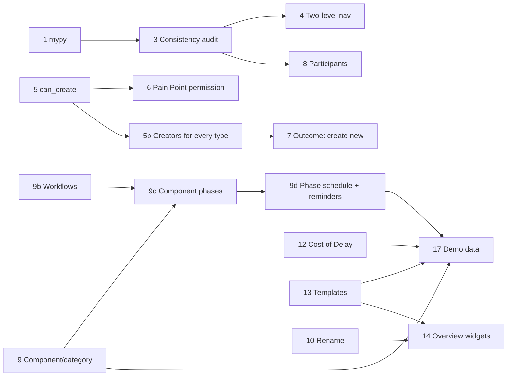

# Platform Review November 2026 — Plan

**Status:** planned 2026-11-06; phases 1 to 6 done (uncommitted), the rest not started; phase 5b added 2026-11-07. **Decision tags:** every decision says `Decided by: User` or `Decided by: Agent`. All sign-off questions were answered on 2026-11-06 (see each phase's *Decided by: User* lines). A question that arises during a phase is asked with `AskUserQuestion`; do not assume.

Source: 17 human review notes (the "Platform Review" list). Each was checked against the code before planning; several are partly built already, and three have a design objection recorded below.

## Status / Resume Here

7 / 21 phases complete.

| # | Phase | Notes | Status |
| --- | --- | --- | --- |
| 1 | mypy: remove the baseline, fix every finding | 1,042 findings (606 distinct keys) fixed, 14 existing `# type: ignore` replaced, baseline and `--update` removed; full-suite result in `docs/decisions.md` | [x] |
| 2 | Storage alert investigation | Cause was SeaweedFS preallocation (already fixed); monitor hardened: restart-safe state, 2-failure threshold, admin email fixed; see `docs/decisions.md` | [x] |
| 3 | Back link consistency + UI/UX consistency audit | Back link on all 21 `RecordHeader` pages, drawn by the header, guarded by `check_record_header_back.py`; not-found state on three core pages; findings register below | [x] |
| 4 | Two-level admin navigation | `group` on module admin sections, expandable `ResourceMenu`, `/…/admin/:group/:section` with redirects; see `docs/decisions.md` | [x] |
| 5 | Links panel: server-side "can create" | `can_create` on each `link-types` record type from `creatable_record_types`; frontend `canCreate` removed; see `docs/decisions.md` | [x] |
| 5b | Create new from the Links panel for every creatable type | 18 creators (core types extracted to shared modals), `not_creatable_from_links`, replay test of `can_create` against every create endpoint (found and fixed the Change Request divergence); see `docs/decisions.md` | [x] |
| 6 | Pain Point submission policy (project setting) | `pain_point_submission_settings` (project and organisation default, nearest-ancestor resolution; platform default Pain Point Managers only, existing organisations kept open by migration 0142), one `can_submit_pain_point` for create, import, Links panel and MCP; see `docs/decisions.md` | [x] |
| 7 | Engagement outcome: create new | Reuses phase 5 | [ ] |
| 8 | Engagement participants | Reproduce first | [ ] |
| 9 | Component/category on every record | Generic table, many per record; settled; adds an agent instruction | [ ] |
| 9b | Customisable workflows (phases with kinds) for project stages | Project and organisation-template workflows; phase kind drives baseline and change-request lock; migrates the four fixed states; settled | [ ] |
| 9c | Component phases (per-component, per-stage workflow) | Each component follows a workflow per stage; project switch, off means the project stage governs; lock rule to confirm | [ ] |
| 9d | Phase schedule and reminders | Expected completion range per phase (stage and component), upcoming, overdue and completed notifications | [ ] |
| 10 | Rename navigation items, with organisation defaults | Navigation, title, breadcrumb, back link; settled | [ ] |
| 11 | Server and organisation messages (login pages and notification) | One mechanism, two scopes; settled with the user | [ ] |
| 12 | Pain Point scoring on the Product Feedback model (custom criteria, Cost of Delay) | General row plus persona overrides; settled | [ ] |
| 13 | Template projects | Partly built; module configuration is the gap | [ ] |
| 14 | Project overview widgets | Configurable widgets, catalogue metrics with allowed filters; settled | [ ] |
| 15 | Organisation overview settings shortcut | Small | [ ] |
| 16 | Organisation-wide files list | Mirrors the project files page | [ ] |
| 17 | Demo seed data | Last, because it exercises phases 9, 12 and 13 | [ ] |

Phases 2, 11, 15 and 16 have no dependency and can be taken in any order.

## Phase 3 findings register

Method: a static scan of the 21 `RecordHeader` pages (header props, layout, links, activity, comments, confirmation and toast use, load-error handling). *Decided by: Agent*; it replaces the planned live walk, which needs a rebuilt stack and adds only rendered output.

| # | Finding | Outcome |
| --- | --- | --- |
| F1 | Requirement, Change request, Action and Compliance standard pages had no back link | Fixed |
| F2 | Nine module pages labelled the link with the singular record name or a typed arrow | Fixed; the header draws the arrow, callers pass the plural name |
| F3 | Requirement, Change request and Action pages showed a spinner indefinitely (and an unhandled rejection) when the record could not be loaded | Fixed; same message as the module pages |
| F4 | `ProjectComplianceDetail` back button read "← Back" | Fixed ("Compliance assignments") |
| F5 | Engagement has Delete permanently but no Archive | By design (a log entry, documented in the page); no change |
| F6 | `VersionWorkspace` has a hand-written "← Back to {standard}" button | A view switch inside a page, not a record header; no change |
| F7 | Compliance standard page has no Links panel, activity or tags | Not a registered artefact type's record page (a navigation workspace); no change |
| F8 | Report layout designer and pack editor back labels had no arrow | Fixed by F2 (same component) |

Phases 4, 9 and 10 take nothing further from this audit.

## Challenges to the notes (read before approving)

| # | Note | Challenge | Outcome |
| --- | --- | --- | --- |
| 5 | "Add an optional `ModuleDefinition` hook `can_create(...)`" | `RecordTableProvider.can_create(db, user, project_id)` already exists for every registered type (`backend/app/modules/registry.py`), defaults to the fine-grained `propose_create` permission, and is documented as "the same check as the type's own create endpoint". A second hook would be a second answer to the same question and would drift. | Reuse the provider's check; add no hook. |
| 6 | "Creating/editing Pain Points should be behind a permission" | Editing is already manager-only. Creation is open to every member by recorded design. | **Settled with the user:** a project setting (not a new role atom), default unchanged, so a project that prefers Enhancement Requests can restrict direct submission. |
| 12 | "Cost of delay as a scoring method" | **Settled with the user:** do not hard-code one more model; give Pain Points the same style as Enhancement Requests (alternative models, organisation and project custom criteria, models enabled per project). The blocker is storage: Pain Point scores hold one fixed column per axis, so custom criteria are impossible until scores are stored one row per axis. Cost of Delay (WSJF) then ships as a built-in model, and the engine needs a sum-then-divide combination. | Storage change first, then `allow_custom_criteria`, then the built-in Cost of Delay model. Open question on per-persona scope. |
| 13 | "Select a template when creating a project" | Already built: `is_template`, `clone_project`, the New project picker, the organisation default template. The real gaps are that a clone copies no module configuration (module enablement, Pain Point types, scoring), templates show in the project list by default, and "None" cannot override the organisation default. | Plan only the gaps. |
| 14 | "Overview customisable with widgets" | **Settled with the user:** more than show/hide: managers add and remove widgets and configure them (for example a gauge on a metric the page does not show today). That is a small dashboard builder, so it needs a bounded metric catalogue, not an open query builder, to stay fast and safe. | Widget instances with a configured metric and visualisation. Metric source needs sign-off. |
| 10 | "Rename modules/sub-module pages" | The terminology feature is deliberately a closed key set because renaming every string is large. A rename that changes only the navigation label leaves "Decisions" in the page title, breadcrumbs, links and reports. | **Settled with the user:** the rename covers the navigation entry, page title, breadcrumb and back link only; record nouns stay as they are. |

## Decisions

Decisions made by the user are recorded in each phase. Cross-phase decisions:

- **D1. A shared check is reused, not duplicated** (phase 5). *Decided by: Agent.* The Links panel and the record list import both ask `RecordTableProvider.can_create`.
- **D2. Each new project-scoped table states its nesting behaviour** (phases 10 and 14: rename and widget layout). *Decided by: Agent*, proposed: all resolve own rows, else the nearest ancestor's, else the organisation default, the `resolve_effective_action_types` shape. Record in `docs/decisions.md` when built.
- **D3. Every new project- or organisation-scoped table travels in its bundle** (phases 9, 9b, 9c, 9d, 10, 14). *Decided by: Agent*, required by CLAUDE.md.

## Phase specs

Every phase follows the standing checklist at the end. "Why / Risk / Outcome" is stated per phase as the requirements rules ask.

### Phase 1 — mypy: remove the baseline, fix every finding

- **Why:** `backend/mypy_baseline.json` held 606 accepted keys (1,042 findings); a ratchet that only shrinks leaves the debt in place. CLAUDE.md already says warnings are fixed, not suppressed.
- **Risk:** type fixes touch hot paths; a wrong "fix" (a cast) hides a real bug.
- **Work:** fix by file group (models, services, routers, each module) in batches; run `scripts/check_mypy.py` after each. Prefer correcting the type over `cast`/`# type: ignore`; an ignore needs a one-line reason and counts as a documented false positive only. Then delete the baseline file and the `--update` mode, make CI run plain mypy (zero findings), and update `scripts/check_mypy.py`, `ci.yml`, `docs/development.md`.
- **Agent instructions:** add to CLAUDE.md (Code Quality Rules): "mypy findings are fixed, not baselined or ignored; a change leaves `scripts/check_mypy.py` at zero." Do not edit the mypy configuration to narrow rules (existing rule); if a rule is wrong for the project, raise it.
- **Outcome:** zero findings, no baseline, CI fails on any new one.
- **Tests:** the full backend suite stays green after each batch (one `pytest` run at a time, per the shared-database rule); no new ignore comments (a grep check in the phase's close-out).
- **Do not:** use `Any` broadly to clear findings; a count of `Any` introduced is reported at the end.

### Phase 2 — Storage alert investigation

- **Why:** `services/storage_health.py` alerts a server administrator once per outage. A server administrator on the test stack sees many, so either storage is genuinely failing, or the "once" logic is defeated.
- **Hypotheses to test, in order:** (a) the SeaweedFS service on the test stack is really failing writes (recorded preallocation/disk trap); (b) `was_unhealthy` is process-local, so a restart or a leader hand-over between workers resets it and re-alerts; (c) the probe flaps (a slow first write) and each flap sends a pair; (d) `disk_monitor` and `storage_health` both alert for one condition.
- **Work:** reproduce on the stack, read the notification rows and the loop's log lines, then fix the cause. Likely fixes: persist the outage state (a row or the leader-lock store), require N consecutive failures before alerting, and de-duplicate by an outage identifier.
- **Outcome:** one notification per genuine outage, one on recovery, none for a transient blip.
- **Tests:** unit tests on `check_storage_health_once` with a scripted probe sequence (fail, fail, recover, fail) and a simulated restart; a regression test for whichever cause is found.
- **Reason for first/early:** the notification noise masks other server-administrator alerts, including those phase 11 will add.

### Phase 3 — Back link consistency and UI/UX consistency audit

- **Why:** the Pain Point page has a back link (`← Pain Point`), other record pages do not, and the label is the singular record name where the destination is a list. `RecordHeader` already accepts `back`, so the gap is in the callers.
- **Risk:** per-page drift again; the style guide is binding.
- **Work:**
  1. Add `scripts/check_record_header_back.py` (empty baseline): every record detail page passes `back` to `RecordHeader`, and the label is the destination's plural list name (`← Pain Points`). Fix every caller it finds, including core pages (requirement, change request, action) and every module.
  2. Run a scripted UI/UX consistency audit across modules: header actions, status badge placement, tabs vs side panel, empty states, toasts on mutation, confirmation tiers, form header, field help, required markers, label maps for enums. Method: a Playwright walk that visits every list and detail page and records structural facts (heading level, action buttons, back link, tabs), then compare in a findings table kept in this plan. No judgement by screenshot alone.
  3. Findings are fixed in the phase (fix, do not defer) or, where large, become a numbered sub-phase in this plan with the user's agreement.
- **Outcome:** one detail-page header shape everywhere, guarded by a check script, and a findings register.
- **Tests:** the check script plus a Playwright spec asserting the back link on one detail page per module (list position restore is already covered).
- **Docs:** `docs/ux-style-guide.md` gains the back-link rule under "Pattern: record header" if absent.

### Phase 4 — Two-level admin navigation (project and organisation)

*Decided by: User* (2026-11-06): an expandable left menu, with URL `/…/admin/:group/:section`.

- **Why:** modules contribute flat sections (Product Feedback registers five: settings, scoring, external systems, channels, plus the inbox), so the project and organisation admin menus grow with every module and similar names ("Pain Point scoring", "Request Scoring") sit side by side with no parent.
- **Design:** add a generic optional `group` (key, label) to `ProjectAdminSectionDef` and `OrgAdminSectionDef` (`frontend/src/modules/types.ts`). A module whose sections share a group renders as one menu entry with sub-pages; a module with a single section stays at one level. Core groups are unchanged. `ResourceMenu` gains an expandable group item (arrow-key navigation preserved) built as the shared component, with the Org and Project admin pages both moved onto it.
- **URL:** `/…/admin/:group/:section?`. Existing `/admin/:group` links redirect to the first section, so bookmarks and the many Playwright specs that deep-link survive; a redirect test pins each old module key.
- **Style guide:** the depth-model principle names resource-menu sub-pages for more than five groups; a second level is an addition and the guide is updated in the same change (settings hierarchy addendum).
- **Pushback:** do not add a third level, and do not group by module name alone — group by the module's own `group` declaration, so a module with two unrelated settings areas can say so.
- **Outcome:** admin menus whose length no longer grows with section count; sub-pages named by their parent.
- **Tests:** unit tests for grouping and the single-section case; story for the group item; Playwright for expand, keyboard use and the redirect; update specs whose locators assume the flat menu.
- **Boundary check:** the grouping field is a generic extension; no module is named in a core file.

### Phase 5 — Links panel: server-side "can create"

- **Why:** each module re-implements a permission check in the browser (`canCreate`), and a module that forgets shows a button that fails on save.
- **Design (Decided by: Agent, D1):** `GET …/link-types` already returns `other_types` filtered by module and sub-component state. Add `can_create: bool` to each entry, computed by the type's `RecordTableProvider.can_create(db, user, project_id)`; a type with no provider is `false` (cannot create from a link). Remove `canCreate` from `LinkedRecordCreator` and `useCreatableRecordTypes`; the panel offers "Create new" only for entries flagged true. Cost: one provider call per distinct type per request, not per record; the call must not add per-row queries (the scaling probe covers it).
- **Risk:** the provider check and the create endpoint diverging. A test per module with a registered creator asserts the flag equals the create endpoint's own result for a member with and without the gating role.
- **Outcome:** one server answer; no module re-implements it.
- **Tests:** per-module test, a role-gated type not offered to a member without the role; `docs/modules.md` §4l2 updated (remove `canCreate`, describe the flag); stories updated.
- **Prerequisite for phase 6's behaviour and phase 7.**

### Phase 5b — Create new from the Links panel for every creatable type

*Decided by: User* (2026-11-07): "Create new" in the Links panel should offer every standard type of record, not only Pain Points.

- **Why:** `linkedRecordCreators` is declared for `pain_point` only (phase 7 adds `stakeholder_need`), so a person on a Risk, Decision or Requirement cannot create the Persona, Open Question or Action they want to link without leaving the page. Phase 7 (outcomes) also picks its target types from the same registry.
- **Types in scope:** every registered artefact type a person authors in a project that has a create form: `requirement`, `requirement_action`, `change_request`, `decision`, `risk`, `enhancement_request`, `strategy`, `future_state`, `guiding_principle`, `open_question`, `persona`, `stakeholder`, `stakeholder_group`, `research_finding`, `engagement`, `compliance_evidence`, plus `stakeholder_need` (phase 7 if not done here). *Decided by: User* (2026-11-07): **Change Request is included** (a finding or an enhancement request is often a change to an existing requirement, so it is created and linked from that record), and **no path is restricted for workflow reasons**: the panel offers every type a link type reaches and the person may create. **Excluded, with the reason recorded in `docs/decisions.md`:** `compliance_requirement`, `project_compliance_requirement` and `compliance_required_action_assessment` only, because they are derived from an assigned standard and cannot be authored at all (*Decided by: Agent*). A test lists the exclusions, so a new type must be creatable or give a reason, as `not_importable` does.
- **Design:** each owning module registers `linkedRecordCreators[type]` with a dialog that wraps the type's existing form (`CreatePainPointDialog` is the pattern: load what the form needs, create through the same API, commit quick links and tags, report the id). The form is the type's own create dialog, so every edit field is present (create and edit share one field group). **`QuickLinkField` stays in every dialog** (*Decided by: User*, 2026-11-07): the new record may need links to other items beyond the page record, even if only "Related to"; the panel's own link to the page record is made in addition. The Change Request dialog takes its affected requirement from the page record when that is a requirement (pre-filled, editable), and otherwise asks as the normal form does. Core types (requirement, action, change request) need their creators declared by the core page set; where a form lives in a page file, extract it to a shared `*FormModal` first and move the page onto it (shared components first), rather than a second copy. `can_create` comes from phase 5 and needs no change.
- **Guard:** `frontend/src/modules/linkedRecordCreators.stories.tsx` (or a unit test) fails for a registered creatable type with neither a creator nor a stated exclusion; the backend lists the exclusions once so the two cannot drift.
- **Outcome:** from any record's Links panel, "Create new" offers every type a link type reaches that the person may create; a role-gated type is hidden by the server flag.
- **Done 2026-11-07.** Phase 7 needs no creator work for Need: `stakeholder_need` is registered here; it only adds the outcome link and the engagement page's "Create new" beside the picker.
- **Permission rule (*Decided by: User*, 2026-11-07):** a type the person may not create is never offered. The server flag from phase 5 is the only gate; no creator adds its own or ignores it. Several providers answer `can_create` with an unconditional "any member" (risk, decision, pain point, open question and others), so this phase audits every creatable type's provider against its create endpoint and fixes any that is looser. A parametrised backend test covers every creatable type: for a person with no role, a plain member and a role holder, the flag equals whether the create endpoint refuses (403), so a gate added to an endpoint without its provider fails the test.
- **Tests:** a story per creator (create and link), the registry-completeness test, a Playwright spec creating and linking one type per module (Requirement, Decision, Risk, Persona, Open Question), a refused case for a role-gated type, and a creator that adds a quick link besides the panel's own link.
- **Docs:** `docs/modules.md` §4l2 (the registry guard), `docs/ux-style-guide.md` if it names Pain Point as the only creator, docs website Links panel page.

### Phase 6 — Pain Point submission policy (project setting)

*Decided by: User* (2026-11-06): a project configuration, not a role the platform imposes. Mirrors Product Feedback's `ProjectFeedbackSettings.submission_policy`.

- **Why:** a project that runs Enhancement Requests usually wants people to raise those and leave Pain Points to managers; today it cannot restrict direct submission.
- **Design:** a `ProjectContextStrategySettings` row (or the module's existing settings row if one exists; check first) with `pain_point_submission_policy`: **Members** (default, today's behaviour) or **Managers only** (holders of the `pain_point_manager` role). Resolution: project, nearest ancestor, organisation default, Members (D2). Organisations set the default in their Context & Strategy settings; a project overrides it with a visible "Organisation default" indicator (style guide: platform-default override visibility). The create endpoint, the record-table `can_create` (so list import, the Links panel from phase 5 and the MCP tool agree) and the UI "New Pain Point" button all read one resolver, `can_submit_pain_point(db, user, project)`.
- **Guidance when restricted:** the refusal and the unavailable button state say that Pain Points are submitted by managers and, where Product Feedback is enabled, point to Enhancement Requests. Wording is formal.
- **Editing:** unchanged (manager-tier). Whether a submitter may edit their own untriaged Pain Point stays as today; not part of this phase.
- **Bundles and templates:** the setting travels in the project and organisation bundles and is copied by a template (phase 13).
- **Checks:** SOC 2 access-control policy (authorisation change); decisions-log entry; MCP tool description "any project member may do this" corrected and the module skill reference regenerated.
- **Outcome:** a project can restrict direct Pain Point submission; nothing changes for existing projects.
- **Tests:** both policies for a plain member and a manager across create, list import, Links panel flag and MCP; ancestor and organisation resolution; bundle round trip; story and Playwright for the setting.

### Phase 7 — Engagement outcome: create new

- **Why:** an engagement raises Pain Points, Needs and Open Questions, but `EngagementOutcomesPanel` can only pick existing records, which forces leaving the page.
- **Design:** add "Create new" beside the picker, using `linkedRecordCreators` and the phase 5 `can_create` flag so it works for every outcome target type without importing a module. If a target type declares no creator (for example Needs, which has none today), add one in its module in this phase. After creation the outcome link is made in the same flow.
- **Create-form rules:** the created record's form is the type's own dialog (`TagField` and every edit field through the shared field group); `QuickLinkField` stays (*Decided by: User*, 2026-11-07, as in phase 5b): the outcome link is made in addition to any quick links.
- **Outcome:** an engagement logged from a session can record its outcomes without leaving the page.
- **Tests:** component story; Playwright creating each target type from an engagement; permission-refused case shows the type unavailable.

### Phase 8 — Engagement participants

- **Why:** the detail page has a Participants panel with an add control, yet it was not found. `EngagementFormModal` has no participants field although the create API accepts participants, which also breaks the rule that a create form takes every edit field.
- **Work:** reproduce first as a project member, a manager and a read-only user on a project with no Stakeholders (the add control may be hidden or empty then). Then fix the cause; likely changes: a participants field on the create form through the shared field group, an empty-state message that says why nobody can be added (no Stakeholders yet) with the link to create one, and the control's label.
- **Outcome:** participants can be added when logging and later, and an empty state says what to do.
- **Tests:** Playwright adding a participant on create and on the detail page; story for the empty state.

### Phase 9 — Component/category on every record

*Decided by: User* (2026-11-06): one generic assignment table; a record other than a requirement may have several assignments; requirements and change requests keep their single component. Today only those two have a component and category (columns on the record; the component prefix forms the requirement code).

- **Why:** a record of any type should be placed in the project's component/category tree so lists, reports and filters can slice by it.
- **Design:** a generic assignment table keyed by `(artefact_type, artefact_id)` with a required `component_id` and a nullable `category_id` (category must belong to the component, validated in the service), exactly like `ArtefactTag` (plain string type validated against the registry, project-scoped, cascade). Requirements and change requests keep their columns because the prefix is part of their code; a read helper presents one resolved view for all types. A record may hold any number of assignments with no primary one (unique per record, component and category); the shared field is a multi-select tree picker. Lists filter on any match, and a list column shows all assignments, sorted by component order. Requirements and change requests stay single-component (*Decided by: User*), so the helper that presents one resolved view returns their one pair and a many-pair list for the rest; a filter matches either. Rejected: a column per module table (a per-module edit forever) and moving requirements onto the table (it changes codes).
- **Surfaces:** a `ComponentField` (shared, like `TagField`) in every create and edit form; a filter on every list via the shared list filter (`ComponentFilterField`); a column in `RecordTableProvider` export and import (`component`, `category` by name); a search field; report field provider entry; project and organisation bundles carry it; quick filter in the nested-project scope. Template cloning (phase 13) remaps the ids.
- **Core boundary:** the table is core and generic; a module adds no code except declaring its type, which it already does.
- **Agent instruction:** add a CLAUDE.md section "Every Item Type Is Placeable": a new registered artefact type uses the shared component/category field, filter, export column, bundle entry and report field, with a test that fails for a type without them (as `test_search.py` does for search).
- **Nested projects:** components belong to a project; a child project's assignment refers to the child's own tree. No fallback is needed (this is a reference, not a definition table); state that in the decisions log.
- **Outcome:** every record type can be placed and filtered by component/category.
- **Tests:** per-type create/edit/filter/export/import round trip; the registry-completeness test; scaling probe stays flat (assignments read in bulk).

### Phase 9b — Customisable workflows for project stages

*Decided by: User* (2026-11-07): phases are customisable within a project, for example Scoping, Technical scoping, Review board, Tendering, Paused, Awarded, In progress, Completion for outsourced work and Scoping, Implementation ready, Done for in-house work. One mechanism serves project stages and (phase 9c) component stages. Workflows are defined at project level, with organisation templates. Organisation templates are additive, like Pain Point types, and a project can hide and restore them. Moves between phases are free in either direction; only entering a locked phase needs the approver role. Progression between stages is advisory.

- **Why:** the four fixed stage states (`StageStatus`: scoping, review, approved, completed) do not fit every way of working; a project that tenders work needs different phases from one that improves a product continuously.
- **Risk addressed:** the baseline and change-request lock (C-G-10, C-G-12) are tied to the name "approved". Custom names would lose it unless behaviour is carried by something other than the name.
- **Design:**
  - A workflow is a named, ordered list of phases (`name`, `kind`, `sort_order`). `kind` is a closed vocabulary that carries behaviour: `open` (editable), `review`, `locked` (writes the baseline, edits limited to change requests), `on_hold`, `closed`. The name is free text. A workflow needs at least one phase and exactly one starting phase.
  - Project stages gain `workflow_id` and a current phase in place of the fixed status. The baseline, lock and completion cascade logic read the phase kind, never the name. Review deadlines and assumed approval keep working on the `review` kind.
  - The four existing states become the seeded default workflow (`open`, `review`, `locked`, `closed`) and a migration maps each existing stage, with no change in behaviour (migrated stages verified against the old status in a test). A migration seeds nothing else.
  - Free movement between phases; entering a `locked` phase needs the project manager, as approval does today. No declared transitions (add only if a need appears).
  - Organisation templates: an organisation tier of workflow definitions (`ProjectDefinitionSuppression` kind registered so a project can hide and restore a default, through `services/definition_suppression.py`); a project's effective set is its own workflows plus the organisation's, minus the hidden ones. A workflow in use cannot be deleted without reassigning its stages (the shared reassign-and-delete rules in `services/definitions.py`).
- **Surfaces:** workflow editor in project administration and in organisation administration (shared component, ordered phases with kind picker and `(?)` help describing every kind); stage form picks a workflow; stage badge and transitions by phase; a phase label map next to the existing label maps (no raw names or kinds); report field and filter; project and organisation bundles carry workflows, hidden defaults and each stage's phase (an imported locked phase never bypasses the approval gate); MCP stage tools updated (skill and reference regenerated).
- **Nested projects:** a project-scoped definition table, so decide and record the fallback: own workflows if any exist, else the nearest ancestor's (the `resolve_effective_action_types` shape), plus the additive organisation tier. *Decided by: Agent*, proposed; record in `docs/decisions.md`. Seed the default workflow for a root project only.
- **Core boundary:** core tables and helpers; a module adds nothing.
- **Outcome:** a project defines its own phases; today's projects behave as before.
- **Tests:** migration of each old status; baseline and lock by kind for a custom locked phase; free movement and approver gate; assumed approval on a `review` phase; hide/restore of an organisation template; in-use delete refusal; bundle round trip; nested fallback; story and Playwright for the editor.
- **Docs:** `docs/solution-architecture.md`, `docs/decisions.md`, glossary and the docs website stage pages; `seed_demo_data.py` and `seed_e2e_dataset.py` (outsourced and continuous-improvement examples).

### Phase 9c — Component phases (per-component workflow per stage)

*Decided by: User* (2026-11-07): a component follows a workflow for each project stage, chosen from the project's workflows (a stage's default if the component picks none). A component can skip a stage (not applicable). Progression is advisory: a component can start the next stage once its previous stage reaches a `closed` phase, but nothing blocks it earlier. A per-project switch turns component phases off, and the project stage then governs as today.

- **Why:** a project that plans by component (for example a product requirements document per component, outsourced work beside in-house improvement) needs each component to progress on its own workflow.
- **Risk addressed:** a second, component-level lock could contradict the project stage lock, or leave a requirement locked by one and open under the other.
- **Design:**
  - `component_stage_states(component_id, stage_id, workflow_id, phase_id, not_applicable, approved_at/by, completed_at/by, review_deadline)`, unique per component and stage, created when a component first picks or moves; no row means the stage's default workflow at its starting phase. Reuses the transition, approval and review-deadline logic from phase 9b, not a second implementation.
  - A nullable project setting `component_phases_mode` (`on`/`off`, NULL inherits the nearest ancestor, else `off`; the `tag_mode` shape). Off: nothing is shown or stored and the project stage is the effective phase. One read helper returns the effective phase for any (component, stage) so lists, reports and filters do not branch on the switch.
  - A requirement targets a stage (`target_stage_id`) and has one component, so its governing component phase is that component's phase in that stage. Other record types have no single component and are never locked by component phases.
- **To confirm at the start of the phase (ask with `AskUserQuestion`, do not assume):**
  1. *Edit lock.* Proposed: the stricter of the project stage lock and the component's phase lock wins for a requirement.
  2. *Baseline.* Proposed: entering a `locked` phase writes a baseline of that component's requirements for that stage only.
  3. *Role.* Proposed: the same roles as for project stages.
- **Surfaces:** per-component stage track on the component in project administration (workflow picker per stage, current phase, not-applicable); phase column and filter in the lists using `ComponentFilterField` (phase 9); report field; stage review notifications; bundles carry the states and the setting (an imported locked state never bypasses the approval gate); template cloning (phase 13) copies the setting and workflow choices and resets every state to its starting phase.
- **Nested projects:** a state, not a definition table, so no fallback; only the switch inherits. State this in `docs/decisions.md`.
- **Outcome:** with the switch on, each component is planned and approved independently per stage; with it off nothing changes.
- **Tests:** transitions and approval per component and stage; skipped stage; advisory progression; lock rule both ways; switch off identical to today; bundle round trip; scaling probe stays flat (states read in bulk).
- **Docs:** as phase 9b, plus the website component pages and both seed scripts.

### Phase 9d — Phase schedule and reminders

*Decided by: User* (2026-11-07): the phases within a stage can carry an expected completion range, with notifications when a phase is upcoming and when it completes, so there are reminders on these events. *Decided by: Agent* (veto if unwanted): an "overdue" notification is added, since a reminder system that is silent when a date is missed is incomplete.

- **Why:** a phase with no dates cannot be planned against, and nobody is reminded to move it on. Tendering and review-board phases have external deadlines.
- **Design:**
  - `stage_phase_plans(stage_id, component_id NULL, phase_id, expected_from, expected_to, started_at, completed_at, upcoming_notified_for, overdue_notified_for)`: `component_id` NULL is the project stage's own phase (phase 9b), set is a component's phase in that stage (phase 9c). Unique per stage, component and phase (a partial index for the NULL case). A row exists only for a phase given dates or entered.
  - **Time shape:** `expected_from`/`expected_to` are plain calendar dates (a person's own day; `from` <= `to`). `started_at`/`completed_at` are past instants in UTC. A phase completes when the stage (or component stage) moves forward out of it or into a `closed` phase; moving back reopens it (clears `completed_at`). The history is also the actual-versus-expected record for reports.
  - **Sweep:** extends the daily stage sweep (`services/stages.py`, leader singleton via the lifespan's `start_singletons`), following the Risk Management review sweep: notify once per date (`*_notified_for` stores the `expected_to` that was notified, so a rescheduled phase re-arms itself), harmless to re-run. **Upcoming:** `expected_from` is within the project's lead days (default 7, `phase_reminder_lead_days`, nullable, inherits the nearest ancestor). **Overdue:** the current phase is past `expected_to`. *Decided by: Agent*, because the sweep has no caller's day: "upcoming" compares against the latest calendar day anywhere (UTC+14), so nobody is reminded late; "overdue" requires the date to have passed everywhere (UTC-12), so nobody is told a deadline was missed while it is still the day. Tests cover both boundaries.
  - **Completed** is event-driven, not a sweep: sent from the transition itself, in the same transaction, and never to the person who made it.
  - **Notification types** `stage_phase_upcoming`, `stage_phase_overdue`, `stage_phase_completed`, core (the stage code is core), so per-user preferences and the digest apply. The text carries the stage, component and phase names and dates, never a record body.
  - **Recipients** (*Decided by: User*, 2026-11-07): the owner, else the project managers. An optional owner on the stage and on a component's stage state (a user or a group, through the shared principal picker; group members are notified via `principal_recipients`); with no owner, the project's project managers, as the risk sweep does. Addressing, not authorisation. The owner field is part of this phase (it does not exist on stages or components today).
- **Surfaces:** expected range fields on the phase in the stage form and on the component stage track (a date range field, `(?)` help describing lead days and overdue); date badge and "overdue" on the phase; lead-days setting in project settings; report fields (expected, actual, variance); the project overview (phase 14) gets a metric for phases upcoming and overdue through the generic metric catalogue; project and organisation bundles carry ranges and actual dates (the `*_notified_for` markers are derived and not exported, so an import re-arms); template cloning copies lead days and clears dates.
- **Nested projects:** plan rows are state, no fallback; only the lead-days setting inherits.
- **Outcome:** a manager sets when each phase is expected to complete and is reminded before, at completion and when late.
- **Tests:** upcoming/overdue once per date and re-armed by a date change; the two timezone boundaries and a leap of lead days; completion on forward, closed and back moves; recipients (user, group, no owner, actor excluded); preference opt-out; bundle round trip; story and Playwright for the date range field and badge.
- **Docs:** `docs/decisions.md`, website stage and notification pages, both seed scripts (dates on the demo phases).

### Phase 10 — Rename navigation items, with organisation defaults

*Decided by: User* (2026-11-06): scope is the navigation entry, page title, breadcrumb and back link of a module or sub-page ("Decisions" to "ADRs"), not every sentence that uses the noun. Record nouns for requirements and change requests stay with the existing terminology feature.

- **Why:** organisations use their own vocabulary; the existing terminology set is closed to six core nouns.
- **Design:** a generic `nav_label_overrides` map keyed by the stable nav key (`ModuleFrontendManifest` already gives every entry a key) on the project, with an organisation default map. Resolution order: project, nearest ancestor (D2), organisation, built-in label. Keys are validated against the registered nav keys (no free text keys); values are length-limited and plain text. `Layout.tsx` and the admin menus read one hook, `useNavLabel(key, builtIn)`, so no module is named in core. Project Admin gets a "Navigation names" panel (a table of built-in name, override, restore), the organisation admin a matching defaults panel, both on the shared shape the existing terminology panel uses.
- **Bundles:** both maps travel in the project and organisation bundles; template clone copies the project map.
- **Formal wording:** the panel and tooltips use "name", "override", "restore default".
- **Outcome:** a project or organisation shows "ADRs" wherever the module's navigation, title and back link appear.
- **Tests:** backend validation (unknown key rejected, length), resolution order incl. ancestor, round-trip bundle; Playwright rename and restore; story.
- **Risk:** accessibility names and Playwright locators that use the built-in label; tests use stable keys or `data-nav-key`.

### Phase 11 — Server and organisation messages

*Decided by: User* (2026-11-06): one mechanism, two scopes. Server administrators write platform-wide messages; organisation administrators write messages for their own organisation.

- **Why:** an operator needs to announce degraded performance, a release, downtime or a demo-instance login hint; an organisation needs the same for its own people without involving the server administrator.
- **Design:** one table `announcements` with a nullable `organization_id` (NULL = server-wide), the pattern `Tag.project_id` and the organisation/server defaults already use. Fields: title, body (plain text), severity (information, warning, critical), optional start and end instants, `show_on_login`, and a `notify_users` action. Server administrators manage rows with a NULL organisation; an organisation administrator manages only rows of their organisation (checked server-side on every write; a server-wide row is read-only to them).
- **Where it shows:**
  - `/login`: active server-wide messages flagged for login.
  - `/login/:slug`: server-wide messages plus that organisation's. The slug page is already public and branded, so this adds no new exposure of the organisation's existence.
  - After sign-in: a dismissible banner with server-wide messages plus the messages of the organisation the person is currently in.
- **Notification:** "Send as notification" fans out one `SYSTEM_ANNOUNCEMENT` notification, once, at send time: to every active user (server-wide) or to the active members of the organisation (organisation scope). It is a recorded send, not a live banner; sending twice is prevented and shown in the row.
- **Security (Decided by: Agent):** the unauthenticated read endpoint is rate-limited and returns only active, login-flagged messages, never a creator, an id of another organisation or any tenant data. Text is rendered as plain text with no links, because organisation administrators are lower trust than the server administrator and the login page is the highest phishing risk. Organisation fan-out is limited to that organisation's members and audit-logged with counts, never the body. Create, change, delete and send are audit events; an organisation administrator can neither see nor affect another organisation's messages.
- **Time shape:** start and end are past/future instants stored in UTC and chosen in the browser; test the boundary hours (09:00 at UTC+10, 23:00 at UTC-8) at the start and end edges.
- **Bundles:** organisation messages travel in the organisation bundle; server-wide messages do not (a deployment setting), with a stated reason in `docs/decisions.md`.
- **UI:** a Messages page in Server Administration and in Organisation Admin (one shared component, scope passed in), under phase 4's grouped navigation; formal wording.
- **Docs:** docs-website server and organisation administration pages.
- **Outcome:** scheduled messages on the login pages and after sign-in at both scopes, with an optional one-time notification.
- **Tests:** active, expired and future filtering at the boundaries; unauthenticated read exposes only flagged active rows; an organisation administrator cannot write a server-wide row or another organisation's; fan-out recipient sets and idempotency; plain-text rendering; Playwright on both login pages and the banner.

### Phase 12 — Pain Point scoring on the Product Feedback model (custom criteria, Cost of Delay)

*Decided by: User* (2026-11-06): Pain Points follow the Enhancement Request style (alternative models, custom criteria) rather than getting one more fixed model. The decision I would otherwise have asked about (WSJF versus a monetary formula) is answered by this: WSJF ships as a built-in model and a monetary Cost of Delay can be built as a custom model.

- **Why:** teams rank Pain Points differently (severity-based, Cost of Delay, their own criteria); Enhancement Requests already allow this, so two scoring experiences exist for the same purpose.
- **What Enhancement Requests have that Pain Points lack:** `allow_custom_criteria=True`, models enabled per project, scores stored one row per axis (`EnhancementRequestVersionScore`), derived axes. Pain Point scores store `severity_level_id`, `frequency_level_id`, `confidence_level_id` columns per persona row, which cannot hold a custom axis.
- **Steps (each a separate, shippable change):**
  1. **Read helper, no behaviour change:** one function returns `{axis_key: level}` for a score; every reader (scores endpoint, scoring filter, matrix chart, report fields, export/import, bundle, MCP, perf generator, scaling probe) is moved onto it while the columns still back it.
  2. **Storage swap:** a `pain_point_score_axes` table (score, axis key, level) with a backfill from the three columns; drop the columns after a verified round trip. Migration number is the global next one (core and module directories share numbering).
  3. **Custom criteria:** set `allow_custom_criteria=True`; enable per-project model selection, hiding and the organisation and project panels as Product Feedback has them (shared panels, not copies).
  4. **Cost of Delay built-in model:** axes User/business value, Time criticality, Risk reduction/opportunity enablement and Job size (relative levels, Fibonacci weights, organisation-editable); model "Cost of Delay" is the sum of the first three and "WSJF" is that sum divided by Job size. This needs a generic engine extension: a weighted-sum model may declare `divisor_axis_keys` (`ScoringModelDefinition`, `validate_scoring_model_maths`, normalised by the best case). Other modules get it for free.
- **Axis scope and the General row (*Decided by: User*, 2026-11-06):** each criterion declares whether it is scored **per persona** or **for the whole Pain Point** (a generic `ScoringAxisDefinition` field; custom criteria choose it when created). The scoring panel opens on a **General** row holding every whole-Pain-Point value and the default for per-persona criteria; the person then adds only the personas that differ, and a persona row holds per-persona criteria only (it overrides General for that persona). The panel never lists every persona in the project, so it stays short with many personas. This replaces today's rule that an all-personas row and persona rows can never coexist: the service accepts both, validates that a persona row carries only per-persona criteria, and the score for a persona is its own value, else General's. A model mixing both kinds uses General's whole-Pain-Point value for every persona. Existing data keeps its meaning (an all-personas row becomes General; persona rows become overrides with no General values), and the migration and MCP `set_pain_point_scores` carry the change.
- **Risk:** many readers and a destructive migration. Mitigation is the step order above; step 2 ships only after step 1 is green on the full suite and the perf scenarios.
- **Outcome:** Pain Points offer the same model choice and custom criteria as Enhancement Requests, with Cost of Delay and WSJF available out of the box.
- **Tests:** model mathematics including the divisor and normalisation; backfill round trip and idempotent re-run; project and organisation bundle round trip with custom axes; report and export columns; MCP tools and skill reference regenerated (`set_pain_point_scores` takes axis keys); scaling shapes stay flat; custom criteria visible in the matrix and filters.

### Phase 13 — Template projects

- **Why:** templates exist but clone only core configuration and are shown like any project.
- **Gaps and work:**
  1. **List visibility:** the project list endpoint gains `include_templates` (default false) and the list page a "Show templates" filter (URL-stored, `useUrlFlag`). The New project picker needs its own source, so it asks for templates explicitly (`templates_only=true`) instead of reading the default list.
  2. **"None" cannot override the default:** replace the null ambiguity with an explicit `use_template: bool` on `ProjectCreate` (the limitation is already recorded in `docs/decisions.md`).
  3. **Module configuration is not cloned:** `clone_project` copies components, categories, custom fields, action types and requirements; `snapshot_project_module_state` then applies the organisation defaults, ignoring the template. A template's modules enabled and sub-components, Pain Point types and their hiding, scoring configuration, Decision Types and every other module vocabulary are lost.
  4. **Mechanism (investigate first, then decide):** the project bundle already carries module vocabularies and module state through `project_bundle_hooks`. Preferred design is to clone a template by reusing those hooks in a configuration-only mode (no records), rather than a second per-module "clone hook". Spike: confirm every module's hooks can export vocabularies without records, and that import-into-new-project preserves hidden organisation defaults. If a module cannot, fix its hooks (that is also a bundle correctness fix).
  5. **Nested projects:** a child created from a template follows the existing rule (own rows, else ancestor's); decide and record whether a template for a child clones fallback rows.
- **Template labelling:** a template shows a "Template" badge; its name is not offered as a parent unless chosen deliberately.
- **Outcome:** a project created from a template has the template's modules, vocabularies and scoring, and templates are hidden from the default list.
- **Tests:** clone round trip comparing module state and vocabularies with the template; list default hides templates and the filter shows them; explicit "no template" overrides the organisation default; Playwright create from template.

### Phase 14 — Project overview widgets

*Decided by: User* (2026-11-06): project managers show or hide, reorder and resize widgets, add and remove widgets, and configure them (for example a gauge on a metric the page does not show today). Free dragging on a grid is not part of this (*Decided by: Agent*: order and width cover the need, and a grid library, mobile layout and keyboard use cost far more than they add).

- **Why:** the overview is a fixed page (metrics, record totals, status charts, stage progress, activity). Teams want a different emphasis and their own indicators.
- **Model:** a **widget instance** is `{id, type, title, width, config}` stored as an ordered list on the project, with an organisation default list. Several instances of one type are allowed (cap of 24 per project). A project with no list falls back to the nearest ancestor's, then the organisation's, then the built-in list (D2), so existing projects look the same after upgrade. A manager edits through a "Customise overview" side panel (add, remove, reorder with keyboard buttons, width, per-widget settings) with the form header rule (Save at the top) and a restore-default action.
- **Widget types (core registry, generic):** Metric tile, Gauge (value, minimum, maximum, optional warning and critical thresholds), Status chart (pie or bar over a breakdown), Stage progress, Activity feed, Record totals, and any type a module contributes through a new generic `TierAModuleDefinition.overviewWidgets` (for example a risk heat map) without core edits. A widget for a disabled module is not offered.
- **Metrics (the bounded part):** a widget of the metric kind reads a **metric** from a catalogue, never an arbitrary query. A metric is `{key, label, unit, value(project scope, filters), optional breakdown}`; the core catalogue covers what the metrics endpoint already returns plus a **record count** metric over any registered type using the same filters the list already accepts (status, tag, component from phase 9, open only). Modules register further metrics through a generic backend `ModuleDefinition.overview_metrics`. A widget's config picks a metric and a few allowed filters; the server validates every key against the catalogue and every filter against the type's declared `filter_params`.
- **Request shape:** the page sends the visible widgets' metric specs in one batched call; the server de-duplicates identical specs, enforces the cap and a time budget, and returns values only for what the caller may see (record visibility and module gates apply, so a gauge never reveals a hidden record's count). A hidden widget issues no request.
- **Metric definition (*Decided by: User*, 2026-11-06):** catalogue plus allowed filters. Ratios and formula metrics are out of scope for this phase; they would need a safe expression evaluator and are a possible later phase.
- **Bundles and templates:** the layout (with its widget configs) travels in the project and organisation bundles and is copied by a template; metric keys are portable, ids of tags or components in a config are remapped by portable key.
- **Style guide:** a new edit surface with a side panel and per-widget settings; settings use field help, not permanent text; "Customise overview" is visible to managers only.
- **Outcome:** a manager builds the project's overview from a catalogue of widgets and metrics; everyone with access sees it.
- **Tests:** layout resolution including ancestor and organisation default; manager-only write; catalogue and filter validation (unknown key, unlisted filter, over-cap); hidden-record counts not leaked; gauge threshold rendering at the boundaries; one-batched-request and flat scaling probe; bundle round trip; Playwright add, configure, reorder, remove and restore; stories per widget type.

### Phase 15 — Organisation overview settings shortcut

- **Why:** a person on the organisation overview who may change settings has to find the admin page by another route.
- **Work:** a "Settings" icon button in the organisation overview header linking to the organisation admin page, rendered only when the caller can open it. The visibility check must be the same predicate the admin page itself uses (extract it to one hook; do not duplicate role logic in the page). A caller who cannot see the admin page does not see the button.
- **Outcome:** a shortcut visible only to those allowed.
- **Tests:** story for both states; Playwright as an organisation administrator and as a plain member.

### Phase 16 — Organisation-wide files list

- **Why:** the project has a files page; an organisation has none, so documents spread across projects cannot be found together.
- **Design:** `GET /orgs/{id}/files` returning only files the caller may see through the existing per-file visibility (project membership, confidential flag, record ownership), never a blanket organisation read. Filters mirror the project page (uploader, type, project, search, sort) with a project column and link; a `ProjectScope`-style project filter applies. The page uses `ListPageLayout`, list position restore and the shared export where the project page has it. Reuse the project files page's components by extracting the shared table.
- **Security:** this is the multi-tenant isolation point to review: the query must apply the same visibility predicate as the per-project listing and the file download endpoint; test with a user in two projects and one in none. Restricted-classified content is not listed by content.
- **Outcome:** an organisation-level Files page showing exactly the files the caller can already reach.
- **Tests:** visibility matrix (member of project A only, org administrator, non-member, confidential file), scaling probe (a bounded number of statements), Playwright.

### Phase 17 — Demo seed data

- **Why:** the example Business Requirements Document renders thin because the demo organisation has too few linked requirements, and there are no pictures, diagrams or formulas in records.
- **Work:** extend `backend/scripts/seed_demo_data.py` (through the API, as it does) so the BRD starter has enough substance: requirements across components and categories, with links (Pain Points, Needs, Decisions, Risks as the enabled modules allow), attached photos and diagrams on records (small bundled images, including one SVG) and a few formulas in record text and report layouts. Add the two template projects (Product Design, Project Management) with different modules enabled and different Pain Point types (uses phase 13), the Cost of Delay model on one project (phase 12) and component/category placement on non-requirement records (phase 9). Keep `seed_e2e_dataset.py` in step with any schema change the phases make.
- **Verification (rule: a generated document is not done until read):** run the BRD for the demo project and read the output text, not only the structure; run the seed on a fresh database once (the recipe in the earlier close-out notes).
- **Tests:** the seed runs end to end on a fresh database; a test asserts the demo BRD contains links, an image and an equation.

## Standing checklist per phase

- Read the SOC 2 policy for any phase touching authorisation (6, 11, 16) and record the identify-verify-remediate review in `docs/decisions.md`.
- Modular boundary: no core file names a module; each new table asks the nested-project, bundle and registry-value questions (phases 9, 10, 13, 14).
- Backend change: a regression test. UI change: a story and a Playwright spec. Run pytest one invocation at a time.
- Shared components first; extract and update call sites rather than adding a copy.
- Formal wording in every label, message and document; field help, required markers, label maps for enums.
- `mypy` clean (from phase 1 on); no new baseline entries before then.
- Update `docs/modules.md`, `docs/solution-architecture.md` where architecture changes, `README.md` if a feature list changes, the docs website, and `docs/decisions.md` with `Decided by` tags. `docs/requirements.md` is never edited.
- Time fields (phase 11 start/end) state which of the three time shapes they are and test the boundary hours.
- Re-run the affected perf scenarios for phases 5, 9, 12, 14 and 16.
- Source files never name this plan or its phases.
- Hand back uncommitted; the user commits.

## Risks

- **Phase 12 and phase 9 storage changes** touch widely read tables; both introduce a read helper first and swap storage second.
- **Phase 4 renames URLs**; redirects and spec updates are part of the phase, not follow-up.
- **Phase 11 puts organisation-authored text on the unauthenticated login page**; plain text only, rate-limited, no links.
- **Phase 1 is large**; running it first delays visible features but prevents every later phase adding to the debt.
- **Phase 13 depends on bundle hooks being complete for configuration**; the spike may uncover module gaps that are fixed in that phase.

When the table reads 18/18: move this file to `docs/plans/completed/` and run `scripts/check_doc_links.py` (see CLAUDE.md "Plan Lifecycle").
