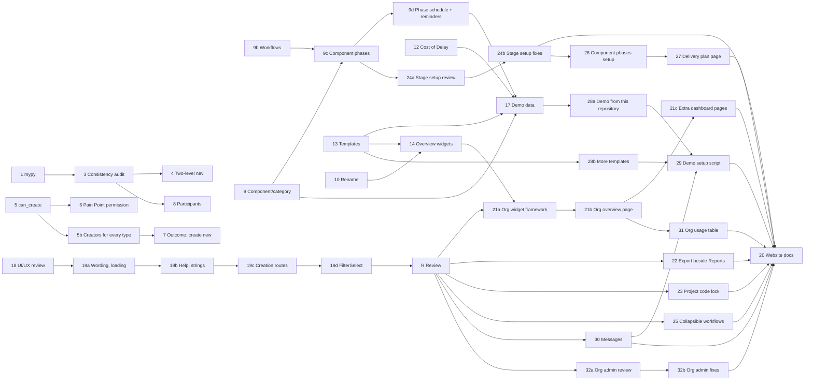

# Platform Review November 2026 — Plan

**Status:** planned 2026-11-06; phases 1 to 17 (including 14b, 9b, 9c and 9d), 25 and 26 done (14, 15, 16 and 17 uncommitted), the rest not started; phase 5b added 2026-11-07; phases 18 and 19 added 2026-11-08; phase 18 done 2026-11-08; phase 19 split into 19a to 19d and 19a, 19b and 19c done 2026-11-08 and 19d done 2026-11-09; review checkpoint R and phase 20 (website documentation) added 2026-11-08; phases 21 (organisation dashboards, 21a to 21c), 22, 23 and 24 (24a, 24b) added 2026-11-09 from the first review items at R; phases 25 to 32 (25, 26, 27, 28a, 28b, 29, 30, 31, 32a, 32b) added 2026-11-09 from further review items at R, planned only (the user starts each one). **Decision tags:** every decision says `Decided by: User` or `Decided by: Agent`. All sign-off questions were answered on 2026-11-06 (see each phase's *Decided by: User* lines). A question that arises during a phase is asked with `AskUserQuestion`; do not assume.

Source: 17 human review notes (the "Platform Review" list). Each was checked against the code before planning; several are partly built already, and three have a design objection recorded below.

## Status / Resume Here

36 / 46 phases complete.

| # | Phase | Notes | Status |
| --- | --- | --- | --- |
| 1 | mypy: remove the baseline, fix every finding | 1,042 findings (606 distinct keys) fixed, 14 existing `# type: ignore` replaced, baseline and `--update` removed; full-suite result in `docs/decisions.md` | [x] |
| 2 | Storage alert investigation | Cause was SeaweedFS preallocation (already fixed); monitor hardened: restart-safe state, 2-failure threshold, admin email fixed; see `docs/decisions.md` | [x] |
| 3 | Back link consistency + UI/UX consistency audit | Back link on all 21 `RecordHeader` pages, drawn by the header, guarded by `check_record_header_back.py`; not-found state on three core pages; findings register below | [x] |
| 4 | Two-level admin navigation | `group` on module admin sections, expandable `ResourceMenu`, `/…/admin/:group/:section` with redirects; see `docs/decisions.md` | [x] |
| 5 | Links panel: server-side "can create" | `can_create` on each `link-types` record type from `creatable_record_types`; frontend `canCreate` removed; see `docs/decisions.md` | [x] |
| 5b | Create new from the Links panel for every creatable type | 18 creators (core types extracted to shared modals), `not_creatable_from_links`, replay test of `can_create` against every create endpoint (found and fixed the Change Request divergence); see `docs/decisions.md` | [x] |
| 6 | Pain Point submission policy (project setting) | `pain_point_submission_settings` (project and organisation default, nearest-ancestor resolution; platform default Pain Point Managers only, existing organisations kept open by migration 0142), one `can_submit_pain_point` for create, import, Links panel and MCP; see `docs/decisions.md` | [x] |
| 7 | Engagement outcome: create new | Reuses the Links panel creators; `engagement-outcome-target-types` carries `can_create`; see `docs/decisions.md` | [x] |
| 8 | Engagement participants | Participants field on the create form (`stakeholder_ids`), empty-state notice in the form and on the detail page; the detail add control already worked; see `docs/decisions.md` | [x] |
| 9 | Component/category on every record | Generic table, many per record; shared field, filter, column, export/import, bundles, search, report field; adds an agent instruction; see `docs/decisions.md` | [x] |
| 9b | Customisable workflows (phases with kinds) for project stages | Organisation and project workflows with phase kinds; kind drives baseline and completion; Standard workflow replaces the fixed states; see `docs/decisions.md` | [x] |
| 9c | Component phases (per-component, per-stage workflow) | Each component follows a workflow per stage; project switch, off means the project stage governs; component lock approves its own requirements for the stage; owner may move a track; list column/filter, report field and per-component review deadlines not built (see `docs/decisions.md`) | [x] |
| 9d | Phase schedule and reminders | `stage_phase_plans`, stage owner, lead time; actual dates on every move, daily upcoming and overdue sweep, completed on the move; report fields for the expected end and start; overview metric left to phase 14; see `docs/decisions.md` | [x] |
| 10 | Rename navigation items, with organisation defaults | `nav_label_overrides` on project and organisation (per-key: project, ancestor, organisation), stable keys from the registry, looked up by route path; navigation, title and back link; see `docs/decisions.md` | [x] |
| 11 | Server and organisation messages (login pages and notification) | One `announcements` table (NULL organisation is platform-wide); login pages, banner and a one-time notification; organisation text may not contain a web address; see `docs/decisions.md` | [x] |
| 12 | Pain Point scoring on the Product Feedback model (custom criteria, Cost of Delay) | Read helper, one row per axis (migrations 0149, 0150), General row plus persona overrides, custom criteria, Cost of Delay and WSJF (weighted sum that divides); Playwright and perf scenarios not run; see `docs/decisions.md` | [x] |
| 13 | Template projects | Declared template keys on bundle hooks, fresh-draft starter records, module switches, tags, report setup; list filter, badge, explicit "None"; Playwright spec not run; see `docs/decisions.md` | [x] |
| 14 | Project overview widgets | Layout as JSON on project and organisation (own, ancestor, organisation, built-in), bounded metric catalogue with filters, one batched read-only metrics request, side-panel editor shared with the organisation default, module metric and widget extension points, bundles and templates; see `docs/decisions.md` | [x] |
| 14b | Overview widgets: on-page editing, grid size, scope and text | UX review of the overview and its editor (findings register in `docs/decisions.md`): the page is the editor, 12-column flow grid with width and height, project scope as an overview setting with a widget override, text widget; Playwright run on a rebuilt stack | [x] |
| 15 | Organisation overview settings shortcut | Settings icon link on the title row for every member who can see the overview (User: no role predicate); story, Playwright spec written and not run; see `docs/decisions.md` | [x] |
| 16 | Organisation-wide files list | `POST /orgs/{id}/files/search`, shared table and filters with the project page; only projects the caller holds a role in; Playwright spec written and not run; see `docs/decisions.md` | [x] |
| 17 | Demo seed data | Requirement statements, pictures and diagram, links, evidence layout, two templates and a project from one, WSJF scoring; scoring configuration now travels in bundles and templates; PDF equation line height fixed; see `docs/decisions.md` | [x] |
| 18 | UI/UX style guide review (whole product) | Read-only audit of every page and dialog against `docs/ux-style-guide.md`; findings register with severity; ends in a user sign-off. Register done 2026-11-08 (static scan, 16 findings in 6 groups, N5 refuted); the user approved every group at the checkpoint; see `docs/decisions.md` | [x] |
| 19a | UI/UX fixes: wording, loading, warnings, style guide | Groups C and F and E2/E3: contractions, abbreviations and colloquial phrases expanded (the group label is now "Organisation group" in the UI, exports and imports, which still read the earlier "Org group" suffix), `Spinner` for every hand-written "Loading…", one `ImportWarnings` component, the `title` rule settled in the style guide; Playwright not run; see `docs/decisions.md` | [x] |
| 19b | UI/UX fixes: help instead of permanent text, strings | Groups A (A1 to A5) and D (D1, D2): hints and muted explanations to `(?)` help, triage of the 166 `helpNotNeeded`, native `title` explanations to `Tooltip`, core nouns and filter labels into `strings` | [x] |
| 19c | UI/UX fixes: creation routes | Group B and the Nesting group: New project and New organisation offer Create and Import as separate dialogs on one field group (`SplitButtonTrigger`, `BundleImportDialog`, `ProjectIdentityFields`); Parent, Inheritance and Mirror role fold into one collapsed "Nesting" group (`ProjectNestingFields`, shared with project settings); Playwright edited, not run; see `docs/decisions.md` | [x] |
| 19d | UI/UX fixes: `FilterSelect` | Group E1: one shared select for every filter panel and all 117 raw `<select>` elements, with a guard script (empty baseline); 95 selects moved onto `FilterSelect`, `LabeledSelect` and `InlineSelect`, enum-typed options via `labelOptions`; Playwright not run; see `docs/decisions.md` | [x] |
| R | Review checkpoint after the UI/UX fixes | User review of phase 19's result; every item raised becomes a numbered phase or is fixed in place; gates phase 20. First items raised 2026-11-09 became phases 21 to 24 | [ ] |
| 22 | Organisation compliance pages: Export beside Reports | `PageActions` portals a section's Export into the title row's action group beside Reports; Playwright run on the rebuilt stack; see `docs/decisions.md` | [x] |
| 23 | Lock project codes after creation | `locked` in the project code policy; enforced in `change_project_code` (the one function every route uses); caller flag `code_change_locked`; Playwright run on the rebuilt stack; see `docs/decisions.md` | [x] |
| 24a | Component stage and phase setup: review | Register of 11 findings (W1 to W11) from a static walk; the user signed off W1 to W3 and W6 to W10 on 2026-11-09 (W11 is phase 20's) | [x] |
| 24b | Component stage and phase setup: fixes | Step list and "In use" badge removed; W1 "Workflows and phases" group, W2 Stage phases page, W3 workflow picker, W6 collapsible filtered track list, W7 phase on the requirement list, filter and overview metrics, W8 locked phases, W9 used by, W10 seed; Playwright run on the rebuilt stack; see `docs/decisions.md` | [x] |
| 21a | Organisation dashboards: widget framework | `WidgetRules`, organisation catalogue and batched figures, `org_overview_widgets` registry hook, tables and migration 0152; see `docs/decisions.md` | [x] |
| 21b | Organisation dashboards: the overview page | Overview page is a dashboard (grid and editor reused with a `dashboard` target); Compliance summary and attention widgets replace its Dashboard page and the stats-header tiles; Playwright run on the rebuilt stack | [x] |
| 21c | Organisation dashboards: extra pages | Pages with per-user and per-group visibility (404 for others), Manage dashboards dialog, audit, bundles, seeds; SOC 2 policy item 2c; Playwright run on the rebuilt stack | [x] |
| 25 | Collapsible workflows | Each workflow in the shared workflows panel is a `DisclosureRow` (name, step count, source; open for one, closed for several); the stage phase schedule uses it too; open state is one stored key per list holding only the exceptions; `ComponentTracksList` left for phase 26; Playwright written, not run; see `docs/decisions.md` | [x] |
| 26 | Component phases setup: compact switch, flat track list | The full-width On/Off/Inherit select becomes a compact control; the per-component expansion becomes a flat list (reverses 24b's W6 collapse, *Decided by: User*); `LabeledSelect` `autoWidth`, one `DirectoryTable` row per component and stage; Playwright written, not run; see `docs/decisions.md` | [x] |
| 27 | Component delivery plan page | The existing Stage phases page (project navigation, not settings) becomes a delivery plan: components against stages and time, progress, expected dates, and phase changes in place; planned 2026-11-09 | [ ] |
| 28a | Demo project from this repository | A demo project built from this product's requirements, decisions, SOC 2 package and architecture, from a curated, drift-checked fixture; planned 2026-11-09 | [ ] |
| 28b | More example template projects | Further template projects beside the two from phase 17, each with modules, workflows, vocabularies, dashboard and starter drafts; planned 2026-11-09 | [ ] |
| 29 | Demo setup script | One guarded command to set a stack up as a demo (migrate, seed all demo projects, accounts, branding, notice) with `--reset`, and an opt-in scheduler for a daily reset at a set time (default UTC midnight); planned 2026-11-09 | [ ] |
| 30 | Messages: defaults, severity colour, non-dismissable, history | Start now and no end by default, severity by colour and icon instead of a badge, a `dismissible` switch, history that is not capped away, and Duplicate; planned 2026-11-09 | [ ] |
| 31 | Organisation settings: usage table | A plain table at the top of the organisation settings overview: users, projects, storage; planned 2026-11-09 | [ ] |
| 32a | Organisation administration UI/UX review | Review of every organisation administration page against the style guide, starting from the "Custom" pills and reset links on company settings; register and sign-off; planned 2026-11-09 | [ ] |
| 32b | Organisation administration UI/UX fixes | The approved findings of 32a, including the style guide change for removed override pills; planned 2026-11-09 | [ ] |
| 20 | Website documentation update | Reviews and updates `docs/website/` for every user-visible change in phases 1 to 19 (and the review's fixes); screenshots and steps re-captured where the UI changed | [ ] |

Phase 19 (19a to 19d) follows phase 18's sign-off (given 2026-11-08); phase R follows phase 19d; phase 20 follows phase R and phases 21 to 32, so the website describes the product as the review left it. Phases 25 to 32 are independent of one another except as drawn (29 needs 28a, 28b and 30, so its demo notice can be non-dismissable; 27 needs 26); the user starts each one.

## Phase 3 findings register

Method: a static scan of the 21 `RecordHeader` pages (header props, layout, links, activity, comments, confirmation and toast use, load-error handling). *Decided by: Agent*; it replaces the planned live walk, which needs a rebuilt stack and adds only rendered output.

| # | Finding | Outcome |
| --- | --- | --- |
| F1 | Requirement, Change request, Action and Compliance standard pages had no back link | Fixed |
| F2 | Nine module pages labelled the link with the singular record name or a typed arrow | Fixed; the header draws the arrow, callers pass the plural name |
| F3 | Requirement, Change request and Action pages showed a spinner indefinitely (and an unhandled rejection) when the record could not be loaded | Fixed; same message as the module pages |
| F4 | `ProjectComplianceDetail` back button read "← Back" | Fixed ("Compliance assignments") |
| F5 | Engagement has Delete permanently but no Archive | By design (a log entry, documented in the page); no change |
| F6 | `VersionWorkspace` has a hand-written "← Back to {standard}" button | A view switch inside a page, not a record header; no change |
| F7 | Compliance standard page has no Links panel, activity or tags | Not a registered artefact type's record page (a navigation workspace); no change |
| F8 | Report layout designer and pack editor back labels had no arrow | Fixed by F2 (same component) |

Phases 4, 9 and 10 take nothing further from this audit.

## Phase 18 findings register

Drafted 2026-11-08 by static scan (*Decided by: Agent*, the phase 3 precedent). **Checkpoint passed 2026-11-08 (*Decided by: User*):** every group (A to F) is approved; Q1 yes (name only, the guide is edited in both places); **Q2 collapse Parent, Inheritance and Mirror role into one "Nesting" group** (the recommendation was inline); **Q3 all 117 selects** move to `FilterSelect`. Every file path below is under `frontend/src/`. **Not covered:** the Playwright structural walk (needs a rebuilt stack), so rendered-only issues (spacing, overflow, focus order) are unreviewed; and permanent muted text (`className="text-muted"`, 801 sites) was triaged only on the New project dialog, because a text scan cannot tell an explanation from an empty state or a required next step.

**Clean:** the eight existing checkers pass with empty baselines (`check_field_help`, `check_required_markers`, `check_list_page_layout`, `check_textarea_autogrow`, `check_record_header_back`, `check_detail_cards`, `check_form_markup`, `check_spacing_tokens`). No hand-written tab bar, modal or portal outside the shared components, no `window.confirm`, no "(optional)", no raw enum string rendered, and every delete confirms or is a reversible one-tap toggle with a toast (`WatchingGroupsPanel`, `FavouritesPage`). Mutations go through `useMutation` or a parent that does.

**Seed findings checked:** N1, N2, N3, N4, N7 confirmed; **N5 refuted** (`FormActions` inside a `Modal` already portals into the dialog header, `components/FormActions.tsx:86-87`); N6 stays an open question (Q2 below).

| # | Group, finding and evidence | Rule | Severity | Proposed fix | Size |
| --- | --- | --- | --- | --- | --- |
| **A. Explain in help, not in the layout** | | | | | |
| A1 | Permanent `hint` explains what a setting does: `pages/OrgAdminPage.tsx` 3016, 3410, 3426, 3581, 3591, 3606, 3627, 3637, 3653; `pages/ProjectAdminPage.tsx` 1626, 1647, 1667, 1693; `pages/PreferencesPage.tsx` 504, 513; `pages/ProjectListPage.tsx` 457 (N2) | Pattern: explain in help | defect (16) | Move each to `help`, one line per option where it has options | M |
| A2 | `helpNotNeeded` plus a `hint` that says what the field is: `modules/stakeholders/EngagementFormModal.tsx` 92, 96, 103, 108, 112; `FindingFormModal.tsx` 64-65; `NeedFormModal.tsx` 49-58; `StakeholderFormModal.tsx` 192, 198; `ResearchPromptsPanel.tsx` 39; `modules/context_strategy/PainPointFormModal.tsx` 118. A warning that must be seen each time (personal data, "Required to reject.") stays visible | Pattern: explain in help; field help | defect (about 14) | Move the explanation to `help`; keep warnings | S |
| A3 | `helpNotNeeded` on fields whose purpose is not obvious from the name. 166 of 441 uses have a label that is not a plain name, title or description (an upper bound, to be triaged by hand): `OrgAdminPage` 19, `ProjectAdminPage` 13, `PreferencesPage` 7, `EvidenceFormModals` 5, `StakeholderFormModal` 5, `DecisionFormModal` 4. Examples: Component and Category `components/RequirementCreateModal.tsx` 231-282 and `ChangeRequestCreateModal.tsx` 423, 433; Owner `RequirementFields.tsx` 100; Role `NewUserFields.tsx` 54; accent colours `OrgAdminPage.tsx` 3251, 3260; SMTP port 3492; cascade `ComponentPhasesPanel.tsx` 181; Template, Organisation, Visibility on New project (N4) | Pattern: field help | defect (the checker cannot judge it) | Triage the 166; add `strings.help.*` to every non-obvious one | L |
| A4 | Permanent muted explanations on the New project dialog: `pages/ProjectListPage.tsx` 428 ("code is assigned automatically", N3) and 465 (`importIgnoresTemplate`). Other pages not triaged | Pattern: explain in help | defect (2 known) | `help` on Name; the import note disappears with B1 | S |
| A5 | Native `title` used to explain, not to name an icon: `ReportParamsForm.tsx` 133, 152; `LinkTraceModal.tsx` 62; `ReportFormatDownload.tsx` 65; `ReportPackRunner.tsx` 228; `TreeSelect.tsx` 85; `pages/OrgAdminPage.tsx` 2369; `ProjectAdminPage.tsx` 1801; `RequirementsPage.tsx` 371-381 (icons whose meaning is only in `title`); `ScoringMatrixChart.tsx` 91 | Pattern: explain in help ("never a native `title`") | defect (about 10) | Shared `Tooltip`; give the `RequirementsPage` icons an accessible name | S |
| **B. Creation routes** | | | | | |
| B1 | New project: Import is a file field inside the Create form that hides the code, report name and template fields (N1): `pages/ProjectListPage.tsx` 513-517, 417, 431, 442, 463 | Create as a layer; one door for bulk | defect | `SplitButtonTrigger` (Create is the default click; chevron offers Import project), two short dialogs on one shared field group. Alternative: `MenuButton` "New" with both. Recommend the split button, which the guide names for a primary action with one alternative | M |
| B2 | Same shape on `pages/ServerOrganisationsPage.tsx` 209-222: "Or import from an exported bundle" in the create dialog, creation choices hidden when a file is chosen | same | defect | Same fix, one component for both pages | M (with B1) |
| **C. Formal wording** | | | | | |
| C1 | Contractions in user-visible text: 27 lines in `i18n/strings.ts` (69, 104, 206, 247, 330, 337, 636, 758, 852, 951, 966, 1212, 1217, 1232, 1256, 1290, 1441, 1469, 1500, 1518, 1761, 3146, 3161, 3172, 3176, 3188, 3210) and about 48 string literals in components (`App.tsx` 120, `CsvImportWizard.tsx` 237, `OrgAdminPage.tsx` 3430, 3851, `RequirementDetailPage.tsx` 372, `ProjectAdminPage.tsx` 1597, 1599, 2393 and others) | Formal wording | defect (about 75) | Expand ("does not", "cannot") | S |
| C2 | Abbreviations: "Org-wide visibility" (`strings.ts` 568, 570), "Org group" (88), "Org Admin" (377, 378, 512, 543, 554 and others; 21 lines); N7: the Visibility options come from `admin.*` while the same word is used elsewhere as "organisation" | Formal wording; one term for one thing | inconsistency | Spell out, reuse the glossary term | S |
| C3 | Colloquial or idiomatic phrasing: `modules/product_feedback/RequestScoresPanel.tsx` 58 ("Worked out"), `RequestFields.tsx` 158 ("Worked out:"), `RequestLoopPanel.tsx` 44 ("Everyone who asked has been told"), `RequestDetailPage.tsx` 616 ("the people who asked"), `strings.ts` 2719, 3708 ("worked out from a number"), 1431 ("let in"), `components/ProposedLinkRow.tsx` 44 (comment, "greyed out") | Formal wording (the correction CLAUDE.md names) | defect (7) | "Calculated", "requesters", "unavailable", "permitted" | S |
| **D. Terminology and strings** | | | | | |
| D1 | Core nouns typed as English literals, so the organisation terminology and the deployment's organisation label are ignored (22 sites): `pages/ProjectListPage.tsx` 361 ("Organisation"), `ServerOrganisationsPage.tsx` 203, 209, 214, 220 (`New ${orgLabel}`, "Defaults to the bundle's own name", "Or import from…"), `ReportParamsForm.tsx` 60, 69, `ServerManagementPage.tsx` 717, `modules/compliance/StandardImportModal.tsx` 86, `OrgComplianceOutstandingPanel.tsx` 388, `StandardWorkspacePage.tsx` 264-268, `ComplianceOrgOverviewTiles.tsx` 58 | Terminology; one term for one thing | defect (22) | Move to `strings` with the noun placeholders | M |
| D2 | `FilterField label="…"` literals outside `strings` (51; most in compliance, product feedback, context strategy and the project, requirement and change request lists) | one term for one thing; translation | inconsistency | `strings.filters.*`; the repeated Status, Role, Organisation labels become shared | M |
| **E. Shared components** | | | | | |
| E1 | 117 raw `<select className="input">` in 55 files, mostly in filter panels (`RequirementsPage.tsx` 7, `OrgComplianceOutstandingPanel.tsx` 6, `ProjectListPage.tsx` 5, `OrgComplianceStandardsPanel.tsx` 5, `SearchPage.tsx` 4, `RequestFilterFields.tsx` 4, `FileFilterFields.tsx` 3). `FilterField` has no select partner; `LabeledSelect` is for forms | one component per pattern | inconsistency | A `FilterSelect` (value, options, "All" entry) used by every filter panel; Q3 | L |
| E2 | Hand-written "Loading…" in `modules/compliance/` (`ComplianceOrgSettingsPanel.tsx` 57, `StandardVersionsSection.tsx` 102, `ProjectComplianceDetail.tsx` 199, `MappingTypesPanel.tsx` 42, `StandardListPage.tsx` 174, `RequirementMappingsModal.tsx` 125) and `product_feedback/RequestDemandPanel.tsx` 105 | one component per pattern | inconsistency (7) | `Spinner` | S |
| E3 | The import-warnings card is written three times with a literal `#b58900` fallback: `ProjectListPage.tsx` 546, `ServerOrganisationsPage.tsx` 260, `OrgAdminPage.tsx` 2570 | one component per pattern; tokens | inconsistency | One shared warning list (`Notice`-style) on theme tokens | S |
| **F. The style guide itself** | | | | | |
| F1 | Contradiction: Principle 8 and the compact-forms and button-size sections (lines 865, 906) ask every icon-only button for an `aria-label` **and** a `title`; "explain in help" (line 1093) says never use a native `title`. About 40 icon buttons carry both | Style guide | ambiguity | Q1 | S (docs) |

Sizes: S under half a day, M about a day, L several days.

### Questions for the checkpoint

- **Q1 (F1):** may an icon-only button keep a native `title` as its name (not as an explanation)? Recommendation: yes, and the guide says so in both places.
- **Q2 (N6):** on New project, keep Parent, Inheritance and Mirror role inline, or fold them under one collapsed "Nesting" group? Recommendation: keep inline; they appear only when a parent exists, so the default dialog is short.
- **Q3 (E1):** build a shared `FilterSelect` and move all 117 selects onto it, or only the filter-panel ones (about 60)? Recommendation: filter-panel ones now, the form ones already have `LabeledSelect`.

## Phase 24a findings register

Drafted 2026-11-09 by static walk of the code (*Decided by: Agent*, the phase 3 and 18 precedent): every task was traced from the navigation to the control and the permission behind it. Every path is under `frontend/src/` unless stated. **Not covered:** a rendered walk (needs a rebuilt stack) and the owner-without-manager journey (W2), which needs one live check.

**Works today** (task, route): define a workflow (Organisation Admin → Projects & workflow → Stage workflows; Project Admin → Structure → Stage workflows; `StageWorkflowEditor`: name, ordered phases, kind, reorder, delete); hide and restore an organisation workflow (project panel); create a stage and choose its workflow, change a workflow while the stage is open, move a stage between phases with the closed-phase prompt (Project Admin → Structure → Stages); turn component phases on, off or inherit (Component phases section); move a track, set its workflow, not-applicable and owner (`ComponentTrackEditor`); set expected ranges, lead time and a stage owner (Stage schedule). The backend rules for each are tested.

| # | Finding | Severity | Proposed fix |
| --- | --- | --- | --- |
| W1 | The four related sections (Stages, Stage workflows, Component phases, Stage schedule) are separate collapsed sections on one long Structure tab; nothing tells a person that component phases exist, that they are off, or the order to set things up (workflows, then stages, then component phases, then schedule) | High | One "Workflows and phases" group in project administration (the two-level menu of phase 4) holding the four as ordered sub-pages, and the off state of component phases states what turning it on does with a link to the switch |
| W2 | Moving a track is only possible inside Project Admin → Structure. The server lets a track's owner (who need not be a manager) move it, and the website says so, but the control lives on a settings page; whether that page loads at all for a plain member is unverified | High | A "Stages and phases" view in the project's own navigation listing the tracks the caller may move (their own first) with the phase picker; a live check of Project Admin as a plain member first |
| W3 | With one workflow the stage's workflow picker is not shown (`stageWorkflows.length > 1`), so a person who wants a custom workflow is shown no sign it exists or where to create one | Medium | Always show the picker; "New workflow" beside it opens the same editor |
| W4 | The workflow list is a row of badges; the order of phases, the starting phase and the closing phase are not readable | Medium | Ordered step list (requested; built in 24b) |
| W5 | The "In use" badge states a fact nobody can act on; the server's refusal when deleting an in-use workflow already explains it | Low | Remove it (requested; built in 24b) |
| W6 | The component phases list is every component by every stage with no filter or collapse; a project with 12 components and 6 stages shows 72 rows | Medium | Collapse per component with the current phases as a summary line; filter by stage, phase and owner |
| W7 | A component's phase is visible nowhere outside that panel (no list column, filter or overview figure); phase 9c recorded this as not built | Medium | Phase column and `TagFilter`-style filter on the requirements list and a metric on the overview; needs the user's agreement on cost, since the inherited switch cannot be resolved cheaply in report SQL |
| W8 | A move into a locked phase by someone without the approver role fails with the server's message only after the choice | Low | Disable the locked phases in the picker for a person who cannot enter them, with the reason in a tooltip (needs the capability from the server) |
| W9 | Which stages and tracks follow a workflow cannot be seen, so a person editing or deleting one has to guess | Low | "Used by" list in the workflow's step list, replacing the badge's information with something useful |
| W10 | The e2e seed has no workflow or component-phase data (the demo seed does), so no Playwright spec starts from a populated state | Low | Seed one custom workflow and a project with component phases on in `seed_e2e_dataset.py` |
| W11 | The website describes the steps but under "Stage schedule" and "Component phases" as separate headings with no setup order | Low | One "Setting up stages and phases" page with the ordered steps and a Mermaid diagram (phase 20) |

**Checkpoint passed 2026-11-09 (*Decided by: User*):** W1 to W3 and W6 to W10 built in 24b (W7 including the list column, filter and overview metric); W4 and W5 were requested and built regardless; W11 is part of phase 20. Outcomes are in `docs/decisions.md`.

## Challenges to the notes (read before approving)

| # | Note | Challenge | Outcome |
| --- | --- | --- | --- |
| 5 | "Add an optional `ModuleDefinition` hook `can_create(...)`" | `RecordTableProvider.can_create(db, user, project_id)` already exists for every registered type (`backend/app/modules/registry.py`), defaults to the fine-grained `propose_create` permission, and is documented as "the same check as the type's own create endpoint". A second hook would be a second answer to the same question and would drift. | Reuse the provider's check; add no hook. |
| 6 | "Creating/editing Pain Points should be behind a permission" | Editing is already manager-only. Creation is open to every member by recorded design. | **Settled with the user:** a project setting (not a new role atom), default unchanged, so a project that prefers Enhancement Requests can restrict direct submission. |
| 12 | "Cost of delay as a scoring method" | **Settled with the user:** do not hard-code one more model; give Pain Points the same style as Enhancement Requests (alternative models, organisation and project custom criteria, models enabled per project). The blocker is storage: Pain Point scores hold one fixed column per axis, so custom criteria are impossible until scores are stored one row per axis. Cost of Delay (WSJF) then ships as a built-in model, and the engine needs a sum-then-divide combination. | Storage change first, then `allow_custom_criteria`, then the built-in Cost of Delay model. Open question on per-persona scope. |
| 13 | "Select a template when creating a project" | Already built: `is_template`, `clone_project`, the New project picker, the organisation default template. The real gaps are that a clone copies no module configuration (module enablement, Pain Point types, scoring), templates show in the project list by default, and "None" cannot override the organisation default. | Plan only the gaps. |
| 14 | "Overview customisable with widgets" | **Settled with the user:** more than show/hide: managers add and remove widgets and configure them (for example a gauge on a metric the page does not show today). That is a small dashboard builder, so it needs a bounded metric catalogue, not an open query builder, to stay fast and safe. | Widget instances with a configured metric and visualisation. Metric source needs sign-off. |
| 10 | "Rename modules/sub-module pages" | The terminology feature is deliberately a closed key set because renaming every string is large. A rename that changes only the navigation label leaves "Decisions" in the page title, breadcrumbs, links and reports. | **Settled with the user:** the rename covers the navigation entry, page title, breadcrumb and back link only; record nouns stay as they are. |
| 26 | "Stages should be a list; expansion does not help" | Phase 24b's W6 collapse was the user-signed-off fix for 72-row lists. A flat list brings that back unless the filter stays. | Flat list **with** the existing stage, phase and owner filters (*Decided by: Agent*, to confirm at the start of 26). |
| 27 | "There maybe should be a component page (not within settings)" | One exists: the **Stage phases** page in the project navigation (`/projects/:id/stage-phases`, phase 24b W2). A third surface would split the same task again. | Extend that page into the delivery plan; rename it through navigation names if wanted. |
| 28a | "Based on this very project (decisions file, requirements, SOC details)" | `docs/decisions.md` is 16,981 lines and 1,373 headings; parsing it at seed time is brittle and loading all of it is unreadable. The SOC 2 package documents known gaps candidly, and a public demo would publish them. | Curated fixture produced by a reviewable extractor, with a drift test; known gaps excluded unless the user says otherwise (question in the phase). |
| 29 | "A script that sets the system up as a demo" | A one-command demo that creates accounts with known credentials and wipes data is dangerous on a real deployment. | Guarded: explicit demo flag, refuses a database holding non-demo organisations, random passwords by default. |
| 30 | "Messages do not need badges; the colours can be used for severity" | Colour alone fails WCAG 1.4.1 (use of colour) and is the only cue left for colour-blind readers. Separately, the 50-message cap per scope forces deleting old messages, which defeats a history. | Colour plus an icon and visually hidden text; the cap counts only messages that are not ended. |
| 32 | "Remove the Custom badges and the reset to platform default" | The style guide's second principle and "Pattern: platform default vs. override" require exactly that pill and reset, and say why (a revert nobody can find). Also, an empty field today means "use the platform default" (the stored value is null), so "make the fields empty" cannot express "show nothing". | The user's instruction wins and the guide is edited in the same change (*Decided by: User*). Recommended replacement: the platform value shows as the field's placeholder, so an empty field is visibly "platform default". The logo and login background keep a remove control, since a file cannot be emptied. |

## Decisions

Decisions made by the user are recorded in each phase. Cross-phase decisions:

- **D1. A shared check is reused, not duplicated** (phase 5). *Decided by: Agent.* The Links panel and the record list import both ask `RecordTableProvider.can_create`.
- **D2. Each new project-scoped table states its nesting behaviour** (phases 10 and 14: rename and widget layout). *Decided by: Agent*, proposed: all resolve own rows, else the nearest ancestor's, else the organisation default, the `resolve_effective_action_types` shape. Record in `docs/decisions.md` when built.
- **D3. Every new project- or organisation-scoped table travels in its bundle** (phases 9, 9b, 9c, 9d, 10, 14). *Decided by: Agent*, required by CLAUDE.md.

## Phase specs

Every phase follows the standing checklist at the end. "Why / Risk / Outcome" is stated per phase as the requirements rules ask.

### Phase 1 — mypy: remove the baseline, fix every finding

- **Why:** `backend/mypy_baseline.json` held 606 accepted keys (1,042 findings); a ratchet that only shrinks leaves the debt in place. CLAUDE.md already says warnings are fixed, not suppressed.
- **Risk:** type fixes touch hot paths; a wrong "fix" (a cast) hides a real bug.
- **Work:** fix by file group (models, services, routers, each module) in batches; run `scripts/check_mypy.py` after each. Prefer correcting the type over `cast`/`# type: ignore`; an ignore needs a one-line reason and counts as a documented false positive only. Then delete the baseline file and the `--update` mode, make CI run plain mypy (zero findings), and update `scripts/check_mypy.py`, `ci.yml`, `docs/development.md`.
- **Agent instructions:** add to CLAUDE.md (Code Quality Rules): "mypy findings are fixed, not baselined or ignored; a change leaves `scripts/check_mypy.py` at zero." Do not edit the mypy configuration to narrow rules (existing rule); if a rule is wrong for the project, raise it.
- **Outcome:** zero findings, no baseline, CI fails on any new one.
- **Tests:** the full backend suite stays green after each batch (one `pytest` run at a time, per the shared-database rule); no new ignore comments (a grep check in the phase's close-out).
- **Do not:** use `Any` broadly to clear findings; a count of `Any` introduced is reported at the end.

### Phase 2 — Storage alert investigation

- **Why:** `services/storage_health.py` alerts a server administrator once per outage. A server administrator on the test stack sees many, so either storage is genuinely failing, or the "once" logic is defeated.
- **Hypotheses to test, in order:** (a) the SeaweedFS service on the test stack is really failing writes (recorded preallocation/disk trap); (b) `was_unhealthy` is process-local, so a restart or a leader hand-over between workers resets it and re-alerts; (c) the probe flaps (a slow first write) and each flap sends a pair; (d) `disk_monitor` and `storage_health` both alert for one condition.
- **Work:** reproduce on the stack, read the notification rows and the loop's log lines, then fix the cause. Likely fixes: persist the outage state (a row or the leader-lock store), require N consecutive failures before alerting, and de-duplicate by an outage identifier.
- **Outcome:** one notification per genuine outage, one on recovery, none for a transient blip.
- **Tests:** unit tests on `check_storage_health_once` with a scripted probe sequence (fail, fail, recover, fail) and a simulated restart; a regression test for whichever cause is found.
- **Reason for first/early:** the notification noise masks other server-administrator alerts, including those phase 11 will add.

### Phase 3 — Back link consistency and UI/UX consistency audit

- **Why:** the Pain Point page has a back link (`← Pain Point`), other record pages do not, and the label is the singular record name where the destination is a list. `RecordHeader` already accepts `back`, so the gap is in the callers.
- **Risk:** per-page drift again; the style guide is binding.
- **Work:**
  1. Add `scripts/check_record_header_back.py` (empty baseline): every record detail page passes `back` to `RecordHeader`, and the label is the destination's plural list name (`← Pain Points`). Fix every caller it finds, including core pages (requirement, change request, action) and every module.
  2. Run a scripted UI/UX consistency audit across modules: header actions, status badge placement, tabs vs side panel, empty states, toasts on mutation, confirmation tiers, form header, field help, required markers, label maps for enums. Method: a Playwright walk that visits every list and detail page and records structural facts (heading level, action buttons, back link, tabs), then compare in a findings table kept in this plan. No judgement by screenshot alone.
  3. Findings are fixed in the phase (fix, do not defer) or, where large, become a numbered sub-phase in this plan with the user's agreement.
- **Outcome:** one detail-page header shape everywhere, guarded by a check script, and a findings register.
- **Tests:** the check script plus a Playwright spec asserting the back link on one detail page per module (list position restore is already covered).
- **Docs:** `docs/ux-style-guide.md` gains the back-link rule under "Pattern: record header" if absent.

### Phase 4 — Two-level admin navigation (project and organisation)

*Decided by: User* (2026-11-06): an expandable left menu, with URL `/…/admin/:group/:section`.

- **Why:** modules contribute flat sections (Product Feedback registers five: settings, scoring, external systems, channels, plus the inbox), so the project and organisation admin menus grow with every module and similar names ("Pain Point scoring", "Request Scoring") sit side by side with no parent.
- **Design:** add a generic optional `group` (key, label) to `ProjectAdminSectionDef` and `OrgAdminSectionDef` (`frontend/src/modules/types.ts`). A module whose sections share a group renders as one menu entry with sub-pages; a module with a single section stays at one level. Core groups are unchanged. `ResourceMenu` gains an expandable group item (arrow-key navigation preserved) built as the shared component, with the Org and Project admin pages both moved onto it.
- **URL:** `/…/admin/:group/:section?`. Existing `/admin/:group` links redirect to the first section, so bookmarks and the many Playwright specs that deep-link survive; a redirect test pins each old module key.
- **Style guide:** the depth-model principle names resource-menu sub-pages for more than five groups; a second level is an addition and the guide is updated in the same change (settings hierarchy addendum).
- **Pushback:** do not add a third level, and do not group by module name alone — group by the module's own `group` declaration, so a module with two unrelated settings areas can say so.
- **Outcome:** admin menus whose length no longer grows with section count; sub-pages named by their parent.
- **Tests:** unit tests for grouping and the single-section case; story for the group item; Playwright for expand, keyboard use and the redirect; update specs whose locators assume the flat menu.
- **Boundary check:** the grouping field is a generic extension; no module is named in a core file.

### Phase 5 — Links panel: server-side "can create"

- **Why:** each module re-implements a permission check in the browser (`canCreate`), and a module that forgets shows a button that fails on save.
- **Design (Decided by: Agent, D1):** `GET …/link-types` already returns `other_types` filtered by module and sub-component state. Add `can_create: bool` to each entry, computed by the type's `RecordTableProvider.can_create(db, user, project_id)`; a type with no provider is `false` (cannot create from a link). Remove `canCreate` from `LinkedRecordCreator` and `useCreatableRecordTypes`; the panel offers "Create new" only for entries flagged true. Cost: one provider call per distinct type per request, not per record; the call must not add per-row queries (the scaling probe covers it).
- **Risk:** the provider check and the create endpoint diverging. A test per module with a registered creator asserts the flag equals the create endpoint's own result for a member with and without the gating role.
- **Outcome:** one server answer; no module re-implements it.
- **Tests:** per-module test, a role-gated type not offered to a member without the role; `docs/modules.md` §4l2 updated (remove `canCreate`, describe the flag); stories updated.
- **Prerequisite for phase 6's behaviour and phase 7.**

### Phase 5b — Create new from the Links panel for every creatable type

*Decided by: User* (2026-11-07): "Create new" in the Links panel should offer every standard type of record, not only Pain Points.

- **Why:** `linkedRecordCreators` is declared for `pain_point` only (phase 7 adds `stakeholder_need`), so a person on a Risk, Decision or Requirement cannot create the Persona, Open Question or Action they want to link without leaving the page. Phase 7 (outcomes) also picks its target types from the same registry.
- **Types in scope:** every registered artefact type a person authors in a project that has a create form: `requirement`, `requirement_action`, `change_request`, `decision`, `risk`, `enhancement_request`, `strategy`, `future_state`, `guiding_principle`, `open_question`, `persona`, `stakeholder`, `stakeholder_group`, `research_finding`, `engagement`, `compliance_evidence`, plus `stakeholder_need` (phase 7 if not done here). *Decided by: User* (2026-11-07): **Change Request is included** (a finding or an enhancement request is often a change to an existing requirement, so it is created and linked from that record), and **no path is restricted for workflow reasons**: the panel offers every type a link type reaches and the person may create. **Excluded, with the reason recorded in `docs/decisions.md`:** `compliance_requirement`, `project_compliance_requirement` and `compliance_required_action_assessment` only, because they are derived from an assigned standard and cannot be authored at all (*Decided by: Agent*). A test lists the exclusions, so a new type must be creatable or give a reason, as `not_importable` does.
- **Design:** each owning module registers `linkedRecordCreators[type]` with a dialog that wraps the type's existing form (`CreatePainPointDialog` is the pattern: load what the form needs, create through the same API, commit quick links and tags, report the id). The form is the type's own create dialog, so every edit field is present (create and edit share one field group). **`QuickLinkField` stays in every dialog** (*Decided by: User*, 2026-11-07): the new record may need links to other items beyond the page record, even if only "Related to"; the panel's own link to the page record is made in addition. The Change Request dialog takes its affected requirement from the page record when that is a requirement (pre-filled, editable), and otherwise asks as the normal form does. Core types (requirement, action, change request) need their creators declared by the core page set; where a form lives in a page file, extract it to a shared `*FormModal` first and move the page onto it (shared components first), rather than a second copy. `can_create` comes from phase 5 and needs no change.
- **Guard:** `frontend/src/modules/linkedRecordCreators.stories.tsx` (or a unit test) fails for a registered creatable type with neither a creator nor a stated exclusion; the backend lists the exclusions once so the two cannot drift.
- **Outcome:** from any record's Links panel, "Create new" offers every type a link type reaches that the person may create; a role-gated type is hidden by the server flag.
- **Done 2026-11-07.** Phase 7 needs no creator work for Need: `stakeholder_need` is registered here; it only adds the outcome link and the engagement page's "Create new" beside the picker.
- **Permission rule (*Decided by: User*, 2026-11-07):** a type the person may not create is never offered. The server flag from phase 5 is the only gate; no creator adds its own or ignores it. Several providers answer `can_create` with an unconditional "any member" (risk, decision, pain point, open question and others), so this phase audits every creatable type's provider against its create endpoint and fixes any that is looser. A parametrised backend test covers every creatable type: for a person with no role, a plain member and a role holder, the flag equals whether the create endpoint refuses (403), so a gate added to an endpoint without its provider fails the test.
- **Tests:** a story per creator (create and link), the registry-completeness test, a Playwright spec creating and linking one type per module (Requirement, Decision, Risk, Persona, Open Question), a refused case for a role-gated type, and a creator that adds a quick link besides the panel's own link.
- **Docs:** `docs/modules.md` §4l2 (the registry guard), `docs/ux-style-guide.md` if it names Pain Point as the only creator, docs website Links panel page.

### Phase 6 — Pain Point submission policy (project setting)

*Decided by: User* (2026-11-06): a project configuration, not a role the platform imposes. Mirrors Product Feedback's `ProjectFeedbackSettings.submission_policy`.

- **Why:** a project that runs Enhancement Requests usually wants people to raise those and leave Pain Points to managers; today it cannot restrict direct submission.
- **Design:** a `ProjectContextStrategySettings` row (or the module's existing settings row if one exists; check first) with `pain_point_submission_policy`: **Members** (default, today's behaviour) or **Managers only** (holders of the `pain_point_manager` role). Resolution: project, nearest ancestor, organisation default, Members (D2). Organisations set the default in their Context & Strategy settings; a project overrides it with a visible "Organisation default" indicator (style guide: platform-default override visibility). The create endpoint, the record-table `can_create` (so list import, the Links panel from phase 5 and the MCP tool agree) and the UI "New Pain Point" button all read one resolver, `can_submit_pain_point(db, user, project)`.
- **Guidance when restricted:** the refusal and the unavailable button state say that Pain Points are submitted by managers and, where Product Feedback is enabled, point to Enhancement Requests. Wording is formal.
- **Editing:** unchanged (manager-tier). Whether a submitter may edit their own untriaged Pain Point stays as today; not part of this phase.
- **Bundles and templates:** the setting travels in the project and organisation bundles and is copied by a template (phase 13).
- **Checks:** SOC 2 access-control policy (authorisation change); decisions-log entry; MCP tool description "any project member may do this" corrected and the module skill reference regenerated.
- **Outcome:** a project can restrict direct Pain Point submission; nothing changes for existing projects.
- **Tests:** both policies for a plain member and a manager across create, list import, Links panel flag and MCP; ancestor and organisation resolution; bundle round trip; story and Playwright for the setting.

### Phase 7 — Engagement outcome: create new

- **Why:** an engagement raises Pain Points, Needs and Open Questions, but `EngagementOutcomesPanel` can only pick existing records, which forces leaving the page.
- **Design:** add "Create new" beside the picker, using `linkedRecordCreators` and the phase 5 `can_create` flag so it works for every outcome target type without importing a module. If a target type declares no creator (for example Needs, which has none today), add one in its module in this phase. After creation the outcome link is made in the same flow.
- **Create-form rules:** the created record's form is the type's own dialog (`TagField` and every edit field through the shared field group); `QuickLinkField` stays (*Decided by: User*, 2026-11-07, as in phase 5b): the outcome link is made in addition to any quick links.
- **Outcome:** an engagement logged from a session can record its outcomes without leaving the page.
- **Done 2026-11-07.** Outcome links are dedicated, so `link-types` has no `can_create` for them; a read-only `engagement-outcome-target-types` endpoint supplies it. The Playwright spec is written but was not run (no compose stack).
- **Tests:** component story; Playwright creating each target type from an engagement; permission-refused case shows the type unavailable.

### Phase 8 — Engagement participants

- **Why:** the detail page has a Participants panel with an add control, yet it was not found. `EngagementFormModal` has no participants field although the create API accepts participants, which also breaks the rule that a create form takes every edit field.
- **Work:** reproduce first as a project member, a manager and a read-only user on a project with no Stakeholders (the add control may be hidden or empty then). Then fix the cause; likely changes: a participants field on the create form through the shared field group, an empty-state message that says why nobody can be added (no Stakeholders yet) with the link to create one, and the control's label.
- **Outcome:** participants can be added when logging and later, and an empty state says what to do.
- **Tests:** Playwright adding a participant on create and on the detail page; story for the empty state.

### Phase 9 — Component/category on every record

*Decided by: User* (2026-11-06): one generic assignment table; a record other than a requirement may have several assignments; requirements and change requests keep their single component. Today only those two have a component and category (columns on the record; the component prefix forms the requirement code).

- **Why:** a record of any type should be placed in the project's component/category tree so lists, reports and filters can slice by it.
- **Design:** a generic assignment table keyed by `(artefact_type, artefact_id)` with a required `component_id` and a nullable `category_id` (category must belong to the component, validated in the service), exactly like `ArtefactTag` (plain string type validated against the registry, project-scoped, cascade). Requirements keep their columns because the prefix is part of their code (a change request has none, only `proposed_*` for a new requirement, so it uses the table: `docs/decisions.md`); a read helper presents one resolved view for all types. A record may hold any number of assignments with no primary one (unique per record, component and category); the shared field is a multi-select tree picker. Lists filter on any match, and a list column shows all assignments, sorted by component order. Requirements stay single-component (*Decided by: User*), so the helper that presents one resolved view returns their one pair and a many-pair list for the rest; a filter matches either. Rejected: a column per module table (a per-module edit forever) and moving requirements onto the table (it changes codes).
- **Surfaces:** a `ComponentField` (shared, like `TagField`) in every create and edit form; a filter on every list via the shared list filter (`ComponentFilterField`); a column in `RecordTableProvider` export and import (`component`, `category` by name); a search field; report field provider entry; project and organisation bundles carry it; quick filter in the nested-project scope. Template cloning (phase 13) remaps the ids.
- **Core boundary:** the table is core and generic; a module adds no code except declaring its type, which it already does.
- **Agent instruction:** add a CLAUDE.md section "Every Item Type Is Placeable": a new registered artefact type uses the shared component/category field, filter, export column, bundle entry and report field, with a test that fails for a type without them (as `test_search.py` does for search).
- **Nested projects:** components belong to a project; a child project's assignment refers to the child's own tree. No fallback is needed (this is a reference, not a definition table); state that in the decisions log.
- **Outcome:** every record type can be placed and filtered by component/category.
- **Tests:** per-type create/edit/filter/export/import round trip; the registry-completeness test; scaling probe stays flat (assignments read in bulk).

### Phase 9b — Customisable workflows for project stages

*Decided by: User* (2026-11-07): phases are customisable within a project, for example Scoping, Technical scoping, Review board, Tendering, Paused, Awarded, In progress, Completion for outsourced work and Scoping, Implementation ready, Done for in-house work. One mechanism serves project stages and (phase 9c) component stages. Workflows are defined at project level, with organisation templates. Organisation templates are additive, like Pain Point types, and a project can hide and restore them. Moves between phases are free in either direction; only entering a locked phase needs the approver role. Progression between stages is advisory.

- **Why:** the four fixed stage states (`StageStatus`: scoping, review, approved, completed) do not fit every way of working; a project that tenders work needs different phases from one that improves a product continuously.
- **Risk addressed:** the baseline and change-request lock (C-G-10, C-G-12) are tied to the name "approved". Custom names would lose it unless behaviour is carried by something other than the name.
- **Design:**
  - A workflow is a named, ordered list of phases (`name`, `kind`, `sort_order`). `kind` is a closed vocabulary that carries behaviour: `open` (editable), `review`, `locked` (writes the baseline, edits limited to change requests), `on_hold`, `closed`. The name is free text. A workflow needs at least one phase and exactly one starting phase.
  - Project stages gain `workflow_id` and a current phase in place of the fixed status. The baseline, lock and completion cascade logic read the phase kind, never the name. Review deadlines and assumed approval keep working on the `review` kind.
  - The four existing states become the seeded default workflow (`open`, `review`, `locked`, `closed`) and a migration maps each existing stage, with no change in behaviour (migrated stages verified against the old status in a test). A migration seeds nothing else.
  - Free movement between phases; entering a `locked` phase needs the project manager, as approval does today. No declared transitions (add only if a need appears).
  - Organisation templates: an organisation tier of workflow definitions (`ProjectDefinitionSuppression` kind registered so a project can hide and restore a default, through `services/definition_suppression.py`); a project's effective set is its own workflows plus the organisation's, minus the hidden ones. A workflow in use cannot be deleted without reassigning its stages (the shared reassign-and-delete rules in `services/definitions.py`).
- **Surfaces:** workflow editor in project administration and in organisation administration (shared component, ordered phases with kind picker and `(?)` help describing every kind); stage form picks a workflow; stage badge and transitions by phase; a phase label map next to the existing label maps (no raw names or kinds); report field and filter; project and organisation bundles carry workflows, hidden defaults and each stage's phase (an imported locked phase never bypasses the approval gate); MCP stage tools updated (skill and reference regenerated).
- **Nested projects:** a project-scoped definition table, so decide and record the fallback: own workflows if any exist, else the nearest ancestor's (the `resolve_effective_action_types` shape), plus the additive organisation tier. *Decided by: Agent*, proposed; record in `docs/decisions.md`. Seed the default workflow for a root project only.
- **Core boundary:** core tables and helpers; a module adds nothing.
- **Outcome:** a project defines its own phases; today's projects behave as before.
- **Tests:** migration of each old status; baseline and lock by kind for a custom locked phase; free movement and approver gate; assumed approval on a `review` phase; hide/restore of an organisation template; in-use delete refusal; bundle round trip; nested fallback; story and Playwright for the editor.
- **Docs:** `docs/solution-architecture.md`, `docs/decisions.md`, glossary and the docs website stage pages; `seed_demo_data.py` and `seed_e2e_dataset.py` (outsourced and continuous-improvement examples).

### Phase 9c — Component phases (per-component workflow per stage)

*Decided by: User* (2026-11-07): a component follows a workflow for each project stage, chosen from the project's workflows (a stage's default if the component picks none). A component can skip a stage (not applicable). Progression is advisory: a component can start the next stage once its previous stage reaches a `closed` phase, but nothing blocks it earlier. A per-project switch turns component phases off, and the project stage then governs as today.

- **Why:** a project that plans by component (for example a product requirements document per component, outsourced work beside in-house improvement) needs each component to progress on its own workflow.
- **Risk addressed:** a second, component-level lock could contradict the project stage lock, or leave a requirement locked by one and open under the other.
- **Design:**
  - `component_stage_states(component_id, stage_id, workflow_id, phase_id, not_applicable, owner, approved_at/by, completed_at/by)`, unique per component and stage, created when a component first picks or moves; no row means the stage's default workflow at its starting phase. Reuses the transition, approval and review-deadline logic from phase 9b, not a second implementation.
  - A nullable project setting `component_phases_mode` (`on`/`off`, NULL inherits the nearest ancestor, else `off`; the `tag_mode` shape). Off: nothing is shown or stored and the project stage is the effective phase. One read helper returns the effective phase for any (component, stage) so lists, reports and filters do not branch on the switch.
  - A requirement targets a stage (`target_stage_id`) and has one component, so its governing component phase is that component's phase in that stage. Other record types have no single component and are never locked by component phases.
- **Confirmed with the user at the start of the phase (2026-11-07):** a requirement's edit lock is its approved status, so the question became what each lock approves. A component's locked phase approves and baselines only that component's requirements for that stage; the stage's own locked phase approves only components with no applicable track; a project manager or the track's owner (a user or group) may move a track, including into a locked phase. The owner field therefore ships in this phase (phase 9d reuses it).
- **Done 2026-11-07.** Not built, recorded in `docs/decisions.md` for the user to veto: the phase column and filter in lists and the report field (the inherited switch cannot be resolved cheaply in report SQL), per-component review deadlines and responses, and stage-review notifications for tracks.
- **Surfaces:** per-component stage track on the component in project administration (workflow picker per stage, current phase, not-applicable); phase column and filter in the lists using `ComponentFilterField` (phase 9); report field; stage review notifications; bundles carry the states and the setting (an imported locked state never bypasses the approval gate); template cloning (phase 13) copies the setting and workflow choices and resets every state to its starting phase.
- **Nested projects:** a state, not a definition table, so no fallback; only the switch inherits. State this in `docs/decisions.md`.
- **Outcome:** with the switch on, each component is planned and approved independently per stage; with it off nothing changes.
- **Tests:** transitions and approval per component and stage; skipped stage; advisory progression; lock rule both ways; switch off identical to today; bundle round trip; scaling probe stays flat (states read in bulk).
- **Docs:** as phase 9b, plus the website component pages and both seed scripts.

### Phase 9d — Phase schedule and reminders

*Decided by: User* (2026-11-07): the phases within a stage can carry an expected completion range, with notifications when a phase is upcoming and when it completes, so there are reminders on these events. *Decided by: Agent* (veto if unwanted): an "overdue" notification is added, since a reminder system that is silent when a date is missed is incomplete.

- **Why:** a phase with no dates cannot be planned against, and nobody is reminded to move it on. Tendering and review-board phases have external deadlines.
- **Design:**
  - `stage_phase_plans(stage_id, component_id NULL, phase_id, expected_from, expected_to, started_at, completed_at, upcoming_notified_for, overdue_notified_for)`: `component_id` NULL is the project stage's own phase (phase 9b), set is a component's phase in that stage (phase 9c). Unique per stage, component and phase (a partial index for the NULL case). A row exists only for a phase given dates or entered.
  - **Time shape:** `expected_from`/`expected_to` are plain calendar dates (a person's own day; `from` <= `to`). `started_at`/`completed_at` are past instants in UTC. A phase completes when the stage (or component stage) moves forward out of it or into a `closed` phase; moving back reopens it (clears `completed_at`). The history is also the actual-versus-expected record for reports.
  - **Sweep:** extends the daily stage sweep (`services/stages.py`, leader singleton via the lifespan's `start_singletons`), following the Risk Management review sweep: notify once per date (`*_notified_for` stores the `expected_to` that was notified, so a rescheduled phase re-arms itself), harmless to re-run. **Upcoming:** `expected_from` is within the project's lead days (default 7, `phase_reminder_lead_days`, nullable, inherits the nearest ancestor). **Overdue:** the current phase is past `expected_to`. *Decided by: Agent*, because the sweep has no caller's day: "upcoming" compares against the latest calendar day anywhere (UTC+14), so nobody is reminded late; "overdue" requires the date to have passed everywhere (UTC-12), so nobody is told a deadline was missed while it is still the day. Tests cover both boundaries.
  - **Completed** is event-driven, not a sweep: sent from the transition itself, in the same transaction, and never to the person who made it.
  - **Notification types** `stage_phase_upcoming`, `stage_phase_overdue`, `stage_phase_completed`, core (the stage code is core), so per-user preferences and the digest apply. The text carries the stage, component and phase names and dates, never a record body.
  - **Recipients** (*Decided by: User*, 2026-11-07): the owner, else the project managers. An optional owner on the stage and on a component's stage state (a user or a group, through the shared principal picker; group members are notified via `principal_recipients`); with no owner, the project's project managers, as the risk sweep does. Addressing, not authorisation. The component state's owner exists from phase 9c (where it also lets the owner move the track); this phase adds the owner on the stage itself.
- **Surfaces:** expected range fields on the phase in the stage form and on the component stage track (a date range field, `(?)` help describing lead days and overdue); date badge and "overdue" on the phase; lead-days setting in project settings; report fields (expected, actual, variance); the project overview (phase 14) gets a metric for phases upcoming and overdue through the generic metric catalogue; project and organisation bundles carry ranges and actual dates (the `*_notified_for` markers are derived and not exported, so an import re-arms); template cloning copies lead days and clears dates.
- **Nested projects:** plan rows are state, no fallback; only the lead-days setting inherits.
- **Outcome:** a manager sets when each phase is expected to complete and is reminded before, at completion and when late.
- **Tests:** upcoming/overdue once per date and re-armed by a date change; the two timezone boundaries and a leap of lead days; completion on forward, closed and back moves; recipients (user, group, no owner, actor excluded); preference opt-out; bundle round trip; story and Playwright for the date range field and badge.
- **Docs:** `docs/decisions.md`, website stage and notification pages, both seed scripts (dates on the demo phases).

### Phase 10 — Rename navigation items, with organisation defaults

*Decided by: User* (2026-11-06): scope is the navigation entry, page title, breadcrumb and back link of a module or sub-page ("Decisions" to "ADRs"), not every sentence that uses the noun. Record nouns for requirements and change requests stay with the existing terminology feature.

- **Why:** organisations use their own vocabulary; the existing terminology set is closed to six core nouns.
- **Design:** a generic `nav_label_overrides` map keyed by the stable nav key (`ModuleFrontendManifest` already gives every entry a key) on the project, with an organisation default map. Resolution order: project, nearest ancestor (D2), organisation, built-in label. Keys are validated against the registered nav keys (no free text keys); values are length-limited and plain text. `Layout.tsx` and the admin menus read one hook, `useNavLabel(key, builtIn)`, so no module is named in core. Project Admin gets a "Navigation names" panel (a table of built-in name, override, restore), the organisation admin a matching defaults panel, both on the shared shape the existing terminology panel uses.
- **Bundles:** both maps travel in the project and organisation bundles; template clone copies the project map.
- **Formal wording:** the panel and tooltips use "name", "override", "restore default".
- **Outcome:** a project or organisation shows "ADRs" wherever the module's navigation, title and back link appear.
- **Tests:** backend validation (unknown key rejected, length), resolution order incl. ancestor, round-trip bundle; Playwright rename and restore; story.
- **Risk:** accessibility names and Playwright locators that use the built-in label; tests use stable keys or `data-nav-key`.
- **Done 2026-11-07.** Resolution is per key rather than whole-map; lookup is by route path, so no module or page names a key; the administration menus of a module are not renamed. The Playwright spec ran against a rebuilt stack. See `docs/decisions.md`.

### Phase 11 — Server and organisation messages

*Decided by: User* (2026-11-06): one mechanism, two scopes. Server administrators write platform-wide messages; organisation administrators write messages for their own organisation.

- **Why:** an operator needs to announce degraded performance, a release, downtime or a demo-instance login hint; an organisation needs the same for its own people without involving the server administrator.
- **Design:** one table `announcements` with a nullable `organization_id` (NULL = server-wide), the pattern `Tag.project_id` and the organisation/server defaults already use. Fields: title, body (plain text), severity (information, warning, critical), optional start and end instants, `show_on_login`, and a `notify_users` action. Server administrators manage rows with a NULL organisation; an organisation administrator manages only rows of their organisation (checked server-side on every write; a server-wide row is read-only to them).
- **Where it shows:**
  - `/login`: active server-wide messages flagged for login.
  - `/login/:slug`: server-wide messages plus that organisation's. The slug page is already public and branded, so this adds no new exposure of the organisation's existence.
  - After sign-in: a dismissible banner with server-wide messages plus the messages of the organisation the person is currently in.
- **Notification:** "Send as notification" fans out one `SYSTEM_ANNOUNCEMENT` notification, once, at send time: to every active user (server-wide) or to the active members of the organisation (organisation scope). It is a recorded send, not a live banner; sending twice is prevented and shown in the row.
- **Security (Decided by: Agent):** the unauthenticated read endpoint is rate-limited and returns only active, login-flagged messages, never a creator, an id of another organisation or any tenant data. Text is rendered as plain text with no links, because organisation administrators are lower trust than the server administrator and the login page is the highest phishing risk. Organisation fan-out is limited to that organisation's members and audit-logged with counts, never the body. Create, change, delete and send are audit events; an organisation administrator can neither see nor affect another organisation's messages.
- **Time shape:** start and end are past/future instants stored in UTC and chosen in the browser; test the boundary hours (09:00 at UTC+10, 23:00 at UTC-8) at the start and end edges.
- **Bundles:** organisation messages travel in the organisation bundle; server-wide messages do not (a deployment setting), with a stated reason in `docs/decisions.md`.
- **UI:** a Messages page in Server Administration and in Organisation Admin (one shared component, scope passed in), under phase 4's grouped navigation; formal wording.
- **Docs:** docs-website server and organisation administration pages.
- **Outcome:** scheduled messages on the login pages and after sign-in at both scopes, with an optional one-time notification.
- **Tests:** active, expired and future filtering at the boundaries; unauthenticated read exposes only flagged active rows; an organisation administrator cannot write a server-wide row or another organisation's; fan-out recipient sets and idempotency; plain-text rendering; Playwright on both login pages and the banner.
- **Done 2026-11-08.** Migration `0148`. Beyond the plan (*Decided by: Agent*, for the user to veto): an organisation message may not contain a web address; at most 50 messages per scope; the unauthenticated read has its own rate-limit bucket. The notification fan-out runs in the request (recorded as a limit). The Playwright spec ran against a rebuilt stack. See `docs/decisions.md`.

### Phase 12 — Pain Point scoring on the Product Feedback model (custom criteria, Cost of Delay)

*Decided by: User* (2026-11-06): Pain Points follow the Enhancement Request style (alternative models, custom criteria) rather than getting one more fixed model. The decision I would otherwise have asked about (WSJF versus a monetary formula) is answered by this: WSJF ships as a built-in model and a monetary Cost of Delay can be built as a custom model.

- **Why:** teams rank Pain Points differently (severity-based, Cost of Delay, their own criteria); Enhancement Requests already allow this, so two scoring experiences exist for the same purpose.
- **What Enhancement Requests have that Pain Points lack:** `allow_custom_criteria=True`, models enabled per project, scores stored one row per axis (`EnhancementRequestVersionScore`), derived axes. Pain Point scores store `severity_level_id`, `frequency_level_id`, `confidence_level_id` columns per persona row, which cannot hold a custom axis.
- **Steps (each a separate, shippable change):**
  1. **Read helper, no behaviour change:** one function returns `{axis_key: level}` for a score; every reader (scores endpoint, scoring filter, matrix chart, report fields, export/import, bundle, MCP, perf generator, scaling probe) is moved onto it while the columns still back it.
  2. **Storage swap:** a `pain_point_score_axes` table (score, axis key, level) with a backfill from the three columns; drop the columns after a verified round trip. Migration number is the global next one (core and module directories share numbering).
  3. **Custom criteria:** set `allow_custom_criteria=True`; enable per-project model selection, hiding and the organisation and project panels as Product Feedback has them (shared panels, not copies).
  4. **Cost of Delay built-in model:** axes User/business value, Time criticality, Risk reduction/opportunity enablement and Job size (relative levels, Fibonacci weights, organisation-editable); model "Cost of Delay" is the sum of the first three and "WSJF" is that sum divided by Job size. This needs a generic engine extension: a weighted-sum model may declare `divisor_axis_keys` (`ScoringModelDefinition`, `validate_scoring_model_maths`, normalised by the best case). Other modules get it for free.
- **Axis scope and the General row (*Decided by: User*, 2026-11-06):** each criterion declares whether it is scored **per persona** or **for the whole Pain Point** (a generic `ScoringAxisDefinition` field; custom criteria choose it when created). The scoring panel opens on a **General** row holding every whole-Pain-Point value and the default for per-persona criteria; the person then adds only the personas that differ, and a persona row holds per-persona criteria only (it overrides General for that persona). The panel never lists every persona in the project, so it stays short with many personas. This replaces today's rule that an all-personas row and persona rows can never coexist: the service accepts both, validates that a persona row carries only per-persona criteria, and the score for a persona is its own value, else General's. A model mixing both kinds uses General's whole-Pain-Point value for every persona. Existing data keeps its meaning (an all-personas row becomes General; persona rows become overrides with no General values), and the migration and MCP `set_pain_point_scores` carry the change.
- **Risk:** many readers and a destructive migration. Mitigation is the step order above; step 2 ships only after step 1 is green on the full suite and the perf scenarios.
- **Outcome:** Pain Points offer the same model choice and custom criteria as Enhancement Requests, with Cost of Delay and WSJF available out of the box.
- **Tests:** model mathematics including the divisor and normalisation; backfill round trip and idempotent re-run; project and organisation bundle round trip with custom axes; report and export columns; MCP tools and skill reference regenerated (`set_pain_point_scores` takes axis keys); scaling shapes stay flat; custom criteria visible in the matrix and filters.

- **Done 2026-11-08.** All four steps. Migrations `0149` (custom axis `per_target`, core) and `0150` (`pain_point_score_axes`, module); next migration `0151`. Reports' `model_key` became a free key (custom models); the project and organisation bundles carry `pain_point_scoring_definitions` (the shared `scoring_definitions` key is Product Feedback's). The Playwright specs were updated and one added but not run, and the perf scenarios were not re-run. See `docs/decisions.md`.

### Phase 13 — Template projects

- **Why:** templates exist but clone only core configuration and are shown like any project.
- **Gaps and work:**
  1. **List visibility:** the project list endpoint gains `include_templates` (default false) and the list page a "Show templates" filter (URL-stored, `useUrlFlag`). The New project picker needs its own source, so it asks for templates explicitly (`templates_only=true`) instead of reading the default list.
  2. **"None" cannot override the default:** replace the null ambiguity with an explicit `use_template: bool` on `ProjectCreate` (the limitation is already recorded in `docs/decisions.md`).
  3. **Module configuration is not cloned:** `clone_project` copies components, categories, custom fields, action types and requirements; `snapshot_project_module_state` then applies the organisation defaults, ignoring the template. A template's modules enabled and sub-components, Pain Point types and their hiding, scoring configuration, Decision Types and every other module vocabulary are lost.
  4. **Mechanism (investigate first, then decide):** the project bundle already carries module vocabularies and module state through `project_bundle_hooks`. Preferred design is to clone a template by reusing those hooks in a configuration-only mode (no records), rather than a second per-module "clone hook". Spike: confirm every module's hooks can export vocabularies without records, and that import-into-new-project preserves hidden organisation defaults. If a module cannot, fix its hooks (that is also a bundle correctness fix).
  5. **Nested projects:** a child created from a template follows the existing rule (own rows, else ancestor's); decide and record whether a template for a child clones fallback rows.
- **Template labelling:** a template shows a "Template" badge; its name is not offered as a parent unless chosen deliberately.
- **Outcome:** a project created from a template has the template's modules, vocabularies and scoring, and templates are hidden from the default list.
- **Tests:** clone round trip comparing module state and vocabularies with the template; list default hides templates and the filter shows them; explicit "no template" overrides the organisation default; Playwright create from template.
- **Done 2026-11-08.** *Decided by: User* (2026-11-08): the mechanism is declared configuration keys on the existing bundle hooks, and module records are copied as fresh drafts (the spike found the hooks mix vocabularies and records, so a key classification replaced a records flag). *Decided by: User* (2026-11-08, reversing the first version): Stakeholders, Compliance assessments, links (requirements keep their codes) and `allow_ai_approvals` are copied too; a template is read-only below project administrator (`services/template_guard.py`, *Decided by: User*); creating from a template requires being able to view it. The Playwright spec `template-projects.spec.ts` was written but not run. See `docs/decisions.md`.

### Phase 14 — Project overview widgets

*Decided by: User* (2026-11-06): project managers show or hide, reorder and resize widgets, add and remove widgets, and configure them (for example a gauge on a metric the page does not show today). Free dragging on a grid is not part of this (*Decided by: Agent*: order and width cover the need, and a grid library, mobile layout and keyboard use cost far more than they add).

- **Why:** the overview is a fixed page (metrics, record totals, status charts, stage progress, activity). Teams want a different emphasis and their own indicators.
- **Model:** a **widget instance** is `{id, type, title, width, config}` stored as an ordered list on the project, with an organisation default list. Several instances of one type are allowed (cap of 24 per project). A project with no list falls back to the nearest ancestor's, then the organisation's, then the built-in list (D2), so existing projects look the same after upgrade. A manager edits through a "Customise overview" side panel (add, remove, reorder with keyboard buttons, width, per-widget settings) with the form header rule (Save at the top) and a restore-default action.
- **Widget types (core registry, generic):** Metric tile, Gauge (value, minimum, maximum, optional warning and critical thresholds), Status chart (pie or bar over a breakdown), Stage progress, Activity feed, Record totals, and any type a module contributes through a new generic `TierAModuleDefinition.overviewWidgets` (for example a risk heat map) without core edits. A widget for a disabled module is not offered.
- **Metrics (the bounded part):** a widget of the metric kind reads a **metric** from a catalogue, never an arbitrary query. A metric is `{key, label, unit, value(project scope, filters), optional breakdown}`; the core catalogue covers what the metrics endpoint already returns plus a **record count** metric over any registered type using the same filters the list already accepts (status, tag, component from phase 9, open only). Modules register further metrics through a generic backend `ModuleDefinition.overview_metrics`. A widget's config picks a metric and a few allowed filters; the server validates every key against the catalogue and every filter against the type's declared `filter_params`.
- **Request shape:** the page sends the visible widgets' metric specs in one batched call; the server de-duplicates identical specs, enforces the cap and a time budget, and returns values only for what the caller may see (record visibility and module gates apply, so a gauge never reveals a hidden record's count). A hidden widget issues no request.
- **Metric definition (*Decided by: User*, 2026-11-06):** catalogue plus allowed filters. Ratios and formula metrics are out of scope for this phase; they would need a safe expression evaluator and are a possible later phase.
- **Bundles and templates:** the layout (with its widget configs) travels in the project and organisation bundles and is copied by a template; metric keys are portable, ids of tags or components in a config are remapped by portable key.
- **Style guide:** a new edit surface with a side panel and per-widget settings; settings use field help, not permanent text; "Customise overview" is visible to managers only.
- **Outcome:** a manager builds the project's overview from a catalogue of widgets and metrics; everyone with access sees it.
- **Tests:** layout resolution including ancestor and organisation default; manager-only write; catalogue and filter validation (unknown key, unlisted filter, over-cap); hidden-record counts not leaked; gauge threshold rendering at the boundaries; one-batched-request and flat scaling probe; bundle round trip; Playwright add, configure, reorder, remove and restore; stories per widget type.
- **Done 2026-11-08.** *Decided by: Agent* (for the user to veto): components and categories in a filter are stored by prefix, so no id remapping is needed; no first-party module declares a metric or widget yet (Compliance's tiles keep working through a core "Module summary tiles" widget); the layout response carries `can_customise`; the template guard's read-only list names the metrics `POST`. The Playwright spec ran and passed; the perf scenarios were edited (the page now calls the layout and the batched metrics) but not re-run; `seed_demo_data.py` was extended and not run on a fresh database. See `docs/decisions.md`.

### Phase 14b — Overview widgets: on-page editing, grid size, scope and text

*Raised by: User* (2026-11-08), after using phase 14: the action buttons should sit with the project name; `This + child projects` belongs in Customise overview; the Customise dialog wastes space and should be much tighter; widgets should be placeable on a grid and made bigger or smaller (on-page edit mode, with a flow layout of width and height that stays responsive); no "Built-in layout" badge, only a way back to the default once edited; a text widget for extra notes. *Decided by: User* for each of these, including the scope as a whole-overview setting with a per-widget override. This reverses phase 14's "free dragging is not part of this" for width and height (*Decided by: User*); positions remain a flow, not absolute.

- **Why:** the first version's editor showed 11 widgets in over 1,200px, hid the effect of each change behind a dimmed page and offered four fixed widths; the findings register is in `docs/decisions.md`'s "Project overview widgets" entry.
- **Work (done 2026-11-08):** the page is the editor (`OverviewEditor`, sticky bar, handle, resize corner, per-widget buttons, settings side panel); a 12-column flow grid with width (1-12) and height (1-12 rows, a minimum) that collapses to six and two columns; layout `{scope, widgets}` with a per-widget scope and a per-reference scope in the metrics request; a text widget with a safe markdown subset; the header's actions follow the project name; Restore default only once the layout is the project's own; the organisation default uses the same editor with labelled blocks.
- **Tests:** backend (`test_overview_widgets.py`: sizes, scope, text, per-scope figures, a scope never widening to an unopenable project, the legacy list), stories for the grid, the editor, the helpers and the markdown, and Playwright (`overview-widgets.spec.ts`: edit, drag, resize, keyboard, save and restore; reflow on a phone; member; organisation default; `project-scope-filter.spec.ts` moved the scope into the editor).

### Phase 15 — Organisation overview settings shortcut

- **Why:** a person on the organisation overview who may change settings has to find the admin page by another route.
- **Work:** a "Settings" icon button in the organisation overview header linking to the organisation admin page, rendered only when the caller can open it. The visibility check must be the same predicate the admin page itself uses (extract it to one hook; do not duplicate role logic in the page). A caller who cannot see the admin page does not see the button.
- **Outcome:** a shortcut visible only to those allowed.
- **Done 2026-11-08.** *Decided by: User* (2026-11-08): shown to anyone who can visit the overview and view settings, with no new role predicate (the admin page loads for every member), so the plain-member test shows the button instead of hiding it. The Playwright spec was written but not run (no compose stack). See `docs/decisions.md`.
- **Tests:** story for both states; Playwright as an organisation administrator and as a plain member.

### Phase 16 — Organisation-wide files list

- **Why:** the project has a files page; an organisation has none, so documents spread across projects cannot be found together.
- **Design:** `GET /orgs/{id}/files` returning only files the caller may see through the existing per-file visibility (project membership, confidential flag, record ownership), never a blanket organisation read. Filters mirror the project page (uploader, type, project, search, sort) with a project column and link; a `ProjectScope`-style project filter applies. The page uses `ListPageLayout`, list position restore and the shared export where the project page has it. Reuse the project files page's components by extracting the shared table.
- **Security:** this is the multi-tenant isolation point to review: the query must apply the same visibility predicate as the per-project listing and the file download endpoint; test with a user in two projects and one in none. Restricted-classified content is not listed by content.
- **Outcome:** an organisation-level Files page showing exactly the files the caller can already reach.
- **Tests:** visibility matrix (member of project A only, org administrator, non-member, confidential file), scaling probe (a bounded number of statements), Playwright.
- **Done 2026-11-08.** *Decided by: Agent* (for the user to veto): the page is reached from an icon link on the organisation overview (no new nav-rail entry); archived projects are hidden unless a filter asks; organisation shared resources are not listed (they have their own list). The Playwright spec `org-files.spec.ts` was written but not run (no compose stack) and the perf scenarios were not re-run. See `docs/decisions.md`.

### Phase 17 — Demo seed data

- **Why:** the example Business Requirements Document renders thin because the demo organisation has too few linked requirements, and there are no pictures, diagrams or formulas in records.
- **Work:** extend `backend/scripts/seed_demo_data.py` (through the API, as it does) so the BRD starter has enough substance: requirements across components and categories, with links (Pain Points, Needs, Decisions, Risks as the enabled modules allow), attached photos and diagrams on records (small bundled images, including one SVG) and a few formulas in record text and report layouts. Add the two template projects (Product Design, Project Management) with different modules enabled and different Pain Point types (uses phase 13), the Cost of Delay model on one project (phase 12) and component/category placement on non-requirement records (phase 9). Keep `seed_e2e_dataset.py` in step with any schema change the phases make.
- **Verification (rule: a generated document is not done until read):** run the BRD for the demo project and read the output text, not only the structure; run the seed on a fresh database once (the recipe in the earlier close-out notes).
- **Tests:** the seed runs end to end on a fresh database; a test asserts the demo BRD contains links, an image and an equation.
- **Done 2026-11-08.** Reading the generated document found two defects, both fixed (the seed's status edit blanked every requirement statement; an inline fraction overlapped the next line in a PDF cell), and a gap the user chose to close: a project's scoring configuration is now carried by project bundles and templates. The seed ran on a fresh database (a second backend on its own database). The Playwright suite and the full backend suite were not run. See `docs/decisions.md`.

### Phase 18 — UI/UX style guide review (whole product)

*Raised by: User* (2026-11-08): a broad review of the interface against `docs/ux-style-guide.md`, with the fixes made in a separate phase after it. The New project dialog prompted it and is the first set of findings, not the scope.

- **Why:** the style guide is binding, yet new surfaces keep copying the nearest example. Phase 3 audited record detail headers only; forms, dialogs, settings pages, list pages and creation routes have had no systematic pass.
- **Scope:** every list page, record detail page, create and edit form, dialog, settings and administration page, in core and every module, at project, organisation and server level. Out of scope: backend behaviour, report content, and anything the style guide does not cover (raise those as a question, not a finding).
- **Method (*Decided by: Agent*):** review only, no product changes. (1) Existing checkers first (`check_field_help.py`, `check_required_markers.py`, `check_list_page_layout.py`, `check_textarea_autogrow.py`, `check_record_header_back.py`) to confirm their baselines are still empty. (2) A static scan of the frontend source for each style-guide rule: permanent muted text or `hint` that explains an option, `helpNotNeeded` on a non-obvious field, `FormActions` outside the dialog header slot, a raw enum string, a native `title` used as a tooltip, a hand-written `side-grid`, a confirm that does not match its tier, a mutation with no toast, a control with no accessible name, per-page copies of a shared component. (3) A Playwright walk through the existing spec suite, recording structural facts per page (heading, actions, filters, tabs, form header, help buttons); the Playwright MCP browser is used only for a specific rendered question. Judgement by screenshot alone is not a finding.
- **Findings register:** kept in this plan, one row per finding: id, page or component, style guide rule broken, severity (**defect**: breaks a binding rule; **inconsistency**: differs from a sibling; **suggestion**: improvement with no rule behind it), proposed fix, estimated size. Findings are grouped by rule so phase 19 can fix a class at once, and a finding that appears on several pages is one row that lists them. Where a fix needs a design choice (for example, a menu or a first dialog step), the register records the options and a recommendation.
- **Seed findings (New project dialog, `frontend/src/pages/ProjectListPage.tsx`; from a read of the code, to be confirmed in the walk):**

| # | Finding | Rule | Proposed fix |
| --- | --- | --- | --- |
| N1 | Import is a file field at the foot of the Create form; choosing a file hides the code, report name and template fields, with a permanent note (`importIgnoresTemplate`) | Explain in help; create-as-a-layer | `+ New project` offers Create and Import as separate choices (menu recommended); each a short dialog sharing one field group |
| N2 | Visibility has a permanent `hint` (`visibilityHint`) | Explain in `(?)` help, one line per option | `help` listing both options |
| N3 | "Code is assigned automatically" is permanent muted text | Same | Move to `help` on Name |
| N4 | Template, Organisation and Visibility use `helpNotNeeded` though non-obvious | Field help | Add `strings.help.*` entries |
| N5 | `FormActions` at the foot of the dialog body | Form header | Move to the header slot |
| N6 | Parent, inheritance mode and mirror role laid out inline in a create form | Settings depth model | Decide: keep inline or collapse; ask the user |
| N7 | Labels and Visibility options come from different string groups | One term for one thing | Reuse the glossary term |

- **Checkpoint (*Decided by: User*, required):** the phase ends with the register presented to the user, who approves, rejects or reprioritises each group. Phase 19 implements only what is approved. Open design questions in the register are asked with `AskUserQuestion`.
- **Outcome:** a complete, ranked, evidence-backed list of style-guide gaps and an approved fix list; no product code changed.
- **Tests:** none for the review itself (nothing ships); the register cites the file and line for each finding so it can be re-checked.
- **Docs:** the register in this plan; `docs/ux-style-guide.md` only if the review finds a rule that is ambiguous or missing (proposed to the user, not edited silently).

### Phase 19 — UI/UX fixes from the review (19a to 19d)

*Split by finding group (*Decided by: Agent*, as the phase allowed):* 19a C, F, E2, E3; 19b A and D; 19c B and Nesting; 19d E1. Each sub-phase is one shippable change with its own stories, Playwright updates and decisions entry. **19a, 19b and 19c done 2026-11-08, 19d done 2026-11-09:** see `docs/decisions.md`.

- **Why:** a review with no fixes leaves the debt in place; the fix-don't-defer rule applies to every approved finding.
- **Work:** implement the findings approved at the phase 18 checkpoint, grouped by rule (for example, "permanent hints to help", "form header", "creation routes"), each group a separate shippable change. Extract shared components rather than patch each page, and move every call site onto them. Where a class of defect can be detected reliably, add a `scripts/check_*.py` guard with an empty baseline, as the existing checkers have. Update the style guide where a pattern was missing (for example, two creation routes: create and import as sibling choices).
- **Risk:** broad UI edits break Playwright locators that use visible text; specs are updated in the same change, preferring stable roles and `data-` attributes.
- **Outcome:** every approved finding fixed or recorded with a user-agreed reason; the register in phase 18 marked with each finding's outcome.
- **Tests:** stories for every changed or new component; Playwright for each changed flow (the New project entry choices, create, template, import, keyboard use); the checkers pass; `check_doc_links.py` passes.
- **Docs:** docs website pages whose screenshots or steps change, `docs/ux-style-guide.md`, `docs/decisions.md` with `Decided by` tags.

### Phase R — Review checkpoint after the UI/UX fixes

*Raised by: User* (2026-11-08).

- **Why:** phase 19 changes many screens at once; the user's own use is the check that the fixes read and behave as intended, and anything raised there must be settled before the website is documented.
- **Work:** the agent hands back phase 19's result with a short list of what changed and where to look (the New project and New organisation entry choices, the moved hints and tooltips, the wording changes, `FilterSelect` on every filter panel). The user reviews and raises items. Each item is fixed in place or becomes a numbered phase with the user's agreement (*Decided by: User*); nothing is dismissed as out of scope.
- **Outcome:** a user sign-off recorded in `docs/decisions.md`, with the items raised and their outcomes.
- **Tests:** none of its own; each item fixed carries the stories and Playwright coverage its change needs.

### Phase 21 — Organisation dashboards (21a to 21c)

*Raised by: User* (2026-11-09), at review checkpoint R. The organisation overview is a fixed stat bar plus module sections, while the project overview is a widget dashboard (phases 14 and 14b). The user wants the organisation overview to be a dashboard too, to which modules contribute widgets, so Compliance needs no separate dashboard page, and wants organisations able to add further dashboard pages to organise their widgets. *Decided by: User* (2026-11-09): organisation administrators manage the pages, and each page can be limited to chosen people or groups.

- **Why:** two overview pages with different mechanics make every module build its organisation tiles twice, and a fixed page cannot show an organisation's own emphasis. Compliance's organisation Dashboard page duplicates the tile idea it already registers (`orgOverviewTiles`).
- **Risk addressed:** (1) an organisation figure that counts records in projects the caller cannot open reveals that they exist; (2) a per-page visibility check that is only a hidden link lets a person read the page by its URL or request its figures directly; (3) a module's organisation widget hand-edited into the core page breaks the module boundary; (4) a second layout editor and grid drift from the project one.
- **Outcome:** every member sees organisation dashboards built from the same widget grid, editor and catalogue as the project overview; modules contribute organisation widgets generically; an administrator adds, reorders, renames, deletes and restricts pages.

#### Phase 21a — Widget framework at organisation scope

- **Design:** reuse, not copy, phase 14's pieces. The widget instance, size, text widget, grid, `OverviewEditor` and settings panel are already tier-neutral; what changes is the data source. A dashboard's `scope` is the organisation: a metric is evaluated over **the projects of the organisation the caller can open** (the same set `ProjectScope.collect` and `link_nesting.can_open_project` already define), optionally narrowed by the widget's project filter, and a figure the caller may not read is `unavailable`, never zero.
- **Backend:** `POST /orgs/{id}/overview-metrics` (membership, not administrator, to read), validating each reference against the same catalogue. Core organisation metrics: projects, requirements, members, file storage (today's `overview-stats`), plus a record count over any registered type summed across readable projects, with the list filters. Modules add organisation metrics and widget types through generic fields on `ModuleDefinition` (`org_overview_metrics`, `org_overview_widgets`) and `TierAModuleDefinition.orgOverviewWidgets`, following `overview_metrics` and `overviewWidgets`; a widget of a module the organisation has disabled is neither offered nor drawn. The existing `orgOverviewTiles` and `orgOverviewSections` stay until 21b migrates their only user.
- **Time budget and batching:** one request per dashboard page, identical references evaluated once, the cap and time budget the project call has; the batch reads per-project counts in bulk so the scaling probe stays flat as projects grow.
- **Tests:** a figure never counts a project the caller cannot open; unavailable not zero; module gate; catalogue and filter validation; a flat statement count at two organisation sizes; stories for the new organisation widgets.

#### Phase 21b — The organisation overview becomes a dashboard

- **Work:** `OrgOverviewPage` renders the organisation's default dashboard through the shared grid; its built-in layout reproduces today's stat bar (four core tiles) so an organisation that never edits sees the same numbers. Compliance's overall percentage, standards, non-compliant projects, outstanding actions, expired and expiring evidence and reviews due become module-contributed organisation widgets, and the Compliance **Dashboard** page and its `orgOverviewSections` entry are removed (a bookmark of its URL redirects to the overview). Compliance by standard and Outstanding stay, since they are working tables rather than dashboards.
- **Editing:** an organisation administrator edits in place with the project overview's editor (sticky bar, resize, settings panel). The Organisation Admin "overview default" panel (`OrgOverviewDefaultPanel`) continues to set the layout a project falls back to; the two layouts are separate and named so (the project default and the organisation dashboard).
- **Decision to record:** the organisation dashboard layout is its own column, not the project default's. *Decided by: Agent* (veto if wanted): they answer different questions and share a widget schema, not a layout.
- **Tests:** stories; Playwright for an administrator and a plain member, and a Compliance widget appearing only when the module is on; the former Dashboard URL redirects.

#### Phase 21c — Extra dashboard pages

- **Design:** an `organization_dashboards` table: `id`, `organization_id`, `name`, `position`, `layout` (JSONB, the phase 14 schema), `visible_to` (a list of principals, user or group, through the shared principal columns; empty means every member of the organisation) and the usual audit columns. The built-in "Overview" page is always first and cannot be deleted; it is `organization.overview_dashboard`'s layout from 21b, and an administrator may also restrict it. An organisation administrator always sees every page and can always edit.
- **Authorisation (SOC 2 access control):** one `can_view_dashboard` predicate, used by the list endpoint, the page read and the metrics request, so a restricted page cannot be fetched, or its figures requested, by URL. A group in `visible_to` means effective membership (organisation groups, transitively), and a group from another organisation is rejected. A page the caller cannot see is a 404, not a 403, to avoid revealing that it exists. Create, rename, reorder, restrict and delete are audited through `services/audit.py`.
- **Surfaces:** the overview's section menu lists the dashboards the caller may see, then the module sections; a "Manage dashboards" entry in the editor adds, renames, reorders, restricts (shared principal picker) and deletes pages. Field help on the visibility field says what an empty value means.
- **Bundles and nesting:** the organisation bundle carries dashboards (`visible_to` by principal key through `principal_to_bundle`, widget configs by portable key); an organisation-scoped table with no project analogue, so no nested-project fallback (record this in `docs/decisions.md`).
- **Tests:** CRUD and ordering; visibility for user, group, empty, administrator and a foreign-organisation group; 404 not 403; metrics refused for a restricted page; bundle round trip; scaling probe; stories and Playwright.
- **Docs:** `docs/modules.md` (organisation widgets), `docs/solution-architecture.md`, the ux-style-guide pattern for overview editing now covering both tiers, website overview and Compliance pages, `docs/decisions.md`; demo and e2e seed scripts (a second dashboard, one restricted).

### Phase 22 — Organisation compliance pages: Export beside Reports

*Raised by: User* (2026-11-09).

- **Why:** the organisation's Compliance by standard and Outstanding pages put **Export** on its own row below the title row where **Reports** sits, and the button's position changes when switching between the pages, so the page's actions are not found in one place.
- **Risk addressed:** one action group per page, in the same position everywhere, is the convention of `ListPageLayout` and the title row; a per-page right-aligned row is the one-off the style guide names.
- **Work:** `ReportExportButton` joins the title row's action group beside `ReportsButton`, on every organisation overview section that has one (Compliance by standard, Outstanding, and any later section). The mechanism is generic: a section gets its actions into the shared header through a render slot on the section definition, never by the core page naming a module. The Dashboard page's own Export row disappears with that page in 21b; until then it moves the same way.
- **Outcome:** Export sits in the same place on every page, level with Reports, with no layout shift when switching.
- **Tests:** a story per section; Playwright asserts that Export and Reports share a row and the same position on each section.

### Phase 23 — Lock project codes after creation

*Raised by: User* (2026-11-09). *Decided by: User* (2026-11-09): only organisation administrators may change a locked code.

- **Why:** an organisation may create its projects through a service account and treat the code as an identifier owned by that automation. Today, with manual assignment, whoever can edit the project can change its code, and every record reference pasted elsewhere stops matching.
- **Risk addressed:** an unintended identifier change breaks references and integrations; a lock enforced only in the form can be bypassed by the API, an import or the MCP server.
- **Design:** a `locked` boolean on the existing `project_code_policy` structure (`code_rules.CodePolicy`), so no migration is needed beyond reading the new key with a default of `false`. With `locked` on, `services.codes.change_project_code` refuses a change unless the caller is an organisation administrator (the lock check sits in the one function every route uses, so the project edit, a bulk edit, an import into an existing project and MCP are covered together). A change by an administrator is audited with the old and new code. The lock applies from creation: **creation is never blocked**, and turning the lock on or off, like the rest of the policy, is an organisation administrator's action recorded in the audit log. A policy change never rewrites a code (existing behaviour).
- **Nested projects and bundles:** policy is organisation-scoped, so no fallback; the organisation bundle does not carry the code policy today, so `locked` follows the rest of it. A project import numbers its code afresh (existing behaviour).
- **Surfaces:** a "Lock codes after creation" checkbox with field help in the organisation's project code policy panel; in project settings the code field is read-only with a short explanation of who can change it when locked, and unaffected for an administrator.
- **Outcome:** with the lock on, a project manager cannot change a project's code by any route; an organisation administrator can.
- **Tests:** project manager refused on every route that edits a code (PATCH, import, MCP, bulk); organisation administrator allowed and audited; creation unaffected; lock off identical to today; story and Playwright; the policy docs and SOC 2 access-control matrix updated.

### Phase 24 — Component stage and phase setup (24a to 24b)

*Raised by: User* (2026-11-09): "I can't see how you set up a component stage/phase... Please do an in-depth review that all workflows needing to setup, configure and use component stages and phases are able to be done in the UI. The Stage workflows should not just be a bunch of badges next to each other, it should be a list of steps. Also the 'In use' badge is pointless."

- **Why:** phases 9b, 9c and 9d built the stage workflows, the component tracks and the phase schedule, each as its own collapsed section on the Structure tab of project administration. The backend rules are tested, but nobody has walked the whole journey as a person using the UI, and the user could not find it.
- **Risk addressed:** a capability with no discoverable route is a capability that does not exist for its users, and a gap here silently leaves a stage workflow impossible to set up (for example a component track editable only by someone who cannot open project administration).

#### Phase 24a — Review

- **Method (*Decided by: Agent*):** a static walk of every task below through the frontend code, from the nav rail to the control, plus a short live check of the three the code cannot settle; findings go in a register in this plan, with severity, like phase 18. Tasks, each traced to the page, the control and the permission that reaches it: (1) define a workflow (organisation and project; phases, kinds, start phase, reorder, rename, delete a phase in use); (2) hide and restore an organisation workflow; (3) create a stage and choose its workflow; change a stage's workflow; (4) move a stage between phases, including into a locked and a closed phase; (5) turn component phases on (project, inherited, organisation default) and learn that it is off; (6) see and move a component's track for each stage, as a project manager and as the track owner who cannot open project administration; (7) choose a component's workflow per stage, mark it not applicable, set its owner; (8) set the expected range and lead days, and see overdue; (9) find a component's phase from the component's own page, the requirements list and the overview (the phase column, filter and report field phase 9c did not build); (10) bundles, templates and the e2e and demo seeds carry all of it; (11) read the website's pages for it.
- **Outcome:** a register of every task that cannot be done, can only be done by an unlikely route, or is not discoverable, each with a proposed fix; the user signs off the register before 24b builds anything beyond the two items already requested.
- **Tests:** none of its own.

#### Phase 24b — Fixes

- **Already requested:** the workflow list shows each workflow as an ordered list of steps (a numbered step per phase with its kind, the start step marked, and the closing step marked), not a row of badges, shared by the organisation and project panels through one component, with the editor's step order matching; the "In use" badge is removed (the server's refusal message already explains why a phase cannot be removed, and a badge states nothing the person can act on).
- **Then:** every approved finding from 24a, extracting shared components rather than patching, with stories, Playwright for each repaired journey, and the docs.
- **Tests:** stories for the step list (own and inherited, hidden, one-phase, long names); Playwright for define workflow, create stage with it, enable component phases, move a track as an owner; the checkers pass.
- **Docs:** website stage, workflow and component pages, `docs/decisions.md`, both seed scripts if a demonstration is missing.

### Phase 25 — Collapsible workflows

*Raised by: User* (2026-11-09): "Workflows should be collapsable in the Workflows and phases page (and any other places you see them in a similar view)." Planned only; the user starts it.

- **Why:** the workflows panel shows every workflow fully expanded (name, phases, actions), so a project or organisation with several is a long page and the one being sought is hard to find.
- **Risk addressed:** a third hand-written disclosure beside `CollapsibleSection` and `ComponentTracksList`'s toggle; a collapse state that resets on every visit.
- **Work:** (1) each workflow in `StageWorkflowsPanel` (the one component both the project and the organisation pages use) becomes a disclosure row: collapsed shows the name, the step count and the source (own, inherited, hidden); expanded shows the ordered step list, used by and actions. Collapsed by default when there is more than one workflow, expanded when there is one. (2) If two disclosure rows already exist (`ComponentTracksList`), extract one shared component and move both onto it. (3) Sweep: list every page that stacks per-item cards or sections with no bound on the count (Stage schedule, scoring models, decision types, report setup and similar) and apply the shared row where an item is long; record each page examined and the decision in `docs/decisions.md`. (4) Per-viewer collapse state through `useUiPreference`, never the server.
- **Outcome:** a long list of workflows is a short list of named rows, and every similar list behaves the same way.
- **Tests:** story (one, many, inherited, hidden); Playwright (collapse, expand, state kept on reload); the checkers pass.
- **Docs:** `docs/ux-style-guide.md` (the disclosure row, if extracted); website workflow page only if its steps change.

### Phase 26 — Component phases setup: compact switch, flat track list

*Raised by: User* (2026-11-09): the component phases section "has a very very long on/off drop down when it doesn't need to be", and "the stages section should be a list as the expansion doesn't help in any way". *Decided by: User:* this reverses phase 24b's W6 collapse. Planned only.

- **Why:** the Off / On / Inherit choice (`ComponentPhasesPanel`) is a full-width select for three short options, and the track list is one disclosure per component, so seeing a stage's phases means opening each one.
- **Risk addressed:** returning to an unfiltered 72-row list; inventing a new switch instead of using a shared control.
- **Work:** (1) the mode becomes a compact control sized to its content, from the shared components (a segmented or toggle control if one exists, else a content-width `LabeledSelect`; check first, extract rather than add a copy) with the same help text, one line per option. (2) `ComponentTracksList` becomes a flat table with no disclosure: component, stage, workflow, phase, owner and state, one row per track, the stage, phase and owner filters kept above it. Open design point, asked with `AskUserQuestion` when the phase starts: rows per component and stage (recommended) or one row per component with a column per stage.
- **Outcome:** the switch takes the width of its label and the tracks read as one list.
- **Tests:** stories for the panel and list (off, on, inherited, empty, many); Playwright updated (`component-phases.spec.ts`); no backend change.

### Phase 27 — Component delivery plan page

*Raised by: User* (2026-11-09): a component page outside settings, "maybe like a delivery plan view, so you can see how it has progressed, estimated times, and in this page also set the states"; "putting it within settings kind of hides the functionality". Planned only.

- **Why:** a component's stage position, progress and expected dates are visible only inside project administration, so the people who track delivery (and a track's owner, who need not be an administrator) have no overview.
- **Risk addressed:** a second page for the same task (the Stage phases page, `/projects/:id/stage-phases`, nav key `stage-phases`, already lists stages and, with component phases on, the movable tracks); a plan that shows a date the data does not hold; a figure that includes a component the caller cannot see.
- **Design:** extend the Stage phases page rather than add one (rename through navigation names if wanted). (1) **View:** components (rows) against stages and time, as a timeline with a list alternative (a table, so the page is usable without the chart). Each track shows its current phase, progress (completed phases of its workflow by kind), the expected start and end from the stage's phase plan (phase 9d), the actual dates recorded on each move, today, and overdue in the viewer's day. A track with no expected dates shows "No dates set" and no bar; nothing is inferred. (2) **Set states in place:** the track phase picker (enabled only where the server says `can_move`), and, for a manager, moving the stage itself and editing the expected range through the same editors the administration pages use (*Prefer the flexible reading*). (3) **Backend:** one bulk read for the plan, read-gated as the existing track list is, with statement counts flat in components and stages; dates are plain calendar dates, overdue through `effective_today()`; time shape stated in the change. Per-component expected dates do not exist today (phase 9c left them out); deciding whether to add them is a question for the start of the phase, recommended no until asked for. (4) Bundles and templates need nothing new unless a field is added.
- **Outcome:** anyone who can see the project sees where each component is, how far along, and when it should finish; owners and managers change the state from the same page.
- **Tests:** backend (visibility, `can_move`, overdue at the day boundary for UTC+10 and UTC-8, flat statements at two sizes); story (empty, no dates, overdue, many components); Playwright (manager and track owner, list alternative); perf: re-measure the read at T2.
- **Docs:** website stage and component pages (the one "Setting up stages and phases" page of phase 20 includes it), `docs/decisions.md`.

### Phase 28a — Demo project from this repository

*Raised by: User* (2026-11-09): "multiple seed projects. One demo project should be based on this very project (the decisions file, the original requirements, SOC details etc.)". Planned only.

- **Why:** the demo shows a fictional company; a project describing the product itself is a realistic, large and self-explanatory dataset, and shows the product managing a real compliance posture.
- **Risk addressed:** a brittle importer that breaks when a document is reformatted; a demo that loads 1,373 decision headings and is unreadable and slow; publishing the SOC 2 package's candid known gaps on a public demo; editing `docs/requirements.md` (it is read-only to agents).
- **Design (*Decided by: Agent*, to veto):** a committed fixture under `backend/scripts/data/`, generated by a reviewable extractor script from `docs/requirements.md` (the requirements, with codes and categories), `docs/decisions.md` (a curated set of decisions, each with its rationale and `Decided by` tag, as Decision records), `docs/soc2/` (the Security and Confidentiality criteria as a Compliance standard, the policies as its evidence and the mapping as requirement mappings), and the architecture document (components). Candidate extras, confirmed at the start: risks from the policies' known-gap sections, the platform's own stages and phases as stages and a workflow. A drift test regenerates the fixture from the documents and fails when it differs from the committed file, so the demo cannot silently go stale. The seed loads it through the API like the existing seeds, idempotently (a second run adds nothing), into its own project in the demo organisation.
- **Questions for the start of the phase (`AskUserQuestion`):** include the known-gap sections or not (recommended: not, and a flag to include them); how many decisions (recommended: about 40, chosen for breadth); whether the project is visible to every demo account.
- **Outcome:** a demo project of this product's own requirements, decisions, SOC 2 mapping and components.
- **Tests:** the seed runs on a fresh database (a second backend on its own database, never the shared test database); counts asserted; the drift test; a second run is a no-op; the generated records read (rule: a generated artefact is not done until read).
- **Docs:** `docs/development.md` demo data section, website installation page.

### Phase 28b — More example template projects

*Raised by: User* (2026-11-09): "some example template projects". Phase 17 already seeded two (Product Design, Project Management); this adds to them. Planned only.

- **Why:** templates are the product's answer to "how should a project be set up", and two examples show too few shapes (modules, workflows, vocabularies, scoring, dashboards).
- **Risk addressed:** templates that differ only by name; starter records that arrive approved; a template that is not read-only to ordinary members (the template guard already covers this).
- **Work:** each template sets its enabled modules and sub-components, a custom stage workflow with phase kinds, component phases on where it fits, vocabularies (action, decision, Pain Point types), a scoring model, an overview dashboard layout and starter drafts. Proposed set, confirmed with the user at the start (`AskUserQuestion`): Software delivery, Compliance readiness (SOC 2 and ISO 27001 style), Research and discovery (stakeholders, needs, findings), Risk-led programme. Created through the API; idempotent; classified template keys covered by `test_template_content.py`.
- **Outcome:** a project created from each template has that shape, and the templates read as examples in the project list's template filter.
- **Tests:** create-from-template round trip per template (modules, vocabularies, workflow, dashboard, drafts only); the seed twice; the Playwright create-from-template spec extended.
- **Docs:** website templates page lists the examples; `docs/development.md`.

### Phase 29 — Demo setup script

*Raised by: User* (2026-11-09): "a script in the project that allows having the system set up as a demo". Planned only; follows 28a, 28b and 30.

- **Why:** a demo today needs several manual steps (start the stack, migrate, run `seed_demo_data.py`, create accounts, post a notice); a repeatable command makes a demo or an evaluation reproducible.
- **Risk addressed:** running it against a real deployment (data loss, accounts with known passwords, a weakened posture); a demo that cannot be reset; a script that bypasses the API's validation or audit trail.
- **Design (*Decided by: Agent*, to veto):** `scripts/demo.sh` (stack: Compose, migrate, wait for health) calling `backend/scripts/demo_setup.py` (data). It: seeds every demo project (28a, 28b and the earlier ones) through the API; creates the demo personas; sets the organisation branding; posts a server message that cannot be dismissed (phase 30) naming the demo accounts and that data is reset. `--reset` removes the demo organisation's data and seeds again. Guards: requires `--demo` (or `DEMO_MODE=1`); refuses a database that holds any organisation it did not create unless the operator types the database name; passwords are random and printed once, and fixed passwords need an explicit flag, in which case the access control policy's known gaps list says so (SOC 2: a documented exception, not a silent one); mail goes to the bundled mail catcher, never an external relay; nothing weakens the password policy, two-factor or rate limits. A `docker-compose.demo.yml` override is added only if an environment variable cannot do it.
- **Scheduled daily reset (*Decided by: User*, 2026-11-09):** the demo can reset itself at a set time each day, for example UTC midnight. *Decided by: Agent* (to veto), following the backup scheduler's precedent (`backup-scheduler` profile in `docker-compose.yml`, `scripts/schedule/` for cron and systemd, which are alternatives, never both): a `demo-scheduler` service under a `demo-schedule` Compose profile runs `demo_setup.py schedule`, driven by `DEMO_RESET_AT` (`HH:MM` daily, default `00:00`) and `DEMO_RESET_TZ` (an IANA zone, default `UTC`), with host cron and systemd examples beside the backup ones. The reset is deliberately **not** an in-application job: a wipe running inside the backend process of a deployment that has the demo flag set by mistake is the worst case, and a separate opt-in service cannot start by accident. Every scheduled run applies the same guards as a manual `--reset`, so a database holding a non-demo organisation is refused each time, not only the first. Time shape: a recurring wall-clock time with its IANA zone, resolved with `zoneinfo` when the next run is computed (never a stored UTC offset), so a zone other than UTC keeps its local time across a daylight-saving change.
- **Login details message (*Decided by: User*, 2026-11-09):** the script sets a **server administration message** (server-wide, `show_on_login`, so it shows on `/login` and every organisation's `/login/:slug`, and as a banner after sign-in) listing each demo account's sign-in name, role and password and a line that the data resets daily at the scheduled time. It is created through the server administration messages API as the demo server administrator, never by writing rows. Rules (*Decided by: Agent*, to veto): (1) it **replaces its own message** on every run and reset, so with random passwords (which change each reset) the text always matches the accounts; it is found by a reserved title, which the script owns, and it is removed when the demo is torn down; (2) it lists **only demo accounts**, which hold only demo data, and the script refuses to write it if any listed account is a server or organisation administrator of a non-demo organisation; (3) the password text is never logged, audited or sent as a notification: the script never uses "send as notification" (an email or in-app copy would put the passwords in mailboxes), and the audit event carries counts only, as phase 11 already requires; (4) it is plain text, which the server message rules already require, within the 1,000-character body limit (the script fails with a clear message if the accounts do not fit, rather than truncating); (5) a visible warning in the script's own output that the message publishes credentials to anyone who can reach the login page, so it is for a demo and a deployment that holds nothing else. Fixed passwords stay opt-in as above; random ones are the default and are what the message then shows. A flag `--no-login-message` skips it for a demo that distributes credentials another way. The message is a server-wide row, so it does not travel in organisation bundles (the phase 11 decision).
- **Reset behaviour:** one reset at a time (a lock, so a manual and a scheduled run cannot overlap); signed-in sessions end, which the notice explains; the stack stays up and is reported not ready only for the seeding window if the health check would otherwise show a half-seeded demo, else the reset is quick enough to need no maintenance state (measure, then decide); the login details message is re-posted by the reset with the new accounts; a reset that fails leaves the previous data in place where it can (seed into the new state before removing the old, else say so in the log) and exits non-zero with a metric the existing monitoring can alert on. The next reset time is part of the login details message; a separate warning is shown from an hour before (phase 30's non-dismissable message, scheduled by the reset itself).
- **Outcome:** one command produces a populated, labelled demo; one more, or the daily schedule, resets it; it cannot be pointed at a production database by accident.
- **Tests:** the script on a fresh stack and a second run (idempotent), the guard refusals (non-demo organisation present, flag missing), the password rule; the login message (present on both login pages, text matches the accounts after a reset with new passwords, replaced not duplicated, removed on teardown, refused when a listed account has a non-demo role, never notified, body too long fails, no password in the log or audit event); the next-run calculation (UTC midnight, a UTC+10 zone and a UTC-8 zone, the week either side of a daylight-saving change), overlapping resets refused, a failed reset leaving the old data and a non-zero exit; the checkers; `check_health_probes.py` if a service is added.
- **Docs:** `docs/development.md`, `README.md` quick start, website installation page, and the schedule setup (Compose profile, cron and systemd examples) beside the disaster recovery scheduling instructions.

### Phase 30 — Messages: defaults, severity colour, non-dismissable, history

*Raised by: User* (2026-11-09): a new message should default to start today and not end; messages need no badges at the start, the colours can show severity; an option to make a message not dismissable (a demo notice naming the accounts, or a degraded-performance warning); the administration panels should list previous messages and allow duplicating them. Extends phase 11. Planned only.

- **Why:** the editor makes every message set its dates, the severity is shown twice (a badge and the colour), a must-see notice can be dismissed away, and an administrator re-types a recurring message.
- **Risk addressed:** a message that never shows because its start was left empty or in the past by mistake (the default is "now"); severity carried by colour alone (accessibility); a non-dismissable notice that blocks the page (it stays a banner, never a modal); the 50-message cap (`MAX_PER_SCOPE`) forcing the deletion of history; organisation administrators using non-dismissable text for phishing (the no-web-address rule stays).
- **Work:** (1) **Defaults:** the editor opens with start set to the current time in the person's browser (stored as a UTC instant, the past-instant shape) and the end empty, whose help says "no end". (2) **Severity:** the severity badge is removed from the banner, notices and login messages; severity is carried by the token colour of the message plus an icon and visually hidden text, so colour is never the only cue; in the administration table the severity is a coloured marker, not a badge, and the "On login" badge becomes a column. (3) **Not dismissable:** a `dismissible` boolean (default true) on `announcements`, a migration (the next number across core and module directories, after 0152), the schema, the bundle and the e2e and demo seeds; the banner hides the close control when false. Dismissal is a per-browser convenience today, so this is a display rule, not a security control, and says so in `docs/decisions.md`. (4) **History and Duplicate:** the list becomes two views, current (active and scheduled) and previous (ended), with search; the cap counts only messages not ended, or ended messages move beyond it (*Decided by: Agent*, to veto, since the cap exists to bound the table); **Duplicate** on any row opens the editor prefilled with a new start of now, no end, and the notification not sent.
- **Time shape:** start and end are instants (UTC), unchanged; test the boundary hours at the default start (09:00 at UTC+10, 23:00 at UTC-8).
- **Outcome:** a new message is live immediately, severity reads by colour and icon, a must-see message cannot be dismissed, and a past message is found and reused.
- **Tests:** backend (the new field, the cap, defaults not applied server-side, bundle round trip, org administrator cannot set it on a server message); stories (each severity, non-dismissable, previous list); Playwright (create with the defaults, non-dismissable has no close control, duplicate); an accessibility check that severity has a non-colour cue.
- **Docs:** website server and organisation messages pages; `docs/decisions.md`.

### Phase 31 — Organisation settings: usage table

*Raised by: User* (2026-11-09): the organisation settings overview should have, at the top, "a table of how many users are in the org, how many projects and how much storage is being used", "just a simple table, not a widget". Planned only.

- **Why:** an organisation administrator has no one place to see the size of their organisation, and the figures exist (`overview-stats`) only behind the dashboard widgets.
- **Risk addressed:** a second query path that drifts from the dashboard's figures; counting projects or storage the caller may not see (an administrator sees the organisation's totals by role, but the read still goes through the shared function); a widget where a plain table was asked for.
- **Work:** a small table (label, value) above the existing settings overview content: users (active), projects (including archived, with the active count), storage used (human-readable, with the organisation's quota if one is set). It reads from the same service function as the dashboard's organisation metrics (phase 21a), never a second implementation. Visible to organisation administrators only, as the settings page is.
- **Outcome:** the first thing on the settings overview is how big the organisation is.
- **Tests:** backend (the figures equal the dashboard metrics for the same organisation; the read is administrator-gated); story; Playwright.
- **Docs:** website administering-an-organisation page.

### Phase 32 — Organisation administration UI/UX review (32a to 32b)

*Raised by: User* (2026-11-09): "a UI/UX review needs to be done on the org admin settings pages, for example I do not think we need badges saying Custom on company name; I would also remove the reset to platform default for the company settings, if an org does not want them, they can just make the fields empty." *Decided by: User* for both named changes. Planned only.

- **Why:** the organisation administration pages (`OrgAdminPage.tsx`) are the largest settings surface and have had only the phase 18 static scan, which did not look at each page as a whole.
- **Risk addressed:** a change that removes the override cue without a replacement leaves the "revert nobody can find" defect the style guide was written to stop; "make the field empty" meaning two things; the style guide and the pages contradicting each other.

#### Phase 32a — Review

- **Method (*Decided by: Agent*):** as phases 18 and 24a: a static walk of every organisation administration section against `docs/ux-style-guide.md` (depth model, override visibility, help text, required markers, form header, confirmation tiers, selects, wording), with a register in this plan (id, page, rule, severity, proposed fix, size) and a user sign-off before 32b builds. Start with the company settings (Custom pills at `OrgAdminPage.tsx` header title, email footer name, website and address; the logo and login background controls) and record, per field, what an empty value means today.
- **Questions for the sign-off (`AskUserQuestion`):** (1) an empty field currently means "use the platform default", so removing the pill and the reset leaves a person unable to tell a default from a custom value; recommended: show the platform value as the field's placeholder, so empty is visibly the default; (2) the logo and login background cannot be "emptied", so recommended: keep a Remove control on each; (3) whether the same applies to every override pill elsewhere (`PersonalDataPolicyPanel`, scoring, the persona page) or only to the organisation company settings, recommended the latter now with a style guide rule that names the exception.
- **Outcome:** a register and the answers.
- **Tests:** none of its own.

#### Phase 32b — Fixes

- **Work:** every approved finding, extracting shared components rather than patching; the company settings change as signed off (the Custom pills and the reset links removed from the text fields, the placeholder showing the platform value if approved); `docs/ux-style-guide.md` "Pattern: platform default vs. override" and principle 2 edited in the same change to state the new rule and its scope (*Decided by: User*), so the guide and the pages agree; the checker scripts still pass, and a new guard only where a class of defect can be detected reliably.
- **Tests:** stories for each changed section; Playwright for company settings (set, empty, save, the platform value shown); the doc link checker.
- **Docs:** website administering-an-organisation page and screenshots, `docs/decisions.md`.

### Phase 20 — Website documentation update

*Raised by: User* (2026-11-08).

- **Why:** CLAUDE.md requires the docs website (`docs/website/`) to be reviewed after every change to user-visible behaviour; this plan has changed many (phases 4 to 17: two-level admin menus, navigation names, messages, Pain Point submission and scoring, templates, overview widgets, organisation files, workflows and component phases; phases 18 to R: creation routes, help tooltips, filter selects, wording; phases 21 to 24: organisation dashboards, Export placement, project code lock, stage workflow steps; phases 25 to 32: collapsible workflows, component phases setup, the delivery plan page, demo projects, templates and setup script, messages, the organisation usage table and organisation administration fixes). A single pass at the end finds pages that earlier phases missed and makes the site consistent.
- **Work:** (1) list every phase's user-visible change from `docs/decisions.md` and the plan's Done notes; (2) for each, decide explicitly whether a page documents it, needs a new page, or needs none, and record the judgement in the decisions log; (3) update or add pages following the site's structure, tone, formal wording and Mermaid conventions, and check the glossary (`docs/website/docs/reference/glossary.md`) for terms the phases introduced; (4) re-capture screenshots and steps for screens that changed (New project and New organisation, admin menus, filter panels, overview, Files, Messages); (5) run the site build, `scripts/check_doc_links.py` and any site link check; (6) the two performance pages (`sizing-and-performance.mdx`, `performance-testing-method.md`) are reviewed because phases 9, 12, 14 and 16 touched measured paths, and the perf scenarios not re-run are listed there as unverified.
- **Outcome:** the site describes the product as it stands after phase R; no page names a removed screen, an old label or a superseded flow.
- **Tests:** the site builds without warnings; the link checkers pass; a screenshot is replaced only by one captured from the current build.
- **Do not:** document internal-only changes; edit `docs/requirements.md`; name this plan or its phases on a site page.

## Standing checklist per phase

- Read the SOC 2 policy for any phase touching authorisation (6, 11, 16) and record the identify-verify-remediate review in `docs/decisions.md`.
- Modular boundary: no core file names a module; each new table asks the nested-project, bundle and registry-value questions (phases 9, 10, 13, 14).
- Backend change: a regression test. UI change: a story and a Playwright spec. Run pytest one invocation at a time.
- Shared components first; extract and update call sites rather than adding a copy.
- Formal wording in every label, message and document; field help, required markers, label maps for enums.
- `mypy` clean (from phase 1 on); no new baseline entries before then.
- Update `docs/modules.md`, `docs/solution-architecture.md` where architecture changes, `README.md` if a feature list changes, the docs website, and `docs/decisions.md` with `Decided by` tags. `docs/requirements.md` is never edited.
- Time fields (phase 11 start/end) state which of the three time shapes they are and test the boundary hours.
- Re-run the affected perf scenarios for phases 5, 9, 12, 14 and 16.
- Source files never name this plan or its phases.
- Hand back uncommitted; the user commits.

## Risks

- **Phase 12 and phase 9 storage changes** touch widely read tables; both introduce a read helper first and swap storage second.
- **Phase 4 renames URLs**; redirects and spec updates are part of the phase, not follow-up.
- **Phase 11 puts organisation-authored text on the unauthenticated login page**; plain text only, rate-limited, no links.
- **Phase 1 is large**; running it first delays visible features but prevents every later phase adding to the debt.
- **Phase 13 depends on bundle hooks being complete for configuration**; the spike may uncover module gaps that are fixed in that phase.

When the table reads 46/46: move this file to `docs/plans/completed/` and run `scripts/check_doc_links.py` (see CLAUDE.md "Plan Lifecycle").
