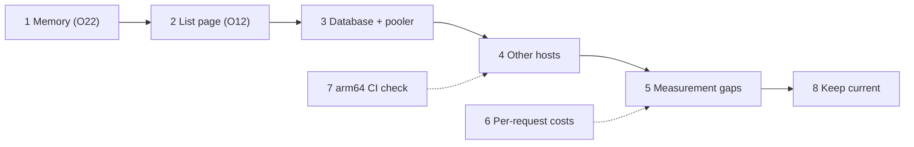

# Resource Profiling Follow-ups — Plan

**Status:** planned 2026-11-01, not started. Collects what [the resource profiling plan](completed/resource-profiling-plan.md) closed with still open or unmeasured (its findings register is [docs/performance.md](../performance.md)). **Decision tags:** every decision says `Decided by: User` or `Decided by: Agent`. Everything below is **Decided by: Agent** (a proposal) until the user signs it off; the order is a recommendation, and any phase can be dropped or reordered.

## Status / Resume Here

0 / 8 phases complete. Phases 1-3 are the ones that move the sizing numbers; 4-8 widen what is known or keep it current.

| # | Phase | Notes | Status |
|---|-------|-------|--------|
| 1 | Finish the memory work (O22) | Reports (rebuilt on another branch), the data a bundle collects, the T4 need above 9.5 GiB; re-size the limits | [ ] |
| 2 | The requirement list reads the whole project (O12) | The wall for large projects: capacity falls about 40% from 1,000 to 5,000 requirements; needs a design signed off first | [ ] |
| 3 | Database settings and the connection ceiling (O4, O10, O13, O15, O20) | A default for `shared_buffers`/`work_mem`; a pooler for more than six workers | [ ] |
| 4 | Smaller and other hosts | Pi with four workers, 4 GiB boards, the Dell's CPU cost (O23), the Dell at one worker | [ ] |
| 5 | Measurement gaps | Frontend page-load at T2/T3, attachments and organisation-owned records in the generators, frontend and MCP under load | [ ] |
| 6 | Per-request costs still open (O6, O7, O11, O19, O21) | Project import at 20,000, report PDF, per-project role reads, the first-request spike | [ ] |
| 7 | Close the first phase's loose end | The first real arm64 CI run and the manifest check after the first merge to `main` | [ ] |
| 8 | Keep the numbers current | A cadence for `perf/run_baseline.sh`, and what triggers an earlier run | [ ] |

## Decisions

- **No performance tests in CI** (**Decided by: User**, 2026-10-23, carried over): profiling is run by hand; only guards that pin behaviour (statement counts at two sizes, the generator's parity with the API, the memory limits, the anonymisation check) run in the main suite. Phase 8 therefore proposes a cadence, not a pipeline.
- **No Redis, no pooler by default** (**Decided by: Agent**, carried over): a cache was considered and not added; a pooler is untested and unsupported until Phase 3 changes the two connections that need a session.
- **Results stay out of the repository** (**Decided by: User**, 2026-11-01): `perf/results/` is git-ignored and only the website figures are committed.

## Phase 1 — Finish the memory work (O22)

**Why:** a backend worker keeps the memory of the heaviest request it has served, so the backend needs workers × that high-water, and the container limit has to cover it. The T3 record import/export spike is fixed (F22) and the project and organisation exports stream (F23): a T2 worker went from 1.67 to 0.91 GiB and a T3 worker from 2.33 to 1.50 GiB. Open: **reports** (1.1-2.4 GiB per worker at T3 before the other fixes; being rebuilt on another branch), **the data a bundle collects** (`collect_project_data` builds one dict per project, about 180 MiB of the remaining growth at 1,000 requirements), and **the need at 20,000 requirements**, where both worker counts reached the 9.3 GiB cap of the test and the organisation export failed there. **Risk addressed:** a backend killed by its limit during an export on a large project; limits sized too high for small hosts. **Outcome:** a measured per-worker high-water at each tier with the reports in, and limits and the sizing formula re-set from it.

- Re-run the report scenarios and the full mix at T2 and T3 once the reports rebuild has merged; compare with the 2026-10-29 sweep (commit f93d8abb).
- Turn each section of `collect_project_data` into a writer that streams into the bundle (the same approach as the exports), so a project's data is never one dict; keep the project and organisation bundle round trips green.
- Run T4 with a backend cap of 16 GiB or more to find the real need, on a host with the memory; record it as a number, not a floor.
- Tried and ruled out (do not repeat): `MALLOC_ARENA_MAX`, a collection plus `malloc_trim` after long requests, and worker recycling (`LIMIT_MAX_REQUESTS`, which returns memory between heavy requests but not the peak).
- Tests: a bound on the bytes a bundle holds or a statement-and-row guard for the new writers; the existing bundle round trips.

## Phase 2 — The requirement list reads the whole project (O12)

**Why:** the default ordering reads every row of a project for each page, so the page costs 18 ms at 30 requirements and 61 ms at 20,000 on the Linux server (185 ms on a Pi), and a six-worker stack delivers about 40% fewer requests per second at 5,000 requirements than at 1,000. A partial index was tested and changed nothing; only a structural change helps. **Risk addressed:** large single projects being the throughput wall, and the cost growing with the project for every page of every user. **Outcome:** a page whose cost does not grow with the project.

- Design first (**needs the user's sign-off**): keep a page's sort keys on one indexed table (the order held on the requirement), or page by a stored position. It is a schema change with a migration, a backfill and upkeep on every write; weigh it against how many people really work in projects of 5,000 or more.
- Measure before and after at T2, T3 and T4 with the capacity climb at T3.
- Tests: the existing page-cost guard, extended to the new ordering; behaviour tests for every sort and filter; the project bundle round trip.

## Phase 3 — Database settings and the connection ceiling (O4, O10, O13, O15, O20)

**Why:** `shared_buffers` 512 MB lifted the T3 cache hit rate from 73% to 99.99% but is advice only; `work_mem` 4 MB makes the bundle exports spill about 500 MiB each; and 97 connections allowed to clients is the wall for more than six workers, because the live-update listener and the startup lock use the request engine and cannot sit behind a transaction-mode pooler. **Risk addressed:** a deployment on defaults that is slower than it needs to be, and no route past six workers. **Outcome:** tested defaults the compose file sets (with the database memory limit following them), and a measured pooler configuration or a stated decision not to support one.

- Re-run the exports and the soak at `shared_buffers` 256, 512 MB and 1 GB and `work_mem` 16 and 32 MB; set the best as compose defaults, overridable, and size `DB_MEM_LIMIT` to match (the database reached 2.7 GiB at T4 and 1.7-2.7 GiB at T3 with 512 MB/16 MB).
- A direct connection URL for the two session connections, then a PgBouncer run at 8 and 12 workers (this changes access to the database: review against the SOC 2 policies and record it).
- Tests: the settings reach PostgreSQL; the session connections ignore the pooler URL.

## Phase 4 — Smaller and other hosts

**Why:** the minimum (2 cores, 4 GiB) is the smallest configuration measured, not a floor; the Raspberry Pi was measured at one worker only and its capacity run was held to half the board; the Dell costs 1.4 times the CPU per request of the Linux server and gets worse past four workers, which looks like the host and WSL2 but is unproven. **Risk addressed:** a minimum that is wrong in either direction, and a host-specific result read as a property of the application. **Outcome:** a measured floor, a Pi figure for the whole board, and a decision on the Dell.

- A 4 GiB board (a Pi 5 4 GB or a 4 GiB virtual machine) at one and two workers; the Pi at four workers (8 GiB); the Pi capacity climb with all four cores.
- The Dell workstation at one worker, and the same worker sweep on a second x86 Linux host, to see whether the Dell result is the machine.
- Record the host's available resources in the results as the docs now do.

## Phase 5 — Measurement gaps

**Why:** the generated data leaves out attachments and organisation-owned records; the browser rendering thousands of rows is a limit no API number shows; the frontend and MCP containers' memory comes from one idle snapshot. **Risk addressed:** a sizing page that describes the server and not what a person sees, and limits for two containers set from a guess. **Outcome:** those three measured.

- A Playwright-driven page load and scroll of the requirement list at T2 and T3 (time to interactive, DOM nodes).
- Attachments and organisation-owned records in the generators, through the registry hooks (no per-module edit to a core file), with the parity test.
- The frontend and MCP server under the capacity climb (add them to the perf stack's sampler).
- The two figures not drawn (latency against request rate; a flamegraph per finding) if the data exists by then.

## Phase 6 — Per-request costs still open (O6, O7, O11, O19, O21)

**Why:** each is small or conditional, so they were recorded and not fixed: project import is 80 s at 20,000 requirements (over the 30 s heavy budget); the report PDF takes 39 s at 20,000 (the reports rebuild may remove it); creates in one project serialise on its counter lock (about 14 a second); the link graph and activity timeline cost about ten statements per related project (`get_effective_permissions` reads module roles and grants per project); the first request after warm-up takes 400-700 ms. **Risk addressed:** a bad day for one user on a large project, or on a deeply nested tree. **Outcome:** each either fixed with a guard or closed with a stated reason.

- O19 is access-control code: batch the module-role and custom-grant reads for a set of projects, review against the access-control policy, and test the batched answers against the per-project ones.
- O6: bundle-scoped caches for the import (the tag list changes as the import creates tags).
- O21: log the first request per worker to see whether it is the imports, a cache or a connection.

## Phase 7 — Close the first phase's loose end

**Why:** the multi-arch images were built and tested locally, but the first real arm64 run in CI and the manifest check after the first merge to `main` were left to do, and a Raspberry Pi now relies on those images. **Risk addressed:** an arm image that builds and does not start, or a manifest without both platforms. **Outcome:** both checked and recorded.

- Confirm the CI arm64 leg runs on a pull request, and after a merge `docker buildx imagetools inspect` shows both platforms for the `sha`, `semVer` and `latest` tags; pull and start on an arm host.

## Phase 8 — Keep the numbers current

**Why:** a measurement goes stale with every module, record type and feature, and a process that is a chore is not repeated. **Risk addressed:** sizing guidance that quietly stops matching the product. **Outcome:** an agreed cadence and trigger list, and the comparison one command.

- Proposal (**Decided by: Agent**): run `perf/run_baseline.sh` on the Linux server before a release that changes any trigger (a new module or record type, a change to a list, report, export or search path, a migration on a large table, a Python, PostgreSQL or uvicorn major version, a change to workers or the pool), compare with `perf/compare.py`, update `docs/performance.md`, then the two website pages and the figures (`perf/plot_results.py`).
- Not proposed: a scheduled job in CI (decided against above). A scheduled run on a spare host, reporting a regression to the user, is possible later and is the user's call.

## Standing checklist per phase

- A change that moves a number updates `docs/performance.md` first, then the sizing page, the README and the figures.
- A fix has a guard that outlives the run (a deterministic test, not a timing) and a before/after at the same tier and host.
- Record each decision in `docs/decisions.md` with a **Decided by** tag; no source file names this plan.

## Risks

- **Reports are on another branch**, so Phase 1 waits for it; the tools are on that branch only if it has merged `perf/`.
- **The server is shared with production**, so heavy runs need a quiet window and the watchdog; T4 with a 16 GiB cap needs the host's agreement.
- **Synthetic data** bounds a deployment and does not predict it; a real instance's shape (mean and maximum links per record) can be supplied without content.

When the table reads 8/8: move this file to `docs/plans/completed/` and run `scripts/check_doc_links.py` (see CLAUDE.md "Plan Lifecycle").
