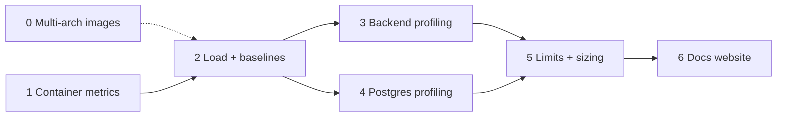

# Resource Profiling (Memory / CPU) — Plan

**Status:** planned 2026-10-12, not started. **Decided by: User** (2026-10-12): wants the ability to profile the stack, scheduled for when no feature is in flight. Everything below about *which tools* and *phase order* is **Decided by: Agent** until the user signs off. **Decided by: User** (2026-10-12): the primary host is Docker Desktop on the user's Mac, and results are about *relative* performance; the same tests must also run on a Linux VM and probably a Raspberry Pi via a script, with outputs stored in the project so reports can be built from all hosts together.

## Status / Resume Here

0 / 7 phases complete (Phase 0 is a prerequisite for the Raspberry Pi runs, not for the rest). Phases 2–4 each save their results under `perf/results/<host-label>/<date>-<commit>/` (summarised CSV/JSON) so Phase 6 can plot them; each phase is independently useful, so stopping after any one is fine.

| # | Phase | Status |
|---|-------|--------|
| 0 | Multi-arch (amd64 + arm64) production images in CI | [ ] |
| 1 | Container-level metrics (cAdvisor → Prometheus → Grafana) | [ ] |
| 2 | Load generator and baseline scenarios | [ ] |
| 3 | In-process profiling of the backend (memory + CPU) | [ ] |
| 4 | PostgreSQL profiling | [ ] |
| 5 | Record baselines, set limits, document sizing | [ ] |
| 6 | Docs website: results, plots, test-method diagrams | [ ] |

## 1. Why, and what exists today

**Why:** the stack's RAM need is currently unknown beyond a one-off `docker stats` snapshot (idle: backend ~1.25 GiB, Postgres ~340 MiB, SeaweedFS ~120 MiB, MCP ~57 MiB, frontend ~11 MiB). No compose service has a memory limit and no doc states a requirement. **Risk addressed:** undersized hosts OOM-killing the backend, unnoticed memory leaks, and a worker count (`BACKEND_WORKERS`, default 4) chosen without evidence. **Outcome:** measured idle/loaded/soak baselines per service, evidence-based `mem_limit`s and sizing guidance, and a repeatable way to find *where* memory or CPU goes.

What exists: the `observability` compose profile (Prometheus, Loki, Tempo, Alloy, Grafana), a Prometheus-compatible `/metrics` on the backend (multi-process mode, request count/latency only), and Alloy with Docker socket access. What is missing: any per-container CPU/memory series, any load generator, any in-process profiler.

**Hypothesis to test first (unproven):** the backend's ~1.25 GiB at idle is mostly 4 × ~300 MB of duplicated imports. `uvicorn --workers N` starts each worker as a separate process that imports the whole app (including every module's models/routers) independently, so nothing is shared copy-on-write. If confirmed, the cheapest win is fewer workers or a pre-fork server (gunicorn with `--preload` and uvicorn workers). Phase 3 confirms or refutes this before any change is made. Note the entrypoint's startup-lock/leader-election design (`process_coordination.py`) would need re-checking under `--preload`.

## 1a. Phase 0 — Multi-arch images in CI

**Why:** CI's `docker-build` job (`.github/workflows/ci.yml`) builds backend, frontend and mcp-server for amd64 only, on one `ubuntu-latest` runner, and pushes `semVer`/`sha`/`latest` tags to ghcr.io. A Raspberry Pi (arm64) cannot pull a usable image, so it must build everything from source, which is slow, memory-hungry and itself distorts the Pi measurements. Apple-silicon Macs and arm cloud instances have the same gap. **Risk addressed:** an arm host silently running amd64 images under emulation (or failing to pull), and arm-only build breakage going unnoticed. **Outcome:** each image tag is a multi-arch manifest (`linux/amd64` + `linux/arm64`), so `docker compose pull` gets the right image on any host, and an arm64 build or smoke-test failure fails CI.

- **Approach (Decided by: Agent):** build each platform on a **native** runner and merge, rather than QEMU emulation on one runner. Emulated arm64 builds of the backend (pip) and frontend (npm build) typically run several times slower and would risk the job's 20-minute timeout. Matrix `{amd64: ubuntu-latest, arm64: ubuntu-24.04-arm}`; each leg runs `docker/build-push-action` with `platforms`, pushes **by digest** (`outputs: type=image,push-by-digest=true`) and uploads the digest as an artifact; a final `merge` job runs `docker buildx imagetools create` to assemble the existing `semVer`, `sha` and `latest` tags as manifest lists. Fallback if native arm runners are unavailable: `docker/setup-qemu-action` with a single multi-platform build, accepting the slowdown (and raising `timeout-minutes`).
- **Check before building:** whether this repository gets free standard arm64 runners (they are free for public repositories; confirm the repo's visibility and plan, and the current runner label, rather than assuming), and what `gittools` GitVersion needs on arm (compute the version once in an earlier job and pass `semVer` to the matrix as an output, instead of installing it per leg).
- **Per-platform build cache:** scope the GHA cache per platform (`cache-from/to: type=gha,scope=<image>-<arch>`) so one arch does not evict the other.
- **Third-party base images must have arm64 variants.** Verify each with `docker buildx imagetools inspect`: `python:3.12-slim`, `node:24-alpine`, `nginx:1.27-alpine`, `postgres:16-alpine`, `chrislusf/seaweedfs:3.97`, plus the optional services in the dev/test compose files (MailHog's upstream image is known to be amd64-only, so it needs an arm-capable replacement or to be excluded from arm runs). Also confirm no Python dependency in `backend/requirements.txt` or `mcp-server` lacks a `manylinux`/`aarch64` wheel (a source build would add compilers to the image or fail).
- **Test scope (Decided by: User, 2026-10-12):** unit, backend and Playwright e2e tests stay amd64-only. The arm64 leg adds one **smoke test**, because users are expected to self-host on Raspberry Pis, so an arm image that builds but does not start is a user-facing failure. Accepted gap: the full test suite is not run on arm.
- **Arm smoke test:** in the arm64 leg, build each image with `load: true`, then on the same native runner: start the backend against a Postgres container (arm64 `postgres:16-alpine`), wait for the container healthcheck, hit `/health`, and make one authenticated API call (login then a list endpoint) to exercise bcrypt/psycopg/cryptography on arm; start the frontend image and fetch `/` and one static asset; start the mcp-server image and check it boots (`python -c "import ..."` plus its own healthcheck if it has one). Only after it passes does the leg push the digest (on `main`) for the merge job, so a broken arm image can never receive the `latest`/`semVer`/`sha` tags. Runs on PRs too (build-only, no push). Use the same seeded-admin/env approach the existing backend test harness uses, rather than a new bootstrap path; budget a few minutes on the arm runner and set the job `timeout-minutes` accordingly.
- **Known limit of the smoke test:** GitHub's arm runners use 4 KB memory pages, whereas a Raspberry Pi 5 uses 16 KB pages, which some allocators and native libraries mishandle. CI cannot catch that; the Phase 2 Pi runs are the check for it. Document supported Pi models, the 64-bit OS requirement (arm64 images do not run on 32-bit Raspberry Pi OS) and minimum RAM (from this plan's measurements) on the website's quick-start/production-deployment pages.
- **Build and publish rules (Decided by: User, 2026-10-12):** both architectures build (and the arm leg smoke-tests) on every run, PRs included, exactly like amd64 does today (no path filter). Images are pushed only on `main`, as the existing job already gates it (`push: github.event_name != 'pull_request'`); PR builds are build-only.
- **Compose:** the `image:` + `build:` pairs in `docker-compose.yml` already name the ghcr images, so `docker compose pull` on a Pi gets arm64 with no compose change. Update the header comment there, and make `perf/run_profile.sh` prefer `pull` over a local build when the tagged manifest includes the host's architecture (building locally only as a fallback and recording which was used in `run.json`, since it changes the Pi's memory profile).
- **Docs and records:** update the `ci.yml` header comment (job list and the new matrix/merge jobs), the README and `docs/development.md` (supported architectures, how to pull on arm), the website's production-deployment/quick-start pages (supported platforms), and add a `docs/decisions.md` entry (native runners vs QEMU, arm smoke-test scope, amd64-only full tests) with **Decided by** tags. Supply chain: pin the new actions by major version like the existing ones, keep `packages: write` scoped to the push/merge jobs only, and consider provenance/SBOM attestations as a later option (check `docs/soc2/policies/` vendor and change-management sections).
- **Verification:** on a PR, both build legs pass without pushing; after the first merge to `main`, confirm the manifest list with `docker buildx imagetools inspect ghcr.io/<repo>-backend:<sha>` shows both platforms; on an arm host `docker compose pull && docker compose up` reaches healthy; a deliberately arm-broken change (e.g. an amd64-only wheel, or a broken entrypoint) fails the arm leg, and a failing smoke test prevents the digest push.

## 2. Phase 1 — Container-level metrics

**Why:** answers "how much does each service use over time?" without touching application code. **Risk:** point-in-time `docker stats` hides peaks and growth. **Outcome:** per-container memory (working set, RSS), CPU, restart/OOM counts in Grafana.

- Add `cadvisor` to the `observability` profile (read-only mounts of `/`, `/var/run`, `/sys`, `/var/lib/docker`); add a scrape job to [observability/prometheus.yml](../../observability/prometheus.yml).
- Add a provisioned Grafana dashboard: memory working set and CPU per container, backend per-worker RSS, Postgres connection count, OOM-kill/restart count.
- Per-worker RSS: `prometheus_client` multiprocess mode does not export the process collector, so add a small gauge (`process_resident_memory_bytes` labelled by worker pid) in `app/metrics.py` using `psutil` or `/proc/self/statm`.
- Caveat to document: on Docker Desktop (macOS/Windows) numbers describe the Linux VM, and the VM's size caps everything.
- **Security:** cAdvisor needs broad host mounts; keep it inside the `observability` profile, bound to localhost, never in the production compose path by default.

## 3. Phase 2 — Load generator and baselines

**Why:** idle numbers say little; leaks and per-request cost only show under traffic. **Risk:** measuring against an empty database understates real usage. **Outcome:** repeatable scenarios producing comparable numbers across commits.

- Use **Locust** (Python, same language and auth helpers as the backend tests) under `perf/`, not in the app image. Scenarios run against the seeded `seed_e2e_dataset.py` data, plus a larger generated dataset (e.g. 10k requirements) to expose list/report/export cost.
- Scenarios: browse (project/requirement lists, search), edit (create/update with versioning + audit), heavy (report generation, bundle export/import, attachment upload), and a 30–60 min **soak** at steady request rate to detect leaks (memory slope after warm-up).
- Login is bcrypt-heavy (see the login timeout exemption); authenticate once per simulated user and reuse the token so the test measures the API, not password hashing.
- Record: p50/p95/p99 latency, throughput, memory slope per container, error rate. Save summarised results through the portable runner below (CSV/JSON, no raw request logs) in the format Phase 6's plotting script reads.
- Never point it at anything but the local/test stack.

### Portable runner and results store (multi-host)

**Why:** the user wants the same tests on Docker Desktop (Mac), a Linux VM and probably a Raspberry Pi, compared relatively. **Risk addressed:** hand-run, differently-configured runs that cannot be compared. **Outcome:** one command per host produces a self-describing results bundle that is dropped into the repo and merged into reports.

- `perf/run_profile.sh <host-label>` (POSIX sh + Python only; needs just Docker, Compose and Python 3, so it works on a bare Pi): preflight (Docker/Compose versions, CPU arch and cores, RAM, Docker VM allocation if any, free disk, storage type if detectable), build and start the plain stack (no observability profile; the Pi cannot afford Grafana/Loki/Tempo), seed the fixed dataset, run each scenario N times (default 3, for variance), sample per-container memory and CPU with its own `docker stats` sampler (so results never depend on Phase 1's cAdvisor), then write the bundle and a `.tar.gz` to copy back.
- Bundle layout, committed under `perf/results/<host-label>/<date>-<commit>/`: `host.json` (arch, cores, RAM, VM allocation, OS, Docker version, storage type, CPU governor/throttle notes), `run.json` (commit, scenario set, dataset size, `BACKEND_WORKERS`, repeat count, schema version), `samples.csv` (container, timestamp, memory, CPU), `latency.csv` (scenario, percentile, rate, run), `pgstat.csv`. A schema version field lets the reporter reject or migrate old bundles.
- `<host-label>` is free text but must be stable (e.g. `mac-docker-desktop`, `linux-vm-4c8g`, `rpi5-8g`); `perf/results/README.md` lists known labels and what each host is.
- Hosts differ in ways that can make the comparison wrong, so the runner records and the reports state them: **Mac** (Docker Desktop VM allocation fixed and recorded; do not change it between runs; close other heavy apps), **Linux VM** (record vCPU/RAM and that it is virtualised), **Raspberry Pi** (arm64: once Phase 0 lands the images are pulled, otherwise they are built locally from source, which is slow and itself memory-hungry; SD card vs SSD I/O is a large factor; record thermal throttling by sampling `vcgencmd get_throttled`, and use active cooling or discard throttled runs).
- Same commit, same dataset, same scenarios and same `BACKEND_WORKERS` across hosts, or the runner flags the bundle as non-comparable. Do not compare absolute latency across hosts of different CPU architecture without saying so; the headline comparison is each host's numbers relative to the others, plus absolute memory per service.
- `perf/results/` stays small (summarised CSV/JSON, no raw request logs, no real data); large artefacts such as flamegraphs go in as SVG only.

### Anonymised outputs (binding for every bundle)

**Why:** results are committed to the repo and published on the website, and the tools that gather them read identifying data by default (`docker info` includes the hostname and daemon ID, `/proc/cpuinfo` on a Pi includes the board's serial number, container names inherit the checkout directory, tar headers carry usernames, profilers capture paths and arguments). **Risk addressed:** leaking hostnames, usernames, serials, IPs/MACs, home paths or secrets into a public repository (SOC 2 data classification and confidentiality policies apply; check `docs/soc2/policies/` before implementing). **Outcome:** a bundle contains only measurements and generic host characteristics, enforced by construction and by a check, not by care.

- **Allowlist, never denylist:** the runner builds `host.json`/`run.json` from explicitly named fields only (arch, core count, RAM size, Docker VM allocation, OS family and major version, Docker/Compose version, storage class such as `ssd`/`sd-card`/`network`, CPU model reduced to a generic family, e.g. "Apple/Intel/ARM Cortex-A76 class"). It never copies raw output from `docker info`, `uname -a`, `hostname`, `/proc/cpuinfo`, `system_profiler`, `ip addr`, `env` or `git log`.
- **Never recorded:** hostname, username, home or checkout paths, serial numbers (board, disk, machine), MAC/IP addresses, Docker daemon/container/image IDs, registry credentials, environment variables, git author/committer, branch names, local-only tags, dirty-tree diffs. The commit hash is recorded (public repo); if the working tree is dirty or the commit is not on a public branch, the run is marked `non-publishable`.
- **Coarsened timestamps:** date only in file names and `run.json`; `samples.csv` uses seconds since run start, not wall-clock time.
- **Neutral runtime names:** the runner always uses a fixed compose project name (`reqtrack-perf`) and generic service names, so container, network and volume names cannot embed the checkout directory or user. Container hostnames and IDs are not logged.
- **Host label:** validated against `^[a-z0-9][a-z0-9-]{2,30}$`, and rejected if it equals or contains the machine's hostname or the current username. Choose a generic label (`rpi5-8g`), not a name you gave the machine.
- **Archive:** created with `tar --numeric-owner --owner=0 --group=0` and normalised mtimes so no username/uid or timestamps ride along.
- **Profiler output:** flamegraphs and `memray`/`py-spy` output go through a scrub step that strips absolute paths outside `/app`, environment and argument values, and SQL literals (`pg_stat_statements` normalises literals by default; keep it that way and never export `pg_stat_activity` query text). Only SVG summaries are committed, never raw profile or heap dumps.
- **Fixed synthetic data:** the load dataset is the fixed generated one (no real user names, emails or tenant data); the bundle records its size and seed only.
- **`perf/scrub_check.py`:** scans a bundle (and `perf/results/` in general) and fails on the machine's own hostname and username, home-directory prefixes (`/Users/`, `/home/`), MAC/IPv4/IPv6 patterns, email addresses, serial-number patterns, 32/64-char hex IDs, and common token shapes, plus any file or field outside the allowlist. The runner runs it before creating the archive and refuses to produce one on failure; it also runs as a repo test (so a bad bundle committed by hand fails CI) and in the pre-commit hook when `perf/results/` is staged.
- **Tests:** a unit test feeds the collector deliberately identifying fixture output (hostname, serial, MAC, path, username) and asserts none survive; another asserts `scrub_check.py` fails on each category.
- Record the policy in `docs/decisions.md` (**Decided by: User**, 2026-10-12) and, once built, note the control in the data-classification policy's relevant section.

## 4. Phase 3 — In-process backend profiling

**Why:** container metrics say *that* memory is high; this says *where*. **Risk:** profilers in a production image add attack surface and overhead. **Outcome:** an attributable memory and CPU breakdown for the backend.

| Question | Tool | How |
|----------|------|-----|
| What does a worker hold at idle (imports vs data)? | `memray` (or `tracemalloc` snapshot diff) | Run one worker under `memray run`; flamegraph by allocation site. Compare 1 vs 4 workers' total RSS to test the duplicated-imports hypothesis. |
| Is something leaking under load? | `memray` + soak; `tracemalloc` top diffs | Snapshot after warm-up and after the soak; diff by line. |
| Where is CPU going? | `py-spy record` (sampling, no code change) | Attach to a worker pid during a load scenario; speedscope/flamegraph output. |
| Which request/handler is slow? | `pyinstrument` as optional ASGI middleware | Dev/profile only, behind an env flag, off by default. |
| Are N+1 queries involved? | SQLAlchemy query-count/timing event hook | Log count and total time per request in profile mode. |

- Provide `docker-compose.profile.yml` (override file) that adds the profiling extras, `cap_add: SYS_PTRACE` for `py-spy`, and a writable output volume. The base and production images stay unchanged: tools are installed in the override's build target or via `docker compose exec ... pip install`, never in the production image.
- Any profiling endpoint or middleware must be disabled unless an explicit env flag is set, and must not exist in the production compose path (policy: no new unauthenticated surface).
- Output: a short written finding listing the top allocation sites and the worker-count conclusion.

## 5. Phase 4 — PostgreSQL profiling

**Why:** connections × workers and query shape dominate DB memory and latency. **Risk:** default Postgres settings are tuned for tiny hosts, and an unbounded pool × 4 workers can exhaust `max_connections`. **Outcome:** known connection budget and a list of the slowest/most frequent queries.

- Enable `pg_stat_statements` in the profile override; report top queries by total time and calls after each load scenario.
- Check connection count per worker against `max_connections`; document the pool settings and the formula (workers × pool size + overflow) in the sizing guidance.
- `EXPLAIN (ANALYZE, BUFFERS)` on the worst few; add indexes via normal migrations if justified (migration ids are one global sequence across core and module directories).
- Review `shared_buffers`/`work_mem` against the measured working set; do not tune blindly.

## 6. Phase 5 — Baselines, limits, documentation

**Why:** without recording the results and acting on them, profiling is a one-off. **Risk:** limits set from guesses either OOM-kill a healthy service or protect nothing. **Outcome:** published sizing and enforced headroom.

- New `docs/performance.md`: how to run Phases 1–4 (with a Mermaid diagram of the tooling), recorded baseline table (idle / load / soak per service, date, commit, dataset size), and interpretation notes.
- Set `mem_limit` (or `deploy.resources`) per service in `docker-compose.yml` at roughly measured peak + 30–50 % headroom, with `BACKEND_WORKERS` guidance tied to RAM (e.g. MB per extra worker).
- Add a "Sizing" section to the README and the deployment docs. The website pages are built in Phase 6.
- Optional follow-up (propose, don't assume): a CI smoke check that fails if idle backend RSS grows more than a set percentage over the recorded baseline. CI currently has no performance gate, so this is a new control, not a fix.
- Record the outcome and any worker-model change in [docs/decisions.md](../decisions.md) with a **Decided by** tag.

## 7. Phase 6 — Docs website: results, plots, test-method diagrams

**Why:** results kept only in a repo markdown file or a Grafana instance nobody else has running are invisible to the people sizing a deployment, and a bare number with no method behind it cannot be trusted or reproduced. **Risk addressed:** unsupported sizing claims and stale figures (the website is a separate published artifact that is not updated by repo docs alone, per `CLAUDE.md`'s "Docs Website Maintenance"). **Outcome:** a reader can see how the stack was tested, see the measured results as plots, and size a host from them, and can re-run the same tests.

**Pages** (in `docs/website/docs/`, Docusaurus, following the existing front-matter and tone):

| Page | Section | Content |
|------|---------|---------|
| Sizing and performance | Installation & Deployment (beside `scaling-and-modules.md`, `observability.md`) | Headline sizing table (minimum / recommended RAM and CPU by deployment size), per-service memory at idle/load/soak, `BACKEND_WORKERS` guidance, the plots below, and the measurement date, commit and dataset size. Cross-link from `scaling-and-modules.md`'s "Scaling the backend" and from `observability.md`. |
| Performance testing method | Reference | How the stack is tested and profiled: the diagrams below, the tools, the scenarios, how to reproduce, how to read a flamegraph or soak plot, and known limits of the numbers. |

**Diagrams (Mermaid, validated before finalising per `CLAUDE.md`):**

- *Test topology*: the load generator, the stack under test (frontend, backend workers, Postgres, SeaweedFS, MCP), and the measurement path (cAdvisor and the backend gauge to Prometheus to Grafana; `py-spy`/`memray` attached to a worker; `pg_stat_statements`). Shows which numbers come from which collector.
- *Run sequence* (sequence diagram): seed dataset, warm-up, scenario, soak, snapshot, teardown; marks where memory is sampled and where profilers attach.
- *Sizing decision flow*: from user/requirement count and concurrency, to worker count, to RAM per service, to host size.
- *Phase/tooling map*: which question each tool answers (the Phase 3 table, as a diagram).

**Plots (generated from recorded data, not hand-drawn):**

- Raw results are committed as CSV/JSON under `perf/results/<host-label>/<date>-<commit>/` (see Phase 2's runner; small, summarised time series; never raw request logs or anything containing data from a real tenant).
- `perf/plot_results.py` (matplotlib) reads every host's latest comparable bundle (same commit and dataset; it refuses to mix incomparable ones and says why) and turns them into SVGs in `docs/website/static/img/performance/`, so figures regenerate with one command and diff cleanly. Mermaid is for structure and flow; its `xychart` is not used for measured time series because it cannot carry hundreds of points or confidence bands.
- Load the `dataviz` skill before writing the plotting code: colour-blind-safe palette, light and dark variants (the site themes both; a figure must be legible in each, so emit two SVGs or use `currentColor`/CSS variables), labelled axes with units, and alt text on every image.
- Plots are per host, side by side, with a relative view (each host normalised to the Mac baseline) as well as absolute values, error bars from the repeated runs, and each host's spec in the caption: (1) stacked memory per service at idle vs load vs soak; (2) backend memory vs time during the soak, with the post-warm-up slope annotated; (3) memory vs `BACKEND_WORKERS` (1, 2, 4, 8) with the duplicated-imports result; (4) p50/p95/p99 latency vs request rate per scenario; (5) top Postgres queries by total time; (6) one `py-spy`/`memray` flamegraph per finding, as a static SVG.
- Each plot carries a one-line caption stating what it shows and the conclusion drawn from it (README screenshots are exempt from this, plots are not, because they convey data).

**Keeping it honest and current:**

- Every figure and table is stamped with date, commit, host label and spec, and dataset size. A page that cannot be reproduced from `perf/` is not published.
- `docs/performance.md` (Phase 5) stays the in-repo source; the website pages are written from it and link back to it, so there is one set of numbers, not two.
- Add a "re-measure when" note listing triggers (new module, changed worker model, Postgres/Python major bump) and add a line to `CLAUDE.md`'s docs-website check pointing at these two pages, so later changes that move the numbers prompt an update.
- Security: only anonymised bundles (see Phase 2, "Anonymised outputs") are plotted or published; the plot script re-runs `scrub_check.py` on its inputs and refuses to proceed on a failure, and the website build must never read from anything outside `perf/results/`.
- Verification: `cd docs/website && npm run build` with zero broken-link/anchor errors, both themes checked in `npm run serve`, and the plot script re-run from the committed CSV reproduces the committed SVGs. No new Playwright UI work is needed because this is static content in an existing site, but check whether the site has a smoke spec that should cover the new pages.

## 8. Risks and open questions

- **Docker Desktop vs Linux vs Pi:** Docker Desktop numbers describe the Linux VM it runs, not the Mac. Memory per service is still valid; CPU, latency and disk I/O depend on the VM and host. This is why the comparison is relative and every result states its host. A Linux VM run is still the closest to a typical server deployment, so the sizing table's recommended figures should cite it.
- **Moving to a pre-fork server** (if the hypothesis holds) touches startup coordination and Prometheus multi-process setup — treat as its own change with tests, not a profiling side effect.
- **Open (needs user input before Phase 2):** target scale (users, projects, requirements) the baseline dataset should represent, and whether CI should ever gate on performance.
