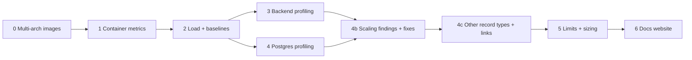
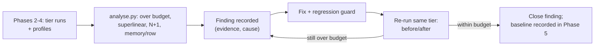
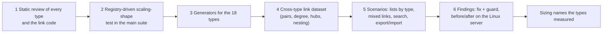

# Resource Profiling (Memory / CPU) — Plan

**Status:** planned 2026-10-12, not started. **Decided by: User** (2026-10-12): wants the ability to profile the stack, scheduled for when no feature is in flight. Everything below about *which tools* and *phase order* is **Decided by: Agent** until the user signs off. **Decided by: User** (2026-10-12): the primary host is Docker Desktop on the user's Mac, and results are about *relative* performance; the same tests must also run on a Linux VM and probably a Raspberry Pi via a script, with outputs stored in the project so reports can be built from all hosts together. **Decided by: User** (2026-10-23): (a) profiling must run at varying data volumes, not only the seed set, including projects with hundreds to thousands of requirements; (b) the results must be used to find scaling problems and drive fixes, not only be recorded; (c) the whole process must be cheap to repeat later so numbers can be refreshed as the product grows. **Decided by: User** (2026-10-23, follow-up): tiers must also scale other record types (pain points, decisions and so on) and link density; test multiple organisations and nested projects (which multiply the volume a parent reads); many projects per organisation matters most; 20,000 requirements is the ceiling for now; CI does not run these performance tests. The dataset tiers, Phase 4b and the re-run process below implement this; their specific mechanisms are **Decided by: Agent** until signed off. **Decided by: User** (2026-10-23, later): the profile must be runnable on a production server without affecting production data or the production stack (see "Safe to run on a production host"). **Decided by: User** (2026-10-23, sign-off): the tooling (Locust, memray, py-spy, optional dev-only pyinstrument, pg_stat_statements, cAdvisor in the observability profile only) is approved; the dataset generator inserts in bulk with an API parity test; budgets start as provisional targets and are refined with a recorded reason; work starts with Phase 0 (multi-arch images), then Phases 1–4b.

## Status / Resume Here

6 / 9 phases complete (Phase 4c, other record types and the links between them, added 2026-10-27 (**Decided by: User**: linking records of different types is a key reason for using the product, so its performance must be reviewed properly, not inferred from requirements alone); it sits between 4b and 5 so the sizing covers it (**Decided by: Agent**); Phase 4 built 2026-10-25, see its decisions entry for the findings, the `GENERIC_PLAN` deviation and the new pool settings; Phase 3 built 2026-10-25, see its decisions entry for the worker-memory and N+1 findings and the three bugs found on the way; CI test duration moved to its own plan, [ci-test-duration-plan.md](ci-test-duration-plan.md) (**Decided by: User**, 2026-10-27); Phase 0 built 2026-10-25; its real arm64 CI run and the merge-to-`main` manifest check are still to do, see its entry in `docs/decisions.md`; Phase 1 built 2026-10-25, see its decisions entry for what was and was not verified; Phase 2 built 2026-10-25 and run end to end on Docker Desktop at T0 and T1, with the Linux, Raspberry Pi and larger-tier runs, the module-type generators, attachments and the frontend page-load scenario still to do: see its decisions entry). Phase 4b done 2026-10-27 (ten findings fixed and verified, including the pool/thread stall found by the capacity scenario). Next: Phase 5 (baselines, limits, sizing). **Start order (Decided by: User, 2026-10-23): Phase 0 first**, so arm64 images exist before any Pi run; it does not block the other phases, which can follow in order 1, 2, 3, 4, 4b, 5, 6. Phases 2–4 each save their results under `perf/results/<host-label>/<date>-<commit>/` (summarised CSV/JSON) so Phase 6 can plot them; each phase is independently useful, so stopping after any one is fine. Every scenario runs at every dataset tier (see "Dataset tiers"), so results are keyed by data volume as well as host.

| # | Phase | Status |
|---|-------|--------|
| 0 | Multi-arch (amd64 + arm64) production images in CI | [x] built 2026-10-25; awaiting first CI run |
| 1 | Container-level metrics (cAdvisor → Prometheus → Grafana) | [x] built 2026-10-25 |
| 2 | Load generator and baseline scenarios | [x] built 2026-10-25; T0/T1 run on Docker Desktop |
| 3 | In-process profiling of the backend (memory + CPU) | [x] built 2026-10-25 |
| 4 | PostgreSQL profiling | [x] built 2026-10-25 |
| 4b | Scaling findings and fixes | [x] done 2026-10-27: F1-F10 fixed with guards and verified on the Linux server; open items O4, O6-O10 are recorded in `docs/performance.md` with their next step |
| 4c | Other record types and the links between them | [ ] |
| 5 | Record baselines, set limits, document sizing | [ ] |
| 6 | Docs website: results, plots, test-method diagrams | [ ] |

## 1. Why, and what exists today

**Why:** the stack's RAM need is currently unknown beyond a one-off `docker stats` snapshot (idle: backend ~1.25 GiB, Postgres ~340 MiB, SeaweedFS ~120 MiB, MCP ~57 MiB, frontend ~11 MiB). No compose service has a memory limit and no doc states a requirement. **Risk addressed:** undersized hosts OOM-killing the backend, unnoticed memory leaks, and a worker count (`BACKEND_WORKERS`, default 4) chosen without evidence. **Outcome:** measured idle/loaded/soak baselines per service, evidence-based `mem_limit`s and sizing guidance, and a repeatable way to find *where* memory or CPU goes.

What exists: the `observability` compose profile (Prometheus, Loki, Tempo, Alloy, Grafana), a Prometheus-compatible `/metrics` on the backend (multi-process mode, request count/latency only), and Alloy with Docker socket access. What is missing: any per-container CPU/memory series, any load generator, any in-process profiler.

**Hypothesis to test first (unproven):** the backend's ~1.25 GiB at idle is mostly 4 × ~300 MB of duplicated imports. `uvicorn --workers N` starts each worker as a separate process that imports the whole app (including every module's models/routers) independently, so nothing is shared copy-on-write. If confirmed, the cheapest win is fewer workers or a pre-fork server (gunicorn with `--preload` and uvicorn workers). Phase 3 confirms or refutes this before any change is made. Note the entrypoint's startup-lock/leader-election design (`process_coordination.py`) would need re-checking under `--preload`.

## 1a. Phase 0 — Multi-arch images in CI

**Why:** CI's `docker-build` job (`.github/workflows/ci.yml`) builds backend, frontend and mcp-server for amd64 only, on one `ubuntu-latest` runner, and pushes `semVer`/`sha`/`latest` tags to ghcr.io. A Raspberry Pi (arm64) cannot pull a usable image, so it must build everything from source, which is slow, memory-hungry and itself distorts the Pi measurements. Apple-silicon Macs and arm cloud instances have the same gap. **Risk addressed:** an arm host silently running amd64 images under emulation (or failing to pull), and arm-only build breakage going unnoticed. **Outcome:** each image tag is a multi-arch manifest (`linux/amd64` + `linux/arm64`), so `docker compose pull` gets the right image on any host, and an arm64 build or smoke-test failure fails CI.

- **Approach (Decided by: Agent):** build each platform on a **native** runner and merge, rather than QEMU emulation on one runner. Emulated arm64 builds of the backend (pip) and frontend (npm build) typically run several times slower and would risk the job's 20-minute timeout. Matrix `{amd64: ubuntu-latest, arm64: ubuntu-24.04-arm}`; each leg runs `docker/build-push-action` with `platforms`, pushes **by digest** (`outputs: type=image,push-by-digest=true`) and uploads the digest as an artifact; a final `merge` job runs `docker buildx imagetools create` to assemble the existing `semVer`, `sha` and `latest` tags as manifest lists. Fallback if native arm runners are unavailable: `docker/setup-qemu-action` with a single multi-platform build, accepting the slowdown (and raising `timeout-minutes`).
- **Check before building:** whether this repository gets free standard arm64 runners (they are free for public repositories; confirm the repo's visibility and plan, and the current runner label, rather than assuming), and what `gittools` GitVersion needs on arm (compute the version once in an earlier job and pass `semVer` to the matrix as an output, instead of installing it per leg).
- **Per-platform build cache:** scope the GHA cache per platform (`cache-from/to: type=gha,scope=<image>-<arch>`) so one arch does not evict the other.
- **Third-party base images must have arm64 variants.** Verify each with `docker buildx imagetools inspect`: `python:3.12-slim`, `node:24-alpine`, `nginx:1.30-alpine`, `postgres:16-alpine`, `chrislusf/seaweedfs:3.97`, plus the optional services in the dev/test compose files (MailHog's upstream image is known to be amd64-only, so it needs an arm-capable replacement or to be excluded from arm runs). Also confirm no Python dependency in `backend/requirements.txt` or `mcp-server` lacks a `manylinux`/`aarch64` wheel (a source build would add compilers to the image or fail).
- **Test scope (Decided by: User, 2026-10-12):** unit, backend and Playwright e2e tests stay amd64-only. The arm64 leg adds one **smoke test**, because users are expected to self-host on Raspberry Pis, so an arm image that builds but does not start is a user-facing failure. Accepted gap: the full test suite is not run on arm.
- **Arm smoke test:** in the arm64 leg, build each image with `load: true`, then on the same native runner: start the backend against a Postgres container (arm64 `postgres:16-alpine`), wait for the container healthcheck, hit `/health`, and make one authenticated API call (login then a list endpoint) to exercise bcrypt/psycopg/cryptography on arm; start the frontend image and fetch `/` and one static asset; start the mcp-server image and check it boots (`python -c "import ..."` plus its own healthcheck if it has one). Only after it passes does the leg push the digest (on `main`) for the merge job, so a broken arm image can never receive the `latest`/`semVer`/`sha` tags. Runs on PRs too (build-only, no push). Use the same seeded-admin/env approach the existing backend test harness uses, rather than a new bootstrap path; budget a few minutes on the arm runner and set the job `timeout-minutes` accordingly.
- **Known limit of the smoke test:** GitHub's arm runners use 4 KB memory pages, whereas a Raspberry Pi 5 uses 16 KB pages, which some allocators and native libraries mishandle. CI cannot catch that; the Phase 2 Pi runs are the check for it. Document supported Pi models, the 64-bit OS requirement (arm64 images do not run on 32-bit Raspberry Pi OS) and minimum RAM (from this plan's measurements) on the website's quick-start/production-deployment pages.
- **Build and publish rules (Decided by: User, 2026-10-12):** both architectures build (and the arm leg smoke-tests) on every run, PRs included, exactly like amd64 does today (no path filter). Images are pushed only on `main`, as the existing job already gates it (`push: github.event_name != 'pull_request'`); PR builds are build-only.
- **Compose:** the `image:` + `build:` pairs in `docker-compose.yml` already name the ghcr images, so `docker compose pull` on a Pi gets arm64 with no compose change. Update the header comment there, and make `perf/run_profile.sh` prefer `pull` over a local build when the tagged manifest includes the host's architecture (building locally only as a fallback and recording which was used in `run.json`, since it changes the Pi's memory profile).
- **Docs and records:** update the `ci.yml` header comment (job list and the new matrix/merge jobs), the README and `docs/development.md` (supported architectures, how to pull on arm), the website's production-deployment/quick-start pages (supported platforms), and add a `docs/decisions.md` entry (native runners vs QEMU, arm smoke-test scope, amd64-only full tests) with **Decided by** tags. Supply chain: pin the new actions by major version like the existing ones, keep `packages: write` scoped to the push/merge jobs only, and consider provenance/SBOM attestations as a later option (check `docs/soc2/policies/` vendor and change-management sections).
- **Verification:** on a PR, both build legs pass without pushing; after the first merge to `main`, confirm the manifest list with `docker buildx imagetools inspect ghcr.io/<repo>-backend:<sha>` shows both platforms; on an arm host `docker compose pull && docker compose up` reaches healthy; a deliberately arm-broken change (e.g. an amd64-only wheel, or a broken entrypoint) fails the arm leg, and a failing smoke test prevents the digest push.

## 2. Phase 1 — Container-level metrics

**Why:** answers "how much does each service use over time?" without touching application code. **Risk:** point-in-time `docker stats` hides peaks and growth. **Outcome:** per-container memory (working set, RSS), CPU, restart/OOM counts in Grafana.

- Add `cadvisor` to the `observability` profile (read-only mounts of `/`, the Docker socket, `/sys`, `/var/lib/docker`; `SYSLOG` capability for OOM events); add a scrape job to [observability/prometheus.yml](../../observability/prometheus.yml).
- Add a provisioned Grafana dashboard: memory working set and CPU per container, backend per-worker RSS, Postgres connection count, OOM-kill/restart count.
- Per-worker RSS: `prometheus_client` multiprocess mode does not export the process collector, so add a small gauge (`worker_resident_memory_bytes`, labelled by worker pid) in `app/metrics.py` reading `/proc/self/statm`, plus `db_pool_connections{state}` for the pool.
- Caveat to document: on Docker Desktop (macOS/Windows) numbers describe the Linux VM, and the VM's size caps everything.
- **Security:** cAdvisor needs broad host mounts; keep it inside the `observability` profile, bound to localhost, never in the production compose path by default.

## 3. Phase 2 — Load generator and baselines

**Why:** idle numbers say little; leaks and per-request cost only show under traffic. **Risk:** measuring against an empty database understates real usage. **Outcome:** repeatable scenarios producing comparable numbers across commits.

- Use **Locust** (Python, same language and auth helpers as the backend tests) under `perf/`, not in the app image. Every scenario runs at each **dataset tier** below (the seeded `seed_e2e_dataset.py` data is tier 0 only), so the output is a scaling curve per endpoint, not a single number.
- Scenarios: browse (project/requirement lists, search), edit (create/update with versioning + audit), heavy (report generation, bundle export/import, attachment upload), and a 30–60 min **soak** at steady request rate to detect leaks (memory slope after warm-up). Scale-sensitive scenarios are listed under "Dataset tiers".
- Login is bcrypt-heavy (see the login timeout exemption); authenticate once per simulated user and reuse the token so the test measures the API, not password hashing.
- Record: p50/p95/p99 latency, throughput, memory slope per container, error rate. Save summarised results through the portable runner below (CSV/JSON, no raw request logs) in the format Phase 6's plotting script reads.
- Never point it at anything but its own throwaway stack (see "Safe to run on a production host"); it never takes a target URL or database URL as input.

### Dataset tiers (varying data volume)

**Why:** a seed set of tens of records hides every cost that grows with data (unpaged lists, per-row queries, report rendering, audit-table growth). **Risk addressed:** a deployment with thousands of requirements in one project is slow or OOMs while every profiling number looked healthy. **Outcome:** each endpoint has a measured scaling curve, and "fine at 50 rows" can never be mistaken for "fine".

| Tier | Requirements (one project) | Purpose |
|------|----------------------------|---------|
| T0 | seed set (tens) | Regression baseline and smoke; what the e2e suite sees |
| T1 | 100 | Typical small project |
| T2 | 1,000 | Large project; where per-row costs first show |
| T3 | 5,000 | Very large project; where O(n²) and memory spikes show |
| T4 | 20,000 | Stress ceiling (optional on a Pi; a host that cannot finish T4 records that as a result) |

Requirement count is not the only axis. Every tier scales **all record types and the links between them**, not just requirements, because cross-type features (global search, links finder, trace, reports, list-scope widening, dashboards) cost more as both row counts and link density rise. Ratios per requirement live in one versioned file (`perf/datasets/profiles.yaml`, so they are a recorded input, not a code constant).

| Content | Scaled with the tier | Why it matters |
|---------|----------------------|----------------|
| Other record types | Pain points (with their scores), decisions, risks, findings, actions, personas, stakeholders, engagements and every other registered type, each in a stated ratio to requirements (e.g. 0.5 pain points, 0.2 decisions, 0.3 risks per requirement) | Search, reports and the links finder read across all of them; per-type scoring and ranking views are only slow with real volume |
| **Link density** | Links per record (mean and a long tail, e.g. mean 3 with a few records at 100+), across types and across projects, including proposed links | Trace, impact views and the links panel are graph traversals: cost depends on degree and depth, not on row count alone, and a hub record with hundreds of links is where it breaks |
| History | Versions and audit events per record (the fastest-growing tables, since every edit adds rows) | Audit and history reads scan these |
| Satellites | Comments, tags, actions, small attachments | Per-row joins on every list |

The generator takes the link degree distribution as a parameter and records the realised histogram in the bundle, so "links per record" is a measured fact of each run, not an intent. **No populated instance is used as a source** (**Decided by: User**, 2026-10-23: a real deployment may hold confidential data, and even its shape statistics are derived from it). The distribution is therefore a stated synthetic assumption (**Decided by: Agent**): a heavy-tailed shape (most records with a few links, a few hubs with hundreds), run at three densities in `profiles.yaml` (sparse mean 1, typical mean 3, dense mean 8) so the sizing page can show how sensitive each result is to link density instead of claiming one number is right. Anyone with a real deployment can supply only the two summary numbers (mean and maximum links per record) from their own side, which carry no content.

**Breadth profiles** vary shape instead of depth. Priority order (**Decided by: User**, 2026-10-23: many projects per organisation matters most):

1. **Many projects per organisation** (primary): e.g. 10, 50, 200 projects × 200 requirements each, with the same per-project content ratios above. Exercises the project list, organisation-level lists and reports, organisation admin pages, global search across projects, per-user project-visibility resolution, and cross-project links.
2. **Multiple organisations**: e.g. 1, 5, 25 organisations, each with its own users, groups, projects and org-owned records, loaded at once. Tests that one organisation's size does not slow another's (tenant isolation must hold for performance as well as access: an unscoped query or a global scan shows up as latency that grows with the *other* organisations' data) and that organisation-scoped counters, codes and module state resolve without scanning other tenants. A scenario logs in as a small organisation's user while the others are large and compares against the same user in a one-organisation dataset.
3. **Nested projects**: a tree (e.g. depth 3, fan-out 5) where a parent's widened list, trace and reports aggregate over all descendants, so a root effectively multiplies the volume it reads: a root over 5 children of 5,000 requirements each reads 25,000. Includes `link_nesting` checks and the nearest-ancestor fallbacks for type vocabularies. Reported as effective rows read, not only the tier label.
4. **Many users and groups per project** (RBAC and effective-membership resolution), lower priority.

Breadth profiles combine with a tier (for example 50 projects at T1 each, or a nested tree whose leaves are T2); the bundle records the profile and the per-project tier so the effective volume is explicit.

- **Generator:** `perf/generate_dataset.py --tier T2 [--profile breadth]`, deterministic from a seed so the same tier is byte-for-byte comparable across hosts and commits. Text fields use varied lengths (short titles to multi-paragraph descriptions) because search, report layout and payload size depend on them; uniform filler gives false results.
- **Bulk insert, not the API.** 20,000 requirements plus their links and history through HTTP would take hours and would measure the API, not the data. The generator writes through the ORM/SQL inside the backend container, but must set what the application would: `unique_code` and the `ProjectSequenceCounter` moved past the generated rows, versions and audit events in realistic proportion, search index rows, tags. **Risk:** a bulk path drifts from the real create path and produces rows no user could have (the same drift the seed-script rule in `CLAUDE.md` guards against). **Mitigation:** a backend test creates one record per type through the API and one through the generator and asserts the same set of populated columns, and an integrity check (codes unique, counters ahead of max code, links resolve) runs after every generation.
- **Module types without a hand-edit of a core file:** per-type generators register through a generic hook on `ModuleDefinition`, the same convention as `search_providers`/`record_tables`; a test fails for a registered artefact type with neither a generator nor a stated reason. Phase 2 ships requirements, links, comments, tags, actions and audit; the remaining types are added through the hook and listed as a tracked gap until they are.
- **Snapshots:** each tier is generated once per host and kept as a `pg_dump` snapshot outside the repo (large, regenerable, never committed); each run restores it, so every run starts from identical state and generation time is not in the measurement. The bundle records tier, profile, seed, row counts per table and database size.
- **Scale-sensitive scenarios** (run at every tier, in addition to the Phase 2 list): unpaged list (the current default returns every row) and paged list; filter and sort combinations; global search; project-scope widened list over nested projects; links finder, trace and dashboard counts; create and update at size (counter allocation, version and audit write); CSV export and import; bundle export and import; report generation as PDF and Word (peak memory is the risk); attachment-heavy requirement; backup-style full-table reads; and applying the latest migrations to the tier snapshot (migration time at scale). **Frontend:** payload size and a Playwright-driven page load and scroll of the requirement list at T2/T3 (time to interactive, DOM node count), because the browser rendering thousands of rows is a scaling limit the API numbers cannot show.
- **Scaling classification:** for each endpoint, `perf/analyse.py` fits latency and peak memory against row count across tiers (log-log slope) and labels it flat / linear / superlinear. Linear is expected for a full unpaged list, but an endpoint that is linear when it returns a fixed-size page, or superlinear anywhere, is a finding by construction. The same script records query count per request per tier (from the Phase 3 SQLAlchemy hook): a count that grows with rows is an N+1.
- **Budgets:** `perf/budgets.yaml` holds the target p95 latency and peak memory per scenario and tier, so "scaling issue" is a defined threshold, not an impression. Initial values need user input (open question below); until set, only the shape classification and relative regressions flag findings.

### Portable runner and results store (multi-host)

**Why:** the user wants the same tests on Docker Desktop (Mac), a Linux VM and probably a Raspberry Pi, compared relatively. **Risk addressed:** hand-run, differently-configured runs that cannot be compared. **Outcome:** one command per host produces a self-describing results bundle that is dropped into the repo and merged into reports.

- `perf/run_profile.sh <host-label>` (POSIX sh + Python only; needs just Docker, Compose and Python 3, so it works on a bare Pi): preflight (Docker/Compose versions, CPU arch and cores, RAM, Docker VM allocation if any, free disk, storage type if detectable), build and start the plain stack (no observability profile; the Pi cannot afford Grafana/Loki/Tempo), restore the requested dataset tier(s), run each scenario at each tier N times (default 3, for variance), sample per-container memory and CPU with its own `docker stats` sampler (so results never depend on Phase 1's cAdvisor), then write the bundle and a `.tar.gz` to copy back.
- Bundle layout, kept under `perf/results/<host-label>/<date>-<commit>/` (git-ignored since 2026-10-26, **Decided by: User**; archives are copied between hosts): `host.json` (arch, cores, RAM, VM allocation, OS, Docker version, storage type, CPU governor/throttle notes), `run.json` (commit, scenario set, dataset tier/profile/seed and row counts, `BACKEND_WORKERS`, repeat count, schema version), `samples.csv` (container, timestamp, memory, CPU), `latency.csv` (scenario, tier, percentile, rate, run), `queries.csv` (scenario, tier, queries per request), `pgstat.csv`. A schema version field lets the reporter reject or migrate old bundles.
- `<host-label>` is free text but must be stable (e.g. `mac-docker-desktop`, `linux-vm-4c8g`, `rpi5-8g`); `perf/results/README.md` lists known labels and what each host is.
- Hosts differ in ways that can make the comparison wrong, so the runner records and the reports state them: **Mac** (Docker Desktop VM allocation fixed and recorded; do not change it between runs; close other heavy apps), **Linux VM** (record vCPU/RAM and that it is virtualised), **Raspberry Pi** (arm64: once Phase 0 lands the images are pulled, otherwise they are built locally from source, which is slow and itself memory-hungry; SD card vs SSD I/O is a large factor; record thermal throttling by sampling `vcgencmd get_throttled`, and use active cooling or discard throttled runs).
- Same commit, same dataset tier and seed, same scenarios and same `BACKEND_WORKERS` across hosts, or the runner flags the bundle as non-comparable. Do not compare absolute latency across hosts of different CPU architecture without saying so; the headline comparison is each host's numbers relative to the others, plus absolute memory per service.
- `perf/results/` stays small (summarised CSV/JSON, no raw request logs, no real data); large artefacts such as flamegraphs go in as SVG only.

### Safe to run on a production host

**Why:** the user wants to run the profile on a server that also hosts the production stack (**Decided by: User**, 2026-10-23: it must not affect production data or the production stack). **Risk addressed:** a load run deleting or writing production data, colliding with production containers, ports or volumes, filling the disk, or starving production of CPU and memory. **Outcome:** data and stack isolation guaranteed by construction and by tests; resource impact bounded, stated honestly, and stopped automatically when it threatens production.

**Isolation (data and stack): by construction** (**Decided by: Agent** for the mechanisms)

- **Its own stack, never a target.** The runner brings up a separate Compose project (`reqtrack-perf`) with its own database, storage service, volumes, network and container names, built from the repository's compose file with an override. It has no option to point at an existing database, URL or stack, and never reads production's `.env`, secrets or volumes: it generates throwaway credentials and keys per run and discards them at the end.
- **No name or port collisions.** The override removes any fixed `container_name`, publishes ports only on loopback (`127.0.0.1` and `::1`, so the IPv6 rule holds) and on ephemeral host ports chosen at start, never the production ports. Preflight refuses to start if a `reqtrack-perf` project already exists from another run, or if the compose project name resolves to anything else.
- **Destructive commands are scoped and centralised.** Every Docker/Compose invocation goes through one command builder that always passes `-p reqtrack-perf` and a label filter; `down -v`, volume removal and any prune are issued only through it, only for that project's labelled resources, and never as a global `docker system prune` or `docker volume prune` (which would delete production's unused volumes). It refuses to run if the project label of a resource it is about to remove is not `reqtrack-perf`.
- **No outward effects.** The perf stack has outbound email, OIDC, webhooks and any external integration disabled (a local mail sink only), so a generated dataset of 20,000 records cannot send notifications to anyone.
- **Tests (main suite, since they pin the runner's safety):** a unit test drives the command builder and asserts every emitted command carries the perf project name and that none is a global prune or touches a name outside `reqtrack-perf`; another asserts the runner has no code path that accepts a database or API URL; another checks that credentials, ports and names are generated per run and never match production's configured values.
- **`--plan` (dry run):** prints exactly what would be created (project name, ports, volumes, limits, expected disk use) and what it will not touch, without starting anything, so the operator can read it before the first real run on a production host.

**Resource impact: bounded, not eliminated.** Isolating the data does not isolate the hardware: the perf stack still shares CPU, memory, disk I/O and network with production, and a heavy tier can slow production even though it cannot corrupt it. The plan states this plainly and limits it:

- **Hard caps:** the perf stack runs with explicit CPU (`cpus`/`cpuset`), memory (`mem_limit`, with no swap) and, where available, I/O limits, defaulting to a conservative fraction of the host (for example at most half the cores and a quarter of RAM) and set with `--max-cpus`/`--max-mem`. Caps also mean an out-of-memory event kills the perf container, not production's. The caps are recorded in `run.json`.
- **Headroom preflight:** it measures current host load, available memory, swap use and free disk and refuses to start (with the reason) unless the stated headroom is free after the caps, including the disk the tier snapshot, images and build cache will take (T4 snapshots are large; the estimate is part of `--plan`).
- **Pressure watchdog:** during the run a sampler watches host load, available memory, swap and disk; if any crosses a threshold (defaults conservative, configurable), it pauses the load, then stops and tears down the perf stack, and marks the bundle `aborted-host-pressure`. An optional read-only `--watch-url` polls a health URL the operator provides (production's `/health`) and aborts on slowness or errors; it only issues GET and is never given credentials.
- **Lowest priority:** the perf containers and the load generator run with reduced CPU shares and `nice`/`ionice` where the platform supports it, and the operator is advised to run outside peak hours. The slow tiers (T3/T4, soak) are opt-in on a shared host (`--allow-heavy`), not part of `--quick`.
- **Cleanup guaranteed:** teardown runs on success, failure, Ctrl-C and watchdog abort (trap handlers), removing only labelled `reqtrack-perf` containers, volumes, networks and its snapshot files; `--cleanup` removes leftovers from a crashed run by the same scoped rule.
- **Results are labelled `shared-host`:** because production load adds noise, a bundle from a shared host carries that flag, is non-comparable with dedicated-host bundles for latency (memory per service is still valid), and is excluded from published plots unless the operator deliberately includes it.
- **Pi and small hosts:** a single-board host that also serves production is likely too tight to run even T1 safely; the headroom preflight will usually refuse it, and the right answer is a spare host or a maintenance window, which the docs say.
- **Honest limit to document:** isolation is by Docker project, not by hypervisor. A kernel- or Docker-daemon-level problem (daemon restart, host out of file descriptors, a runaway build) can still affect production, and the pressure watchdog reduces but cannot remove that risk. For a production host with strict availability needs, a clone or a separate machine is safer; the docs recommend it first and the shared-host mode second.
- **Docs:** the performance docs and website method page get a "Running on a production host" section with these controls, the `--plan` step and the honest limit.

### Anonymised outputs (binding for every bundle)

**Why:** results are committed to the repo and published on the website, and the tools that gather them read identifying data by default (`docker info` includes the hostname and daemon ID, `/proc/cpuinfo` on a Pi includes the board's serial number, container names inherit the checkout directory, tar headers carry usernames, profilers capture paths and arguments). **Risk addressed:** leaking hostnames, usernames, serials, IPs/MACs, home paths or secrets into a public repository (SOC 2 data classification and confidentiality policies apply; check `docs/soc2/policies/` before implementing). **Outcome:** a bundle contains only measurements and generic host characteristics, enforced by construction and by a check, not by care.

- **Allowlist, never denylist:** the runner builds `host.json`/`run.json` from explicitly named fields only (arch, core count, RAM size, Docker VM allocation, OS family and major version, Docker/Compose version, storage class such as `ssd`/`sd-card`/`network`, CPU model reduced to a generic family, e.g. "Apple/Intel/ARM Cortex-A76 class"). It never copies raw output from `docker info`, `uname -a`, `hostname`, `/proc/cpuinfo`, `system_profiler`, `ip addr`, `env` or `git log`.
- **Never recorded:** hostname, username, home or checkout paths, serial numbers (board, disk, machine), MAC/IP addresses, Docker daemon/container/image IDs, registry credentials, environment variables, git author/committer, branch names, local-only tags, dirty-tree diffs. The commit hash is recorded (public repo); if the working tree is dirty or the commit is not on a public branch, the run is marked `non-publishable`.
- **Coarsened timestamps:** date only in file names and `run.json`; `samples.csv` uses seconds since run start, not wall-clock time.
- **Neutral runtime names:** the runner always uses a fixed compose project name (`reqtrack-perf`) and generic service names, so container, network and volume names cannot embed the checkout directory or user. Container hostnames and IDs are not logged.
- **Host label:** validated against `^[a-z0-9][a-z0-9-]{2,30}$`, and rejected if it equals or contains the machine's hostname or the current username. Choose a generic label (`rpi5-8g`), not a name you gave the machine.
- **Archive:** created with `tar --numeric-owner --owner=0 --group=0` and normalised mtimes so no username/uid or timestamps ride along.
- **Profiler output:** flamegraphs and `memray`/`py-spy` output go through a scrub step that strips absolute paths outside `/app`, environment and argument values, and SQL literals (`pg_stat_statements` normalises literals by default; keep it that way and never export `pg_stat_activity` query text). Only SVG summaries are committed, never raw profile or heap dumps.
- **Fixed synthetic data:** the load dataset is the fixed generated one (no real user names, emails or tenant data); the bundle records its size and seed only.
- **`perf/scrub_check.py`:** scans a bundle (and `perf/results/` in general) and fails on the machine's own hostname and username, home-directory prefixes (`/Users/`, `/home/`), MAC/IPv4/IPv6 patterns, email addresses, serial-number patterns, 32/64-char hex IDs, and common token shapes, plus any file or field outside the allowlist. The runner runs it before creating the archive and refuses to produce one on failure; it also runs as a repo test (so a bad bundle committed by hand fails CI) and in the pre-commit hook when `perf/results/` is staged.
- **Tests:** a unit test feeds the collector deliberately identifying fixture output (hostname, serial, MAC, path, username) and asserts none survive; another asserts `scrub_check.py` fails on each category.
- Record the policy in `docs/decisions.md` (**Decided by: User**, 2026-10-12) and, once built, note the control in the data-classification policy's relevant section.

## 4. Phase 3 — In-process backend profiling

**Why:** container metrics say *that* memory is high; this says *where*. **Risk:** profilers in a production image add attack surface and overhead. **Outcome:** an attributable memory and CPU breakdown for the backend.

| Question | Tool | How |
|----------|------|-----|
| What does a worker hold at idle (imports vs data)? | `memray` (or `tracemalloc` snapshot diff) | Run one worker under `memray run`; flamegraph by allocation site. Compare 1 vs 4 workers' total RSS to test the duplicated-imports hypothesis. |
| Is something leaking under load? | `memray` + soak; `tracemalloc` top diffs | Snapshot after warm-up and after the soak; diff by line. |
| Where is CPU going? | `py-spy record` (sampling, no code change) | Attach to a worker pid during a load scenario; speedscope/flamegraph output. |
| Which request/handler is slow? | `pyinstrument` as optional ASGI middleware | Dev/profile only, behind an env flag, off by default. |
| Are N+1 queries involved? | SQLAlchemy query-count/timing event hook | Log count and total time per request in profile mode. |

- Provide `docker-compose.profile.yml` (override file) that adds the profiling extras, `cap_add: SYS_PTRACE` for `py-spy`, and a writable output volume. The base and production images stay unchanged: tools are installed in the override's build target or via `docker compose exec ... pip install`, never in the production image.
- Any profiling endpoint or middleware must be disabled unless an explicit env flag is set, and must not exist in the production compose path (policy: no new unauthenticated surface).
- Output: a short written finding listing the top allocation sites and the worker-count conclusion.

## 5. Phase 4 — PostgreSQL profiling

**Why:** connections × workers and query shape dominate DB memory and latency. **Risk:** default Postgres settings are tuned for tiny hosts, and an unbounded pool × 4 workers can exhaust `max_connections`. **Outcome:** known connection budget and a list of the slowest/most frequent queries.

- Enable `pg_stat_statements` in the profile override; report top queries by total time and calls after each load scenario.
- Check connection count per worker against `max_connections`; document the pool settings and the formula (workers × pool size + overflow) in the sizing guidance.
- `EXPLAIN (GENERIC_PLAN)` on the worst few (a stored statement has no parameter values to `ANALYZE` with; flagged statements get a manual `EXPLAIN (ANALYZE, BUFFERS)` with real parameters); add indexes via normal migrations if justified (migration ids are one global sequence across core and module directories).
- Review `shared_buffers`/`work_mem` against the measured working set; do not tune blindly.

## 5a. Phase 4b — Scaling findings and fixes

**Why:** profiling that ends in a table changes nothing; the point is to find what breaks as data grows and fix it. **Risk addressed:** findings recorded and then left (the project rule is to fix what is found, not defer it), or fixes made on a hunch without a before/after. **Outcome:** a findings register, each finding either fixed with a measured improvement and a regression guard, or carried as its own planned change with a stated reason.

- **Findings register:** a "Findings" section of `docs/performance.md` (created here, extended in Phase 5), one entry per finding: symptom (scenario, tier, metric vs budget), evidence (bundle path, flamegraph, `EXPLAIN`, query count), root cause, fix, before/after numbers at the same tier and host, and **Decided by**. Entries are the latest state; closed ones stay as a short record of what was learnt.
- **Triage rule:** a finding that breaks a budget at T1–T3, or shows superlinear growth anywhere, is fixed in this phase. A finding that needs a design change (for example a pre-fork worker model, a new index strategy across many tables, or server-side pagination of an endpoint that currently returns everything) becomes its own change with tests, recorded here with its reason, never silently dropped.
- **Likely candidates to verify, not conclusions:** list endpoints that load every row and then slice in Python (`routers/requirements/core.py` applies `limit`/`offset` after building the full result, so a page request still pays for the whole project); unpaged defaults that return thousands of rows to the browser; per-row queries in list serialisation (the existing N+1 note in that file shows this has happened before); report and export generation holding the whole document in memory; audit/version history reads that scan unindexed columns; missing composite indexes on project-scoped filters; connection pool × worker budget. Each is confirmed or refuted by the tier runs first.
- **Every fix gets a guard that outlives the profiling run:** (1) a backend **scaling-shape test** that builds the same list at two sizes (for example 200 and 800 rows) and asserts the query count and response size do not grow with rows beyond what the endpoint's contract allows; these are deterministic, unlike wall-clock timings, so they belong in the main backend test suite (see "Where tests live": they add coverage and are not timed); (2) the usual behaviour test pinning the endpoint's output unchanged. Index changes go through normal migrations (one global revision sequence across core and module directories).
- **Fixes that change an API** (adding server-side paging, changing a default) follow the product's own rules: the frontend list must call it (a capability nothing calls is not done), list position and filters in the URL keep working, MCP/skill docs update if a tool's behaviour changes, and the change is recorded in `docs/decisions.md`.
- **Verification:** each closed finding shows the same tier and host before and after in the register; the tier runs are repeated after all fixes, and those later numbers (not the pre-fix ones) become Phase 5's baseline.

## 5b. Phase 4c — Other record types and the links between them

**Why (Decided by: User, 2026-10-27):** every measurement and fix so far concerns requirements and what hangs off them. Eighteen other registered types (change requests, risks, decisions, personas, pain points, strategies, stakeholders and their needs and groups, engagements, research findings, open questions, future states, guiding principles, the four compliance types) have no dataset generator and no measurement (`TRACKED_GAPS` in `tests/test_perf_dataset.py`), and reading their code shows the shapes already fixed for requirements: a change request list that builds every row then slices, module lists with no paging and a version lookup per row, comment and link helpers that resolve one record at a time. The links between types are the reason people use the product (trace a requirement to the risk it mitigates, the decision behind it, the pain point it answers, the compliance requirement it satisfies), and only requirement-to-requirement links have been measured, where the link graph for a hub already costs 0.5-0.6 s at 5,000 requirements and the link finder 1.0-1.3 s at 16 connections (O8). **Risk addressed:** the screens that exist because of the links (the Links panel, the link graph, link candidates and browse, the activity timeline's link events, search across types, reports that trace, project and organisation bundles) being slow or unbounded on a project that mixes thousands of records of many types with dense cross-type links, and a sizing page that quietly describes requirements only. **Outcome:** a scaling curve for each type's list, detail, comments, export and import, and for the link system against link degree, depth, the number of types in the graph and the number of projects it crosses; every finding fixed with a guard that outlives the run, or carried as its own change with a reason; and a sizing statement that names what was measured.

1. **Static review first (read-only, cheap, finds the obvious).** For each type, and for the link code, check by reading: the list endpoint (server-side paging? list-then-slice? filters in Python?), detail serialisation (per-row lookups, version lookups), comment and link helpers (one lookup per comment or link), the type's `RecordTableProvider` (`list_records`, `prepare`), search provider, summary provider (`ArtefactSummary`), report collectors, bundle hooks. Record the result as a table of type by shape in `docs/performance.md`, marked as hypotheses until measured. Patterns to look for: list-then-slice; no paging; one query per row (versions, people, tags, counts); a count that reads rows back; a filter or sort done in Python; a query that scans a table growing with other tenants' data (the shape of the audit trail and version scans); a lock held longer than needed.
2. **A registry-driven guard in the main suite (Decided by: Agent).** For every registered type that has a list and a generator or a seeding hook, build the list at two sizes and assert statements per request and rows read do not grow with the number of records beyond what the endpoint's contract allows (the Phase 4b guard shape, applied to every type, for list, detail, comments and links). A registered type with neither the guard nor a stated reason fails a test, like `not_searchable` and `not_importable`, so a new module cannot skip it. Deterministic, runs in CI, adds coverage.
3. **Generators for the 18 types, all in one pass** (**Decided by: User**) through the existing generic hook (`ModuleDefinition.perf_generators`; no per-module edit to a core file), each with its ratio per requirement in `perf/datasets/profiles.yaml`, bulk-inserted, with the parity test (every column the API create path populates is populated) and the integrity check; each type removed from `TRACKED_GAPS` as it lands. Order by expected volume and by the links they carry: change requests, risks (with treatments), decisions, pain points (with scores), personas, stakeholders, strategies, future states and guiding principles, open questions and research findings, the four compliance types, engagements and stakeholder needs and groups.
4. **A cross-type link dataset.** Links per record by type pair (requirement to risk, to decision, to pain point, to compliance requirement; risk to treatment action; persona to stakeholder; change request to requirement, and so on), each with a mean degree and a heavy tail (hubs of hundreds to a thousand), across projects and through the project tree (`cross_level_link_fraction`), including proposed links and links to records the viewer cannot see (which the graph must omit). The realised histogram per type pair is recorded in the bundle, so the link density is a measured fact of each run. All of it is synthetic and stated as such (the confidentiality rule: no populated instance is a source), run at three densities as before.
5. **Scenarios** (load generator, `perf/loadgen/scenarios.py`, catalogue in `perf/lib/catalog.py`): `lists_by_type` (a page, a record, its comments, the export, for each type); `links_mixed` (the Links panel for a record of each type, the link graph at depth 1 to 3 from hubs of each type, link candidates and browse for each type pair, creating and removing a link, which takes locks); `search_all_types`; export and import per type; a project and an organisation bundle that carry the links; and a capacity mix with the other types and links in the weights. Dimensions: links per record (sparse, typical, dense), depth, hub degree (100, 1,000), types in the graph (1, 5, all), projects crossed (1, 10, a nested tree of depth 3).
6. **Findings, fixes and guards** under the Phase 4b triage rule (a finding that breaks a budget at T1-T3 or grows superlinearly is fixed here; a design change becomes its own change with its reason). Candidates to confirm or refute first, from reading the link code: the per-type batch in `ArtefactResolver.resolve` (statements per hop per type); `build_link_graph` statements per hop and its cost against depth and the number of types; link candidates and browse (`services/link_browse.py`, `link_authoring.py`); the activity timeline's generic link events, which filter the project's link events on JSON fields with no index (`record_activity._generic_link_entries`); the indexes on `artefact_links` for the project-scoped, reverse and cross-project lookups; `link_nesting.can_open_project` per record; the module `_link_to_out` and `comment_to_out` helpers; and the bundle links (`bundle_links`) and report tracing at volume. Authorization is not traded for speed: a batched lookup still applies each record's own view permission and project scope, and nothing is cached across users (the access-control policy in `docs/soc2/policies/`).
7. **Verification and reporting.** The Linux server at T2 and T3 with the mixed dataset, before and after each fix at the same tier and host; findings and curves in `docs/performance.md`; the sizing page states which types and which link densities were measured and gives a per-type note where a type differs.

**Step 1 done 2026-10-27:** the review is in `docs/performance.md` ("Static review of the other types and the link system"). **Resume here: step 2 (the registry-driven scaling-shape guard).** Step 1's brief, kept for reference: output: a table in `docs/performance.md` under "What has and has not been measured", one row per type (and one for each link path), columns: list (paging, list-then-slice, Python filters), detail (per-row lookups), comments, links, export/import (`RecordTableProvider`), summary and search provider, bundle, report; each cell marked "by reading" until measured, with the file and line. Where each type lives: core `change_request` (`backend/app/routers/change_requests/`), `requirement_action` (`routers/actions.py`); modules under `backend/app/modules/`: `compliance` (compliance_requirement, project_compliance_requirement, compliance_evidence, compliance_required_action_assessment), `context_strategy` (pain_point, strategy, future_state, guiding_principle, open_question), `decisions` (decision), `risk_management` (risk), `stakeholders` (stakeholder, stakeholder_group, stakeholder_need, persona, engagement, research_finding). The link system: `routers/artefact_links.py` (link-graph, link-candidates, link-browse, links, activity), `services/link_graph.py` (`ArtefactResolver`, `build_link_graph`), `services/relationships.py`, `link_authoring.py`, `link_browse.py`, `link_nesting.py`, `record_activity.py`, `bundle_links.py`, and `models/relationship.py` (`ArtefactLink` and its indexes). Reference fixes to compare against: `services/requirements.py` (`filter_requirement_rows`), `routers/requirements/links.py` (`_links_to_out`), `services/engagement.py` (`comments_to_out`). Findings already known by reading: the change request list slices in Python after building every row (`routers/change_requests/core.py`), the module lists have no `limit`/`offset`, the risk list looks up a version per row (`modules/risk_management/project_router.py`). The persistent project memory (`project_resource_profiling_plan.md`) holds the state, the test and run commands and the traps; read it first.

**Budgets (provisional, Decided by: Agent, to be refined with the first run as in Phase 4b):** the Links panel and a record's detail p95 300 ms; a link graph at depth 2 from a hub of 500 links p95 1 s up to T2; link candidates p95 1 s; a page of any list p95 300 ms up to T2 and flat in the number of records; no per-type statement count that grows with rows. They go in `perf/budgets.yaml` with the reason next to any change.

**Constraints:** generators and scenarios arrive through the registry (a `ModuleDefinition` hook), never as a per-module edit to a core file; fixes that change an API follow the 4b rules (the frontend must call it, list position and filters in the URL keep working, MCP and skill documents update with a tool); a fix that touches a module's data keeps its project and organisation bundle round trip; CI runs only the guards and parity tests, never timings.

**Decided by: User (2026-10-27):** (1) **all 18 generators are written in one pass** before anything is measured, so there is one consistent dataset, rather than type by type; the static review (step 1) and the registry-driven guard (step 2) still come first and need no generators. (2) **Link assumptions: a typical mean of 3 links per record, 5% of them across projects, a heavy tail with hubs up to 1,000 links**, still run at sparse (1), typical (3) and dense (8) so the sensitivity is visible; synthetic, as always. (3) **The stored-position change for large lists (O12) is in scope if measured**: if the other types' lists show the same whole-project read at 5,000 records, the design for it is part of this phase (a schema change with a migration, backfill and upkeep, with the user's sign-off on the design before it is built).

## 6. Phase 5 — Baselines, limits, documentation

**Why:** without recording the results and acting on them, profiling is a one-off. **Risk:** limits set from guesses either OOM-kill a healthy service or protect nothing. **Outcome:** published sizing and enforced headroom.

- New `docs/performance.md`: how to run Phases 1–4 (with a Mermaid diagram of the tooling), recorded baseline table (idle / load / soak per service, date, commit, dataset size), and interpretation notes.
- Set `mem_limit` (or `deploy.resources`) per service in `docker-compose.yml` at roughly measured peak + 30–50 % headroom, with `BACKEND_WORKERS` guidance tied to RAM (e.g. MB per extra worker).
- Sizing is expressed against dataset tiers, not only users: for each tier, the measured peak memory per service and the p95 for the headline scenarios, so a reader with "about 3,000 requirements in my largest project" reads the T2–T3 rows. Where a tier needs more RAM than a host class offers (for example T4 on an 4 GB Pi), say so as a limit rather than omitting it.
- The sizing states which record types and link densities were measured (Phase 4c), and says plainly where a type was not.
- Add a "Sizing" section to the README and the deployment docs. The website pages are built in Phase 6.
- Record the outcome and any worker-model change in [docs/decisions.md](../decisions.md) with a **Decided by** tag.

### Re-running as the product grows

**Why:** the first measurement goes stale with every new module, record type and feature, and a process that is a chore does not get repeated. **Risk addressed:** sizing guidance and limits that quietly stop matching the product, and regressions found by users instead of by a run. **Outcome:** a refresh is one command with a defined cost, comparable to the last run, with a short list of when to do it.

- **Two modes of one runner:** `perf/run_profile.sh <host-label> --quick` (T0–T1, one repeat, no soak; minutes; for "did my change move anything?") and `--full` (all tiers, repeats, soak; the figures that get published). Same bundle format, so a quick run can be compared with the last full one on the tiers they share.
- **Compare, don't eyeball:** `perf/compare.py [bundle]` diffs a run against the latest comparable bundle for the same host label (same tier, seed and scenario), prints regressions beyond the noise band measured from the repeated runs, and flags any new superlinear or over-budget endpoint. Exit status is non-zero on a regression, so it can be used by hand or later in a scheduled job.
- **Deterministic by default:** fixed seeds and per-tier snapshots mean a difference between two runs is the code or the host, not the data. Anything that is not (a different Docker VM size, a different `BACKEND_WORKERS`, an uncommitted tree) is recorded and makes the bundle non-comparable rather than silently skewing the diff.
- **New record types come along automatically:** the generator hook and the per-type scenario list are driven by the module registry, so a module added later is profiled when it registers a generator; a missing one fails the registry test above rather than being forgotten.
- **Re-measure triggers** (also placed in `docs/performance.md`, the website page and `CLAUDE.md`'s docs-website check): a new module or artefact type, a change to a list/report/export/search path, a migration touching a large table, a Python, PostgreSQL or uvicorn major bump, a change to worker model or pool settings, and in any case before each release that changes either. Anything that changes a measured number also reruns the affected scenario at T2.
- **CI does not run performance tests** (**Decided by: User**, 2026-10-23): no timed profiling, soak, load or RSS gate in CI, and no CI performance baseline. Profiling is run by hand, on the hosts that matter, using the quick/full modes above.
- **Where tests live** (**Decided by: User**, 2026-10-23): a test that already lives in the main suites stays there. A test written for this plan that adds coverage of product behaviour goes in the main suite and so runs in CI like any other: the scaling-shape guards from Phase 4b (query count and response size at two data sizes, which catch N+1 and unbounded-response regressions), the generator parity and registry tests, the `scrub_check.py` and anonymisation tests, and any behaviour test accompanying a fix. A test that exists only to gauge performance (timing, load, soak, memory slope, tier runs, `compare.py` thresholds) lives under `perf/` and is run by hand, never in the main suite. Rule of thumb: if it would still be a meaningful pass/fail on a noisy machine, it is a main-suite test; if its result is a number to read, it is a perf run.
- **Cost and effort stay visible:** `docs/performance.md` states the expected wall time of each mode per host class (measured during Phase 2) so a refresh can be planned; a full run on the Pi is expected to be overnight.

## 7. Phase 6 — Docs website: results, plots, test-method diagrams

**Why:** results kept only in a repo markdown file or a Grafana instance nobody else has running are invisible to the people sizing a deployment, and a bare number with no method behind it cannot be trusted or reproduced. **Risk addressed:** unsupported sizing claims and stale figures (the website is a separate published artifact that is not updated by repo docs alone, per `CLAUDE.md`'s "Docs Website Maintenance"). **Outcome:** a reader can see how the stack was tested, see the measured results as plots, and size a host from them, and can re-run the same tests.

**Pages** (in `docs/website/docs/`, Docusaurus, following the existing front-matter and tone):

| Page | Section | Content |
|------|---------|---------|
| Sizing and performance | Installation & Deployment (beside `scaling-and-modules.md`, `observability.md`) | Headline sizing table (minimum / recommended RAM and CPU by deployment size), per-service memory at idle/load/soak, `BACKEND_WORKERS` guidance, the plots below, and the measurement date, commit and dataset size. Cross-link from `scaling-and-modules.md`'s "Scaling the backend" and from `observability.md`. |
| Performance testing method | Reference | How the stack is tested and profiled: the diagrams below, the tools, the scenarios, how to reproduce, how to read a flamegraph or soak plot, and known limits of the numbers. |

**Diagrams (Mermaid, validated before finalising per `CLAUDE.md`):**

- *Test topology*: the load generator, the stack under test (frontend, backend workers, Postgres, SeaweedFS, MCP), and the measurement path (cAdvisor and the backend gauge to Prometheus to Grafana; `py-spy`/`memray` attached to a worker; `pg_stat_statements`). Shows which numbers come from which collector.
- *Run sequence* (sequence diagram): seed dataset, warm-up, scenario, soak, snapshot, teardown; marks where memory is sampled and where profilers attach.
- *Sizing decision flow*: from user/requirement count and concurrency, to worker count, to RAM per service, to host size.
- *Phase/tooling map*: which question each tool answers (the Phase 3 table, as a diagram).

**Plots (generated from recorded data, not hand-drawn):**

- Raw results are CSV/JSON under `perf/results/<host-label>/<date>-<commit>/`, git-ignored; a curated set for the website is added deliberately (see Phase 2's runner; small, summarised time series; never raw request logs or anything containing data from a real tenant).
- `perf/plot_results.py` (matplotlib) reads every host's latest comparable bundle (same commit and dataset; it refuses to mix incomparable ones and says why) and turns them into SVGs in `docs/website/static/img/performance/`, so figures regenerate with one command and diff cleanly. Mermaid is for structure and flow; its `xychart` is not used for measured time series because it cannot carry hundreds of points or confidence bands.
- Load the `dataviz` skill before writing the plotting code: colour-blind-safe palette, light and dark variants (the site themes both; a figure must be legible in each, so emit two SVGs or use `currentColor`/CSS variables), labelled axes with units, and alt text on every image.
- Plots are per host, side by side, with a relative view (each host normalised to the Mac baseline) as well as absolute values, error bars from the repeated runs, and each host's spec in the caption: (1) stacked memory per service at idle vs load vs soak; (2) backend memory vs time during the soak, with the post-warm-up slope annotated; (3) memory vs `BACKEND_WORKERS` (1, 2, 4, 8) with the duplicated-imports result; (4) p50/p95/p99 latency vs request rate per scenario, and latency and peak memory **vs dataset size** (the scaling curves per endpoint, log-log, with the budget line and the flat/linear/superlinear label); (5) top Postgres queries by total time; (6) one `py-spy`/`memray` flamegraph per finding, as a static SVG.
- Each plot carries a one-line caption stating what it shows and the conclusion drawn from it (README screenshots are exempt from this, plots are not, because they convey data).

**Keeping it honest and current:**

- Every figure and table is stamped with date, commit, host label and spec, and dataset size. A page that cannot be reproduced from `perf/` is not published.
- `docs/performance.md` (Phase 5) stays the in-repo source; the website pages are written from it and link back to it, so there is one set of numbers, not two.
- Add a "re-measure when" note listing triggers (new module, changed worker model, Postgres/Python major bump) and add a line to `CLAUDE.md`'s docs-website check pointing at these two pages, so later changes that move the numbers prompt an update.
- Security: only anonymised bundles (see Phase 2, "Anonymised outputs") are plotted or published; the plot script re-runs `scrub_check.py` on its inputs and refuses to proceed on a failure, and the website build must never read from anything outside `perf/results/`.
- Verification: `cd docs/website && npm run build` with zero broken-link/anchor errors, both themes checked in `npm run serve`, and the plot script re-run from the committed CSV reproduces the committed SVGs. No new Playwright UI work is needed because this is static content in an existing site, but check whether the site has a smoke spec that should cover the new pages.

## 8. Risks and open questions

- **Docker Desktop vs Linux vs Pi:** Docker Desktop numbers describe the Linux VM it runs, not the Mac. Memory per service is still valid; CPU, latency and disk I/O depend on the VM and host. This is why the comparison is relative and every result states its host. A Linux VM run is still the closest to a typical server deployment, so the sizing table's recommended figures should cite it.
- **Moving to a pre-fork server** (if the hypothesis holds) touches startup coordination and Prometheus multi-process setup — treat as its own change with tests, not a profiling side effect.
- **Resolved (2026-10-23, Decided by: User):** the baseline must span hundreds to thousands of requirements per project; 20,000 is the top tier for now; CI does not run performance tests; many projects per organisation is the priority breadth shape, then multiple organisations and nested projects; tiers scale all record types and link density, not only requirements. No populated instance is used as a data source (confidentiality); link density is a synthetic assumption run at three densities. Tests that add coverage go in the main suite; tests that only gauge performance stay under `perf/`.
- **Budgets (Decided by: User, 2026-10-23): provisional targets, then refine.** `perf/budgets.yaml` starts with stated targets: interactive single-record and paged-list requests p95 ≤ 300 ms; unpaged or filtered lists p95 ≤ 1 s up to T2 (T3/T4 measured and reported against a relaxed target agreed after the first full run); reports, exports and imports p95 ≤ 30 s; peak memory per request must not grow with row count for paged endpoints. They are a starting point (**Decided by: Agent** for the numbers): the first full run may adjust a target, but only with the reason and the measured value written next to it, so a slow result is never silently relabelled as acceptable.
- **Open:** none. The three Phase 4c questions were answered by the user on 2026-10-27 (see the end of that phase).
- **Synthetic data is not production data:** real text, link graphs and edit histories are clumpier than generated ones. The tiers bound the cost; they do not predict a specific deployment, and the sizing page must say so.
