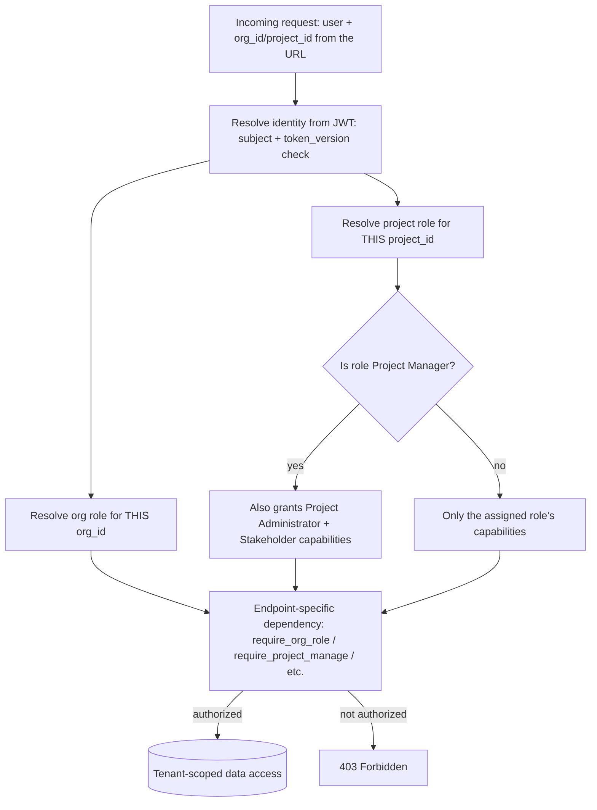

# Access Control Policy

| | |
| --- | --- |
| Policy Owner | **[Name / Title]** |
| Approved By | **[Name / Title]** |
| Effective Date | **[YYYY-MM-DD]** |
| Review Cadence | Annually, and upon any change to the role model or authentication mechanisms |
| Applies To | All users of ReqTrackManager (staff and customer organizations), and everyone administering it |

## Purpose

Satisfies CC6.1–CC6.3, CC6.5, and CC6.6: authentication, authorization, provisioning/deprovisioning, least privilege, and protection against external threats. See [trust-services-criteria-mapping.md](../trust-services-criteria-mapping.md) §CC6.

## Scope

Covers logical access to the ReqTrackManager application at every layer: authentication (proving who you are), authorization (what you're allowed to do), and the lifecycle of both (provisioning, review, deprovisioning). Physical access control is out of scope here — see [system-description.md](../system-description.md) §10 for the carve-out to the hosting provider.

## Policy

### Authentication

1. Every user authenticates either with a native email/password credential or, if their organization has enabled it, via that organization's own OIDC identity provider (SSO). Both paths resolve to the same underlying account model — there is exactly one `User` per person, never one per login method. (CC6.1)
2. Passwords must be a minimum of 8 characters. **Known gap:** no complexity, breach-list, or rotation requirement is currently enforced beyond length — see Known Gaps below.
3. Passwords are never stored or logged in plaintext; only a bcrypt hash is persisted.
4. Users may enable TOTP-based two-factor authentication; when enabled, a successful password check yields only a short-lived 2FA challenge token, not a usable session.
5. Session tokens (JWTs) are short-lived (12 hours by default, configurable) and bearer-based; a user's `token_version` counter allows the system to invalidate every previously issued token at once (used on password change and on 2FA disable), which is also this system's primary technical incident-containment tool — see [incident-response-plan.md](incident-response-plan.md). That counter is the **credential epoch**: a completed password reset and a forced credential reset increment it as well (item 9).
9. **Password reset and credential recovery** (`services/credential_reset.py`). A native password is reset only with a single-use, expiring (60 minutes by default) link emailed to the account's own address: a 256-bit secret of which only a SHA-256 hash is stored (`credential_reset_tokens`), carried in the URL fragment so it stays out of access logs and referrers, and never logged, audited, returned by an API or shown to an administrator. Requests for a link answer identically for every address (no account enumeration), are rate-limited per client address, and cost the account at most one email a minute. Redemption is one conditional UPDATE (a link cannot be used twice, even concurrently), spends every other outstanding link, increments the credential epoch (ending all sessions) and does not sign the person in or touch 2FA. An organisation admin may send a link to a member of their organisation and a server admin to any account (rate-limited per administrator; audited as `password_reset_link_sent`); neither ever sees it, so the feature cannot be used to take over an account. A server admin may **force a credential reset** for everyone, one organisation or the server administrators (`POST /system/credentials/force-reset`, audited as `credentials_force_reset` with counts only): sessions end, personal access tokens are revoked, outstanding links are spent, `must_reset_credentials` blocks native sign-in (even with the correct password, which is acceptable to disclose because it follows a correct password) until a new one is chosen, and 2FA enrolment can be cleared. SSO accounts hold no local credential and are listed, never silently skipped. The same operations run from the command line (`python -m app.cli.credentials`, and `restore.sh --force-reset` on a restored copy) with shell and database access as the authority, no application sign-in and no email, audited with the actor `cli:<os user>`; the link is printed to the operator's terminal only.
6. SSO login is proven, not assumed, to be safe against session-fixation: the initiating browser generates a nonce that must round-trip through the entire OIDC redirect flow before a returned token is trusted, closing a login-CSRF class vulnerability identified and fixed in this codebase's hardening history. This applies identically to both places that can now initiate an OIDC login — the frontend's own `/login/{slug}` page and `mcp-server`'s `/login?org=<slug>` page — which perform the same nonce check independently; the backend's OIDC callback (`routers/auth_oidc.py`) picks which of the two initiators to redirect back to via a `client` value carried inside its own signed `state` token, restricted to exactly two literal values and resolved to one of two fixed, server-configured URLs, never a caller-supplied redirect target (which would otherwise be an open-redirect/token-theft vector, since the resulting redirect carries a live access token).
7. **Non-interactive/programmatic access (the MCP server, `mcp-server/`) authenticates with a caller's own bearer token — a session token or a Personal Access Token (item 8 below) — never a shared service credential.** There is deliberately no shared service-account or API-key mechanism issuing its own *broader* access than any individual caller already has — every MCP tool call must present a caller's own token, which the MCP server does nothing but forward to the backend; `mcp-server` is entirely format-agnostic about which of the two token types it's relaying. See [mcp-server.md](../../mcp-server.md)'s "Authentication model". `mcp-server` also serves its own `/login` convenience page, which briefly holds a submitted native password in memory only for the single relay call to the backend's existing login endpoint (never logged, never persisted, no new credential store) — functionally identical to a user calling the login endpoint themselves, just without hand-crafting the request.
8. **Personal Access Tokens (PATs)** are a second, opt-in bearer-credential type for exactly this non-interactive use case — long-lived (up to 90 days by default, or an organization-configured cap) where a session JWT (12 hours) isn't practical. A PAT is never a broader grant than its owner's own account: only a hashed secret is ever stored (`sha256`, never plaintext, mirroring password handling), it is explicitly scoped by its creator to one or more organizations they already belong to, and every org/project-scoped authorization check enforces that scope *in addition to*, never instead of, the caller's real role — a PAT can only narrow what its owner could already do, never widen it, and is rejected outright at any deployment-wide (server-admin) action regardless of the owner's own privileges. That includes reads of a *related* project made on the caller's behalf (a list widened to parent/child projects, the overview counts, the link graph, link authoring): a token scoped to one project does not reach its parent or child through them, enforced centrally by `rbac.session_may_reach_project` via `link_nesting.can_open_project`, which applies the same limit to a Tier B `<ModuleFrame>` token's single project. Its effective expiry is recomputed on every use from the *current* cap of every organization it's scoped to, so a tightened organization policy applies retroactively to already-issued tokens, not just new ones. Revocation is independent of `token_version` (a PAT is not killed by a password change, by design — that would defeat its purpose) but is per-token, instant, and available at three levels for incident response: a user revoking their own token(s), an organization admin revoking every token touching their organization (or narrowing a specific multi-organization token to remove just that organization, without ever being shown which other organizations it also reaches — a deliberate cross-tenant confidentiality boundary), and a server admin revoking every token platform-wide. See [decisions.md](../../decisions.md)'s "Personal Access Tokens" section for the full design. **A PAT cannot manage credentials:** creating, listing or revoking tokens, changing the password and enrolling or disabling the second factor require an interactive session (`deps.get_current_session_user`, 403 for a PAT), so a token cannot mint a wider or longer-lived one or rewrite the second factor, and neither a PAT nor a session token is ever accepted in a URL (item 10).
9. **The SCIM 2.0 provisioning channel (`routers/scim.py`) authenticates as an *organization*, not as any individual user** — a third bearer-credential type, structurally closer to a PAT than to a session (only a hashed secret is stored, `sha256`, same `hash_pat` function; never shown again after (re)generation), but scoped to a whole organization rather than to one person's own access, since it exists for an IdP to call unattended, with no user behind the request at all. A single active token per organization (regenerating invalidates the previous one immediately, mirroring the PAT single-owner-token-per-slot pattern above), generated and revoked only by that organization's own `org_admin` (`POST`/`DELETE /orgs/{id}/scim-token`), and every SCIM request additionally re-derives the organization from the token itself (never trusts a client-supplied organization id) — a token minted for organization A can 404 (not silently succeed against) any resource belonging to organization B, and 403s outright once that organization is disabled. Every SCIM-driven write is audit-logged the same as any other mutating action (see the system-operations-monitoring-and-logging-policy).
10. **A credential in a URL is a short-lived media token, never a session token or a PAT.** A browser `` and the WebSocket handshake cannot send an Authorization header, so file downloads and `/ws/projects/{id}` accept a `purpose=media` token (`POST /auth/media-token`, session only, 15 minutes, dies with the next `token_version` bump) in `?token=`, and nothing else; the backend access log and Loki therefore never hold a working session. (CC6.1, CC7.2)
11. **The second factor cannot be replaced while it is active, and its enrol/disable step is throttled.** `POST /auth/2fa/enroll` is refused (409) while 2FA is on, so a held session cannot swap in a secret it chose and then disable the factor with a code from it; confirming and disabling count wrong codes against the same per-account lockout `/auth/2fa/verify` uses (429 while locked). (CC6.1)

### Authorization

1. Access is granted according to least privilege via independent scopes, never a single flat permission list. Three are foundational (below); item 4 documents a fourth, narrower scope added for the modular feature system:
   - **Server administrator** — deployment-wide; explicitly does *not* grant access to any organization's content. A small set of narrow, explicit carve-outs exist, all tenancy/provisioning actions rather than content access: creating an organization and its first user (`POST /orgs`, `POST /orgs/{id}/users`); a server admin granting *themselves* (self-targeting only, always `org_admin`, never another user or role) membership in an organization they don't belong to (`POST /orgs/{id}/join-as-admin`) — added specifically for self-hosting deployments where the server admin is also the one person who wants to run their own organization's content, not just provision other people's; and disabling, re-enabling, or permanently deleting an organization (`POST /orgs/{id}/disable`, `POST /orgs/{id}/enable`, `DELETE /orgs/{id}`, the last gated behind typing the organization's exact name to confirm) — a tenancy lifecycle action, not content access, since it never reads or exposes the organization's actual data; it either revokes everyone's access to that data (disable, reversible) or removes it entirely including from object storage (delete, irreversible — see [decisions.md](../../decisions.md)'s "Organisation disable and hard delete" section). None of these carve-outs let a server admin read or write any organization's actual content (requirements, projects, files) without first holding a real role there.
   - **Organization role** (org admin, project creator, member) — scoped to one organization.
   - **Project role** (project manager, project administrator, stakeholder, member) — scoped to one project; a project manager's elevated rights are the *only* role that implies the lesser roles' capabilities, and that implication is explicit and tested, not incidental.
2. Every request that touches organization- or project-scoped data resolves the caller's effective roles *from the specific organization/project ID in the request*, never from "has this role anywhere." This is the concrete technical control behind confidentiality between tenants (see [data-classification-and-confidentiality-policy.md](data-classification-and-confidentiality-policy.md)). This must apply to the *target* of an action, not only to the caller's own role: a SOC 2 review pass found and fixed two endpoints (`deactivate_org_user`, `archive_org_user`) that correctly scoped the caller's admin role to the specific organization but never checked that the *target user* actually belonged to that organization — meaning an admin of Org A could deactivate/archive a user with no relationship to Org A at all. Both now require the target user to hold membership in the acting admin's own organization. A later hardening pass found the same class of gap twice more, both fixed: `assign_project_role_by_email` (the by-email external-user invite flow) granted organization membership without the `is_banned` check `assign_org_role` itself already enforces; and `search_org_users` exposed a lower-privilege signal than the action it was meant to support — any org member (not just an org admin or a manager of the specific project) could learn whether an arbitrary email had an account *anywhere in the system*, a cross-tenant fact the actual grant endpoint (`require_project_manage`) is gated well above. A deeper follow-up pass found and fixed one more instance of the same class, at a finer grain: `_resolve_report_images` (report image attachments) checked the correct organization boundary but not the *project* one — a direct (non-shared) `FileAsset` such as a requirement attachment is gated on project-level access by its own real download endpoint (`routers/files.py::download_file`), a boundary report content had no equivalent check for, letting a hand-typed attachment reference pull another project's attachment into a report regardless of the caller's actual access to that project. Fixed by restricting report-image resolution to organization shared resources only, matching what the feature's own UI ever offers. A hardening pass on the organisation merge-import feature found the same `is_banned` gap a fourth and fifth time, in the bundle-import member/group-grant helpers (`_import_members`/`_import_org_groups`, shared by `import_org_bundle` and `merge_org_bundle`): neither checked `is_banned` before granting a bundle-matched member an organization role or org-group membership, and — since `rbac.get_effective_project_roles` resolves project access through org-group nesting with no separate `UserOrgRole` check — the group-membership gap could hand out real project access without the account ever regaining an organization role at all. `import_org_bundle` (server-admin-only, always a brand-new organization) had the same gap from the start; `merge_org_bundle` widened it to any organization's own `org_admin`, against real existing membership, which is what triggered the fix. Both now skip a banned match with a warning. See [decisions.md](../../decisions.md)'s "Hardening pass on self-signup/invites/external-users", "Deeper hardening pass", and "Hardening pass on org merge-import and rename" entries. **The two cross-project RBAC mechanisms** (`ProjectMemberSource`, generalized beyond a strict parent/child pair to any project in the same organization; and `ProjectGroupMember.source_project_id`, "this group's members = that project's own direct members") **were reviewed against this same item-2 principle before being generalized**, not exempted from it: both remain constrained to the *same organization* (never cross-tenant), both remain authorized entirely from the *receiving* project's side (never the source's, so a source project's manager can't be surprised by nor prevent being referenced — the same asymmetry the original parent/child design already established), and neither ever reads another such mechanism's already-resolved result (preventing a sibling-project leak the same way forward inheritance and member-source were already kept decoupled from each other). See [decisions.md](../../decisions.md)'s entry on this generalization for the full identify/verify/remediate review. **Project-level link types were reviewed against the same principle:** a link type that belongs to one project means "is in my organisation" no longer implies "may be used by, or shown to, this project", so one check (`services.link_type_scope.assert_link_type_usable`, called from `services.relationships.create_link`) now decides usability from the project's own chain of ancestors, every organisation-level link-type endpoint sees organisation-wide types only, and phrases for display are resolved from the ids a visible link references rather than from every type the organisation has. See [decisions.md](../../decisions.md)'s "Project-level link types, hiding, project rules and the organisation lock" entry.
3. **Shared UI chrome is a deliberate, narrow exception to item 2, not a gap in it.** User avatars and organization logos (`routers/files.py`'s `is_avatar_or_logo` check) are readable by any authenticated user regardless of organization membership, since they render in shared UI (the header, member lists) where the alternative would be broken images for anyone without a role in the asset's owning organization — and they carry no confidential content, unlike a requirement attachment or an organization's shared resource file, which remain fully role-gated. The platform-wide default branding logo (`ServerSettings.default_logo_file_id`, UI/UX pass) extends this same bucket for the same reason. Its read endpoint, `GET /api/v1/system/branding`, is likewise the one endpoint in `routers/system.py` — otherwise entirely server-admin-only — open to any authenticated user, since every user's own app shell needs the platform default to render, not just server admins'; the corresponding `PUT`/logo-upload endpoints remain server-admin gated.
4. **A fourth scope, server-tier but narrower than full server administrator, was added for the modular feature system** (`ServerRole.MODULE_ADMINISTRATOR`, granted via `UserServerRole`/`services/rbac.py::require_server_role`). This is additive to, not a replacement for, item 1's `is_server_admin` boolean: `is_server_admin` remains the sole source of truth for full server-administrator power (a `MODULE_ADMINISTRATOR` grant is never written for it, and the grant endpoint rejects an attempt to do so), and `require_server_role` composes with it the same way `require_org_role`'s callers already treat `ORG_ADMIN` as implying every narrower org capability — a genuine server admin passes any `require_server_role` check with no separate grant needed. `MODULE_ADMINISTRATOR` itself can only ever be granted or revoked by an existing full server administrator (`require_server_admin`-gated grant/revoke endpoints, no `MODULE_ADMINISTRATOR`-self-service path) — the same "a narrower role can never grant itself or others a role" privilege-escalation-safe pattern item 1's other scopes already follow. As of this policy revision it gates the deployment-wide default module entitlement policy and module entitlement/enablement management deployment-wide — `GET`/`PUT /system/modules`, `GET`/`PUT /system/orgs/{id}/module-entitlements/*` .

   **Module-contributed roles** (table `user_module_roles`, dependency factory `services/rbac.py::require_module_role(module_key, role_key)`) are now implemented: a module declares its own named roles via `ModuleRoleDefinition` (e.g. a future Compliance module's `compliance_manager`/`compliance_officer`), each scoped to either an organisation or a project, synced into a `module_role_definitions` mirror table at process startup so a grant's display name/description stays resolvable even if the declaring module is later removed. `require_module_role` does **not** participate in the org/project-group and hierarchy inheritance the role-resolution diagram below shows for core roles (a real, deliberate difference in how these roles resolve — see the diagram's own note below) — but it is **no longer direct-grant-only**: a second grant table, `group_module_roles` (`services/rbac.py::_has_module_role_grant`'s own group-grant branch), lets a module-contributed role be granted to an organisation group as a whole, resolved for every (transitively, via nested org groups) member of that group at check time via `services/rbac.py::effective_org_group_member_ids` — mirroring `OrgGroupProjectRole`'s own already-shipped group-grant precedent for core `ProjectRole`s one tier up, rather than the org/project-group *hierarchy inheritance* those core roles separately also get (a module-contributed role still has no hierarchy-inheritance concept of its own; only this direct-to-a-specific-group grant path). This was a deliberate reversal of the module system's original "V1 is direct grants only" scope decision — **Decided by: User**  — not an oversight discovered later; see that phase's own entry in `docs/decisions.md` for the full identify→verify→remediate account. It composes with the existing higher-tier scopes the same way item 4's own `MODULE_ADMINISTRATOR` composes with `is_server_admin`: a genuine server administrator passes any `require_module_role` check with no grant needed; an org-scoped module role additionally passes for `OrgRole.ORG_ADMIN` on that organisation; a project-scoped module role additionally passes for `ProjectRole.PROJECT_MANAGER` on that project. Like every other module-gated surface, a disabled/non-entitled module's role-gated endpoints 404 rather than 403, so they stay indistinguishable from not existing.

   **A fifth, deliberately narrower authentication mode was added for Tier B remote modules** (`<ModuleFrame>`/Host UI Bridge — `app.security.create_module_frame_token`/`decode_module_frame_token`, `app.deps.get_current_user_or_module_frame`). A sandboxed remote module never receives the viewer's real session token; instead the frontend mints a short-lived (15-minute) JWT scoped to exactly one `(module_key, organization_id or project_id, user_id)` tuple (`POST /orgs/{id}/modules/{key}/frame-token` / `POST /projects/{id}/modules/{key}/frame-token`, themselves gated by a normal session — a module-frame token can never mint another one). This is not a sixth RBAC scope alongside items 1-4/module-contributed roles above — it is an *authentication*-layer restriction that composes underneath whichever scope a request would otherwise need: `app.deps.get_current_user`, used by every endpoint outside the module-gating dependencies, rejects a module-frame token outright (wrong `purpose` claim, the same mechanism that already rejects a 2FA challenge token replayed as a session token), so it is mechanically unusable against anything but `require_org_module_enabled`/`require_project_module_enabled`/`require_module_role`'s own three dependencies. Those three additionally call `services/rbac.py::_enforce_module_frame_scope`, which 403s if the token's own `organization_id`/`project_id` claim doesn't match the specific resource named in the request path — checked *before* any `is_server_admin`/`ORG_ADMIN`/`PROJECT_MANAGER` bypass, so a mis-scoped token is never rescued by the fact that the underlying real user happens to hold broader access elsewhere. `Content-Security-Policy: frame-src` (see `main.py`'s security-headers middleware) is a second, independent, browser-enforced backstop restricting which origins the app will embed at all — defaults to `frame-src 'none'` until a deployment operator explicitly lists a trusted module origin (`MODULE_FRAME_ALLOWED_ORIGINS`), mirroring `MODULE_ADMINISTRATOR`/`ALLOW_EXTERNAL_MODULES`'s own off-by-default precedent above.

   **A widened Compliance-module authorization boundary was reviewed and accepted for standard applicability defaults** (Standard Applicability Defaults, Exceptions, and Project-Manager Assignment): creating a `ProjectCompliance` row (a project's assignment to a compliance standard) is no longer `compliance_manager`-only. Project-Manager self-service assignment (`ProjectRole.PROJECT_MANAGER` on the target project, via the existing project-scoped `compliance_officer` module role's own `require_module_role` composition — no new role, no new dependency factory) is now the *default, primary* path a project acquires a standard; the original org-scoped, `compliance_manager`-gated assignment endpoint remains available unchanged as the *secondary*, centrally-administered path (a Compliance Manager assigning on a project's behalf, or in bulk, per §3's "subject to appropriate permissions" framing). A standard's own `applicability_default`/exclusion-list *governance* — whether it applies to all projects by default, and which are excepted — stays exactly where it already was: Compliance-Manager/org-admin-only, on the org-scoped router, unreachable by a Project Manager. This mirrors the boundary the standards feature already drew between "who curates the org-wide catalogue" (unchanged) and "who runs day-to-day assessment for one project" (now includes creating that project's own assignment row, not only editing one that already exists). See `docs/decisions.md`'s entry on standard applicability defaults for the identify→verify→remediate pass this widening received before shipping.

   **A sixth scope, a module-owned entity scope narrower than an organisation, was added for standard-level RBAC** (Standard-Level RBAC): `ModuleRoleDefinition.scope` is no longer limited to the two core-recognised `"org"`/`"project"` literals above — a module may declare any other string as its own entity scope, one role per row of a first-class entity it owns (Compliance's `standards_manager`/`standards_contributor`, one per `ComplianceStandard` row, are the first example). `require_module_role` resolves such a role's owning organisation via the declaring module's own `resolve_entity_organization_id` hook rather than a fixed path-parameter name, then applies the identical module-enabled/2FA/frame-scope checks every scope already gets. **This scope resolves exactly like the org/project scopes above** — direct grant (`user_module_roles`) or group grant (`group_module_roles`, the module system — see the paragraph above) — with one further, narrow, explicitly-flagged addition specific to Compliance's own standard-scoped roles: an organisation may *also* designate one `OrgGroup` as a fallback whose current membership counts as satisfying a `standards_manager`-shaped floor for any standard with no explicit grant of its own at all, direct or group (§3's "defaulting to a group of all compliance managers where roles are SSO-managed"), resolved live at check time, never as a stored per-standard row. This fallback-floor mechanism is distinct from, and coexists with, the general group-*grant* path above: the fallback only ever answers "does a floor remain satisfied" for a standard with zero explicit grants of its own, while a `group_module_roles` grant is a real, standard-specific grant like any other, just held by a group instead of a user. A standard-scoped role also composes with a *second*, module-owned override tier alongside the existing core-role one: `ModuleRoleDefinition.overridden_by` lets a role declare that another role the *same module* owns (Compliance's own org-scoped `compliance_manager`) also satisfies it, the same "a higher tier already retains full access" principle core roles get one level up, extended one tier further down since there is no core role to reuse at this narrower scope. A companion mechanism, `ModuleDefinition.validate_org_group_member_removal`, lets a module block `app.routers.orgs.remove_org_group_member` from removing a user whose removal would break one of the module's own group-backed floors (Compliance's fallback-group floor being the first user) — core code asks every registered module, via `app.modules.registry.run_org_group_member_removal_hooks`, without importing any specific module's own models, the same "core code shouldn't need to know a specific module exists" principle this plan's hooks already established for org/project creation. See `docs/modules.md`'s "§4a. A module-owned entity scope" and "§4b. `validate_org_group_member_removal`" sections for the full mechanism, and `docs/decisions.md`'s entry on standard-level RBAC for the identify→verify→remediate pass this addition received before shipping (in particular, the "never build a narrower gate on top of a broader membership-requiring one" fix `_require_standard_manage`'s own design went through).

   **A channel-scoped restriction, narrower than any RBAC role, was added for AI-originated approval actions reached through the MCP server** (`mcp-server/`, item 7 under Authentication above). `requirements.approve_requirement`/`change_requests.decide_change_request`/`requirements.complete_requirement` (backend core routers) additionally require, only when the request is identified as MCP-originated (`app.deps.get_request_channel`, reading the self-declared, non-secret `X-Reqtrack-Client` header `mcp-server` adds to every request it forwards), that both the target organisation's and project's own `allow_ai_approvals` flag be enabled — an org-admin-only and a project-manager/administrator-only opt-in respectively, each requiring the enabling user to explicitly acknowledge (via a UI dialog) that an AI-made approval isn't necessarily a deliberate human decision. This is not a new RBAC scope and does not compose with or replace the existing project-manager role check every one of these endpoints already performs — it is a strictly additional, narrowing restriction applied only to one specific channel, consistent with item 2's principle that a caller can never gain access beyond what their real role already grants: a human calling the same endpoint directly (no such header) is entirely unaffected by either flag, in every case. See [decisions.md](../../decisions.md)'s "AI approval via MCP" entry for the full identify→verify→remediate review, including why a plain, unsigned header is sufficient here (the check can only restrict, never grant, so there is no privilege-escalation path in a caller spoofing it in either direction) — this reopens, deliberately, the boundary the original MCP write-mode entry described as structural and non-negotiable, which that same entry explicitly anticipated as a risk if ever done "without anyone deciding that on purpose."

   **This gate was generalized (2026-09-22) so any module's own approval endpoint can reuse it**, rather than staying a core-router-only pattern: `app.services.rbac.require_ai_approvals_enabled(db, project)` is the same function all three core call sites above already called inline, now also called the identical way — `if get_request_channel(request) == "mcp": require_ai_approvals_enabled(db, project)`, before performing the approval — by the Compliance module's `project_router.py::approve_requirement`/`reject_requirement`. Those two were previously excluded from the MCP tool surface outright (`app.modules.registry.APPROVAL_ACTION_ROUTE_EXTRA`, no opt-in path at all); as of this generalization they are MCP-reachable exactly like the three core endpoints, gated by the same org+project opt-in, not a weaker one. See [decisions.md](../../decisions.md)'s "Compliance MCP write tools + generalized AI approval gate" entry for the full identify→verify→remediate review.

   **Decision Management's own `approve_decision_endpoint`/`reject_decision_endpoint` (`backend/app/modules/decisions/project_router.py`) received the identical treatment (2026-09-22, explicit user confirmation — "Yes, apply the same treatment")**, closing the coverage gap the paragraph above used to flag: both routes had `APPROVAL_ACTION_ROUTE_EXTRA` removed and now call `require_ai_approvals_enabled` the same way, only when `get_request_channel(request) == "mcp"`. Decision Management's approvals are now gated identically to Compliance's and to core's three endpoints — the same org+project `allow_ai_approvals` opt-in, no weaker and no stronger. See [decisions.md](../../decisions.md)'s "Decision Management MCP approval gate" entry for the full identify→verify→remediate review.

   **A finer-grained gate one tier below whole-module enablement was added for Module 0 (Platform Foundations)** (`ModuleSubComponentDefinition`/`app.modules.registry.is_module_subcomponent_enabled`/`is_org_module_subcomponent_enabled`, `services/rbac.py::require_project_subcomponent_enabled`/`require_org_subcomponent_enabled`), at the user's explicit request (a project admin toggling "Pain Points" off while keeping "Strategy" on, not only the whole module at once). This is additive to, and always checked *after*, whole-module enablement — a disabled whole module always 404s first, with no sub-component lookup at all — and follows the identical 404-not-403 posture every other module-gated dependency in this document already holds itself to, for the same "indistinguishable from not existing" reason. Two new explicit-override-only tables mirror the existing whole-module pair one level down: `organization_module_subcomponent_defaults` (`OrgRole.ORG_ADMIN`-managed, parallel to `organization_modules`) and `project_module_subcomponent_enablements` (project-admin-managed) — a genuinely new capability, since whole-module enablement itself had no project-level override at all when this gate shipped (see the project-level override immediately below, which added one). A project's own override always wins over the organisation's default, which itself falls back to the registry's own `default_enabled` absent either row. For a sub-component of an **org-scoped** artefact (no project in the picture to hold an override at all — Context & Strategy's org-scoped Strategy records are the first example), `is_org_module_subcomponent_enabled` deliberately omits the project-override tier rather than inventing a second, parallel mechanism: the organisation's own default *is* the effective value for that case, not merely a fallback beneath a higher tier — **Decided by: Agent**, recorded in `docs/decisions.md`'s entry on sub-component enablement alongside the full reasoning.

   **Module 0 (Platform Foundations) project-level override of whole-module enablement, added immediately after the sub-component gate shipped, closed the gap that paragraph flagged: whole-module enablement itself gained a project-level override.** A new explicit-override-only table, `project_module_enablements` (project-admin-managed, unique on `(project_id, module_key)`), sits one tier below `organization_modules`, resolved by `app.modules.registry.is_module_enabled_for_project`: entitlement first (unchanged — still an absolute ceiling no override tier below it can cross, the same "entitled AND (...)" formula `is_module_enabled` already applies), then the project's own override, then the organisation's default, then the registry's `default_enabled`. **Symmetric — Decided by: User**, matching the sub-component rule: a project admin's own choice always wins over the organisation's default in either direction (can enable a module the org has turned off, or disable one the org has turned on), a one-directional "project can only narrow" alternative having been explicitly raised and rejected in favour of consistency with the already-shipped sub-component behaviour. `require_project_module_enabled`/`require_project_module_enabled_dynamic` (`services/rbac.py`) resolve through this function now instead of calling the org-only `is_module_enabled` directly — the same 404-not-403 posture, same call sites, and every existing project's effective state is unchanged until a project admin actually sets an override (day one has zero rows in the new table). **Not purely additive — flagged explicitly, not silently folded in:** the earlier `is_module_subcomponent_enabled` used to resolve whole-module state via the org-only `is_module_enabled`; it now calls this phase's `is_module_enabled_for_project` instead, so a project-level whole-module override correctly cascades to disable/enable that module's own sub-components too — a distinct code path from the org-level disable case the earlier tests already covered, with its own regression test added. Org-scoped artefacts are unaffected by this phase: `require_org_module_enabled`/`is_org_module_subcomponent_enabled` remain untouched, the same "no project to hold an override against" reasoning the paragraph above already applied one level down. Recorded in `docs/decisions.md`'s entry on project-level module enablement.

   **Server-wide module defaults and hiding (platform review, 2026-10-19).** A new explicit-override-only table, `server_module_defaults`, holds what an organisation with no `organization_module_enablements` row of its own gets for a module (`ServerRole.MODULE_ADMINISTRATOR` or server admin only, via `/system/module-defaults`; every change and every "apply to all organisations" is audit-logged, `module.server_default_updated` / `module.server_defaults_applied`). It is consulted below an organisation's own row and above the registry default, so it can widen availability only for organisations that never chose for themselves; applying it overwrites organisations' choices only on an explicit, typed-confirmation action and only for modules the organisation is entitled to. Separately, a module an administrator cannot use is no longer listed to them (non-entitled modules from organisation admins, organisation-disabled modules and sub-components from project admins; server admins keep the full view): this removes a switch that could not work, and does not change any authorization check, since the endpoints already returned 404 for such a module. A fresh install is seeded all-on once (`MODULES_DEFAULT_AVAILABLE`); an upgrade is not.

   **Hiding an organisation default in a project (platform review, 2026-10-19).** A project administrator can hide an organisation-level type (Pain Point, Persona, Stakeholder and Risk types) in their own project through `project_definition_suppressions`. It needs the same module-manager role (or FGAC grant) as the existing rename/disable override, applies to one project only, cannot reach another organisation's row (the id is validated against the project's organisation), changes no read or write gate, and is audit-logged (`hidden` / `restored` on the project type entity). Nothing is deleted: records keep the type.

5. **A fine-grained, organisation-definable permission system was added as a core platform capability, not an optional module** (reclassified from an originally-proposed optional module to core on 2026-09-23). It is additive to every scope above, never a replacement — an organisation that never touches it sees no behavioural change. An organisation admin (`OrgRole.ORG_ADMIN`/server admin only, never delegable — no "manage custom roles" permission atom exists, closing off the "mint a new, arbitrarily powerful role" escalation path entirely) can define a `CustomRoleDefinition` as a named set of **permission atoms**: `(artefact_type, level, subtype)` triples — `level` one of View/Propose-Create/Manage/Link/Approve-Baseline, crossed with every artefact type an installed module registers and, where a module registers one, that artefact type's own per-organisation sub-type vocabulary (e.g. Decision Management's Decision Types) — plus a short, fixed list of non-artefact administrative permissions (`manage_members`, `manage_settings`, `manage_integrations`, `grant_roles`, `export_personal_data`; the last lets its holder include or import personal-data columns of a record file when the organisation's policy also allows them, and is held by organisation administrators and by project administrators and managers in their project, see [data-classification-and-confidentiality-policy.md](data-classification-and-confidentiality-policy.md)). This vocabulary is derived, never hand-maintained (`app.services.permissions.get_all_permissions`), the same "registry-derived, not a static enum" principle `ArtefactLink.source_type` already established for relationship link types. A permission atom's `subtype` may be the wildcard (`None`, meaning "every sub-type"): composition (checked directly against this item's own tenant-isolation principle, item 2 above, and found consistent with it) means a broader, unscoped grant satisfies every narrower sub-type-specific check, never the reverse (`app.services.rbac.permission_satisfied`).

   **Linking by default role (restored 2026-10-11).** Before link authoring moved to the generic endpoint, a stakeholder, project administrator or project manager could add and remove requirement links; the move silently removed that for the first two. They now link a record of a core type (requirement, action) by role, but only while no requirement involved (either end) is approved; the audit event's `authorised_by` is then `role`. `link` and `manage` work in any state, which is what `link` is for. A module's records need `link` or `manage`, and the project's "require a change request for links" rule still refuses everyone, `link` and `manage` holders included, on an approved requirement. A plain member links nothing.

   **The `link` level .** `link` lets its holder add and remove links on records of that artefact type and nothing else: link authoring (`services/link_authoring.py`, the generic `.../links` endpoints, MCP) accepts `link` **or** `manage` on the page record's type, while every other gate (view of both ends, module enabled, link-type and artefact-type rules, nesting, hidden types, the change-request rule for approved requirements) applies unchanged. Only the project manager's static mapping lists `link` (it already lists every level, and a manager already held `manage`); no other built-in role holds it and `manage` is not rewritten to imply it, so no existing project's permissions change. The audit event of each link create/delete records `authorised_by` (`manage` when held, else `link`) so a review can see the new level in use. An organisation can also hold an **"every record type" atom** (`*:<level>:`, `ALL_ARTEFACT_TYPES`), resolved by `permission_satisfied` for any type including ones registered later; it exists at every level, so an admin granting `*:manage:` or `*:approve_baseline:` is granting that level on all current and future types — only an organisation admin can define such a role. A new organisation is seeded with a project-scoped **Link editor** custom role (`*:view:`, `*:link:`); it is an ordinary role (editable, deletable), is not added to existing organisations, and still needs a project role such as Member to open the project at all.

   **Proposed links on change requests .** A change request can propose links that become real only when a project manager approves. Proposing needs the authority to link requirements at all (`link`/`manage`, or a stakeholder, project administrator or manager role; checked for the request's creator at creation and again at approval); approving needs no new authority but the approver must hold `view` on the far end in its own project, so approval cannot create a link to a record the approver cannot read, and a far end that is missing, unseen or in an unrelated project reads identically as "not found". Cross-level far ends are resolved through the caller's own project chain (`related_projects`), and a viewer who cannot see a proposed link's far end gets only its type (no title, id, project id or project name). The nil UUID is accepted as a page artefact by the three finder reads only, and only for a user who may link that type. Each merge writes the normal link audit event in both projects with `via: change_request`.

   A defined role is granted to a user or an organisation group (`UserCustomRoleGrant`/`GroupCustomRoleGrant`, shaped like their module-role equivalents one tier up), scoped to `"org"`, `"project"`, or — since the permission system generalised the module-owned entity-scope mechanism (this item's sixth-scope paragraph above) into a central registry (`app.modules.registry.get_all_registered_entity_scopes()`/`EntityScopeDefinition`) — any registered module-owned entity scope (e.g. Compliance's own `"standard"`), letting an organisation scope a custom role to one specific standard, decision type, or future module-owned entity, with no core-file change required to support it. Every grant is validated against the granting organisation both at write time and at resolution time (`get_effective_permissions`) — a custom role and its grants are never resolvable from another organisation's data, the same tenant-isolation principle (item 2) this whole capability was reviewed against before being drafted (per that plan's own "Design principles carried over" section) and again at each phase's own completion.

   Composition with every scope above is deliberate, not incidental: a server administrator, an `OrgRole.ORG_ADMIN` (org-wide) or `ProjectRole.PROJECT_MANAGER` (project-wide), and any module-contributed role's own optional `permissions` (`ModuleRoleDefinition.permissions`, adopted by Decision Management and by Compliance) all continue to satisfy a permission-atom check with no separate custom-role grant needed — the same "a higher tier already retains full access" rule item 1's foundational scopes and this item's module-contributed roles already follow, now extended to this fourth, independently-resolving path (see the role-resolution diagram's own note below).

   **`grant_roles` — a deliberately broad, explicitly-flagged residual-risk permission, not folded in quietly alongside the rest of this mechanism.** Unlike custom-role *definition* (`ORG_ADMIN`/server-admin-only, never delegable, above), *assignment* of any existing role — fixed `OrgRole`/`ProjectRole`, module-contributed, or custom — is itself gated by an ordinary permission atom, `grant_roles`, delegable by an `ORG_ADMIN` to any user or group. Two values stay carved out regardless of who holds it: `OrgRole.ORG_ADMIN` (grantable/revocable only by an existing `ORG_ADMIN` or server admin) and `ServerRole.MODULE_ADMINISTRATOR` (server-admin-only — a pre-existing invariant, item 4 above, unrelated to this capability and unweakened by it). This is a confirmed, deliberate design property, disclosed candidly rather than discovered later: a `grant_roles` holder who is not themselves an `ORG_ADMIN` can still assign any *other* existing role — including one broader than their own — to themselves or an accomplice. The blast radius is bounded (no permission combination can be *minted* this way that an `ORG_ADMIN` did not already define or already grant somewhere), but an organisation delegating `grant_roles` to a non-admin should understand this scope before doing so. See [decisions.md](../../decisions.md)'s "Fine-Grained Access Control (core)" hardening entry for the full identify→verify→remediate review this capability received before being considered complete, including a real defense-in-depth gap the review found and fixed: `require_permission`'s FastAPI dependency had no `_enforce_module_frame_scope` check at all (unlike every sibling `require_*` dependency in `rbac.py`), reachable only via Compliance's own two call sites that invoke it as a plain function rather than through FastAPI's dependency injection — closed by adding the same check, in the same "before any admin-override bypass" position every other scope in this document already holds itself to.

6. **Links between a project and its ancestors/descendants are the one read path that crosses a project boundary on purpose, and each end is authorised in its own project** (`services/link_nesting.py`, `services/link_graph.py::ArtefactResolver`, `services/link_authoring.py`). A cross-level link is only ever created through the generic link endpoint and only between projects in one ancestry line (siblings and unrelated projects cannot be linked). The caller needs a genuine role on the other project (not settings-management capability and not organisation membership alone), `manage` on the page artefact's type in its project and `view` on the other end's type in *its* project; a project the caller cannot open answers 404, indistinguishable from "does not exist". The related-project walk stops at the first project the caller cannot open, so a hole in the chain hides everything beyond it. Default-deny at the query layer protects every reader that predates the feature: `ArtefactLink.source_project_id`/`target_project_id` are set only for cross-level links and `services/relationships.py` excludes them unless a caller asks (`include_cross_project`), so a reader that loads "the other end" by id and assumes it shares the page's project can never show an ancestor's artefact to a child-only member; a test (`tests/test_link_nesting.py::test_only_reviewed_modules_query_artefact_links_directly`) fails when a new file queries the link table directly without review. The link graph resolves, module-checks and permission-checks every node against its own project and counts what it cannot show without naming it. Project exports and CSV exports carry same-project links only. Link creation and removal write the audit event in both projects. (CC6.1, CC6.3)

7. **Tags are authorised like the record they label** (`services/tags.py`, `routers/tags.py`). Reading a record's tags needs what opening the record needs (`ArtefactResolver`: member of the project, module enabled, `view` on the type); a record the caller cannot open is a 404, never a 403. Adding or removing a tag needs `manage` on the record's type (or, for a requirement or action, a role that can edit it); it is not blocked by an approved requirement's lock because a tag is not record content. Changing the vocabulary (add, rename, merge, delete, reclassify by tag, the free/restricted mode) needs project-settings authority, or organisation administrator for the organisation's own list. Bulk reclassify by a list of records authorises every record's type and requires every record to be visible in the request project; usage tables omit a record type the caller cannot view; find-by-tag omits records the caller cannot open and never describes them. A child project's vocabulary falls back to its nearest ancestor's read-only (a member of the child sees tag names the ancestor's members chose; tag names are low-sensitivity labels, the same accepted trade-off as inherited action types). A tag belongs to exactly one organisation and one scope, and every maintenance call loads it by that scope, so another organisation's or an ancestor's tag id is a 404. Every tag change is audited (`tagged`/`untagged` against the record; `created`/`updated`/`merged`/`deleted`/`reclassified` against the tag; `tag_settings` for the mode). (CC6.1, CC6.3, CC7.2)

8. **Global search reads across projects and is authorised before it queries** (`services/search.py`, `routers/search.py`). A search covers only projects the caller holds a genuine role in (`services/project_access.py`, the definition the project list uses, with a token's organisation and project scope applied through `rbac.session_may_reach_project`; no server-admin bypass). Per record type it then keeps only the projects where the owning module and sub-component are enabled and the caller holds `view` *in that project*, the same checks as the link graph and the scope-filtered lists, so a record the caller cannot open is never fetched and a count (per type, total) cannot disclose one: results are omitted, never redacted. An organisation-owned record is found only through a project the owning module's visibility rule shows it to (a persona hidden from a project is not found from it), and its count is taken after that check. A module-defined scope (Compliance's "This standard") resolves to a project set that is intersected with the caller's own, and answers "not found" identically for a missing unit, one in another organisation, and one the caller cannot read. Searchable fields are opt-in per record type, so personal-data columns (a stakeholder's contact details) are excluded by omission. Bounds: two characters minimum, 500 results deep, 250 projects per search and a 5-second statement timeout. An organisation that requires two-factor authentication is excluded for a member without it, exactly as every project and organisation read refuses them. Organisation-owned records with an organisation-level surface are searched only for members of an organisation where the owning sub-component is on, under the same organisation gates (active, two-factor, token scope); a one-project search adds them only for the project's own organisation and where the project has the feature on. Comments are searched only when asked for, inherit their record's gate, and cannot be a stored default. A user's default fields are validated on save against the fields they can currently choose (`GET /search/fields` returns labels only). The MCP tool `search_records` calls the same service, so an assistant sees exactly what its user would. (CC6.1, CC6.3, C1.1)

9. **Custom report layouts are managed through two separate administrative permissions** (`manage_org_report_layouts`, `manage_project_report_layouts`; `services/rbac.py`, `routers/report_layouts.py`). They are two atoms so a person can be trusted with one project's layouts without being able to change the layouts every project in the organisation inherits. Organisation admins hold both; project administrators and managers hold the project one in their project only; a custom or module role can grant either to a user or an organisation group, and an organisation-wide grant of the project atom applies in every project. Server administrators have no bypass on the organisation routes. Reading a layout's tree or history and every write need the atom; an inherited layout is read-only in the inheriting project. A layout never widens what a report shows: a run (a later endpoint) reads records through the caller's own link-graph access, so authoring a layout over a type the author cannot read exposes nothing.

### Provisioning and deprovisioning

1. New users are provisioned by an organization admin (native accounts), automatically on first successful SSO login subject to that organization's optional required-group gate, through public self-signup when a server admin has enabled it (`ServerSettings.signup_mode`), through an admin-initiated invite to a specific project (`Organization.external_user_policy`), or by a server admin from Server Management → Users → Add user (`POST /system/users`). (CC6.2)
   - **Self-signup** (`routers/auth.py::signup`) is either open to anyone (no organization joined automatically — an admin assigns one afterward) or, in "org specified" mode, gated on a matching email domain *and* the target organization having explicitly opted in (`Organization.allow_self_signup`) — a configured domain alone is never sufficient, closing the obvious "someone else set the domain, I get to walk in" gap. An organization requiring SSO (`sso_only`) cannot also allow self-signup, enforced as a write-time validation error on both settings, since self-signup would otherwise hand out exactly the password credential that organization has chosen not to issue.
   - **Invited external users** (`services/invites.py`, reached via a project admin adding a project member by email) branch on whether the target organization is SSO-only: an ordinary organization gets a token-based invite email and completes native signup to redeem it; an SSO-only organization instead gets its account and roles provisioned immediately, since there is no working native-password path for it — the invitee simply signs in via SSO once, and `services/oidc_provisioning.find_or_provision_user`'s existing email-matching logic adopts the pre-provisioned account (still refusing to link if the identity provider doesn't assert a verified email, the same protection every other SSO-linked account already gets).
   - **Server-admin account creation** (`routers/system/users.py::create_system_user`, `services/user_provisioning.py`) uses the same code as Org Admin's "New user" and "Invite user": email uniqueness, the `sso_only` refusal, the shared 8-character password rule (`security.MIN_PASSWORD_LENGTH`) and a `user.created` / `pending_invite.invited` audit row naming the acting server admin. The typed password is hashed at once and never returned, logged or audited. An account may have no organisation in either mode; an invite into an organisation grants `member`, and an invite redeemed at sign-up overrides `signup_mode` as every invite does. The request carries no server-admin or server-role field, so it cannot mint a privileged account (those stay on their own audited endpoints). It is rate limited per administrator and worker process (`user_create_rate_limit_*`). The admin who types a password knows it until the person changes it; no forced change at first login exists (a known limitation, below).
   - **An organisation's identity provider can only sign in as its own members** (`services/oidc_provisioning._assert_may_link`). The IdP is configured by that organisation's administrator, so its claims prove identity *to that organisation*, not to the platform: an existing account is matched by email only when the organisation already has a claim on it (a role there, or an unexpired invite), never when it is a server administrator account, is already bound to a different `(issuer, subject)`, or also belongs to an organisation that signs in through a different issuer. A refusal looks like a required-group refusal to the browser and is audited as `oidc_login_denied_link_refused`. Without this rule any organisation administrator could sign in as any account, including the server administrator.
   - **Pulling an existing account into an organisation is one rule** (`services/org_membership.py`): an account another organisation holds joins only when the organisation allows external users (`external_user_policy`), a banned account never does, and an unclaimed account may. It is applied to a role grant by user id, SCIM `POST /Users` and an organisation bundle merge (including its group lists), alongside the project by-email route that already enforced it. An organisation administrator's authority over an account stops at the organisation: deactivating (and SCIM `active: false`) ends the whole account, so for a server administrator or an account another organisation also holds it is scoped to the organisation — the membership, project access and group membership there are removed and the account stays active elsewhere (`remove_member_from_organization`); SCIM `active: true` never lifts a ban and a server administrator is invisible to SCIM. (CC6.2, CC6.3)
   - `Organization.sso_only` is enforced at the native login step itself (`auth_backends/native.py`), not only as a UI hint on that organization's branded login page — a native-credentialed account whose *every* organization requires SSO cannot authenticate natively, even with a correct password.
   - The SSO login callback (`routers/auth_oidc.py::oidc_callback`) checks the resolved account's `is_active`/`is_archived` status before completing login, a check a deeper hardening pass found was previously missing entirely — the only login path without it, since `get_current_user`'s own per-request check made the gap easy to miss (the resulting token was already inert against every other API call). Without this check, a deactivated or banned account could still complete SSO login, and — the concrete risk — the same callback's invite-consumption and SSO-group-role-sync steps would still commit brand-new role grants for it, which would sit dormant until the account was later reactivated for an unrelated reason and become live without the reactivating admin knowing new access had been granted mid-deactivation.
2. When set, `sso_group_mappings` determines what role a newly-provisioned SSO user receives; a user outside a required group is refused a session entirely, before any account state is created for them to later have access via. This is re-evaluated, in both directions, on *every* SSO login, not just the first: a role gained via a matching IdP group claim is also revoked once that claim is no longer present, closing a timely-deprovisioning gap a later hardening review found (the original version only ever granted). Scoped strictly to whatever roles `sso_group_mappings` itself covers — a role granted manually, outside any mapping, is never touched by this sync in either direction — and skipped entirely on a login where the IdP asserts no groups/roles claim at all, since that's ambiguous with "this provider doesn't send the claim" rather than a genuine zero-groups assertion. (CC6.2, CC6.3)
2a. **Org-group membership sync is claims-based (`services/oidc_provisioning.sync_org_groups_from_claims`) or push-based (SCIM, `routers/scim.py`)**, offered as two complementary mechanisms rather than one: claims-based sync only ever runs at login time (same grant/revoke and "no claim asserted at all is unknown, not empty" rules as item 2 above, scoped to whichever `OrgGroup`s have `idp_synced_group_name` set) and so cannot promptly deprovision someone who simply stops logging in; SCIM lets the IdP push a membership change the moment it happens in the directory, independent of any login. Both funnel into ordinary `OrgGroupMember` rows, so every downstream authorization check (project-role resolution via group nesting) applies identically regardless of which mechanism produced the row. SCIM user provisioning (`POST /scim/v2/Users`) checks `User.is_banned` before reprovisioning a matched account — the same check `assign_org_role`/the bundle-import paths enforce (see the "Hardening pass" entries in [decisions.md](../../decisions.md)) — closing off a sixth instance of the class of gap those entries describe. Neither mechanism ever manages an org group's *nested-group* edges (`OrgGroupMember.member_org_group_id`) — those are a structural, admin-managed relationship, not per-user membership an external directory should be able to rearrange.
2b. **Deleting an org group** (`DELETE /orgs/{id}/groups/{group_id}`, org-admin only, tenant-scoped, audit-logged as `org_group`/`deleted`) removes every role and project access the group carried, for all its (nested) members at once. It is refused when an enabled module depends on the group (the generic `validate_org_group_deletion` hook, e.g. Compliance's fallback compliance-managers group). It can't breach the C-U-08 project-manager floor or the last-org-admin floor, since both count only direct grants, never group-derived ones. See [decisions.md](../../decisions.md), "Org groups are deletable". (CC6.2, CC6.3)
3. No role or membership can be granted to a deactivated or archived account (`org_membership.assert_account_active`, 409). Deactivating the sole manager of an archived project does not appoint the acting administrator (audited as `manager_fallback_skipped_archived`). Access is removed by deactivating a user (`is_active = False`), which blocks further logins immediately, and — since `is_active` is rechecked fresh on every REST request (`deps.py`) — also immediately rejects that user's already-issued token on their very next API call, without waiting for it to naturally expire. The one remaining bounded exception is an already-open WebSocket connection, which rechecks `is_active` (and, since a later hardening review found the original WebSocket fix covered token expiry but not this, `token_version` — see item 5 above) every 60 seconds rather than on every message (SOC 2 hardening pass) — see Known Gaps below for the residual window this leaves. (CC6.5)
4. **Access reviews are a first-class, built-in feature, not an external process bolted on:** organization admins can list and filter their organization's members by staleness (`stale_since_days`, `never_logged_in`), missing 2FA (`has_2fa`), role, and whether they hold any project access at all (`has_project_access`) — and server admins have the equivalent org-spanning `no_org_membership` ("orphaned account") view. A server admin is, by design (I-M-05), never itself a member of any organisation — that's the intended shape of the role, not an anomaly — so this view always excludes server admins; a separate `is_server_admin` filter reviews that roster instead. The review is actionable, not just informational: a server admin can deactivate or reactivate an orphaned account directly (the one category of user no *organisation* admin can ever reach, since org-scoped deactivation requires the target to already belong to that org) and can grant or revoke the server-admin role itself, with a built-in safety net rejecting a revocation that would leave the deployment with zero active server admins. Banning goes further than an ordinary deactivation — it also blocks future role grants (item 2 above) and, since a deeper hardening pass found `reactivate` didn't check it, can no longer be silently undone by a plain reactivate call: a banned account must be explicitly unbanned before it can be reactivated, preserving ban's documented guarantee that it "survives even if something else were to flip `is_active` back on." Using this tooling on a recurring cadence is a **complementary user-entity control** the organization itself is responsible for (see [system-description.md](../system-description.md) §9) — the application provides the capability, not the schedule.
5. **Membership changes made from outside a project's own management are surfaced to its managers.** When an organisation admin or `grant_roles` holder who holds no project manager/administrator role on a project adds or removes a project member (direct user, by-email invite, direct org-group grant, project-group role, or project-group membership/deletion), the project's effective managers are notified in-app/by email (`services/membership_notifications.py`). It is a detective control alongside the audit event, not a gate; changes *inside* an org group are not covered.

### Protection against external threats

1. CORS is restricted to an explicit origin allow-list, not left open.
2. All outbound calls the backend makes to an org-configured OIDC endpoint validate that the resolved IP is public before connecting, closing an SSRF path where a malicious/compromised org admin could otherwise point the backend at internal infrastructure.
3. TLS termination is required in front of the application in production; the application itself does not serve plaintext HTTP externally in a correctly deployed environment (enforced operationally, not by the application — see [deployment.md](../../deployment.md) §TLS and reverse proxy).

## Diagram: role resolution

This diagram shows how a single request's effective permissions are computed — read top to bottom as the actual order of resolution. It matters because it's the definitive answer to "what can this user do right now": nothing is cached or assumed between requests, and no single node in this chain can be skipped to reach the data at the bottom.

**Scope, not exhaustiveness**: this diagram covers the three core scopes (server administrator, organization role, project role) shown in the Authorization section's item 1. The server-tier module role added in that section's item 4 (`ServerRole.MODULE_ADMINISTRATOR`) resolves independently of this chain (`require_server_role`, not the org/project role resolution shown below), and module-contributed roles (`user_module_roles`/`group_module_roles`, `services/rbac.py::require_module_role`) resolve as a direct grant or a group grant  — explicitly not through the org/project-group *hierarchy* inheritance this diagram's `ProjRole`/`Implies` nodes represent for core project roles (a `group_module_roles` grant reaches a group's transitive membership, the same way `OrgGroupProjectRole` already does for core roles one tier up, but a module-contributed role still has no forward/member-source hierarchy-inheritance concept of its own). This applies identically to the module-owned entity scope (item 4's own sixth-scope paragraph, e.g. Compliance's per-standard `standards_manager`/`standards_contributor`) — same direct-or-group-grant resolution, just against an entity id instead of an org/project id, plus its own narrow, additional group-backed floor-fallback for a standard with zero explicit grants of its own (not the same thing as a `group_module_roles` grant — see that paragraph for the distinction). **A fourth, independently-resolving path was added by item 5's fine-grained permission system**: `get_effective_permissions`/`require_permission` (`backend/app/services/rbac.py`) union the static fixed-role mapping above with module-contributed roles' own optional `permissions` and `CustomRoleDefinition` grants (direct or group, at `"org"`/`"project"`/any registered entity scope), composing with every path already described here rather than replacing any of them — a permission-atom check a caller fails against this diagram's own core-role resolution can still succeed via a custom-role or module-role-`permissions` grant, and vice versa. Not redrawn here as a fourth/fifth/sixth path to keep this diagram legible as the answer for the common case; see item 4 and item 5 above for the authoritative description of how every module-role scope and the permission system actually resolve.

## Roles and Responsibilities

| Role | Responsibility |
| --- | --- |
| Server administrators | Tenancy management only; must not be assumed to have or granted organization content access |
| Module administrators | Server-tier but narrower than server administrator (`ServerRole.MODULE_ADMINISTRATOR`): manage module entitlement/enablement settings only, granted exclusively by an existing server administrator |
| Organization admins | Provision/deprovision their own org's users, run periodic access reviews using the built-in filters |
| Engineering | Maintains the RBAC implementation and its test coverage |

## Known Gaps / Exceptions

1. **No account lockout / brute-force protection on the first-factor password check.** There is no limit on failed `/login` password attempts. Recommendation: add rate limiting and/or progressive lockout on repeated failures per account/IP. **Partially addressed for the second factor** (hardening review, round 3): a bounded 6-digit TOTP keyspace, unlike a password, made the *2FA challenge* step (`/2fa/verify`) a materially different risk — a stolen password plus an unthrottled, freely re-mintable 5-minute challenge converges toward a near-certain eventual bypass given enough repeated windows, unlike password guessing's effectively-unbounded keyspace. `/2fa/verify` now locks the account (not just the challenge token) for a configurable cooldown after a configurable number of consecutive wrong codes (`User.failed_2fa_attempts`/`failed_2fa_locked_until`, `Settings.two_factor_max_failed_attempts`/`two_factor_lockout_minutes`), so restarting the login flow for a fresh challenge token does not reset it. The first-factor password check itself remains unprotected by this fix — its keyspace is large enough that the same repeated-window compounding doesn't apply the same way, which is why it remains an open (not urgent) gap.
2. **No password complexity or rotation policy**, only a minimum length. Recommendation: consider a breach-list check (e.g. HaveIBeenPwned range API) over forced periodic rotation, which is broadly considered better practice than rotation alone.
3. ~~Deactivating a user does not immediately revoke their already-issued access token~~ — **resolved.** This was based on an inaccurate reading of the code: REST already rechecked `is_active` on every request. The one genuine residual gap — an already-open WebSocket connection not rechecking `is_active` — is now closed too (rechecked every 60 seconds; see the Authorization section above). The only remaining exposure is that 60-second window itself, which was judged an acceptable bound rather than adding a DB check on every WebSocket message.
4. **Self-signup and invite-based provisioning trust the caller-typed email address, with no confirmation-link-before-activation step.** Unlike the SSO path (which only ever provisions against an identity-provider-verified email claim), a native sign-up or an invite redemption creates a fully active, logged-in account the instant the form is submitted — nothing confirms the person submitting it actually controls that mailbox. In practice this is bounded by what an unverified email can actually reach: an org-specified self-signup only grants membership in an organization whose admin already opted in and configured that domain, and an invite only grants access to whatever a project admin explicitly targeted that address for — but a squatted or mistyped email could still receive an invite meant for someone else, or complete a domain-matched self-signup it wasn't the intended recipient of. Recommendation: an email-verification step (confirm-before-activate, or at minimum confirm-before-any-org/project-role-grant) before this gap should be considered closed. **Reviewed against the "resend a pending invite" addition** (`GET/POST /projects/{id}/pending-invites[/{id}/resend]`, `services.invites.resend_pending_invite`): resending rotates the token and re-sends the same email to the same caller-typed address the original invite already targeted — it does not create a new grant, target a new address, or otherwise widen who can be reached. Same risk profile as the original send, not a new instance of this gap. **Also reviewed against the "org-level invites" addition** (`GET/POST /orgs/{id}/pending-invites[/{id}/resend]`, `create_org_pending_invite`/`resend_org_pending_invite`): an org-only invite is the same caller-typed-email flow scoped to organization membership alone (no project role), created via the same `services.invites.create_pending_invite`/`resend_pending_invite` this gap already covers — not a new mechanism, and rejected outright (400) for an `sso_only` organization rather than falling back to a different, unreviewed provisioning path. Same risk profile as the existing entries above, not a new instance of this gap.

5. **The search rate limit is per worker process, not shared.** `POST /search` and `GET /search/fields` share one per-person token bucket (`services/rate_limit.py`, a reserve of 60 then 120 requests a minute by default, answering 429 with `Retry-After`), alongside the client debounce and the server's minimum length, depth limit, project cap and 5-second statement timeout. Each backend worker keeps its own bucket, so a person's ceiling is the limit times the number of workers, and a restart clears it. Recommendation: a shared store behind the same limiter class, which the first-factor lockout gap above could also use.

6. **An administrator-set password is not forced to change at first login, and the account-creation rate limit is per worker process.** A server admin (or an org admin) who creates a user with a typed password knows it until the person changes it; there is no must-change flag. The invite route avoids this (the person sets their own). `POST /system/users` shares one per-administrator token bucket per worker (`services/rate_limit.py`), so the effective ceiling is the limit times the number of workers, as for the search limit above. Recommendation: a `must_change_password` flag cleared by change-password, if the organisation's risk assessment requires it. The forced-reset marker (`must_reset_credentials`) and its clearing on redemption now exist, so this reduces to setting it at account creation.
7. **Password-reset limits are per worker process and the client address is spoofable.** The "forgot password" and "reset password" rate limits are token buckets kept in each backend worker (`services/rate_limit.py`) and keyed on the first `X-Forwarded-For` hop, which a client can set when the backend is reached directly; the per-account one-link-a-minute cooldown, the single-use hashed 256-bit secret and the uniform responses are the controls that hold regardless. A mailbox compromise is a password compromise by design (the link is the proof of control). A forced reset does not rotate SCIM tokens, `JWT_SECRET` or `APP_SECRET_ENCRYPTION_KEY`; those are rotated by hand.

8. **The backup credential on the bundled object store can write.** The backup only reads the object store, but SeaweedFS 3.97 refuses an identity every operation unless it holds `Write` on the bucket, so the bundled `backup` service uses the application's own S3 identity (the `restore` service must, because it writes objects back). A defect in the backup tool could therefore modify the store; the compensating control is a test that fails if a backup run makes any call other than list and get. With an external S3 service a genuinely read-only identity (`s3:ListBucket`, `s3:GetObject`) is configured through `BACKUP_STORAGE_ACCESS_KEY` and `BACKUP_STORAGE_SECRET_KEY`; that path is unit-tested but has not been exercised against a read-only-capable store. The `backup` and `restore` services hold database credentials, have no listener or Docker socket and run with all capabilities dropped; authority to run a restore or a credential reset comes from shell access to the deployment, and each use is audited (`cli:<os user>`). See [docs/disaster-recovery.md](../../disaster-recovery.md#security-notes).
9. **A tenant's identity provider can still create a new account for an address nobody has registered.** The link rule above stops it signing in as an existing account, but it may provision a fresh `oidc` account for a not-yet-registered address, which then blocks that person's later invite or self-signup (409). Recommendation: a per-organisation list of verified email domains the IdP may assert, or a server-level approval of an organisation's IdP. Also recorded: a tenant administrator can infer whether an address already has an account (an SSO link refusal, a SCIM 403 versus 201), a consequence of one global account per address.

## Related Documents

[data-classification-and-confidentiality-policy.md](data-classification-and-confidentiality-policy.md), [incident-response-plan.md](incident-response-plan.md), `docs/enterprise-integration.md`, `backend/app/services/rbac.py`.
