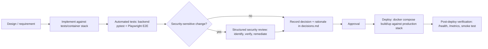
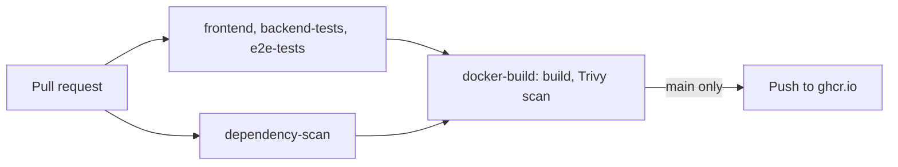

# Change Management and Secure Development Policy

| | |
| --- | --- |
| Policy Owner | **[Name / Title]** |
| Approved By | **[Name / Title]** |
| Effective Date | **[YYYY-MM-DD]** |
| Review Cadence | Annually, and upon material change to the development process or tooling |
| Applies To | Engineering |

## Purpose

Satisfies CC8.1 (authorizes, tests, and approves changes to software and infrastructure) and the CC6.8/CC7.1 secure-development-adjacent expectations. See [trust-services-criteria-mapping.md](../trust-services-criteria-mapping.md) §CC8.

## Scope

Covers all changes to the ReqTrackManager application code, database schema, and infrastructure-as-code (`docker-compose.yml` and related config).

## Policy

1. **Changes are made in isolated environments before touching production.** A dedicated development/test Compose stack (`tests/container/`) is structurally separate from the production stack (`docker-compose.yml`) — this is not just a convention but an enforced separation, born from a real incident where a shared stack led to the test suite wiping a live database (see `docs/decisions.md`). No change should ever be validated by running test tooling against the production stack.
2. **Automated tests are required for new functionality and bug fixes**, and the existing suite must continue to pass. As of the last hardening pass this comprises 189 backend tests (`backend/tests/`) and a full browser-driven Playwright E2E suite (`tests/playwright/`) covering golden-path workflows, permission boundaries, and — specifically — adversarial "attempt to bypass a workflow guarantee" scenarios.
3. **Database schema changes go through Alembic migrations**, applied automatically (and only) on backend startup — never applied by hand against a running database.
4. **Security-sensitive changes get an explicit, structured security review** before being considered complete — this codebase's practice is a three-phase identify → independently re-verify (false-positive-filtered) → remediate process, documented for every pass in `docs/decisions.md`.
5. **Every significant design or security decision is recorded with its rationale** at the time it's made, in `docs/decisions.md` — not reconstructed after the fact. This gives CC8.1's "documents changes" requirement a genuine paper trail rather than relying on commit messages alone.
6. **Dependencies are pinned**, not left floating — `backend/requirements.txt` and `frontend/package-lock.json` fix exact versions, so a rebuild doesn't silently pull in a new (and unreviewed) dependency version.
7. **Changes are approved before being merged/deployed.** **[Company must define the actual approval mechanism — see Known Gaps.]**

## Diagram: change lifecycle

Read this left to right as the path a change takes from idea to production. The "Security review?" branch is a genuine decision point, not a formality — the two hardening passes recorded in `docs/decisions.md` are real instances of a change (a large new feature area) triggering exactly this branch and producing fixes before the change was considered complete.

## Roles and Responsibilities

| Role | Responsibility |
| --- | --- |
| Engineering | Writes tests, follows the isolated-environment workflow, documents decisions |
| Reviewer/approver | Approves changes before deployment — **[Company must name this role]** |
| Information security owner | Determines which changes require a security review |

## Implementation in ReqTrackManager

This is one of the better-evidenced policies in this package precisely because the codebase's own working conventions already closely match what CC8.1 asks for — the gap was formalizing CI enforcement, not inventing a process from nothing. See `docs/decisions.md` for the running record and `docs/deployment.md`'s "Two separate Compose stacks" section for the environment-isolation rationale.

- **CI enforcement**: `.github/workflows/ci.yml` — `frontend` (lint/type-check/build/Storybook tests), `backend-tests` (the real `tests/container/docker-compose.yml` stack; pytest with coverage and a failing threshold, JUnit reporting; `ruff check`), `e2e-tests` (the full Playwright suite), `dependency-scan` (`pip-audit` on the backend and mcp-server requirements, `npm audit --omit=dev` at high on the frontend and Playwright lockfiles) and `docker-build` (production images built, scanned with Trivy for fixable HIGH/CRITICAL findings, then pushed to ghcr.io on `main` only; a pull request builds and scans but never pushes). The documentation site's `npm audit` is reported but not gating (see Known Gaps).
- **Coverage threshold**: `--cov-fail-under=93.2`, the published backend figure (95.2% on 2026-10-22) minus two points. It is raised when coverage rises and never lowered to make a run pass.
- **Code owners**: `.github/CODEOWNERS` names the reviewer GitHub requests on every pull request.

Read left to right: a vulnerable dependency or image stops the job before anything is published.

## Branch protection checklist (Company action)

The "Main Branch" ruleset (Settings → Rules → Rulesets) exists but its enforcement is **Disabled**, so none of the CI gates above can block a merge yet. Only a repository admin can change it; the agent does not. Settings as found on 2026-10-22, and what to set:

| Setting | Found | Set to | Why |
| --- | --- | --- | --- |
| Enforcement status | Disabled | **Active** | A disabled ruleset enforces nothing. |
| Required status checks | `Backend tests, coverage & E2E`, `Build production container images (not published)`, `Build, version, and push production container images` | `Frontend lint, build & test`, `Backend tests & coverage`, `E2E (Playwright) suite`, `Dependency vulnerability scan`, `Build, version, and push production container images` | The first two found names no longer exist (the job was split and renamed), so enabling them as they are would block every merge forever; the frontend job was not required at all. A name must match a job's `name:` exactly. |
| Require branches up to date | On (strict) | Keep | A merge result is the one that was tested. |
| Required approvals | 0 | Decide: 1 with the owner as a bypass actor, or 1 with a second reviewer | A sole owner cannot approve their own pull request, so 1 with no bypass blocks every merge. With a bypass the owner can merge their own change; the bypass is itself an auditable ruleset event. |
| Require review from Code Owners | On | Keep (needs `.github/CODEOWNERS`, now present) | Without the file the rule has nobody to ask. |
| Bypass actors | None | Owner only, if the 1-approval option above is chosen | Keeps an emergency path without disabling the rule. |
| Block deletions, block force pushes | On | Keep | Protects history. |

Once applied, mark Known Gap 2 resolved here and in the control matrix (CC4.1, CC8.1).

## Known Gaps / Exceptions

1. ~~No CI pipeline~~ — **resolved.** `.github/workflows/ci.yml` runs on every push/PR to `main`; every job above is gating. See Implementation above.
2. **The review requirement is configured but not enforced.** The "Main Branch" ruleset is disabled, requires 0 approvals and lists stale check names; `.github/CODEOWNERS` now exists. Applying the [checklist above](#branch-protection-checklist-company-action) is a Company action in GitHub settings, not a workflow change.
3. ~~No automated dependency/container vulnerability scanning~~ — **resolved with one reported exception.** `dependency-scan` and the Trivy step in `docker-build` fail on fixable findings; existing findings were fixed by upgrades (FastAPI 0.111.0 → 0.136.3 with Starlette pinned at 1.9.0 for seven Starlette advisories; the nginx base images 1.27 → 1.30 for about 58 fixable Alpine findings; `follow-redirects` and `launch-editor` in the documentation site lockfile). **Open:** the documentation site's `braces` advisory (GHSA-vfj7-8cjw-p6xm, a build-time glob dependency of Docusaurus) has no patched release, so that step is reported, not gating; the published docs image contains only static files. Findings with no released fix are excluded from the image scan and shown again on every run. Dependency scanning does not cover the third-party images in the Compose files (PostgreSQL, SeaweedFS, Keycloak, MailHog).
4. ~~No coverage threshold~~ — **resolved.** See Implementation: `--cov-fail-under=93.2`. Frontend coverage is reported only, because the Storybook figure excludes the page logic the Playwright suite covers.
5. ~~Container images are built but not published~~ — **resolved.** `docker-build` pushes the backend, frontend, mcp-server and docs images to ghcr.io on every push to `main`, tagged with the GitVersion SemVer, the commit SHA and `latest`, after the scans pass.
6. **Pre-release migration convention:** during initial development, schema changes are folded into the single baseline migration rather than issued as incremental Alembic revisions (documented in `docs/decisions.md`). This is appropriate before a first production release but must stop once real production data exists — every schema change after that point needs its own forward migration, since the baseline-squash convention would otherwise require a destructive `down -v` against live data.

## Related Documents

[risk-assessment-policy.md](risk-assessment-policy.md), [system-operations-monitoring-and-logging-policy.md](system-operations-monitoring-and-logging-policy.md), `docs/decisions.md`, `docs/deployment.md`.
