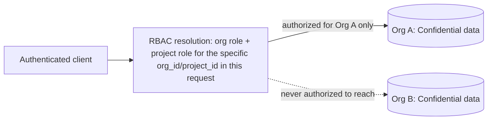

# Data Classification and Confidentiality Policy

| | |
| --- | --- |
| Policy Owner | **[Name / Title]** |
| Approved By | **[Name / Title]** |
| Effective Date | **[YYYY-MM-DD]** |
| Review Cadence | Annually |
| Applies To | Engineering, Operations, and anyone handling exported/backed-up data |

## Purpose

Satisfies C1.1: identifying and maintaining confidential information consistent with the Company's objectives. See [trust-services-criteria-mapping.md](../trust-services-criteria-mapping.md) §C1.

## Scope

Covers all data processed, stored, or transmitted by ReqTrackManager.

## Policy

### Classification scheme

| Class | Definition | Examples in ReqTrackManager |
| --- | --- | --- |
| **Restricted** | Would cause severe harm if disclosed; access must be minimized even internally | Password hashes, password-reset link secrets (and the hashes in `credential_reset_tokens`), TOTP secrets, JWT signing secret, OIDC client secrets, SMTP/storage credentials |
| **Confidential** | Customer-owned business data; disclosure would breach customer trust/contract | Requirement content and reasoning, change requests, review comments, file attachments, report templates, report layouts, tags and their names — everything scoped to a customer organization |
| **Internal** | Not customer data, but not for public release | Audit/login event history, operational metrics, internal architecture documentation |
| **Public** | Safe for unrestricted release | Product documentation, marketing material |

### Handling requirements

1. **Confidential data is isolated per organization** at the query/authorization layer — every request resolving organization- or project-scoped data does so from the specific org/project ID in the request, never from a broader "has this role somewhere" check. This is the system's primary confidentiality control (see [access-control-policy.md](access-control-policy.md) §Authorization and the diagram there).
2. **Restricted data is never returned in API responses or logs.** Password hashes are never serialized to a response; password/secret fields are explicitly stripped from validation error payloads before they reach a client or a log line.
3. **Access to Confidential data requires an authenticated, authorized session** — there is no anonymous or unauthenticated path to organization/project content (the only unauthenticated endpoints are login-adjacent: the login page itself, an org's public branding lookup, and the OIDC callback).
4. **Personal data about identifiable people is Confidential too, and handled more tightly than other content.** The record kinds that hold it today are a Stakeholder (name, contact/reference information) and an Engagement (notes, session prompts, anonymous participant labels and findings that can quote people): it is visible only to members of its organization/project (the Stakeholders & Personas module must also be enabled), is never written to audit events (no name, contact detail or filename in an event's detail), and can be permanently erased on its own (see the retention policy's Implementation section). Bundle exports include it (an explicit operator-initiated backup), so an export is handled as Confidential.
5. **Personal data leaves the application through a record file only when policy and permission both allow it.** A record column that holds personal data carries a sensitivity tag set by the module that owns it (`personal`: names and identifiers; `contact`: ways to reach a person; `free_text_people`: free text that can quote people). The export and import of every record list excludes a tagged column unless (a) the organisation's setting for that tag allows it, else the server default, and a fresh install has everything excluded, **and** (b) the person holds the `export_personal_data` permission in the project (held by organisation administrators, and project administrators and managers; a custom role can grant it to a user or a group). One function decides this for every route, so no route can apply a looser rule. A policy change is audited with its old and new value, and an export or import that included tagged columns records which tags, never the data. Tagged today: a Stakeholder's name, role and organisation or group (`personal`), its contact details and availability (`contact`), the free text about a named person (a Stakeholder's description, interests, responsibilities, goals, priorities, constraints and workflows) and an Engagement's summary and notes (`free_text_people`); a Persona is a fictional archetype and holds none. A test fails if one of these columns loses its tag.
6. **Backups and restore-test copies are Confidential.** A backup set holds everything production holds, including password hashes and encrypted secrets, so it is classified and protected as the most sensitive data it contains: an encrypted repository, access limited to operations, and no row content or secret in any log, status file, metric or report the tooling writes (counts, ids and check names only; scrubbed by `dr_restic.redact`). The scratch stack a restore test starts is a full copy of production data and is treated the same way: isolated network, no published ports, outbound email disabled (`EMAIL_DELIVERY=disabled`), credentials generated per run, removed afterwards.
7. **Confidential data disposal is covered separately** in [data-retention-and-disposal-policy.md](data-retention-and-disposal-policy.md) (C1.2).
8. **Confidentiality commitments to customers** (contractual promises about how their data is handled) must be reflected accurately by this classification scheme — if a customer contract promises something this policy or the underlying system doesn't actually do, that's a compliance gap to close, not a discrepancy to paper over. **[Company must reconcile actual customer contract language against this policy.]**
9. **The MCP server (`mcp-server/`) is an additional retrieval path for Confidential requirement content, not an exception to isolation control #1** — it authenticates and authorizes every request exactly the same way the REST API does (by forwarding the caller's own token), so the isolation boundary above still holds for it. What's new is *where the data goes after retrieval*: if an organization connects a third-party AI platform to it, Confidential content now also flows to that platform's infrastructure. That's a data-flow/subprocessor question (see [vendor-and-subprocessor-management-policy.md](vendor-and-subprocessor-management-policy.md) item 6), not an isolation-control gap — the access-control boundary itself is unchanged.

## Diagram: tenant data isolation

This is the same trust-boundary picture as [system-description.md](../system-description.md) §7, repeated here because it is specifically the mechanism this policy relies on: read it as showing that Confidential data (an organization's requirements/change-requests/etc.) is reachable *only* through the RBAC resolution step, never directly.

## Roles and Responsibilities

| Role | Responsibility |
| --- | --- |
| Engineering | Maintains the isolation boundary; ensures new endpoints follow the org/project-scoped authorization pattern |
| Information security owner | Owns this classification scheme and its alignment with customer contracts |

## Implementation in ReqTrackManager

- **Isolation enforcement**: `backend/app/services/rbac.py` (`require_org_role`, `require_project_manage`, `get_effective_org_roles`, etc.), applied as FastAPI dependencies on every organization/project-scoped router.
- **Personal data in record files**: `backend/app/services/record_policy.py` (policy resolution and audited changes), `backend/app/services/record_tables.py::resolve_export_columns` (the single column filter), `backend/app/routers/system/record_policy.py` and `backend/app/routers/orgs/record_policy.py` (admin APIs), `backend/app/routers/org_record_tables.py` (the organisation-level export and import, same resolver); tested by `backend/tests/test_record_policy.py` (server default x organisation override x permission), `backend/app/modules/stakeholders/tests/test_stakeholders_record_tables.py` (the Stakeholder and Engagement columns stay tagged; a fresh install leaks none of them), `backend/tests/test_org_record_tables.py` (the same rule on the organisation-level lists, with the organisation-level grant) and `tests/playwright/tests/e2e-workflows/personal-data-policy.spec.ts`.
- **Secret redaction**: `backend/app/main.py::redact_sensitive_validation_errors`.
- **Password hashing**: `backend/app/security.py` (bcrypt via `passlib`).
- **Tested confidentiality boundary**: `backend/tests/test_permission_matrix.py`, `backend/tests/test_rbac.py`, and the negative-path cross-org tests in `backend/tests/test_access_review.py` (a non-admin gets 403; an admin of a *different* org gets 403).

## Known Gaps / Exceptions

1. ~~OIDC client secrets are stored in the primary database without application-layer encryption~~ — **resolved.** Every Restricted-classified secret column (`oidc_client_secret`, `smtp_password`, `totp_secret`) is now encrypted at the application layer. See [encryption-and-key-management-policy.md](encryption-and-key-management-policy.md).
2. **No formal reconciliation against actual customer contract language** has been performed — the classification scheme reflects the system's technical behavior, not a review of specific promises made to customers.

## Related Documents

[access-control-policy.md](access-control-policy.md), [encryption-and-key-management-policy.md](encryption-and-key-management-policy.md), [data-retention-and-disposal-policy.md](data-retention-and-disposal-policy.md), [system-description.md](../system-description.md) §5, §7.
