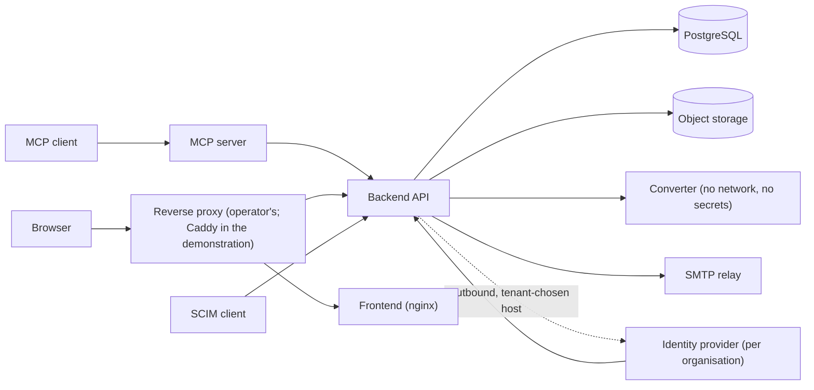

# Security Audit Inventory

Reference for the next security audit: the externally reachable surface, its gates, the trust boundaries and the stored secrets, as read on 2026-11-10. It lists what exists, not findings; findings and their decisions are in [decisions.md](../decisions.md).

## Routes and their gates

Generated from the application's own route table (1,426 entries, HTTP and WebSocket), not from source text. A route is counted once under the first gate found in its dependency tree, so the figures are an orientation, not a proof; a route's real gate is read from its handler.

| Gate (first found) | Routes |
| --- | --- |
| Project, with its module enabled | 341 |
| Organisation, with its module enabled | 180 |
| Project viewer | 146 |
| Signed in (or module frame), checked inline | 143 |
| Organisation role | 139 |
| Fine-grained permission | 122 |
| Project manager | 104 |
| Module role | 74 |
| Signed in, checked inline | 64 |
| Server administrator | 40 |
| Server role (subscription manager, removal authority) | 15 |
| Organisation administrator | 13 |
| SCIM organisation token | 12 |
| Session only (a Personal Access Token is refused) | 10 |
| No authentication | 23 |

**Routes with no authentication** (each reviewed): `/openapi.json`, `/docs`, `/redoc`, `/health`, `/metrics`; sign-in (`/auth/login`, `/auth/2fa/verify`), password recovery (`/auth/forgot-password`, `/auth/reset-password`), `/auth/signup`; OIDC login and callback; `/orgs/by-slug/{slug}/login-info`; `/announcements/login`; `/public/policies` (list and read); `/notifications/unsubscribe` (can only switch the digest off, audited); `/system/branding`, `/system/signup-config`; two SCIM discovery routes; the project WebSocket (authenticates inline with a media token).

**Credential kinds:** session token (12 hours, `purpose=access`, revoked by `token_version`); two-factor challenge (5 minutes); media token (15 minutes, files and WebSocket only, accepted in a query string); Personal Access Token (hashed, scoped to organisations and projects, never accepted for server administration or credential management); SCIM token (hashed, per organisation, no expiry); password reset link (hashed, single use).

**Checks to repeat:** every route with a project or organisation id in its path has a scoping dependency or an inline check; every mutating route writes an audit event; a Personal Access Token is refused wherever a credential or sign-in method changes; the server-role allow-lists cover every route that names them.

## Trust boundaries

- The proxy is the trust boundary for client address and scheme; the backend honours forwarded headers from the addresses in `FORWARDED_ALLOW_IPS` only.
- Outbound connections to a tenant-chosen host (identity provider, SMTP relay) pass `services/net_guard.assert_public_host`; the check resolves then judges and does not pin the connection.
- The converter sits on an internal network shared with the backend only; the backend treats its output as untrusted and sanitises it.
- The front-end server does not proxy the API; `/metrics`, `/docs` and `/openapi.json` are not reachable through the demonstration proxy.

## Stored secrets

| Secret | Where | Protection |
| --- | --- | --- |
| Session signing key | Environment (`JWT_SECRET`) | Refused at start when a placeholder or under 32 characters (`REQUIRE_STRONG_SECRETS`) |
| Column encryption key | Environment (`APP_SECRET_ENCRYPTION_KEY`) | Fernet key from SHA-256 of the value; no rotation path |
| TOTP secret, OIDC client secret, SMTP password | Database | Encrypted with the column encryption key |
| Password | Database | bcrypt (silently truncated at 72 bytes) |
| Personal Access Token, SCIM token, reset link | Database | SHA-256 of a 256-bit value |
| Object storage and database credentials | Environment | Required, no default, in the production Compose file |
| Backup repository password and encrypted environment file | Backup service | restic; age-encrypted copy of the environment |

## Scanning in the pipeline (at 2026-11-10)

`ruff`, `mypy`, `eslint`, `pip-audit`, `npm audit`, Trivy (vulnerabilities). Not present: security-specific static analysis, secret scanning, Trivy's secret and misconfiguration scanners, a dynamic scan, dependency-update automation, and actions pinned by commit.
