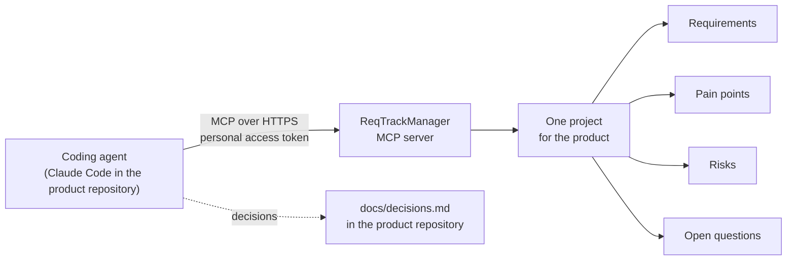

# Tracking a product being built

Use one ReqTrackManager project as the system of record for the requirements, pain points, risks and open questions of a product that is being built in another repository, with a coding agent (Claude Code) writing to it as the work proceeds. The code repository keeps the code and the plan; ReqTrackManager keeps the reasons.



## Set up

1. **Create the project** in ReqTrackManager for the product, and give the account that will connect a role that can edit requirements (stakeholder, administrator or manager).
2. **Create a personal access token** (Preferences → Personal Access Tokens) scoped to that one organisation. See [Authenticating](../authenticating.md). Export it as `REQTRACK_TOKEN` in the shell that starts the agent. Never write it into a file.
3. **Connect the agent** with a `.mcp.json` in the product repository. The server must be reachable over HTTPS; see [Deploying for remote clients](./deploying-for-remote-clients.md).

   ```json
   {
     "mcpServers": {
       "reqtrackmanager": {
         "type": "http",
         "url": "https://<your-instance>/mcp",
         "headers": { "Authorization": "Bearer ${REQTRACK_TOKEN}" }
       }
     }
   }
   ```

   A personal instance's address does not belong in a shared repository: keep `.mcp.json` in `.gitignore` for a repository other people use.
4. **Install the agent skill** so the agent knows the tool order and the rules. Download it from [Agent skill](./agent-skill.md) and unzip it into the repository's `.claude/skills/` folder, or build it from this repository with `python mcp-server/scripts/build_skill_zip.py <out-dir>`. Rebuild it after upgrading the server so it matches the tools.
5. **Tell the agent what to record.** Put the instructions in a file the agent reads at the start of a session (for a personal setup, a git-ignored local instructions file). The table below is the content to include.
6. Start the agent and check `claude mcp list` shows `reqtrackmanager` connected.

## What the agent records, and with which tool

| Product thinking | Record | Tool |
| --- | --- | --- |
| A need the product must meet | Requirement (always created as a draft) | `create_requirement`, `update_requirement` |
| A problem users or the build face today | Pain point | `context_strategy_create_pain_point` |
| Something unresolved that blocks a choice | Open question | `context_strategy_create_open_question` |
| A threat to the plan or the product | Risk | `risk_management_create_risk` |
| A request or idea from a user | Feedback request | `product_feedback_create_request` |
| Why two records relate | Link | `create_artefact_link` |

The agent should search (`search_records`) before it creates, so a record is updated rather than duplicated, and should cite records by code (`REQ-001`) in the product repository's own documents.

## Limits to plan for

- **Decisions cannot be created through MCP.** The Decision Management module has read and approval tools only; decisions are authored in the ReqTrackManager UI. Have the agent write each decision in the product repository's decision log and tell you when it is ready to enter.
- **The agent cannot approve unless you allow it.** Approving, deciding and completing need the organisation and the project to opt in to AI approval, and are best left off for a product still being shaped. A requirement the agent creates stays a draft until a person moves it on.
- **The agent can do only what its token's account can do.** Use a dedicated account for the agent if you want its writes distinguishable from yours; every change records who made it.
- **Standing permission to write.** The skill tells an agent to confirm before writing. A project dedicated to the product can grant a standing instruction to create and update drafts without asking, while still requiring a question before a status change, an approval, a deletion or a write to any other project.
- **Content flows to the assistant's provider.** See [Known limitations](./known-limitations.md).
