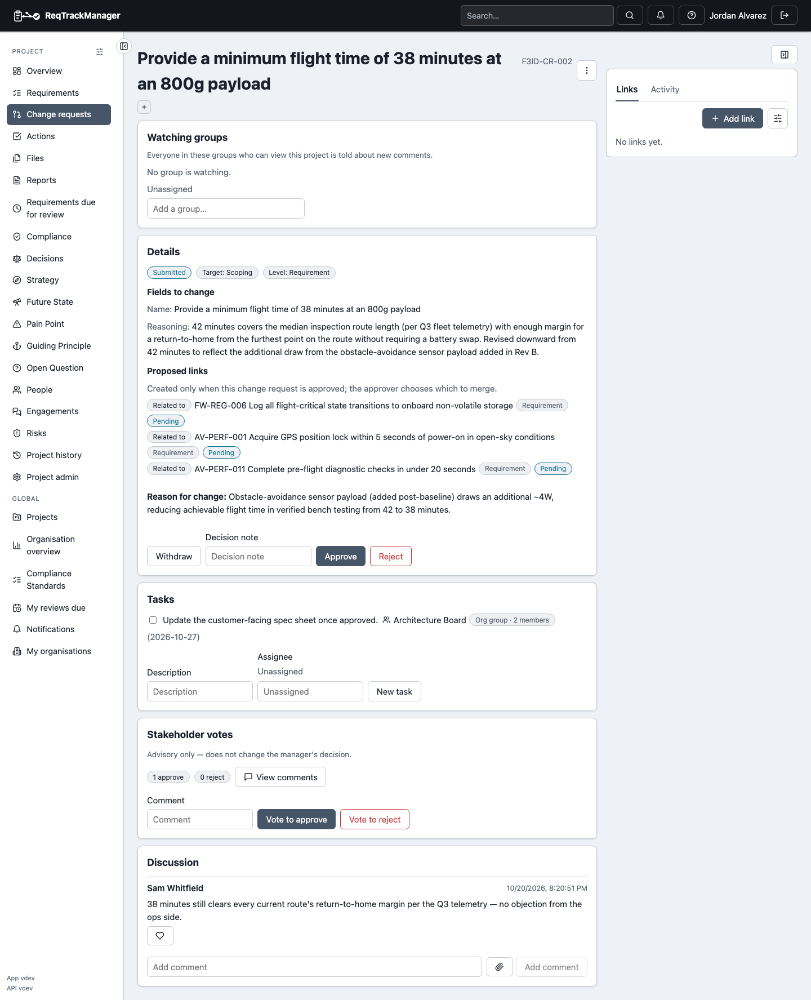
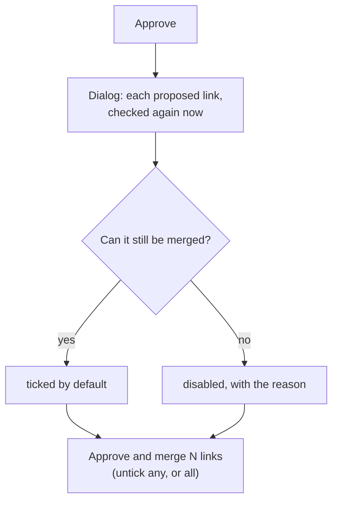

# Change requests

## Creating and submitting

Go to a project's **Change Requests** page to propose a new requirement or a modification to an existing one:

1. **Create**: choose "new requirement" or "modify requirement." For "modify requirement," pick the requirement first, then tick a checkbox for each field to actually change — Name, Reasoning, Clarification, Description, Target version, Level, Review date, Reminder lead time, Assigned reviewer, Custom fields, Attachments. Only ticked fields become editable, each pre-filled from the requirement's current value, and only ticked fields are proposed — anything left unticked is untouched when the change request is approved. For "new requirement," fill in the proposed fields directly. Either way, a reason for the change is required.
2. Optionally **propose links** (see [Proposing links](#proposing-links)).
3. **Submit** it — this notifies project managers and stakeholders.
4. A manager or administrator **approves** or **rejects** it, with an optional decision note. Approval applies only the ticked fields to the target requirement (creating it, for a "new requirement" change request) and notifies the requester. A proposed attachment is only actually attached to the requirement once the change request is approved.
5. The creator — or a manager, on their behalf — can **withdraw** a change request before it's decided.

By default only stakeholders, administrators, and managers can submit change requests; a project setting (**Project Admin → Settings**) can open this up to ordinary members too.

| Change request detail |
| --- |
| Tasks, advisory stakeholder votes, discussion, and approve/reject |
|  |

## Proposing links

A "new requirement" or "modify requirement" change request can also propose **links** from the requirement to other records, such as the decision it follows from or a requirement in a parent project. The create form has a **Proposed links** section with the same **Add a link** dialog as the [Links panel](links-and-traceability.md#the-links-panel): choose the project, find the record, then the relationship. Nothing is linked yet; the links are listed on the change request as **Pending**. The section appears only if you may link requirements (a stakeholder, project administrator or project manager, or anyone with the **Link** or **Manage** permission). You can propose links on an approved requirement even if you could not link it directly.

An approved requirement in a project that [requires a change request for links](requirements-management.md#traceability-links) uses the same mechanism: adding a link from its Links panel creates an "add link" change request that holds the proposed link.

When a manager approves a change request that proposes links, a dialog lists them:

- Every link that can still be created is ticked. **Select all** and **Select none** change the lot; **Approve and merge 2 links** (or **Approve without links**) says what will happen. Approving with none ticked still applies the change request's other changes. For an "add link" change request it would apply nothing at all, and the dialog says so and points to **Reject**.
- A link is checked again when you approve, not trusted from when it was proposed. It is disabled, with the reason, if its link type has since been hidden or removed, a rule no longer allows the pair, the record was deleted or the two projects are no longer related, the records are already linked ("Already linked, will be skipped"), the person who proposed it has lost the right to link, or **you** cannot view the record (you cannot merge a link to something you cannot read).
- If a link you ticked stops being valid while the dialog is open, nothing is applied: the dialog shows the updated list and asks you to approve again.
- Afterwards each link on the change request shows **Merged**, **Left out** (you unticked it) or **Not valid** (with the reason). Merged links are attributed to the person who proposed them and appear in the requirement's Links panel. The requester's notification says how many were merged and how many were not. Rejecting or withdrawing merges none.

## Tasks and stakeholder votes

While a change request is open, anyone with access can:

- Add **tasks** — a short description, an optional assignee and due date, and a done/not-done checkbox — for tracking follow-up work the change implies, like updating a spec sheet once it's approved.
- Cast an **advisory stakeholder vote** (approve/reject, with an optional comment). This is a visible signal for whoever makes the actual decision; it never itself approves or rejects the change request. **View comments** next to the vote tally shows every comment left with a vote.

Like a requirement, every change request also carries its own threaded **discussion** — informal comments distinct from tasks and stakeholder votes — so the reasoning behind a decision lives next to the change itself.

## Filtering the list

Search the Change Requests list by the change's proposed name, its reason, or the target requirement's name or ID. The search runs on the server, so it finds a change request whichever page of the list it's on. As with requirements, clicking a status or target-stage badge filters to it, and clicking again clears the filter.

## Where this fits

See [Change requests and baselines](../concepts/change-requests-and-baselines.md) for why the review workflow exists and the locking rule that triggers it, and [Workflows → Change requests](../workflows/change-requests.md) for the end-to-end task walkthrough.
