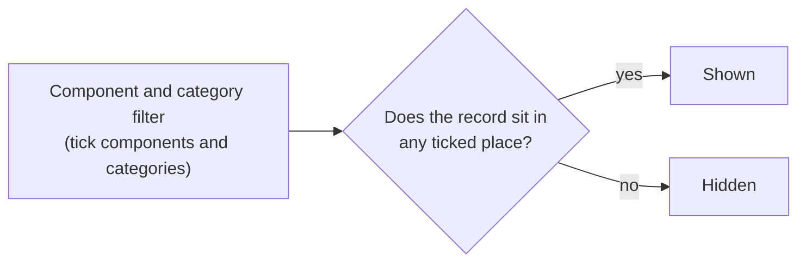
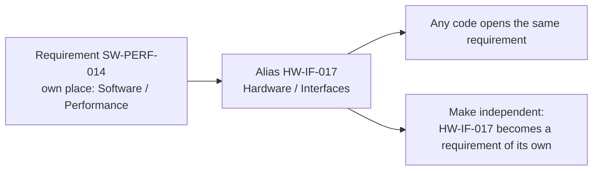

# Components on every record

A project's **components** and **categories** (the tree you set up under **Project admin → Components**) classify requirements. The same tree can classify every other kind of record too: an action, a decision, a risk, a pain point, a persona, a piece of evidence. A record can belong to **several** places in the tree, for example *Hardware / Cooling* and *Software*, so lists, reports and exports can be sliced by it.

A requirement is placed differently: it has one **own** component and category, because the component's prefix forms its code (for example `SW-PERF-014`), and it can sit in further places that each get a code of their own. See [Requirements in several components](#requirements-in-several-components). The rest of this page is for the other kinds of record.

## Placing a record

Under a record's title, in the same row as its tags and external references, are its components. If you may tag that kind of record (the same people who may edit it), the row ends with a single **+** button.

- Select the **+** and choose **Add component or category**, then open **Components and categories**: each component is listed with its categories beneath it, and its arrow collapses or expands them. Type to filter (a match keeps its component open), and tick any number of places. A component on its own and the same component with a category are different places; tick both if you want both.
- Remove a place with the delete button on its chip.
- A change is saved at once and appears in the record's **Activity** tab ("Alex placed this in Hardware / Cooling").
- A person who may only read the record sees its places but no **+**.
- **Add component or category** is not in the menu in a project that has no components yet.

The form that creates a record has a **Components** field too (below **Tags**). The places are applied when the record is saved; if one is refused the record is still saved and a message says where to set them.

## Finding records by component

- Every list has a **Component and category** filter in its filter panel, the same collapsible tree. A record is shown when it sits in **any** ticked component or category; ticking a component on its own matches the record whatever its category.
- The filter combines with the tag filter and the other filters, and **Export** respects it.
- Once a project has placed records, a **Components** column shows where each listed record sits.
- Global search can match component and category names: choose **Component and category** among the search fields.
- A custom report can print, filter and group by the **Component and category** field. Grouping by it puts a record with two places in both groups.

## Import and export

A list's CSV has a **Component and category** column (`placements`), written as component prefixes: `SW` for a component, `SW/PERF` for a category under it, several separated by `;`. Importing the same file puts each record in the places named. A prefix the project does not have is a row error. Someone who may not place records cannot change the column.

## Requirements in several components

A requirement often concerns more than one component: an interface requirement touches both sides. It keeps **one record**, with one text, approval, discussion, set of links and attachments, and sits in further places called **aliases**. Each alias has a **code of its own**, named after that component and category (`HW-IF-017` beside `SW-PERF-014`), numbered from the same sequence as every other requirement code, so a code is never reused.

- **Add a place.** The create form has **Additional components** (choose categories; a component cannot be chosen alone). On an existing requirement, the **Components and codes** section lists the own place and each alias with its code, and has the same picker. Adding or removing a place needs the same permission as tagging and, like a tag, is allowed on an approved requirement.
- **Any code finds the requirement.** The record by code look-up, the Links finder, search, the requirement list's search box, a CSV import and the MCP tools accept an alias code. The list filter by component or category also matches an alias, and a list narrowed to a component shows the alias code after the own code.
- **Remove from this component** retires the alias. Its code is never reused and still opens the requirement.
- **Make this the own place** swaps the own place and the alias, together with their codes, so no code is lost. It is a change to the requirement's own place, so it is not available while the requirement is approved.
- **Make independent** turns an alias into a requirement of its own. It cannot be undone, so you type the alias code to confirm. A new **draft** takes the alias code and the original's current text, owned by you and not approved; the original loses the alias. Its tags, comments (with their author and date, marked *Copied from*), attachments and links are copied, and it is linked to the original with *Related to* (an organisation without that link type is asked to choose another). A link the approved-link lock refuses is left out and listed afterwards. Copied links show *Copied from SW-PERF-014* in the Links panel.
- **Reports and exports.** The requirements report lists a requirement under each place with that place's code and a *Same as* reference to its own code (tick **List under own component only** in the report dialog to list it once). The CSV has **Additional components and categories** (`additional_places`, prefixes such as `HW/IF`, several separated by `;`) and a read-only **Alias codes** column; a row named by an alias code updates the one requirement.
- **Turning aliases off.** **Organisation settings → Projects** and **Project admin → Structure** have **New requirement aliases**: *Allowed* or *Disabled* (a project can follow its parent project, then the organisation). Disabled stops *new* aliases; existing ones keep working and can be made independent one at a time or all at once from the project setting. A project that relies on traceability matrices and coverage reads them most clearly with one code per requirement.

## What cannot be placed

- A requirement's **own** component and category are chosen when it is created and changed by editing it; only its further places are aliases.
- Records the **organisation** owns (an organisation persona, stakeholder, strategy and so on) cannot be placed, because a component belongs to one project.
- The three compliance assessment kinds (a standard's requirements, a project's assessments and required-action assessments) follow the standard's own structure.

## Changing the tree

- **Deleting a category** moves every record placed in it to the category you choose to replace it; a record already there keeps one place.
- **Deleting a component** is refused while records are placed in it, with a message to remove their places first.
- A child project has its own tree and does not use its parent's.

## Moving between projects

A project [export and import](zip-export-import.md) carries each record's places by component and category prefix, so a copy points at its own tree.

## For API clients

`GET` and `PUT` `/projects/{id}/artefacts/{type}/{id}/placements` read and replace a record's places; lists take repeated `component_id` and `category_id` parameters.
