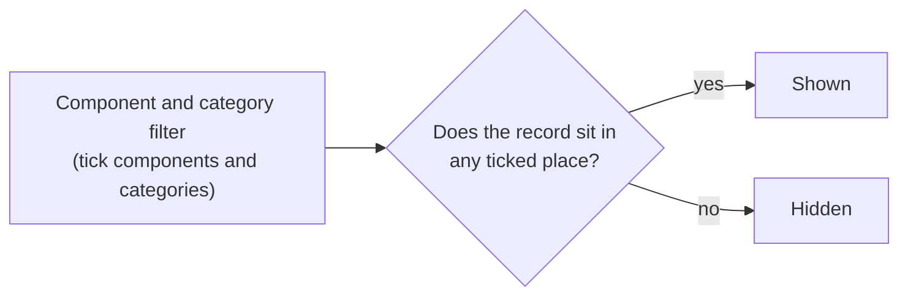

# Components on every record

A project's **components** and **categories** (the tree you set up under **Project admin → Components**) classify requirements. The same tree can classify every other kind of record too: an action, a decision, a risk, a pain point, a persona, a piece of evidence. A record can belong to **several** places in the tree, for example *Hardware / Cooling* and *Software*, so lists, reports and exports can be sliced by it.

A requirement is the exception: it keeps its own single component and category, because the component's prefix forms its code (for example `SW-PERF-014`). Everything below is for the other kinds of record.

## Placing a record

Under a record's title, next to its tags, are its components. If you may tag that kind of record (the same people who may edit it), a picker is there.

- Choose **Components and categories**, type to filter the list, and tick any number of places. A component on its own and the same component with a category are different places; tick both if you want both.
- Remove a place with the delete button on its chip.
- A change is saved at once and appears in the record's **Activity** tab ("Alex placed this in Hardware / Cooling").
- A person who may only read the record sees its places but no picker.
- The picker does not appear in a project that has no components yet.

The form that creates a record has a **Components** field too (below **Tags**). The places are applied when the record is saved; if one is refused the record is still saved and a message says where to set them.

## Finding records by component

- Every list has a **Component and category** filter in its filter panel. A record is shown when it sits in **any** ticked component or category; ticking a component on its own matches the record whatever its category.
- The filter combines with the tag filter and the other filters, and **Export** respects it.
- Once a project has placed records, a **Components** column shows where each listed record sits.
- Global search can match component and category names: choose **Component and category** among the search fields.
- A custom report can print, filter and group by the **Component and category** field. Grouping by it puts a record with two places in both groups.

## Import and export

A list's CSV has a **Component and category** column (`placements`), written as component prefixes: `SW` for a component, `SW/PERF` for a category under it, several separated by `;`. Importing the same file puts each record in the places named. A prefix the project does not have is a row error. Someone who may not place records cannot change the column.

## What cannot be placed

- A requirement keeps its own component and category.
- Records the **organisation** owns (an organisation persona, stakeholder, strategy and so on) cannot be placed, because a component belongs to one project.
- The three compliance assessment kinds (a standard's requirements, a project's assessments and required-action assessments) follow the standard's own structure.

## Changing the tree

- **Deleting a category** moves every record placed in it to the category you choose to replace it; a record already there keeps one place.
- **Deleting a component** is refused while records are placed in it, with a message to remove their places first.
- A child project has its own tree and does not use its parent's.

## Moving between projects

A project [export and import](zip-export-import.md) carries each record's places by component and category prefix, so a copy points at its own tree.

## For API clients

`GET` and `PUT` `/projects/{id}/artefacts/{type}/{id}/placements` read and replace a record's places; lists take repeated `component_id` and `category_id` parameters.
