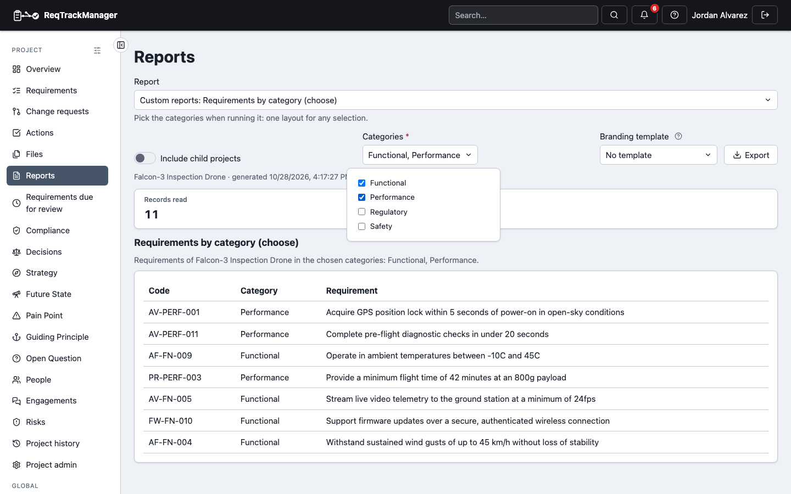

# Blocks, report components and variables

What a layout can contain beyond headings and text, written in the [designer](./designing-a-layout.md)'s text view (the block editor builds the same blocks).

## Equations

write an equation on its own line with `@equation \frac{a}{b} = c`, or inside a text line between `\( ... \)` (inline) or `$$ ... $$` (display). Equations are drawn in the preview, the HTML page and the PDF, are native, editable equations in Word when the equation is one Word handles (otherwise a picture), and are pictures in OpenDocument text. A record field shows equations too when it is one people write them in (a requirement's description, reasoning and clarification), including in a table column; any other record text, such as a title, is never read as an equation. Equations work in headings, list items and table cells as well as paragraphs (a `$$ ... $$` there is drawn inline); Excel, OpenDocument spreadsheet and CSV tables keep the TeX as text. The same equations are typeset on a requirement's page once it is locked. Only a set of common commands is accepted (Greek letters, operators, fractions, roots, subscripts, matrices and the like); `\href`, `\input` and anything else is refused when you save. An equation that cannot be drawn is printed as you wrote it, with a warning on the run.

## Embedded report tables (widgets)

a document layout can include a table, the headline figures or the notes of any module report, such as the Risk register's table of Risks or the Context & Strategy summary's figures, as a line of its own, `[[widget.context_strategy.summary.figures stale_months=12]]`. A widget is only the component: the headings and the sentences around it are the layout's own, so the same table can sit under different words in different reports. It keeps the report's cell colours, can be ordered by one of its columns (`sort "Next review" desc`; numbers sort as numbers, dates as dates, other text without regard to case) and can say what to show when it is empty (`empty "No risks recorded."`). It is produced for the project being reported on, so a project that has switched the module off shows a note that the report is not available there and the rest of the layout still runs. The list of components (with each report's settings) comes from the REST API or the `list_report_widgets` MCP tool; a layout can run up to 20 different reports (components of one report with the same settings share a run).

## Leaving a part out where a module is off

`@if module risk_management` ... `@end` (with `@else` if you want) shows its contents only in a project that uses that module, so one organisation layout can span modules and still read cleanly in a project that uses only some of them. The starters are built this way.

## Choosing which records a layout lists

a layout's `where` can combine tests with `and`, `or`, `not` and brackets, and test a field against a list: `category in Safety, Security` or `status not_in draft, rejected`, on any field that has a value to compare (text, status, person, number, date), so "every category except General" and "these three categories in one table" are both a single line. A record with no value for the field counts as not in the list.

## Variables

| Variables: the form the Reports dialog shows for a layout that asks for categories |
| --- |
|  |

a layout can ask for values when it is run, so one layout serves any selection. Declare each at the top of the text view, for example `@var categories enum list label "Categories" from requirement.category`, and use it as `where category in $categories` or in a sentence as `{{var.categories}}`. The Reports page and the designer's preview then show a form: a list of the project's own categories to tick, a date, a number, a switch or text. A variable with a default (`default today` for a date) runs at once; one without a default holds the report back, and Export is hidden, until you choose. A download carries the same choice, and the run records the values it used. Variables only narrow what a report shows; they never show you anything you could not already open, and a value outside the current list still runs but warns that it may match nothing.
