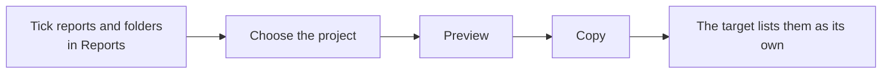

# Copying reports to another project

A project administrator can copy reports from one project to another project of the **same organisation**, so a set of reports built once does not have to be rebuilt. You need to be able to manage reports in **both** projects.

## How to copy

1. Open **Project Admin**, **Reports**, and choose **Copy to another project…**. Tick boxes appear. A folder's box ticks everything in it. Alternatively, open a report's menu and choose **Copy to another project…** to copy just that one.
2. Choose **Copy…**, then the project to copy into. Only projects where you can manage reports are listed.
3. Choose what happens if the target already has something with the same name, then **Preview**. Each item says what will happen, with a note for anything that may not work in the target.
4. Choose **Copy**. The dialog says what was copied and links to the target's Reports.

## What is copied

| Item | What the copy is |
| --- | --- |
| Report layout or table | A new layout owned by the target, holding the **latest version** as its version 1. The original keeps its history and is not changed. A layout shared by the organisation or a parent project is copied as the project's own editable copy. |
| Pack | A new pack with the latest definition and its saved sets. Entries that name a copied layout follow its new name. |
| Folder | A folder the source project added. Reports keep the folder they are filed in. |
| Module report setting | A module report's folder or hidden setting the source project made for itself. |
| Pictures | A picture from the organisation library stays shared. A picture from a project library is copied into the target's library. |
| Favourites | Your own stars on the copied reports. |

Record content is never copied: only the definitions.

## Names are never replaced

If the target project already has a layout or pack with the same name, the copy is added as **Name (copy)** (then **(copy 2)** and so on), or skipped if you chose that. Nothing in the target is replaced or changed. A copy that has the same name as a report the target only inherits will shadow it in that project; the preview says so.

## What may not work in the target

The preview warns when:

- a layout uses report parts of a module that is switched off in the target (they stay in the layout and show nothing there);
- a pack entry uses a layout that was not copied, so it runs in the target only if the target has a layout of that name;
- a variable's default is not one of the target's current options;
- pictures will be copied into the target's library.

Copying into a child project makes the copy the child's own.
