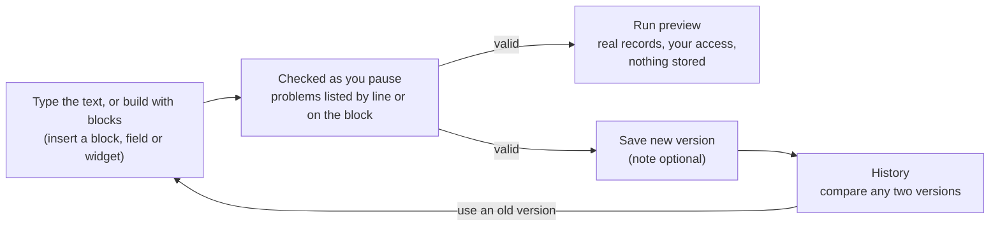
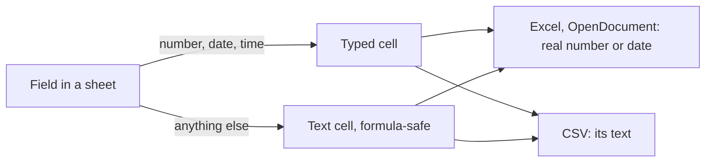
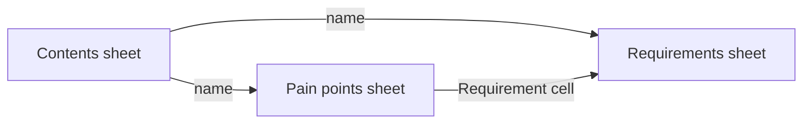
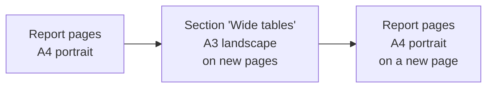
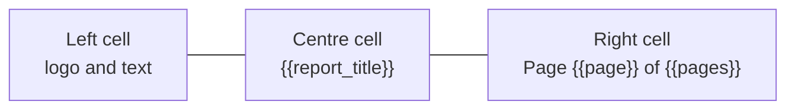
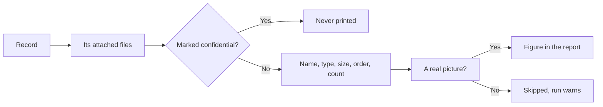
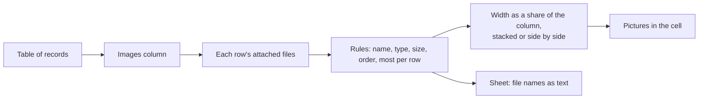

# Designing a layout

**Report Setup** lists a project's own layouts, those shared by its parent projects and by the organisation, and, for an organisation, its own, in one folder list with the report packs and the reports modules provide. **Search** (name, description or folder) and the **Type**, **Show** and **Shared from** filters narrow it. Choose **New**, then **New layout**, give it a name, optionally a **Folder** for the Reports picker (such as `Handover/Quarterly`, see [finding and organising reports](./organising-reports.md)) and say whether it is a **Document** (headings, text and tables, for PDF, Word or HTML) or a **Table** (one or more plain tables, for Excel or CSV); the kind cannot be changed later. A layout shared from elsewhere opens read-only: **Duplicate…** it to change it for this project (see [duplicating a report](./duplicating-a-report.md)), or **Hide in this project** and bring it back with **Add organisation defaults**.

The designer shows the layout in two views you can switch between at any time: **Text** and **Blocks**. In the text view each block is a line starting with `@`, and `{{req.title}}` puts a field of a record in the text.

| The text view: icon buttons for the blocks and the page setup, one block per line, problems listed by line, and a live preview beside it |
| --- |
|  |

```text
@layout document

@heading Requirements of {{project_name}}

@each requirement sort title as req
  @heading level=2 {{req.code}} {{req.title}}
@end
```



- **Problems** are listed by line and column; choosing one puts the cursor there. **Save new version** and **Run preview** wait until the text is valid. A layout's first line must declare its own kind (`@layout document` or `@layout table`).
- The **icon buttons** above the text add a heading (of level 1, 2 or 3), text, *for each record*, a group, a table, an *if*, an equation or a page break at the cursor (a sheet for a table layout); hover or focus a button for its name. The **Page setup** button beside them opens a dialog for the [page setup](#page-setup): the page **size**, **orientation**, **margins**, **header and footer** and **page styles**, written into the first lines of the text; the PDF, Word and OpenDocument files use them. The **Fields** tab is one searchable list of everything `{{…}}` can name at the cursor: the report and project values (`{{project_name}}`, `{{project_code}}`, `{{project_description}}`, `{{report_title}}`, `{{generated_on}}`, `{{organisation}}`, `{{layout_version}}`) together with the fields of the names in scope (the name after `as` of the block you are in), each saying where it comes from. Search it, or use **From** to narrow it to the report and project values or to one name. The **Widgets** tab lists the report components you can embed as a tree: each module, then each of its reports, then the report's parts, all collapsed until you open them (a search opens every branch that still holds a match). Choose a part to see the report's settings and to insert the finished line.

| The Fields tab: report and project values and the fields of the names in scope, in one searchable list |
| --- |
|  |

| The Widgets tab: modules, reports and parts as a tree that starts collapsed |
| --- |
|  |

- **Blocks** shows the same layout as blocks, so you can build a layout without writing the `@` syntax, and it has the full width of the page. **Add block** lists the blocks (*Heading*, *Text* and *Table* first), and the line beside it says where the next one will go: after the selected block, inside it (a block that holds others, such as *for each record*, a group or an *if*, offers each of its lists) or at the end of the layout. The new block is selected at once, and **Ctrl+Z** (**Cmd+Z** on a Mac) takes it back. Drag blocks on the canvas to reorder them or drop them inside another block. Short settings (a heading's words and level, the name a *for each* gives each record) are on the block itself. **Select a block** to edit all its settings in the panel beside the canvas (under it on a narrow screen): *Linked from* lists the names of the enclosing blocks, and a filter offers the fields and operators that suit the field you chose. The arrow keys move around the blocks. A block with a problem shows a warning mark, and the message appears under the field in the panel; **Layout settings** at the top holds the page size and orientation, the margins, the [page styles](#page-setup) and the [variables](./blocks-widgets-and-variables.md#variables). The layout is checked as you pause, **Save new version** and **Run preview** wait until there are no problems, and switching to **Text** shows the same layout as text. You can switch from the text only while it reads without problems. A block dragged outside the layout is not part of it, and the panel says so. **Preview** opens the preview in a dialog; **Preview panel** keeps it open beside the blocks (your choice is remembered).

- **Insert snippet** (beside **Add block** in Blocks, and beside the block shortcuts in Text) adds a ready-made piece to the layout: a cover page, a logo at the top right of the first page, record images, a document control list, an approvals block, a landscape table section or, for a table layout, two linked sheets. The window lists the snippets by category with a search box, shows the output formats each is true in (PDF, Word, OpenDocument, HTML) and an outline of the blocks it adds, and asks for what it needs: a picture from the library, a kind of record, a short text. A snippet for the other kind of layout (a table snippet in a document) is shown greyed out with the reason. In **Blocks** it goes where the line beside **Add block** says, or at the start of the layout, and one **Ctrl+Z** removes all its blocks (a page style it added stays until you delete it). In **Text** the text is read as a layout first, so it must be free of problems; the snippet goes at the end or the start, and **Undo insertion** puts the text back while you have not edited it. Either way a note lists what was added ("Added page style "Cover""), and a page style or variable the layout already has is reused rather than overwritten. A snippet is copied in: changing the layout later never changes the snippet, and the snippet never changes the layout again. A snippet cannot give anyone access to more than they could already read: its blocks run with the permissions of whoever runs the report.
- **Save as snippet** keeps a piece you built so you can insert it into other layouts. In **Blocks**, select a block (a container is saved with everything inside it) and choose **Save as snippet**; in **Text**, put the caret in a block or select several, and the top-level blocks you touched are saved. Give it a **Name**, an optional description and a **Category**, and choose where to keep it: this project (also shared with the projects below it) or, from a project, the organisation, which shares it with every project. The window says how many blocks it saves and which page styles and variables it carries along, so it works in a layout that has neither. A selection that needs something defined outside it (an alias of an enclosing "for each") cannot be saved, and a picture from a project's library cannot be kept for the organisation: the window names the picture. Saved snippets appear in **Insert snippet** beside the built-in ones, marked "Saved" with where they come from, and are copied in like any other. They have no parameters: edit the result after inserting.
- **Report snippets** in **Report Setup** (and an organisation's **Templates & reports**) lists the saved snippets with their source, block count and what they carry. **Edit details** renames or re-describes one, **Make a copy** makes a snippet of your own from it (or **Copy to the organisation**), and **Delete** removes one you own after you type its name; layouts already built from it keep their blocks. A snippet shared from the organisation or a parent project is read-only: **Hide in this project** stops it being offered here, and **Add organisation defaults** brings it back. Snippets travel with the project and organisation exports.

- **Preview** runs the layout as you, on the real records, and shows a document as it will print or a table layout's first rows of each sheet (with the real row count). It stores nothing, and a project preview can include child projects while an organisation preview can be limited to chosen projects.
- **Saving** adds a version: **Save new version** asks for an optional note in a small window, then saves. If somebody saved while you were editing, you are told and can reload their version; nothing is overwritten. Leaving with unsaved changes asks first.
- **History** lists every version and compares any two line by line (added lines start with `+`, removed with `-`). **Use this version as the new text** puts an old version in the editor; saving it adds a new version, so history is never rewritten.

| History: any two versions compared line by line |
| --- |
|  |

- Organisation administrators can design organisation layouts, and project administrators their own project's; others can run layouts but not open the designer.

Next: [blocks, report components and variables](./blocks-widgets-and-variables.md).

## Sheets: numbers and dates stay numbers and dates

In an Excel or OpenDocument spreadsheet, a field that holds a number, a date or a time of day is saved as a real number or date, not as text, so the spreadsheet can sort, filter and add it up. Everything else (titles, statuses, people, codes) stays text.

- A date shows as `2026-10-30`; a time of day (when something happened) shows in UTC as `2026-10-30 09:15:30Z`. A spreadsheet cell has no time zone, so the `Z` says which one it is.
- A number with a minus sign stays a number. Text that starts with `=`, `+`, `-` or `@` is still written as plain text and cannot run as a formula.
- A number too long to keep exactly (more than 15 digits) stays text.
- A CSV file has no types, so it holds the same text as before.



## Links between sheets and a contents sheet

In a table layout, a column can open the row of the same record on another sheet, in Excel and OpenDocument spreadsheets.

1. Make a sheet for each kind of record (for example *Requirements* and *Pain points*).
2. On the second sheet, join the first kind of record (the join gives one row per linked record) and add a column that reads it, for example the requirement's code.
3. In that column's settings choose **Link to sheet** and pick the first sheet. Only sheets that list the same kind of record are offered. In the text view it is `@column req.code "Requirement" link "Requirements"`.

Each cell then opens the matching row on the first sheet. A record that is not on that sheet (filtered out by that sheet's conditions, or not visible to you) stays plain text, and the run says how many cells could not be linked. A CSV file has no links and keeps the text.

Switch on **Contents sheet** in the layout's settings (`@layout table contents` in the text view) to start the workbook with a *Contents* sheet: one row per sheet, its name linking to the sheet, and how many rows it holds. A sheet of your own cannot be called *Contents* while it is on.



One cell opens one row. To follow several linked records from a requirement, use the join, which lists each linked record on its own row, and link the column in each row. A ready-made starting point is the **Two linked sheets** snippet.

## Page setup

A document layout has its own pages (size, orientation and margins) and can name other **page styles** for parts of the report, for example an A3 landscape table inside an A4 portrait report.



- **Margins** are in centimetres on each side (1 to 10), with a **gutter** (0 to 5) of extra room on the binding side for punching or binding. Left out, every side is 1.5 cm and there is no gutter.
- **Mirror margins** is for double-sided printing: left and the gutter become the *inner* edge of every page and right the *outer*, so they swap sides on facing pages. It applies to every page style of the layout.
- A **page style** has a name, and optionally its own size, orientation and margins; whatever it leaves out is the layout's own. Add one in the Page setup dialog, or with a line in the text before the first block: `@pagestyle "Wide tables" landscape A3 margins left=1 right=1`.
- A **section** lays its contents out in one page style: `@section "Wide tables"` … `@end` in the text, or the *Section* block, which asks for the page style. The section starts on a new page, and the report goes back to its own page style on a new page after it. A section that shows nothing leaves no page behind, and a section cannot contain another.
- Every style must leave at least 5 cm of text width and height; a problem is listed under the field that causes it.
- PDF, Word and OpenDocument files have real pages in the sizes and margins you set. The HTML preview has no pages: a section appears as a box as wide as its page, labelled with the paper and margins, and printing the HTML page from a browser uses the same sizes. A table layout (CSV, Excel, ODS) has no pages, so it has no page setup.

## Headers and footers

A header (top margin) and a footer (bottom margin) are an invisible row of three cells, **left**, **centre** and **right**, so content lines up across the page without you building a table. The layout has one of each, and each page style can have its own.



- For each, choose **Print**: *The report template's default* (for the layout) or *Same as the layout's* (for a page style), *Its own text*, or *Nothing*. With no footer set anywhere, the organisation's report template supplies its footer text (and its logo as a header) and every page gets a page number.
- Each cell holds up to three lines of text. **Insert placeholder** adds one to the cell you last edited: `{{report_title}}`, `{{project_name}}`, `{{project_code}}`, `{{organisation}}`, `{{generated_on}}` (the date you ran the report, on your own calendar), `{{layout_version}}`, and the page fields `{{page}}` (this page) and `{{pages}}` (the total). Page numbers carry on across sections.
- A **logo** from the image library can sit in any cell, beside that cell's text, at a height you set. The logo follows the same library rule as an Image block.
- **First page** can be *Skipped*, for a cover page. For a page style it applies to the first page of each section in that style.
- A header or footer must fit in its margin (the editor says how much it takes and the check refuses one that does not fit), so raise the top or bottom margin for a bigger logo or more lines.
- When margins **mirror** for double-sided printing, the left and right cells swap on left-hand pages, so a page number stays at the outer edge.
- In the text view they are `@header left "…" centre "…" right "…" logo "<file id>" height 0.8 slot left first none` and `@footer …`, written under the `@layout` line, or under the `@pagestyle` line they belong to. `@footer` on its own means no footer.
- PDF, Word and OpenDocument files show them with live page numbers. The HTML preview shows them as a row above and below each page style's part of the report, with `n` and `N` in place of the numbers; printing the HTML page from a browser that supports CSS page margin boxes (Chrome and Edge do; Firefox does not yet) prints them with the real numbers, but not the logo. A table layout has no pages, so no header or footer.

## Images

An **Image** block puts a picture from the image library into the report: on a line of its own, with text running beside it, or behind or in front of the text.

- **Choose** the picture with *Choose image…*. The dialog lists the library (search by name) and lets you upload a PNG, JPEG, GIF, WebP or SVG file; the largest file allowed is shown in the dialog and set by your administrator (50 MB unless changed). A project layout can use its own project's pictures and the organisation's; an organisation layout can use the organisation's only, because every project runs it. An upload goes to the library of the layout you are editing, and the dialog says which.
- **Selecting a picture shows its details**: a larger preview, its size in pixels and, for a photograph, when it was taken (on the camera's own clock), the camera, any description saved in the file and where it was taken. Use these to tell photographs apart when their names do not. The same details are behind the *i* button beside a picture's name on the project's Files page, an organisation's shared resources and any list of attachments. Double-click a picture, or press *Use image*, to choose it.
- **Tidying the library.** Each picture says whether it is used. Tick *Unused only* to list the pictures no layout uses, in its current version or any older saved one (a picture only an older version uses is labelled *Only in older versions*, since deleting it would lose it if that version is restored). *Delete several…* lets you mark pictures you own (all the ones shown, if you like) and delete them with one confirmation, which says how many are still used by a layout. Those layouts skip the picture until another is chosen. You can only delete pictures of the library you are in: a project cannot delete the organisation's.
- **Alternative text** says what the picture shows, for readers who cannot see it; it is required unless you tick *Decorative*.
- **Width** is in centimetres, millimetres or as a percentage of the text width and keeps the picture's shape; **height** is in centimetres or millimetres, and setting both stretches it. With no size the picture prints at its own size, never wider than the text.
- **Alignment** is left, centre or right. A **caption** can sit above or below the picture and can use `{{project_name}}` and the other placeholders.
- **Caption numbering** is *Automatic* by default: a picture with a caption is numbered "Figure 1:", "Figure 2:" … in the order they appear, and one without (a logo) is not. Choose *Always* to number it anyway ("Figure 3") or *Never* to leave a captioned picture plain.
- **Placement** is *In line* (the picture has a line of its own, with an optional caption), *Text wraps beside it*, *Behind the text* or *In front of the text*.
  - **Wrap**: set *Alignment* to left or right, the side the picture is on. The text blocks that follow it (headings, paragraphs, notes and lists) run beside it for its height and then across the full width, and carry on over a page break. A table, an equation, another picture or a page break ends the wrap in the PDF; Word and OpenDocument wrap any text that overlaps the picture, so keep a table away from it.
  - **Behind and in front**: *Position from* is where the picture is measured from: *This block's place in the text*, *The corner of the text area* (inside the page margins) or *The corner of the page*. *Across* and *Down* are in centimetres from that corner (negative goes left or up). A picture behind the text suits a watermark, a picture in front a stamp.
  - A picture that floats has no caption and no figure number, and a layered picture has no alignment; the designer says so rather than ignoring the setting.
  - PDF, Word and OpenDocument text place the picture exactly. The HTML preview has no pages, so it measures *The corner of the text area* and *The corner of the page* from where the block sits in the text.

  ```mermaid
  flowchart LR
    A[Image block] --> B{Placement}
    B -->|In line| C[Own line, caption]
    B -->|Wrap| D[Text beside it, left or right]
    B -->|Behind or in front| E[Over the page at an anchor and offset]
  ```
- In the text view an image is one line: `@image "<file id>" alt "The logo" width 85 mm align right caption "Our logo"`; a layered picture adds `placement behind anchor page x 2 y 3` (`x` across and `y` down, in cm).
- A picture's GPS position, camera and other hidden details are removed when it is placed in a report. A picture that has been deleted is left out and the run warns about it.
- A report that is exported or imported with its project carries the pictures it uses.

## Pictures attached to records

A **Record images** block, placed inside a *For each record* block, prints the pictures attached to each record (for example the photos on a Pain Point). It is for records that can hold attachments; a type whose attachments may show or concern identifiable people (stakeholders and engagements) is not offered, and the designer says why.

- **File names** chooses by name: one pattern per line, using `*` for any run of characters and `?` for one letter, ignoring case (`site-photo-*`). A pattern can use the record's own values, for example `{{rec.code}}-*` picks the photo named after each record; a value is matched as plain text, so a title of `*` matches only a file called `*`. Leave it empty to allow any name.
- **File types** allows only some extensions (png, jpg, jpeg, gif, webp, svg). Whatever the name says, only a real picture prints: a text file renamed `.png` is skipped, with a warning on the run.
- **Most per record** (up to 20), **Order** (by file name, or by when the file was attached, oldest first) and **Largest file** keep a record with many photos in check. A very large report that embeds many pictures stops with a message to narrow it or download it in the background.
- **Caption** is the file name, text you write (with placeholders), or none; the Image block's width, height, alignment, caption position and numbering apply to every picture. Placement is *In line* or *Text wraps beside it* (which has no caption). *Text when there is nothing* appears for a record with no matching picture; leave it empty to print nothing.
- A picture prints only if you could open it from its record's page. A picture marked **confidential** never prints, whatever the rules say.



### A column of pictures in a table

A table can show the pictures attached to each row's record in a column of its own, beside the code and title: **Add images column** in the table block's details. It is for any pictures, a photo or a diagram, so there is no thumbnail size: each picture is shown at **90% of the column's width** unless you choose otherwise, and a percentage follows the column, so it still fits when you change the page size or orientation.

- The rules that choose the files are the same as for a Record images block (**File names**, **File types**, **Most per row**, **Order**, **Largest file**). A name can use the row's own values as `{{row.code}}`, for example `{{row.code}}-*`.
- **Width** (a percentage of the column, or cm or mm) and **Height** are yours to set; nothing else limits the size. The one exception is physical: if a cell would be taller than a page of the report, its pictures are shrunk together (keeping their shapes) so the row can be printed.
- **Arrangement** is **stacked** (one under another) or **side by side** (a line that wraps inside the cell), chosen for each column. A row with no matching picture has an empty cell.
- The same pictures print in PDF, Word, OpenDocument and HTML, and the same record rules apply: a picture prints only if you could open it from its record's page, and a picture marked confidential never does. In a **sheet** (Excel, OpenDocument spreadsheet, CSV) the column lists the matching file names instead, because a cell there holds text.



In the text view an images column is one line inside the table: `@images names "site-*" types png width 80 percent arrange side_by_side label "Photos"`.

### Repeating table headings

A table's column headings print again at the top of every page the table runs onto. If you would rather have them only at the start, turn off **Repeat table header rows** in the layout's settings (Blocks) or **Page setup** (Text). It applies to every table in the layout, and the text view writes `norepeatheader` on the first line (`@layout document norepeatheader`).

### Marking a picture confidential

On a record's page, each attached picture has a lock button. Marking it confidential keeps it out of every report; it does **not** change who can open the file. The page says so beneath the list. The person who attached the picture, and anyone who manages the project, can mark or clear it. The mark travels with the file when a project is exported and imported.

In the text view the block is one line: `@record_images names "site-*", "{{rec.code}}-*" types png, jpg max_count 3 order uploaded caption_source none`.
