# Designing a layout

**Reports** lists a project's own layouts, those shared by its parent projects and by the organisation, and, for an organisation, its own, in one folder list with the report packs and the reports modules provide. **Search** (name, description or folder) and the **Type**, **Show** and **Shared from** filters narrow it. Choose **New**, then **New layout**, give it a name, optionally a **Folder** for the Reports picker (such as `Handover/Quarterly`, see [finding and organising reports](./organising-reports.md)) and say whether it is a **Document** (headings, text and tables, for PDF, Word or HTML) or a **Table** (one or more plain tables, for Excel or CSV); the kind cannot be changed later. A layout shared from elsewhere opens read-only: **Duplicate…** it to change it for this project (see [duplicating a report](./duplicating-a-report.md)), or **Hide in this project** and bring it back with **Add organisation defaults**.

The designer shows the layout in two views you can switch between at any time: **Text** and **Blocks**. In the text view each block is a line starting with `@`, and `{{req.title}}` puts a field of a record in the text.

| The text view: icon buttons for the blocks and the page setup, one block per line, problems listed by line, and a live preview beside it |
| --- |
| 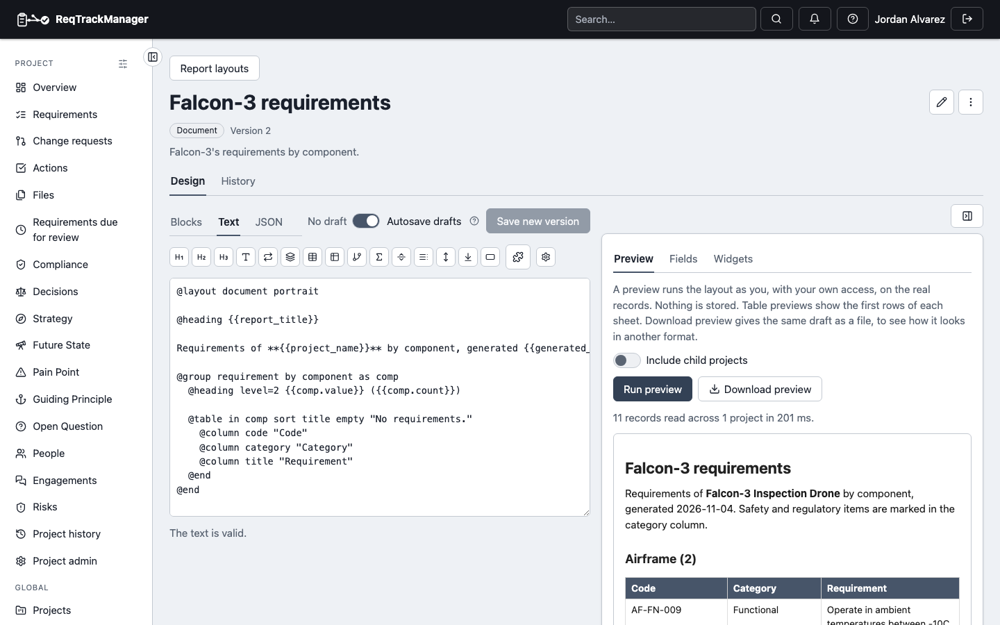 |

```text
@layout document

@heading Requirements of {{project_name}}

@each requirement sort title as req
  @heading level=2 {{req.code}} {{req.title}}
@end
```

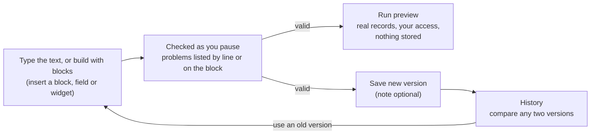

- **Problems** are listed by line and column; choosing one puts the cursor there. **Save new version** and **Run preview** wait until the text is valid. A layout's first line must declare its own kind (`@layout document` or `@layout table`).
- The **icon buttons** above the text add a heading (of level 1, 2 or 3), text, *for each record*, a group, a table of records, a custom table, an *if*, an equation, a page break, a spacer or content at the page bottom at the cursor (a sheet for a table layout); hover or focus a button for its name. The **Page setup** button beside them opens a dialog for the [page setup](#page-setup): the page **size**, **orientation**, **margins**, **header and footer** and **page styles**, written into the first lines of the text; the PDF, Word and OpenDocument files use them. The **Fields** tab is one searchable list of everything `{{…}}` can name at the cursor: the report and project values (`{{project_name}}`, `{{project_code}}`, `{{project_description}}`, `{{report_title}}`, `{{generated_on}}`, `{{organisation}}`, `{{layout_version}}`) together with the fields of the names in scope (the name after `as` of the block you are in), each saying where it comes from. Search it, or use **From** to narrow it to the report and project values or to one name. The **Widgets** tab lists the report components you can embed as a tree: each module, then each of its reports, then the report's parts, all collapsed until you open them (a search opens every branch that still holds a match). Choose a part to see the report's settings and to insert the finished line.

| The Fields tab: report and project values and the fields of the names in scope, in one searchable list |
| --- |
| 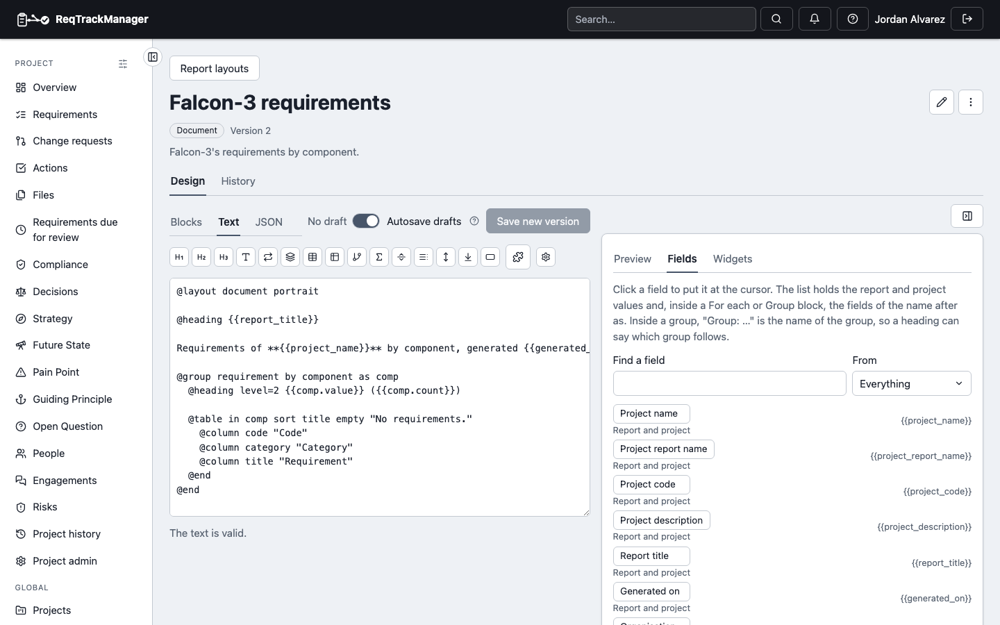 |

| The Widgets tab: modules, reports and parts as a tree that starts collapsed |
| --- |
| 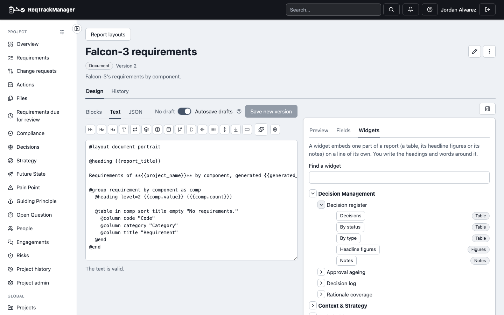 |

- **Blocks** shows the same layout as blocks, so you can build a layout without writing the `@` syntax. **Add block** lists the blocks (*Heading*, *Text* and *Table* first), and the line beside it says where the next one will go: after the selected block, inside it (a block that holds others, such as *for each record*, a group or an *if*, offers each of its lists) or at the end of the layout. The new block is selected at once, and **Ctrl+Z** (**Cmd+Z** on a Mac) takes it back. Drag blocks on the canvas to reorder them or drop them inside another block. A block shows a one-line summary of its key facts (a heading's level and words, the name a *for each* gives each record) and cannot be typed into. **Select a block** to edit all its settings, long or short, in the **Block** tab of the panel beside the canvas (under it on a narrow screen), the only place a value is changed: *Linked from* lists the names of the enclosing blocks, and a filter offers the fields and operators that suit the field you chose. The arrow keys move around the blocks. A block with a problem shows a warning mark, and the message appears under the field in the panel; Select the **Layout** block at the top of the canvas (or press the gear on it) to edit the layout's own settings in the same panel: the page size and orientation, the margins, the [page styles](#page-setup) and the [variables](./blocks-widgets-and-variables.md#variables). A problem with one of those settings shows as a warning on the Layout block. The layout is checked as you pause, **Save new version** and **Run preview** wait until there are no problems, and switching to **Text** shows the same layout as text. You can switch from the text only while it reads without problems. A block dragged outside the layout is not part of it, and the panel says so. Selecting a block (or pressing the gear on the Layout block) brings the **Block** tab forward; the **Preview** tab of the same panel runs the preview, and **Open in dialog** shows it larger.

- **Snippets** (the puzzle-piece button beside **Add block** in Blocks, and beside the block shortcuts in Text) opens a menu with **Insert snippet** and **Save as snippet**. **Save as snippet** is greyed out in Blocks until a block is selected. **Insert snippet** adds a ready-made piece to the layout: a cover page, a logo at the top right of the first page, record images, a document details table (title, project, organisation, version and date, filled in from the run), a document review and control table (version, date, author, reviewer and comments, with blank rows to write in), an approvals table (role, name, signature and date boxes), a landscape table section or, for a table layout, two linked sheets. The window lists the snippets by category with a search box, shows the output formats each is true in (PDF, Word, OpenDocument, HTML) and an outline of the blocks it adds, and asks for what it needs: a picture from the library, a kind of record, a short text. A snippet for the other kind of layout (a table snippet in a document) is shown greyed out with the reason. In **Blocks** it goes where the line beside **Add block** says, or at the start of the layout, and one **Ctrl+Z** removes all its blocks (a page style it added stays until you delete it); the new block is selected, so its settings are ready in the side panel. In **Text** the text is read as a layout first, so it must be free of problems; the snippet goes at the end or the start, and **Undo insertion** on the confirmation puts the text back while you have not edited it. Either way a pop-up confirmation appears in the corner, so nothing above your blocks moves. A plain insertion fades after a few seconds; when the snippet also added something ("Added page style "Cover"") or the layout already had problems, the pop-up lists it and stays until you dismiss it. A page style or variable the layout already has is reused rather than overwritten. A snippet is copied in: changing the layout later never changes the snippet, and the snippet never changes the layout again. A snippet cannot give anyone access to more than they could already read: its blocks run with the permissions of whoever runs the report.
- **Save as snippet** (in the **Snippets** menu) keeps a piece you built so you can insert it into other layouts. In **Blocks**, select a block (a container is saved with everything inside it) and choose it; in **Text**, put the caret in a block or select several, and the top-level blocks you touched are saved. Give it a **Name**, an optional description and a **Category**, and choose where to keep it: this project (also shared with the projects below it) or, from a project, the organisation, which shares it with every project. The window says how many blocks it saves and which page styles and variables it carries along, so it works in a layout that has neither. A selection that needs something defined outside it (an alias of an enclosing "for each") cannot be saved, and a picture from a project's library cannot be kept for the organisation: the window names the picture. Saved snippets appear in **Insert snippet** beside the built-in ones, marked "Saved" with where they come from, and are copied in like any other. They have no parameters: edit the result after inserting.
- **Report snippets** in **Reports** (and an organisation's **Templates & reports**) lists the saved snippets with their source, block count and what they carry. **New snippet** makes one without opening a layout: choose its kind (document or table, fixed once the first block exists), give it a name, and build its blocks in the same **Blocks** and **Text** editors a layout uses; the window says what saving would store and refuses what the designer's **Save as snippet** would refuse. **Edit** changes a snippet you own, details and blocks together. **Make a copy** makes a snippet of your own from it (or **Copy to the organisation**), and **Delete** removes one you own after you type its name; layouts already built from it keep their blocks. A snippet shared from the organisation or a parent project is read-only: **Hide in this project** stops it being offered here, and **Add organisation defaults** brings it back. Snippets travel with the project and organisation exports.

- **The right-hand panel** is the same in Text and Blocks: Text has **Preview**, **Fields** and **Widgets** tabs, Blocks has **Block** and **Preview**. The round button at its top folds it to a thin strip, which gives the editor the width, and the same button opens it again; below 1100 pixels wide the panel sits under the editor and does not fold. The fold, and the last tab you used in each view, are remembered for you. The projects you pick for a preview (and the child-projects switch) are remembered for that layout in this browser, so the next preview opens on them; a project you can no longer choose drops out.
- **Preview** runs the layout as you, on the real records, and shows a document as it will print or a table layout's first rows of each sheet (with the real row count). It stores nothing, and a project preview can include child projects while an organisation preview can be limited to chosen projects.
- **Saving** adds a version: **Save new version** asks for an optional note in a small window, then saves. If somebody saved while you were editing, you are told and can reload their version; nothing is overwritten. Leaving with unsaved changes asks first.
- **History** lists every version and compares any two line by line (added lines start with `+`, removed with `-`). **Use this version as the new text** puts an old version in the editor; saving it adds a new version, so history is never rewritten.

| History: any two versions compared line by line |
| --- |
| 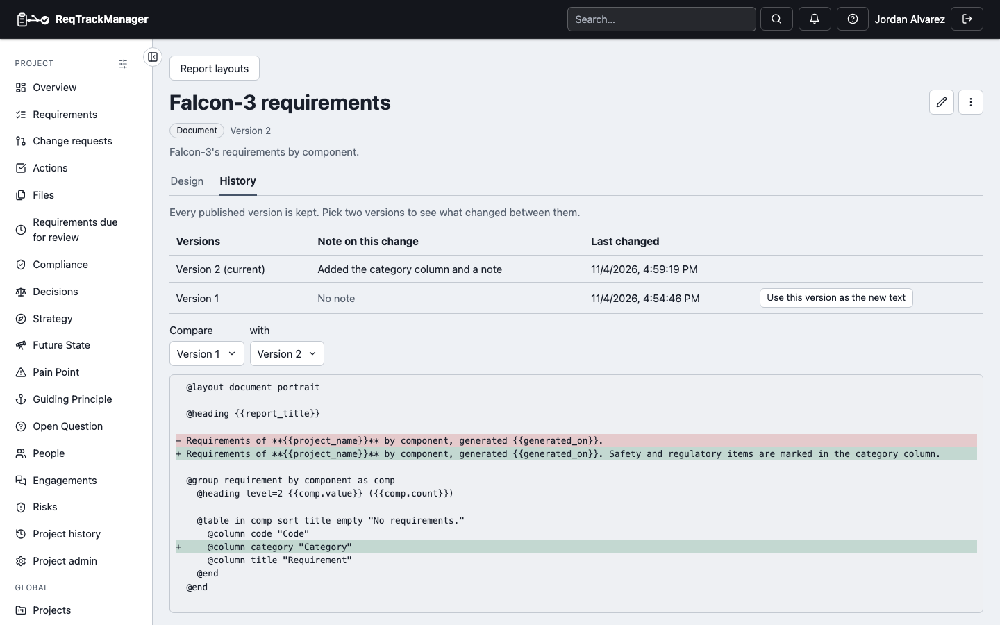 |

- Organisation administrators can design organisation layouts, and project administrators their own project's; others can run layouts but not open the designer.

Next: [blocks, report components and variables](./blocks-widgets-and-variables.md).

## Sheets: numbers and dates stay numbers and dates

In an Excel or OpenDocument spreadsheet, a field that holds a number, a date or a time of day is saved as a real number or date, not as text, so the spreadsheet can sort, filter and add it up. Everything else (titles, statuses, people, codes) stays text.

- A date shows as `2026-10-30`; a time of day (when something happened) shows in UTC as `2026-10-30 09:15:30Z`. A spreadsheet cell has no time zone, so the `Z` says which one it is.
- A number with a minus sign stays a number. Text that starts with `=`, `+`, `-` or `@` is still written as plain text and cannot run as a formula.
- A number too long to keep exactly (more than 15 digits) stays text.
- A CSV file has no types, so it holds the same text as before.

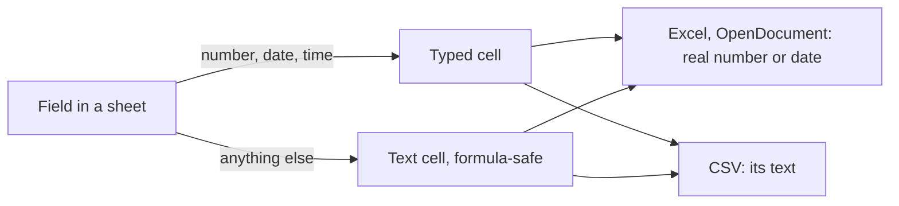

## Links between sheets and a contents sheet

In a table layout, a column can open the row of the same record on another sheet, in Excel and OpenDocument spreadsheets.

1. Make a sheet for each kind of record (for example *Requirements* and *Pain points*).
2. On the second sheet, join the first kind of record (the join gives one row per linked record) and add a column that reads it, for example the requirement's code.
3. In that column's settings choose **Link to sheet** and pick the first sheet. Only sheets that list the same kind of record are offered. In the text view it is `@column req.code "Requirement" link "Requirements"`.

Each cell then opens the matching row on the first sheet. A record that is not on that sheet (filtered out by that sheet's conditions, or not visible to you) stays plain text, and the run says how many cells could not be linked. A CSV file has no links and keeps the text.

Switch on **Contents sheet** in the layout's settings (`@layout table contents` in the text view) to start the workbook with a *Contents* sheet: one row per sheet, its name linking to the sheet, and how many rows it holds. A sheet of your own cannot be called *Contents* while it is on.

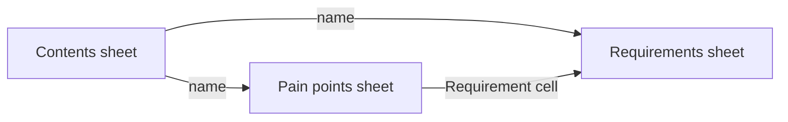

One cell opens one row. To follow several linked records from a requirement, use the join, which lists each linked record on its own row, and link the column in each row. A ready-made starting point is the **Two linked sheets** snippet.

## Page setup

A document layout has its own pages (size, orientation and margins) and can name other **page styles** for parts of the report, for example an A3 landscape table inside an A4 portrait report.

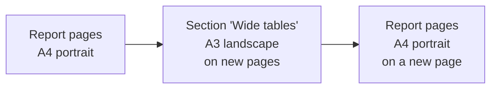

- **Margins** are in centimetres on each side (1 to 10), with a **gutter** (0 to 5) of extra room on the binding side for punching or binding. Left out, every side is 1.5 cm and there is no gutter.
- **Mirror margins** is for double-sided printing: left and the gutter become the *inner* edge of every page and right the *outer*, so they swap sides on facing pages. It applies to every page style of the layout.
- A **page style** has a name, and optionally its own size, orientation and margins; whatever it leaves out is the layout's own. Add one in the Page setup dialog, or with a line in the text before the first block: `@pagestyle "Wide tables" landscape A3 margins left=1 right=1`.
- A **section** lays its contents out in one page style: `@section "Wide tables"` … `@end` in the text, or the *Section* block, which asks for the page style. The section starts on a new page, and the report goes back to its own page style on a new page after it. A section that shows nothing leaves no page behind, and a section cannot contain another.
- Every style must leave at least 5 cm of text width and height; a problem is listed under the field that causes it.
- PDF, Word and OpenDocument files have real pages in the sizes and margins you set. The HTML preview has no pages: a section appears as a box as wide as its page, labelled with the paper and margins, and printing the HTML page from a browser uses the same sizes. A table layout (CSV, Excel, ODS) has no pages, so it has no page setup.

## Headers and footers

A header (top margin) and a footer (bottom margin) are an invisible row of three cells, **left**, **centre** and **right**, so content lines up across the page without you building a table. The layout has one of each, and each page style can have its own.

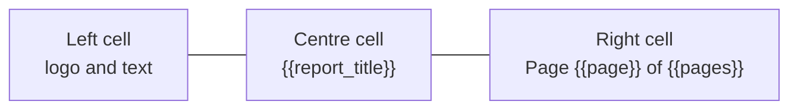

- For each, choose **Print**: *The default* (for the layout) or *Same as the layout's* (for a page style), *Its own text*, or *Nothing*. With no footer set anywhere, every page gets a page number. The organisation's footer text and logo are never added for you: write `{{org.footer_text}}` in a cell, or use `org_logo` as the logo's file in the Text view.
- Each cell holds up to three lines of text. **Insert placeholder** writes one at the cursor in the cell you last edited (at the end if you have not clicked in it). **Page number**, **Total pages** and **Page X of Y** are always at the top of the list, and a line under the cell shows what it prints ("Prints as: Page 3 of 12"). The others are `{{report_title}}`, `{{project_name}}`, `{{project_code}}`, `{{organisation}}`, `{{generated_on}}` (the date you ran the report, on your own calendar), `{{layout_version}}`, the organisation's `{{org.footer_text}}`, with the page fields `{{page}}` (this page) and `{{pages}}` (the total) behind the first three entries. Page numbers carry on across sections.
- A **logo** from the image library can sit in any cell, beside that cell's text, at a height you set. The logo follows the same library rule as an Image block.
- **First page** can be *Skipped*, for a cover page. For a page style it applies to the first page of each section in that style.
- **Font, size and text colour** apply to the whole header or footer (its three cells share them). Left empty, it follows the document's body font, prints at 8 points and in black; choose a scheme colour to keep it in step with the branding. A larger size takes a taller line, so it needs a taller margin. A page style's header or footer has its own, independent of the layout's.
- A cell reads **bold** and *italic* marks: select words and press **B** or **I**, or write `**bold**`, `*italic*` and `***both***` yourself. A page number can be marked too (`**Page {{page}}**`). Only those marks are read (no code, links or equations), a lone `*` stays as written, and `\*` is a literal asterisk. A web page printed from the browser can show a mark only when it covers the whole cell.
- A header or footer must fit in its margin (the editor says how much it takes and the check refuses one that does not fit), so raise the top or bottom margin for a bigger logo or more lines.
- When margins **mirror** for double-sided printing, the left and right cells swap on left-hand pages, so a page number stays at the outer edge.
- In the text view they are `@header left "…" centre "…" right "…" logo "<file id>" height 0.8 slot left first none font serif size 9 colour primary` and `@footer …`, written under the `@layout` line, or under the `@pagestyle` line they belong to. `@footer` on its own means no footer.
- PDF, Word and OpenDocument files show them with live page numbers. The HTML preview shows them as a row above and below each page style's part of the report, with `n` and `N` in place of the numbers; printing the HTML page from a browser that supports CSS page margin boxes (Chrome and Edge do; Firefox does not yet) prints them with the real numbers, but not the logo. A table layout has no pages, so no header or footer.

## Images

An **Image** block puts a picture from the image library into the report: on a line of its own, with text running beside it, or behind or in front of the text.

- **Choose** the picture with *Choose image…*. The dialog lists the library (search by name) and lets you upload a PNG, JPEG, GIF, WebP or SVG file. If your administrator has turned on the optional converter, it also takes an EPS or a PDF: it is converted to an SVG when you upload it and listed as `logo.eps.svg` or `logo.pdf.svg`, so it stays sharp at any size (a PDF contributes its first page, a bitmap inside it is kept as a picture, and the file is refused if nothing at all can be drawn); the largest file allowed is shown in the dialog and set by your administrator (50 MB unless changed). A project layout can use its own project's pictures and the organisation's; an organisation layout can use the organisation's only, because every project runs it. An upload goes to the library of the layout you are editing, and the dialog says which.
- Pictures are drawn on a **checkerboard**, so a white or transparent logo stays visible. Beside the large preview, *Background* switches between the checkerboard, a light page and a dark page, to judge a logo against the page it will print on; your choice is remembered for you. The report itself is unchanged.
- **Selecting a picture shows its details**: a larger preview, its size in pixels and, for a photograph, when it was taken (on the camera's own clock), the camera, any description saved in the file and where it was taken. Use these to tell photographs apart when their names do not. The same details are behind the *i* button beside a picture's name on the project's Files page, an organisation's shared resources and any list of attachments. Double-click a picture, or press *Use image*, to choose it.
- **Tidying the library.** Each picture says whether it is used. Tick *Unused only* to list the pictures no layout uses, in its current version or any older saved one (a picture only an older version uses is labelled *Only in older versions*, since deleting it would lose it if that version is restored). *Delete several…* lets you mark pictures you own (all the ones shown, if you like) and delete them with one confirmation, which says how many are still used by a layout. Those layouts skip the picture until another is chosen. You can only delete pictures of the library you are in: a project cannot delete the organisation's.
- **Alternative text** says what the picture shows, for readers who cannot see it; it is required unless you tick *Decorative*.
- **Width** is in centimetres, millimetres or as a percentage of the text width; **height** is in centimetres or millimetres. Both start as **Auto** (the box says so): set one and leave the other Auto to keep the picture's shape, set neither for the picture's own size (never wider than the text), or set both to stretch it. When both are lengths and their ratio differs from the picture's by more than 5%, a note under the fields says the picture will print stretched. In the Text view, `width auto` and `height auto` are accepted and are the same as leaving the size out.
- **Alignment** is left, centre or right. A **caption** can sit above or below the picture and can use `{{project_name}}` and the other placeholders.
- **Caption numbering** is *Automatic* by default: a picture with a caption is numbered "Figure 1:", "Figure 2:" … in the order they appear, and one without (a logo) is not. Choose *Always* to number it anyway ("Figure 3") or *Never* to leave a captioned picture plain.
- **Placement** is *In line* (the picture has a line of its own, with an optional caption), *Text wraps beside it*, *Behind the text* or *In front of the text*.
  - **Wrap**: set *Alignment* to left or right, the side the picture is on. The text blocks that follow it (headings, paragraphs, notes and lists) run beside it for its height and then across the full width, and carry on over a page break. A table, an equation, another picture or a page break ends the wrap in the PDF; Word and OpenDocument wrap any text that overlaps the picture, so keep a table away from it.
  - **Behind and in front**: *Position from* is where the picture is measured from: *This block's place in the text*, *The corner of the text area* (inside the page margins) or *The corner of the page*. *Across* and *Down* are in centimetres from that corner (negative goes left or up). A picture behind the text suits a watermark, a picture in front a stamp.
  - A picture that floats has no caption and no figure number, and a layered picture has no alignment; the designer says so rather than ignoring the setting.
  - PDF, Word and OpenDocument text place the picture exactly. The HTML preview has no pages, so it measures *The corner of the text area* and *The corner of the page* from where the block sits in the text.

  ```mermaid
  flowchart LR
    A[Image block] --> B{Placement}
    B -->|In line| C[Own line, caption]
    B -->|Wrap| D[Text beside it, left or right]
    B -->|Behind or in front| E[Over the page at an anchor and offset]
  ```
- In the text view an image is one line: `@image "<file id>" alt "The logo" width 85 mm align right caption "Our logo"`; a layered picture adds `placement behind anchor page x 2 y 3` (`x` across and `y` down, in cm).
- A picture's GPS position, camera and other hidden details are removed when it is placed in a report. A picture that has been deleted is left out and the run warns about it.
- A report that is exported or imported with its project carries the pictures it uses.

**Example: a logo on a coloured plate.** A logo is often white on a transparent background, so it needs something behind it. Add a **Shape** (a rounded rectangle filled with `accent`, the organisation's report colour, placed *Behind the text*) and then an **Image** with the logo (placed *In front of the text*) at the same position. A layer is drawn above the one before it, so the logo sits on the plate in PDF, Word, OpenDocument and the preview. The demo organisation has this ready as **Project overview with logo**, which also carries a document details table and a document review and control table inserted from the snippets.

```
@shape rounded fill accent width 5 cm height 2.5 cm placement behind anchor paragraph x 12 y 0
@image "<file id>" alt "Logo" height 1.75 cm placement front anchor paragraph x 12.75 y 0.375
```

## Shapes

A **Shape** block draws a coloured rectangle, rounded rectangle, ellipse, triangle, line or arrow, or your own SVG. Use one as a plate behind a logo that is white on a transparent background, a banner, a callout box or a divider. It sits in line with the text, beside it, or behind or in front of it, exactly as a picture does.

- **Shape** names the preset, or **Custom SVG** to paste your own markup (scripts, links to other files and embedded data are refused, and the SVG needs a `viewBox`, or a width and height). A custom shape is painted by its own SVG, so it has no fill or outline.
- **Fill** and **Outline** are chosen with the [colour control](#colours): the branding colour, a colour of your scheme such as `primary`, white, black, a custom hex colour such as `#475569`, or (fill only) no colour. A line or arrow has no fill and is drawn in the outline colour (black unless you set one); an arrow's **Height** is the size of its head. **Outline width** is in millimetres.
- **Width** and **Height** are in centimetres or millimetres and are needed for a preset. A shape wider than the text is scaled down with its proportions kept.
- **Placement**, **Position from**, **Across** and **Down** work as they do for an Image block. A block later in the layout is drawn above an earlier one, so to put a logo on a plate, add the Shape first and the Image after it, both placed behind the text at the same position.
- Shapes need no alternative text: leave it empty and a reader using assistive technology skips the shape. Describe it when it carries meaning.
- A shape is drawn as a vector in PDF and HTML. Word and OpenDocument get a sharp, transparent picture of it rather than an editable shape object. A table layout (CSV or spreadsheet) cannot hold a shape.
- In the text view a shape is one line: `@shape rounded fill #475569 width 5 cm height 2 cm placement behind anchor page x 1 y 1`; a custom shape writes `@shape custom svg "<svg ...>" width 3 cm` (the SVG in quotes).

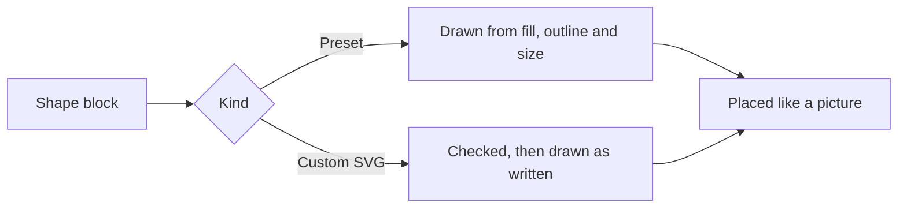

## Colours

Anything that has a colour in a layout (today a shape's fill and outline) is set with one **colour control**: a button showing the colour and its name, which opens a list with the **branding colour** first (with its actual colour), then your layout's own colours, the organisation's colours, the four standard colours, a light and a dark form of the branding colour, white, black, and **Custom colour** for any hex code. Each line says what the colour is as well as showing it.

A colour you give a name is a **colour scheme**: set it once and use it by name wherever a colour is needed, so changing it changes the document.

- **Layout colours.** In the layout's settings (select the **Layout** block), **Colour scheme** lists up to eight named colours. **Add colour** opens its settings: a name (lower-case letters, digits and underscores, such as `primary` or `warning`) and a colour. A colour's colour can be the branding colour or its light or dark form, so the scheme follows your branding when it changes.
- **The organisation's colours.** An organisation administrator sets **Report colours** on **Branding**. A layout that has no colours of its own uses them, and so does a layout that has some but not the name a block asks for. A layout's own colour of the same name wins.
- **The standard four** always exist: `primary` (the branding colour), `secondary` (a darker form), `tint` (a lighter form) and `neutral` (a grey). Use them in a layout that has no scheme and it follows whatever your organisation's branding is.
- **Start from** fills the layout's list from the organisation's colours, the Branding set, or a monochrome, cool or warm set. It copies the colours: the list is yours to edit afterwards. **Follow the organisation's colours** clears the layout's own list.
- A colour a block uses cannot be removed or renamed until that block is changed. If an organisation colour a layout names is later deleted, the layout stops running with a message naming the block, rather than printing a different colour.
- In the text view: `@palette primary=#1f3a5f warning=#b45309` before the first block, and a block names a colour in the usual place, for example `@shape rectangle fill primary outline warning width 3 cm height 1 cm`.

```mermaid
flowchart LR
  A[A block says "primary"] --> B{Layout's own colours}
  B -->|has it| Z[That colour]
  B -->|no| C{Organisation's colours}
  C -->|has it| Z
  C -->|no| D[Standard four, from the branding colour]
  D --> Z
```

A saved report records the colours it used and what each was that day, so a report stays explainable after the scheme changes.

## Fonts

A document layout sets its fonts once, in the layout's settings (select the **Layout** block), under **Fonts**. Every block then follows.

- **Body font** and **Body size (pt)** set the text, lists, tables and notes; a header or footer follows the body font (but has its own size, 8 points unless it sets one). The size is in points, from 6 to 72 in half points, and headings scale with it; table text, captions and notes keep their own smaller sizes.
- **Heading font** sets headings and the title. Left on *Same as the body font*, headings follow the body text. **Bold headings** and **Italic headings** set the weight and slant, and **Heading colour** uses the [colour control](#colours), so headings can follow the branding.
- Choose from **Sans**, **Serif**, **Mono** and **Unicode Sans** (for text beyond Latin letters), then any font your server administrator provides. Leave a setting empty and each format keeps its own look (PDF in Helvetica, Word in its template font).
- Text view: `@style body font=serif size=11` and `@style headings font=sans colour=primary bold italic` before the first block (`nobold` and `noitalic` switch a heading setting off).

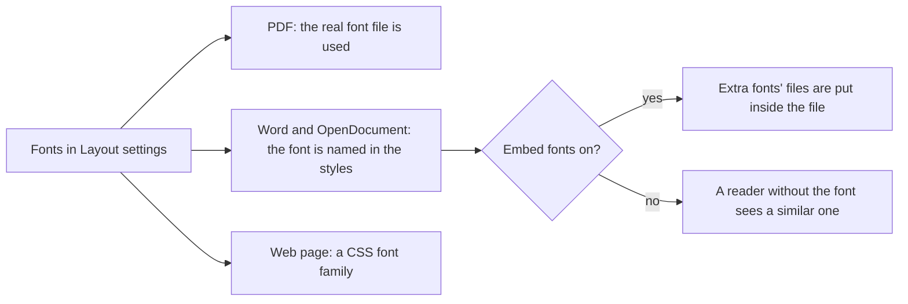

**PDF always prints in the font you chose.** Word, OpenDocument and the web page name the font, so a reader whose machine lacks it sees a similar one and lines may break differently. The four standard fonts match common fonts (Sans is Arial, Serif is Times New Roman, Mono is Courier New), so they print the same wherever those are installed. For a font your server administrator provides, switch **Embed fonts** on to put the font files inside Word and OpenDocument files; the file grows by roughly 0.3 to 0.4 MB for each face used, and Word on the web and some Mac versions ignore embedded fonts. A font whose licence forbids embedding is never offered.

If a layout names a font the server no longer has (for example after moving the layout to another server), it still saves and runs: the report prints in a standard font of the same kind, and the run says so.

### A block's own font and size

The layout's fonts are the rule; a block can be the exception. Select a **Text** or **Heading** block and its panel shows **Font** and **Size**; a heading also has **Colour**. Left empty (*Document font*, *Document size*, *Document heading colour*) the block follows the layout. A setting applies to the whole block, not to a selection, and a size on a heading never changes its level, so the contents list and Word's navigation are unaffected.

- A **text block** sets the font and size of the paragraphs and lists it writes. A Markdown heading written inside the text block keeps the layout's heading style.
- A **heading block** can carry **bold**, *italic* and `code` in its words, the same way a text block does: `A *plan* for **review**`. A heading is bold already unless the layout's heading style turns that off, so `**` matters only then. A contents entry shows the words without the marks.
- Text view: `@heading level=2 font=sans size=18 colour=primary A *plan*` and `@text font=serif size=11` … `@end` (or `@text font=serif "one line"`).
- Table and sheet cells, list items and captions keep their block's or the layout's setting.

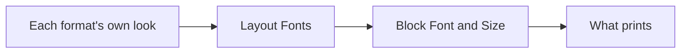

A font the server does not have saves with a warning and prints in a standard font of the same kind, as for the layout's fonts.

### Fonts and colours in the starter layouts

The four document starters (Business Requirements Document, Engineering Specification, Review Package, Requirements by Component) colour their headings with the standard colour `primary`. They carry no colour scheme and no font of their own, so each prints its headings in your branding colour and follows your organisation's colours the moment they set `primary`. Tables already use the branding colour for their heading row. Existing copies of a starter are not changed; to get the new look, rename or delete the old copy and use **Add missing starters**.

The built-in snippets (document details, review and control, approvals, cover page and the rest) use only white, black and the standard colours, so they insert cleanly into a layout that has no scheme, and they leave the layout's colours and fonts alone.

## Custom tables

A **Table (custom)** block is a table you write cell by cell: a document-details box, a review and sign-off sheet, a form. It is the counterpart of **Table (records)**, which has one row per record. Cells can be **merged**, and each can be aligned and coloured; the PDF, Word, OpenDocument and the preview draw it the same way. A table layout (a spreadsheet) has no use for one and refuses it.

- **Merging.** A cell can span several columns and rows. A merged cell is written once, on its top-left position, and the positions it covers are left out of the rows. A merge that overlaps another, runs past the table or leaves a row short is a problem at save, naming the row and the cell.
- **Style cascade.** Alignment, vertical alignment, fill, text colour and bold can be set on the whole table, a column, a row or a cell; the most specific wins. "The first and third columns black with white bold text" is one setting per column, not one per cell. Colours are a hex colour, a name from the [colour scheme](#colours), or one of the reserved words (`accent`, `white`, `black`, `none`).
- **Font and size.** The whole table and each column can set a **Font** and a **Size** (points, 6 to 72 in half points); the column wins over the table, and empty means the document's font and the table's own 9 points. A row or a cell never sets either, so a column of codes in **Mono**, or a dense table at 8 points, is one setting. A font the server does not have saves with a warning and prints in a standard font of the same kind.
- **Text.** A cell holds the same text as a text block: bold, italic, code, links, lists, `{{placeholders}}` and equations. Inside a *For each record* block, `{{record.field}}` fills each cell from the record. A cell can be blank, and a row can have a minimum height, so there is room to write in a printed sign-off sheet.
- **Widths and borders.** A column can have a width (`25%`, `4cm`, `40mm`); the others share the rest, and a word too long for its column breaks inside it. Borders are **all**, **outer** (round the table only), **horizontal** (lines between rows) or **none**.
- **Headings and pages.** The first rows can be **header rows**, printed again at the top of each page unless the layout turns repeated headings off. A row stays whole on a page, and the rows of a merged cell stay together. A row taller than a page is split rather than failing the report.
- **Readability.** A cell whose text and fill colours are hard to read together (below 4.5 to 1) is flagged in the report's warnings; it is not refused.
- **Limits.** Up to 20 columns, 200 rows and 2,000 characters in a cell.

### Editing a table in the Blocks view

Select the **Table (custom)** block. The block's panel shows a summary (for example *3 columns · 4 rows · 1 merged*) and **Edit table**, which opens the table in a window of its own.

- **Select cells** by clicking, dragging or Shift+clicking a range; with the keyboard, the arrow keys move and Shift+arrow keys extend the selection. A merged cell is always selected whole.
- **Merge cells** and **Unmerge cells** work on the selection. The text of the merged cells is joined into the top-left one. A merge may not run from the header rows into the rows below; the editor says so.
- **Align** (left, centre, right, justify; top, middle, bottom), **Bold**, **Fill** and **Text colour** apply to the selection. Set **Apply to** to *Whole columns* or *Whole rows* to colour a column in two clicks: the first and third columns black with white text is one setting for each, not one per cell. Fill and text colour offer your branding colour, the layout's colours, white, black and a custom colour.
- **Add and remove** rows and columns from the buttons above the table; a merge that spans the place you add to grows with it. The table keeps at least one row and one column, and at most 20 columns and 200 rows.
- **Cell text** is typed in the box under the table (Enter moves you there). It takes the same text as a text block, including `{{placeholders}}`. A blank cell shows a dashed *blank* marker.
- **Row height**, **column width**, **column font**, **column size** and **header rows** are set under the table for the selected cell's row and column. Leave a column's font or size empty to follow the table's. The table's own font and size are in the block's panel.
- **Undo** and **Redo** (or Ctrl+Z and Ctrl+Y) step through your changes; **Cancel** throws all of them away and **Save** puts them in the layout. Borders and the table-wide settings stay in the block's panel.

If a cell's text and fill are hard to read together, the editor warns you; it does not stop you.

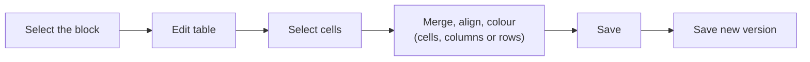

In the text view the table is `@grid` … `@end`, with one line of cells per row:

```
@grid columns=4 headerrows=1
  @col 1 fill=#000000 color=#ffffff bold
  @col 3 fill=#000000 color=#ffffff bold
  | {colspan=4 align=center fill=primary} Document details |
  | Document | {{report_title}} | Version | {align=right} {{layout_version}} |
  @row height=2cm
  | Approved by | | Date | |
@end
```

`@col` sets a column's width, font, size and style (`@col 2 font=mono size=8`; the same `font=` and `size=` words go on `@grid`), `@row` (before a line of cells) a row's height and style, and `{…}` at the start of a cell sets its merge and style. In a cell, `\|` is a bar, `\\` a backslash and `\n` a new line.

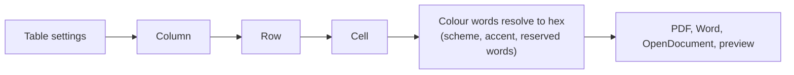

## Vertical space

A **Spacer** block leaves an exact amount of vertical space, the same in PDF, Word, OpenDocument and the preview. Use it instead of stacking empty paragraphs, which print differently in each format.

- **Height** is from 1 mm to 20 cm; **Height unit** is centimetres (the default, 1 cm) or millimetres.
- The space is kept at the top of a page as well as between two blocks. One taller than the room left on the page moves to the next page, and is never taller than the page's text area.
- A spacer can sit inside a section or a *For each record* block. A table layout (a spreadsheet) has no use for one and refuses it.
- In the text view a spacer is one line: `@spacer 1.5 cm`.

## Content at the foot of the page

An **At page bottom** block keeps its contents (usually a sign-off table, or a few lines of text) on the bottom edge of the page's text area, however long the part above it is. Put the blocks you want there inside it.

- What is before the block flows as usual. If the contents do not fit in the room left on the page, they go to a fresh page and sit at its foot.
- What comes **after** the block starts on a new page, in every format.
- It cannot hold a page break, a section, a widget or another At page bottom block. A table layout refuses it.
- If the contents are as tall as a page they cannot sit at the foot, so they flow as ordinary content.
- **PDF** is exact. **Word** places the contents in a borderless floating table fixed to the foot of the page (above the page number, when there is one), and **OpenDocument** in a text frame fixed to the foot of the text area; text above wraps around them, so a very long part above can push text onto the next page while the contents stay on the page they were placed on. Open the Word file once to check a layout you rely on.
- The browser **preview** has no pages, so it shows the contents in place.
- In the text view it is `@bottom` … `@end`, with the contents indented between.

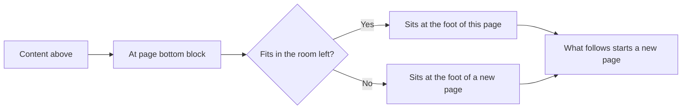

## Pictures attached to records

A **Record images** block, placed inside a *For each record* block, prints the pictures attached to each record (for example the photos on a Pain Point). It is for records that can hold attachments; a type whose attachments may show or concern identifiable people (stakeholders and engagements) is not offered, and the designer says why.

- **File names** chooses by name: one pattern per line, using `*` for any run of characters and `?` for one letter, ignoring case (`site-photo-*`). A pattern can use the record's own values, for example `{{rec.code}}-*` picks the photo named after each record; a value is matched as plain text, so a title of `*` matches only a file called `*`. Leave it empty to allow any name.
- **File types** allows only some extensions (png, jpg, jpeg, gif, webp, svg). Whatever the name says, only a real picture prints: a text file renamed `.png` is skipped, with a warning on the run.
- **Most per record** (up to 20), **Order** (by file name, or by when the file was attached, oldest first) and **Largest file** keep a record with many photos in check. A very large report that embeds many pictures stops with a message to narrow it or download it in the background.
- **Caption** is the file name, text you write (with placeholders), or none; the Image block's width, height, alignment, caption position and numbering apply to every picture. Placement is *In line* or *Text wraps beside it* (which has no caption). *Text when there is nothing* appears for a record with no matching picture; leave it empty to print nothing.
- A picture prints only if you could open it from its record's page. A picture marked **confidential** never prints, whatever the rules say.

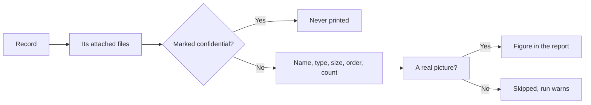

### A column of pictures in a table

A table can show the pictures attached to each row's record in a column of its own, beside the code and title: **Add images column** in the table block's details. It is for any pictures, a photo or a diagram, so there is no thumbnail size: each picture is shown at **90% of the column's width** unless you choose otherwise, and a percentage follows the column, so it still fits when you change the page size or orientation.

- The rules that choose the files are the same as for a Record images block (**File names**, **File types**, **Most per row**, **Order**, **Largest file**). A name can use the row's own values as `{{row.code}}`, for example `{{row.code}}-*`.
- **Width** (a percentage of the column, or cm or mm) and **Height** are yours to set; nothing else limits the size. The one exception is physical: if a cell would be taller than a page of the report, its pictures are shrunk together (keeping their shapes) so the row can be printed.
- **Arrangement** is **stacked** (one under another) or **side by side** (a line that wraps inside the cell), chosen for each column. A row with no matching picture has an empty cell.
- The same pictures print in PDF, Word, OpenDocument and HTML, and the same record rules apply: a picture prints only if you could open it from its record's page, and a picture marked confidential never does. In a **sheet** (Excel, OpenDocument spreadsheet, CSV) the column lists the matching file names instead, because a cell there holds text.

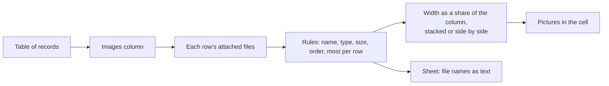

In the text view an images column is one line inside the table: `@images names "site-*" types png width 80 percent arrange side_by_side label "Photos"`.

### The columns list

A table or sheet block lists its columns as a short list: each row shows the column's name (its heading, or the field's name) with buttons to move it up or down, **Settings** (a gear) and **Remove** (an ×). **Add column** adds a row and opens its settings so you can choose the field at once. Everything else about a column is behind its gear: the field, its heading, its width, which record it reads in a sheet with joins, the sheet it links to and, for an images column, the picture rules. A gear with a coloured border has a setting changed from the default.

### Fixing a column's width

Left alone, a table sizes each column from what it holds, so the columns of one table can differ from the next (for example the requirements of one component and the next). Give a column a **Width** in its settings (the gear beside it in the table block's details) to fix it:

- A share of the table (`30%`), which follows the page when you change its size or orientation, or a length (`4 cm`, `40 mm`). Leave it empty for **automatic**.
- Columns with no width share what the others leave. Widths that do not fill the table are scaled to fit it, and percentages may not add to more than 100%.
- A block that produces several tables (one per component, say) gives every one of them the same widths, so the columns line up down the document. A long word breaks inside its column instead of widening it, and no column is narrower than 8 mm.
- It applies in PDF, Word, OpenDocument and HTML. In a **sheet** (Excel, OpenDocument spreadsheet) a length is the column's width and a percentage is of a 25 cm sheet; a column with no width is sized from its content, and CSV ignores widths.

In the text view it follows the heading: `@column code "ID" width 12%`, `@column title width 4 cm`; an images column writes `colwidth 20%` because its `width` is the picture's. The starter layouts fix their code, status and similar columns, so documents from a new organisation print steady columns; a copy already in your organisation is not changed, and **Add missing starters** does not replace it.

### Repeating table headings

A table's column headings print again at the top of every page the table runs onto. If you would rather have them only at the start, turn off **Repeat table header rows** in the layout's settings (Blocks) or **Page setup** (Text). It applies to every table in the layout, and the text view writes `norepeatheader` on the first line (`@layout document norepeatheader`).

### Choosing which projects a report runs for

Some reports are wrong if they merge projects: a sign-off sheet that names the project, or a project charter. Set **Projects it runs for** in the layout's settings (Blocks):

| Setting | Text word | Meaning |
|---|---|---|
| Any number of projects (default) | `anyprojects` | An organisation run covers the projects you select, merged |
| One project | `oneproject` | Exactly one project, nothing else |
| One project and its child projects | `projecttree` | Exactly one project; **Include child projects** merges its readable child projects into the same report |

The text view writes the word on the first line (`@layout document oneproject`).

- Run from the organisation's Reports dialog, a one-project report shows a **Project** list instead of the **Projects** selector. It has no "all projects" choice and nothing is produced until you pick one (if you can report on only one project, it is picked for you). The result reads like a project's own report: no per-project heading or *Project* column.
- With *One project and its child projects*, the **Include child projects** switch is offered; only child projects you can read are added.
- The rule is enforced on the server, so a download, a background run, "generate again" and the MCP `run_custom_report` tool all refuse none or several projects. In a report pack, the report is listed as not available unless the pack is run for one project; an organisation pack runs a *project and its children* report for the project alone (run the pack from the project to include children).
- A hint in the layout's settings suggests limiting the report to one project when an organisation layout prints the project's name or code.

### Marking a picture confidential

On a record's page, each attached picture has a lock button. Marking it confidential keeps it out of every report; it does **not** change who can open the file. The page says so beneath the list. The person who attached the picture, and anyone who manages the project, can mark or clear it. The mark travels with the file when a project is exported and imported.

In the text view the block is one line: `@record_images names "site-*", "{{rec.code}}-*" types png, jpg max_count 3 order uploaded caption_source none`.
