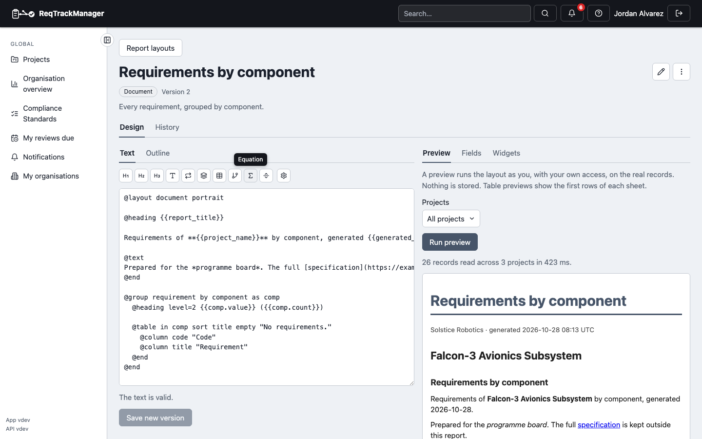
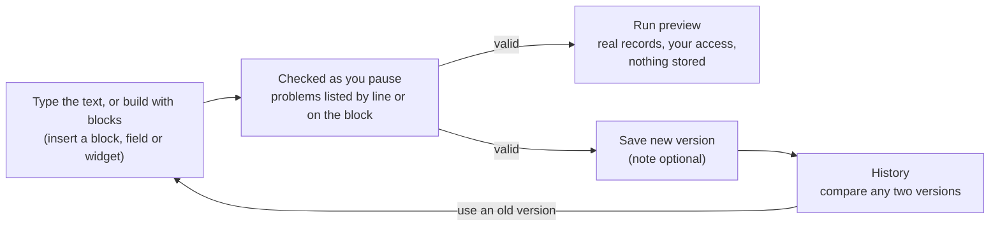
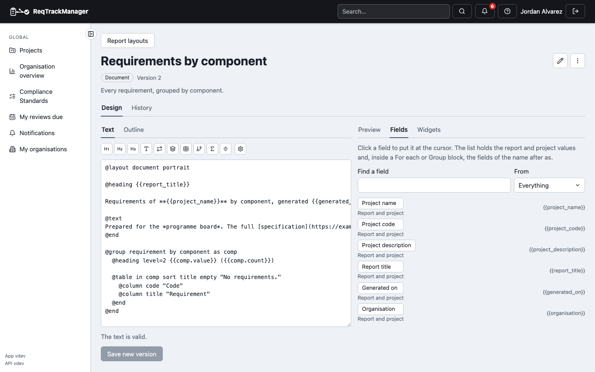
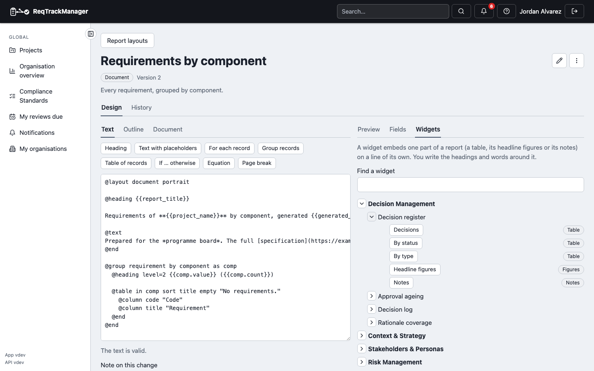
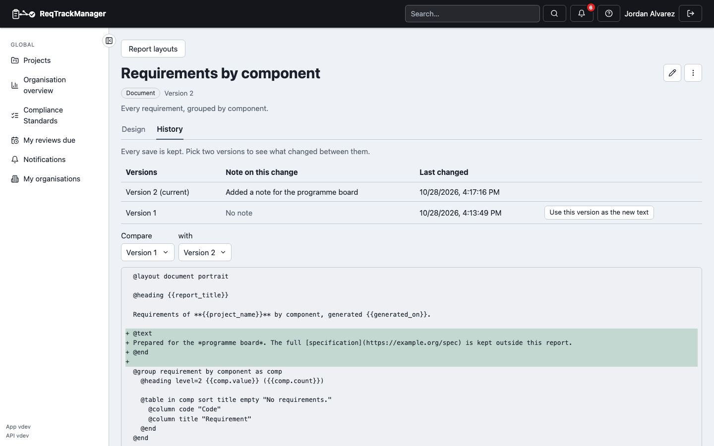

# Designing a layout

**Report layouts** lists a project's own layouts, those shared by its parent projects and by the organisation, and, for an organisation, its own. Long lists have **search** (name, description or folder), filters for the kind, the **Folder** and where a layout is shared from, and **Load more**. Choose **New layout**, give it a name, optionally a **Folder** for the Reports picker (such as `Handover/Quarterly`, see [finding and organising reports](./organising-reports.md)) and say whether it is a **Document** (headings, text and tables, for PDF, Word or HTML) or a **Table** (one or more plain tables, for Excel or CSV); the kind cannot be changed later. A layout shared from elsewhere opens read-only: **Make a copy** to change it for this project, or **Hide in this project** and bring it back with **Add organisation defaults**.

The designer shows the layout in two views you can switch between at any time: **Text** and **Blocks**. In the text view each block is a line starting with `@`, and `{{req.title}}` puts a field of a record in the text.

| The text view: icon buttons for the blocks and the page setup, one block per line, problems listed by line, and a live preview beside it |
| --- |
|  |

```text
@layout document

@heading Requirements of {{project_name}}

@each requirement sort title as req
  @heading level=2 {{req.code}} {{req.title}}
@end
```



- **Problems** are listed by line and column; choosing one puts the cursor there. **Save new version** and **Run preview** wait until the text is valid. A layout's first line must declare its own kind (`@layout document` or `@layout table`).
- The **icon buttons** above the text add a heading (of level 1, 2 or 3), text, *for each record*, a group, a table, an *if*, an equation or a page break at the cursor (a sheet for a table layout); hover or focus a button for its name. The **Page setup** button beside them sets the page **size** (A4, A3, A5, Letter or Legal) and **orientation** and writes them into the first line, `@layout document landscape A3`; the PDF, Word and OpenDocument files use them. The **Fields** tab is one searchable list of everything `{{…}}` can name at the cursor: the report and project values (`{{project_name}}`, `{{project_code}}`, `{{project_description}}`, `{{report_title}}`, `{{generated_on}}`, `{{organisation}}`) together with the fields of the names in scope (the name after `as` of the block you are in), each saying where it comes from. Search it, or use **From** to narrow it to the report and project values or to one name. The **Widgets** tab lists the report components you can embed as a tree: each module, then each of its reports, then the report's parts, all collapsed until you open them (a search opens every branch that still holds a match). Choose a part to see the report's settings and to insert the finished line.

| The Fields tab: report and project values and the fields of the names in scope, in one searchable list |
| --- |
|  |

| The Widgets tab: modules, reports and parts as a tree that starts collapsed |
| --- |
|  |

- **Blocks** shows the same layout as blocks, so you can build a layout without writing the `@` syntax, and it has the full width of the page. **Add block** lists the blocks (*Heading*, *Text* and *Table* first), and the line beside it says where the next one will go: after the selected block, inside it (a block that holds others, such as *for each record*, a group or an *if*, offers each of its lists) or at the end of the layout. The new block is selected at once, and **Ctrl+Z** (**Cmd+Z** on a Mac) takes it back. Drag blocks on the canvas to reorder them or drop them inside another block. Short settings (a heading's words and level, the name a *for each* gives each record) are on the block itself. **Select a block** to edit all its settings in the panel beside the canvas (under it on a narrow screen): *Linked from* lists the names of the enclosing blocks, and a filter offers the fields and operators that suit the field you chose. The arrow keys move around the blocks. A block with a problem shows a warning mark, and the message appears under the field in the panel; **Layout settings** at the top holds the page orientation and the [variables](./blocks-widgets-and-variables.md#variables). The layout is checked as you pause, **Save new version** and **Run preview** wait until there are no problems, and switching to **Text** shows the same layout as text. You can switch from the text only while it reads without problems. A block dragged outside the layout is not part of it, and the panel says so. **Preview** opens the preview in a dialog; **Preview panel** keeps it open beside the blocks (your choice is remembered).

- **Preview** runs the layout as you, on the real records, and shows a document as it will print or a table layout's first rows of each sheet (with the real row count). It stores nothing, and a project preview can include child projects while an organisation preview can be limited to chosen projects.
- **Saving** adds a version: **Save new version** asks for an optional note in a small window, then saves. If somebody saved while you were editing, you are told and can reload their version; nothing is overwritten. Leaving with unsaved changes asks first.
- **History** lists every version and compares any two line by line (added lines start with `+`, removed with `-`). **Use this version as the new text** puts an old version in the editor; saving it adds a new version, so history is never rewritten.

| History: any two versions compared line by line |
| --- |
|  |

- Organisation administrators can design organisation layouts, and project administrators their own project's; others can run layouts but not open the designer.

Next: [blocks, report components and variables](./blocks-widgets-and-variables.md).
