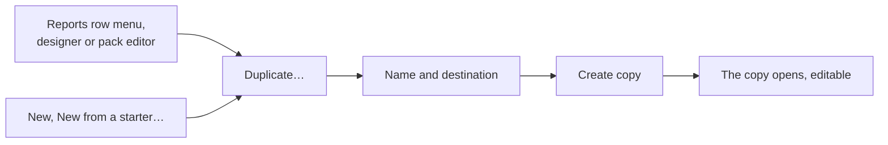

# Duplicating a report

Start a new report from one that already exists instead of building it from nothing: a layout or pack shared from the organisation or a parent project, one of your own, or one of the built-in starters (Business Requirements Document, Engineering Specification, Review Package, Requirements by Component). To move several reports to another project at once, see [copying reports to another project](./copying-between-projects.md).

You need to be able to manage report layouts where the copy goes. A person who can only run reports does not see the action.

## How to duplicate

1. In **Reports**, open a row's menu and choose **Duplicate…**. The same action is in the menu of the designer and of the pack editor. To start from a built-in starter, choose **New**, then **New from a starter…** and pick the starter. The starters work even if your organisation's own copy was edited or deleted.
2. The name is filled in as **Name (copy)** (then **(copy 2)** and so on). Change it if you like. A name this place already uses is refused before anything is created. A name that matches a report only inherited from above is allowed and warned about: your copy then shadows it in this project.
3. In a project, choose where the copy goes: **This project** or **The organisation** (shared with every project; needs the organisation's report right).
4. Choose **Create copy**. The copy opens in the designer (or pack editor).

## What the copy is

| Part | Behaviour |
| --- | --- |
| Content | The **latest saved version**, as version 1 of a new report. Unsaved edits in the designer are not copied, and the dialog says so. |
| Independence | Later changes to the original never reach the copy, and the copy is always editable, even when the original is a starter or shared from above. |
| Kept | Description, run-time variables and the default file name. Filed in the same folder when the destination has it, otherwise at the top level (the dialog says so). |
| Not kept | Version history, favourites, hide settings, pack membership and a pack's saved sets. |
| Packs | The pack's definition. Its entries still name the same layouts, so the dialog warns when a layout of that name does not exist where the copy lands. |

## Pictures when copying up to the organisation

A picture from a project's library cannot be shared with the whole organisation as a side effect. The dialog lists those pictures and **Create copy** stays disabled until you replace them in the layout with organisation pictures. Pictures from the organisation library are always kept. Copying within a project reuses its pictures. Copying into a child project from a parent's layout copies the parent's pictures into the child's library.
