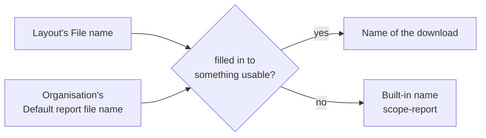

# Naming downloaded reports

A downloaded or stored report is named by a **file name template**: text with `{{placeholders}}` that is filled in each time the report is produced, for example `{{project_code}}-{{report_title}}-{{generated_on}}` gives `ACME-Quarterly review-2026-10-29.pdf`. The extension always comes from the format, never from the template.

A report uses the first of these that gives a name:

1. **The layout's own File name** (in the designer's layout settings, or `@filename "…"` in the text view). A pack entry's own file name comes first for that entry.
2. **The organisation's default** (Organisation Admin, Templates & reports, Report file names). It also names the built-in reports, such as the requirements report, the compliance reports and the module reports.
3. **The built-in name**, as before: the project or organisation name, then the report's name.

A **pack** has its own *Zip file name*; each report inside it is `NN-<name>.<ext>`, where the name is the entry's *File name*, else the layout's, else the layout's title.

| Placeholder | Fills in |
| --- | --- |
| `{{report_title}}` | The layout, pack or report title |
| `{{project_name}}`, `{{project_code}}` | The project (the code is empty in an organisation-wide run) |
| `{{organisation}}` | The organisation's name |
| `{{generated_on}}` | The day the report was run, as **your own** calendar day (`2026-10-29`) |
| `{{layout_version}}` | The layout version that ran (layouts and packs only) |
| `{{format}}` | The extension of the file (`pdf`, `docx`, `zip` …) |
| `{{var.name}}` | A run-time variable of the layout or pack, a list joined with commas |

The organisation default cannot use `{{layout_version}}` or `{{var.name}}`, since it names reports that have neither. A record field such as `{{req.code}}` is not available either: a file has no current record. (The *Record images* block's name rule can use record fields to pick the picture named after each record.)

The field checks the template as you type and shows an **example** built from sample values, so a mistake is explained before anything is saved. The result is always a plain file name: letters, digits, spaces, dots, dashes and underscores; accents are folded to their plain letters; slashes, `..` and anything else become a dash; each substituted value is cut at 40 characters and the whole name at 100. A template that fills in to nothing falls back to the next name in the list above rather than failing the report.
