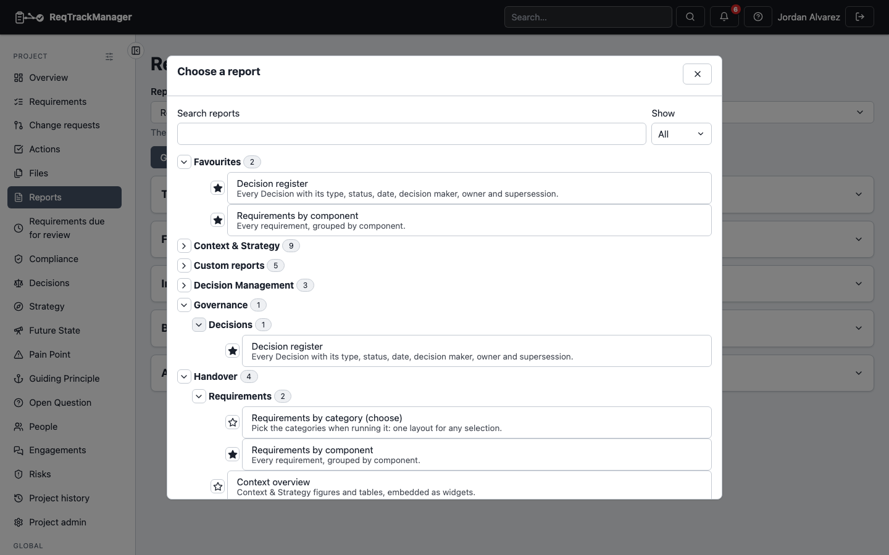
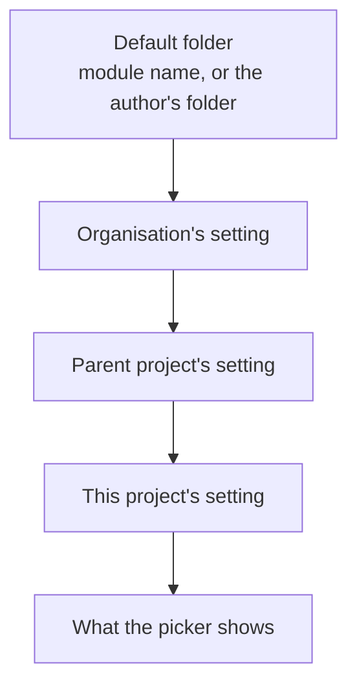

# Finding and organising reports

The **Reports** page picks a report from a dialog, not a long drop-down, and the people who look after a project or an organisation can arrange that list for their team.

## Choosing a report

The button at the top of the Reports dialog (opened from the **Reports** menu on the project or organisation overview) names the current report and the folder it is in. Choosing it opens the picker:

| Reports picker |
| --- |
|  |

- **A file-style list.** The picker reads like a file manager's list view: a **Name** header (select it to reverse the order; folders always stay first), a folder icon and chevron on each folder, a small icon on each report that says whether it is a report, a sheet or a pack, and each level indented under its folder. With the keyboard, Up and Down move between rows, Right opens a folder (and then steps into it), Left closes it or goes back to its folder, and Enter opens a folder or chooses a report.
- **Folders.** Reports are filed in folders, which can hold folders (up to three levels, such as *Handover / Quarterly*). A module's reports start in a folder named after the module; your own layouts and packs are in the folder you gave them, or in **Custom reports** and **Report packs** when you gave none. Every folder starts collapsed the first time, so a long list stays short; after that the picker opens with the folders you left open (each place that offers reports, such as the Reports page and a record list's **Download report**, remembers its own).
- **Search** finds a report by its title, description or folder; every folder that still holds a match opens.
- **Show** narrows to **Reports**, **Sheets** (layouts made of tables, for Excel or CSV) or **Packs**.
- **Favourites.** The star on the right of a report's row adds it to your **Favourites** folder, which is listed first. Favourites belong to you, are kept on the server, and follow you to another browser.
- A report the project cannot offer is not listed: a module that is off, or a sub-component of a module that is off (a report that spans several, such as the Context & Strategy summary, is listed while at least one of them is on).

The chosen report is in the page's link (`?report=…`), so a link to a report opens it.

## Filing your own layouts and packs

A layout or a pack has an optional **Folder** in its create and edit form. The field only says where it is filed now (the folder path, or **No folder**); press it to open a small panel with a tree of the folders already in use, so nothing is misspelt. Choosing a folder closes the panel and the field shows it; the move is saved with the form's **Save**, and **Cancel** discards it. Choose **No folder** to file it under **Custom reports** (layouts) or **Report packs**. In the panel, beside the tree:

- **New folder** adds one inside the folder you have chosen (or at the top level when none is), up to three levels deep, and chooses it.
- **Rename** changes the last level of the folder you chose. Reports filed in it, and in the folders inside it, follow.
- **Delete** asks first, then removes the folder. What was filed in it moves up one level; no report is deleted, and a message says how many moved.

You can rename or delete only folders your organisation or project owns; a folder that comes from the organisation or a parent project can be filed under but not changed from below. Folders you add travel in a project or organisation [export](../zip-export-import.md) even when empty. The folder travels with the layout or pack in a project or organisation [export](../zip-export-import.md).

## Reports: one list for every report

An organisation's **Templates & reports** and a project's **Reports** show every report people there can run in one folder list, laid out like the Reports chooser: your layouts, your report packs, and the reports modules and the platform provide. Each row has an icon for its type (a document, a table of rows, or a pack of files), and the folders open and close like a file manager's. **Search** and the **Type**, **Show** (moved from the default, hidden) and, in a project, **Shared from** filters narrow it; a search opens every folder that holds a match.

The **New** menu creates a layout, a pack or a folder, starts a layout from a built-in starter, and (in an organisation) offers **Add missing starters** when a starter layout was deleted. Each row's **Actions** menu offers what applies to it:

| Row | Actions |
| --- | --- |
| A layout or pack of your own | Open (the designer or pack editor), Edit details, Move to folder…, Duplicate…, Delete (type the name to confirm) |
| A layout or pack shared from above | View, Move to folder…, Duplicate…, Hide in this project (and show it again) |
| A module or platform report | Move to folder…, Hide from the list, Show in the list, Reset folder to default, Follow the default again |

Each folder has its own **Actions** menu: **New folder inside**, and, for a folder your organisation or project owns, **Rename** and **Delete**.

- Each report shows when it is not in its default folder, with the default and who set the change beside it (*Default: Decision Management · the organisation*).
- **Move to folder…** files a report under another folder, chosen in the same tree (choose **Top level** to file a module report outside any folder). Moving your own layout or pack changes its own folder; moving any other report sets this scope's placement.
- A project's setting wins over its parents', and a parent's over the organisation's, one thing at a time: a project can move a report the organisation hid without touching where the organisation filed it.
- **Hiding only tidies the list.** The report is not removed and anyone with access can still run it from its link; access is decided by roles, not by this list.

Placements are configuration: they travel in the project and organisation export (a layout or pack by name, a module report by its key), and every change is recorded in the audit log.
