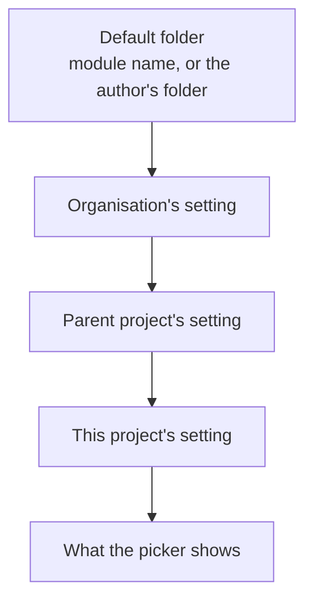
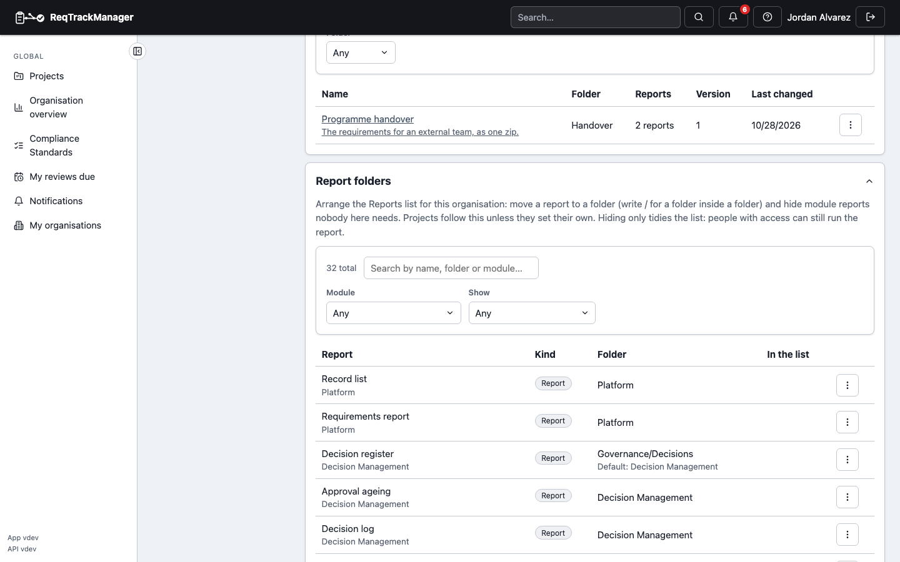

# Finding and organising reports

The **Reports** page picks a report from a dialog, not a long drop-down, and the people who look after a project or an organisation can arrange that list for their team.

## Choosing a report

The button at the top of the Reports page names the current report and the folder it is in. Choosing it opens the picker:

| Reports picker |
| --- |
|  |

- **Folders.** Reports are filed in folders, which can hold folders (up to three levels, such as *Handover / Quarterly*). A module's reports start in a folder named after the module; your own layouts and packs are in the folder you gave them, or in **Custom reports** and **Report packs** when you gave none. Every folder starts collapsed the first time, so a long list stays short; after that the picker opens with the folders you left open (each place that offers reports, such as the Reports page and a record list's **Download report**, remembers its own).
- **Search** finds a report by its title, description or folder; every folder that still holds a match opens.
- **Show** narrows to **Reports**, **Sheets** (layouts made of tables, for Excel or CSV) or **Packs**.
- **Favourites.** The star on the right of a report's row adds it to your **Favourites** folder, which is listed first. Favourites belong to you, are kept on the server, and follow you to another browser.
- A report the project cannot offer is not listed: a module that is off, or a sub-component of a module that is off (a report that spans several, such as the Context & Strategy summary, is listed while at least one of them is on).

The chosen report is in the page's link (`?report=…`), so a link to a report opens it.

## Filing your own layouts and packs

A layout or a pack has an optional **Folder** in its create and edit form. Type a path with `/` between the levels; the form suggests the folders already in use. An empty folder files it under **Custom reports** (layouts) or **Report packs**. The folder travels with the layout or pack in a project or organisation [export](../zip-export-import.md).

## Arranging the list for a team

An organisation or a project can move or hide the reports it receives from above: module reports, and layouts and packs shared from the organisation or a parent project. Open **Report folders** under the organisation's **Templates & reports** or a project's **Report Setup** (you need the permission to manage report layouts).

- Each report shows the folder it is in now, with the default and who set the change beside it (*Default: Decision Management · the organisation*).
- **Move to folder…** files a report under another folder (empty means the top level). **Reset folder to default** removes your change.
- **Hide from the list** removes a *module* report from the picker (you are asked first). **Show in the list** brings back one a parent hid, and **Follow the default again** removes your own choice. A shared layout or pack is hidden from its own list in **Report layouts** or **Report packs**, so here it can only be moved.
- A project's setting wins over its parents', and a parent's over the organisation's, one thing at a time: a project can move a report the organisation hid without touching where the organisation filed it.
- **Hiding only tidies the list.** The report is not removed and anyone with access can still run it from its link; access is decided by roles, not by this list.

| Report folders |
| --- |
|  |

Placements are configuration: they travel in the project and organisation export (a layout or pack by name, a module report by its key), and every change is recorded in the audit log.
