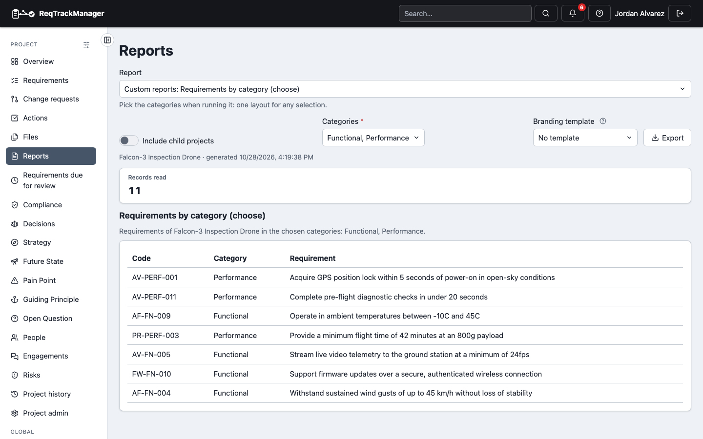
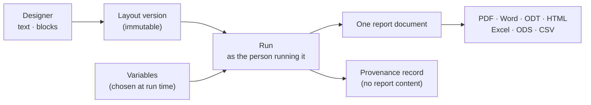
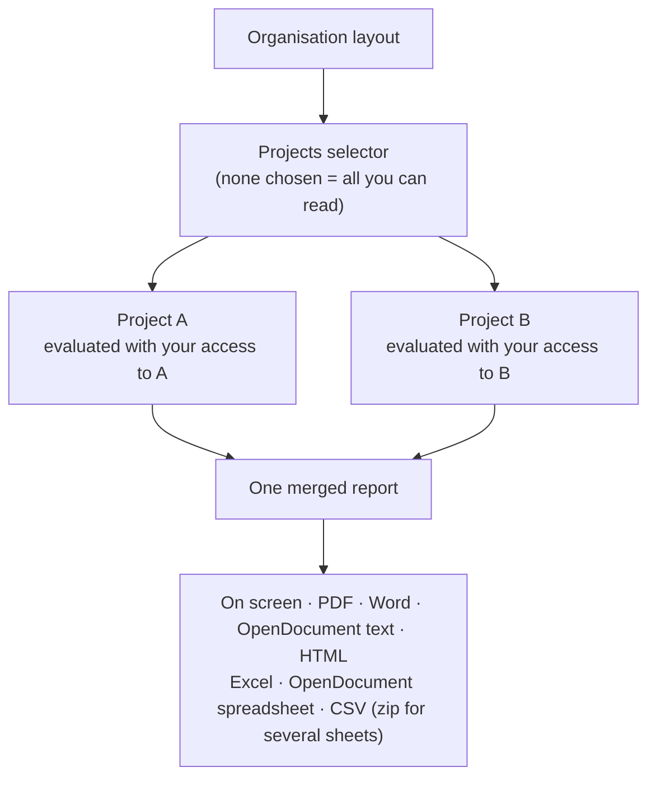

# Custom reports

A **custom report** is a report layout somebody designed: a document (headings, text, tables, and for each record its linked records) or a set of tables. Layouts are written for an organisation, which every project can run, or for one project (a child project also sees its parents'). Each appears in the **Report** picker beside the module reports, in the [folder](./organising-reports.md) its author chose or in **Custom reports** (a project can hide an organisation layout it does not want to offer). A layout never shows more than you could already read: records you cannot open are counted in a note ("2 record(s) not shown") and never named.

Layouts are written in the [designer](./designing-a-layout.md), opened from **Report layouts** in a project's **Report Setup** or the organisation's **Templates & reports**; they can also be created through the REST API, or by an AI assistant that has the [MCP tools](../../api-integrations/ai-assistants-mcp/overview.md) in write mode. A layout can have its own introduction, chapters and appendices (the **Report type** drop-down in Report Setup and Report Defaults lists it by name), and a PDF or Word download uses the chosen branding template as for any report.

| The Reports dialog running a custom layout: the layout is chosen from the Report picker and its Categories choice narrows the table |
| --- |
|  |

## Starter layouts

Every organisation starts with four ready-made document layouts, so a first report needs no design work:

| Starter | What it gives you |
|---|---|
| **Business Requirements Document** | Purpose and scope, Pain Points, stakeholders and Personas, needs, Strategy, Future State, requirements, constraints and assumptions, decisions, risks, traceability coverage, Open Questions and the approval state of each record. |
| **Engineering Specification** | Scope, guiding principles, requirements by component, requirement types, needs, constraints, compliance obligations, decisions, traceability coverage and each requirement's review date. |
| **Review Package** | What needs a person now: requirements still in draft or reviewed, change requests under review, decisions awaiting approval, open and overdue questions and risk reviews. |
| **Requirements by Component** | Every requirement grouped under its component and then its category, with its reasoning, status and tags, between an Introduction and an Appendices section for you to write. It is the requirements report as a layout. |

Each section is built from the project's records when you run it, so the document is a view of them, not a copy to keep up to date. A section whose module a project does not use is left out, not printed empty. The starters are ordinary layouts: open one in **Report layouts** to change the words and sections, rename it or delete it. If you delete one, or your organisation was created before the starters existed, choose **Add starter layouts** in the organisation's **Report layouts**; it adds only the starters you do not already have and never changes one you edited.

## Running a layout

| Run | What you get |
| --- | --- |
| A project's Reports dialog (**Reports** menu on the overview) | The layout for that project; **Include child projects** adds the readable child projects |
| The organisation overview's Reports dialog | An organisation layout evaluated once for **each project you can read**, merged into one report: a document has a heading and a new page per project, a table layout a leading *Project* column |

- **Formats:** a document layout downloads as PDF, Word, OpenDocument text (ODT, for LibreOffice and other office suites) or a standalone HTML page (no scripts, safe to open or email); a table layout as an Excel workbook or OpenDocument spreadsheet (ODS), one tab per sheet, or CSV, which is a zip of one CSV file per sheet when the layout has several sheets. Text a cell starts with `=`, `+`, `-` or `@` is stored as plain text, never run as a formula. The on-screen view shows each table of the report as a section, titled by the headings above it.
- **Choosing projects:** the **Projects** selector lists exactly the projects you hold a role in; downloads carry the same choice as the screen. A project that has hidden the layout is left out, and the report says so.

## Limits and background runs

a report shown on screen that is too large or takes too long is refused with a message to narrow the layout or the project choice; nothing partial is produced. A **file** download (PDF, Word, HTML, Excel, CSV) that is too big to produce while you wait is [prepared in the background](../reports-and-export.md#large-reports-are-prepared-in-the-background) instead.

## Provenance and versions

every run is recorded (which layout and version, who ran it, when, which projects, how many records of each kind, the version of each versioned record such as a requirement, and a fingerprint of all the records used) without storing the report's content, so a report can be traced back to what produced it. Layouts are versioned: saving a change adds a version and never rewrites an earlier one.

## Export and import

Layouts travel in a project or organisation [export](../zip-export-import.md).

See also [designing a layout](./designing-a-layout.md), [blocks, report components and variables](./blocks-widgets-and-variables.md), [report packs](./report-packs.md) and [finding and organising reports](./organising-reports.md).
