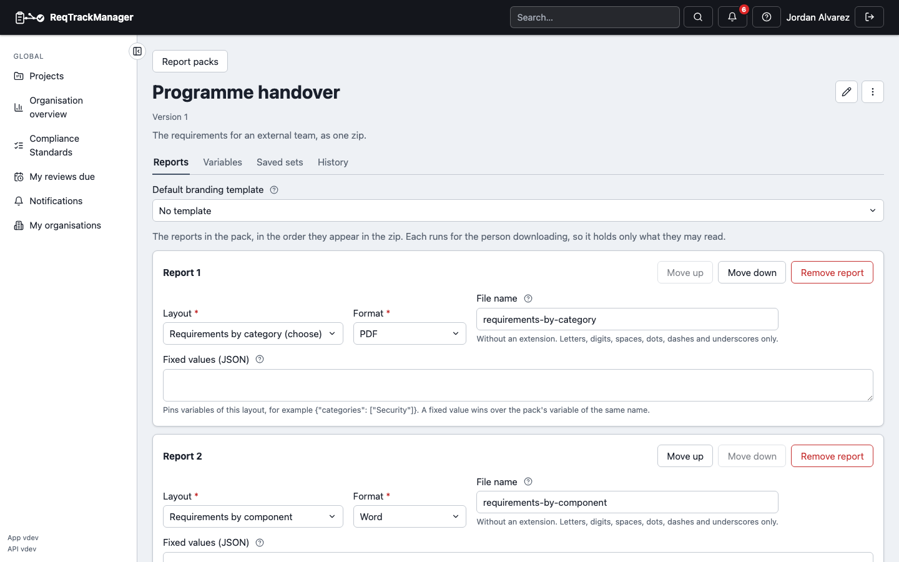
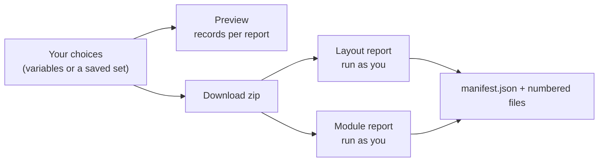
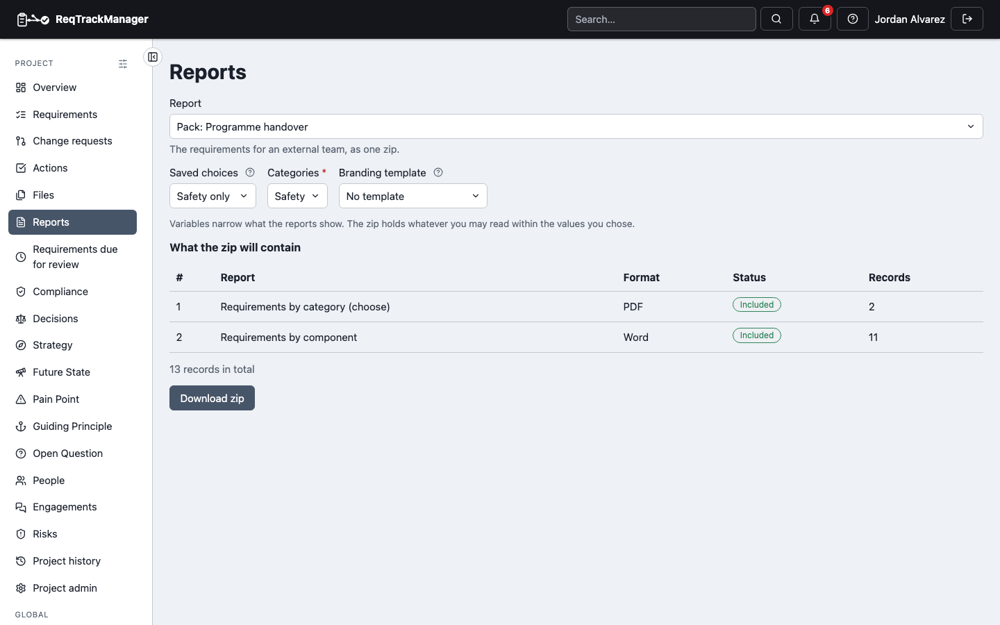

# Report packs

A **report pack** is a list of several reports you hand over together, each in its own format, downloaded as **one zip**: for example the overview and strategy as PDF and the requirements and Pain Points as Excel, for the categories an external team cares about. A pack is configuration, like a layout: an organisation's packs are shared with every project, a project can have its own, and a child project also sees its parents'. Give it an optional **Folder** to file it in the Reports picker (see [finding and organising reports](./organising-reports.md)), and find a pack in a long list with search and the folder filter. Build one in **Report packs** under a project's **Report Setup** or the organisation's **Templates & reports** (it needs the same permission as designing layouts); a pack shared from elsewhere can be copied, hidden in a project and shown again.

| Report packs: the reports in a pack, each with its format and file name |
| --- |
|  |

| Before downloading: what the zip will contain, with the records in each report for the chosen values |
| --- |
|  |

- **Reports in a pack.** Each is a custom layout (named, optionally the organisation's or a project's) or a module report, with its format (PDF, Word, OpenDocument text, HTML, Excel, OpenDocument spreadsheet or CSV; a layout offers the ones its kind can make, a module report all of them), the name of its file inside the zip, and optionally values it always uses. Files are numbered by their position (`01-overview.pdf`), so two reports can share a name, and a file name can never be a path.
- **Variables.** A pack declares the choices a person makes once, such as the categories to include. A layout in the pack that has a variable of the same name and type receives the choice; a value the pack entry fixes itself wins. Variables narrow what the reports show. They are not access control: every report runs with the access of the person downloading it, so the zip holds only what they may read.
- **Saved sets.** A pack can keep named choices ("Team Alpha: categories A and B") so a repeat download is one click. A set saved with an organisation pack can be **overridden for a project**, variable by variable: the project sees the shared value beside its own and can reset it. A project can also add sets of its own. In an organisation-wide run, each project's reports use that project's values. A saved value that is no longer one of the variable's options is flagged on the form, not dropped.
- **See before you download.** The Reports dialog lists, for the chosen values, how many records each report would include and which reports are **not available** (the layout was hidden, its module is off, you lack the role it needs) and why. Nothing is stored or produced until you download.
- **The manifest.** The zip's `manifest.json` records the pack and its version, who it was run for and when (UTC), the values used (and the saved set), each report with its format, layout version, record counts and status, and the reports that were left out. It holds no record content. A pack where nothing can run is refused.
- **Large packs** that cannot be produced while you wait are prepared in the background like any large report, and you are notified when the zip is ready; click the notification to download it.
- Packs, their saved sets and project overrides travel in a project or organisation [export](../zip-export-import.md), and an AI assistant with the [MCP tools](../../api-integrations/ai-assistants-mcp/overview.md) can list, preview and queue them.
