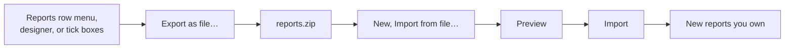
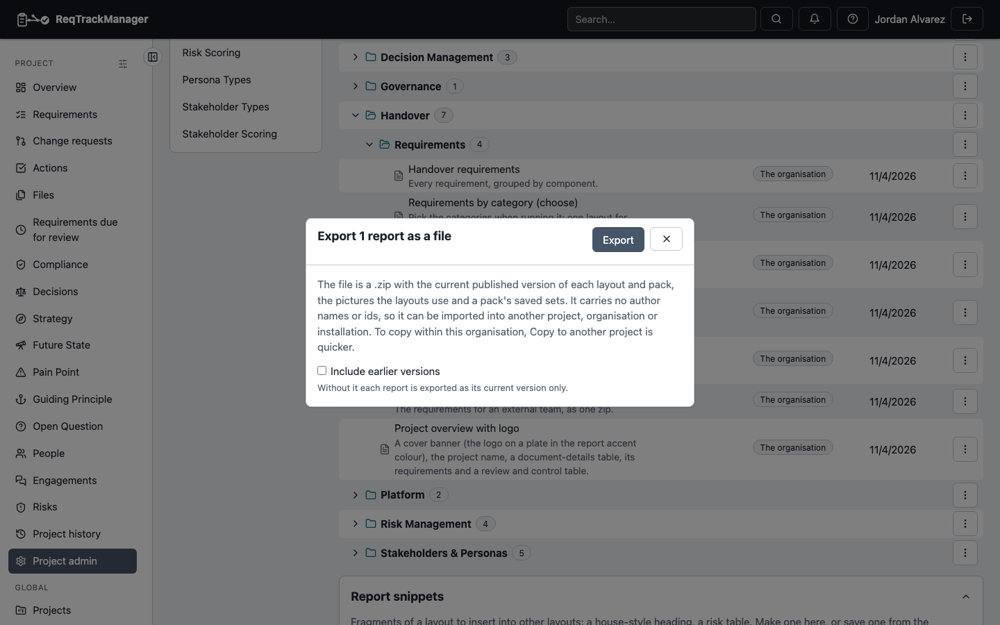
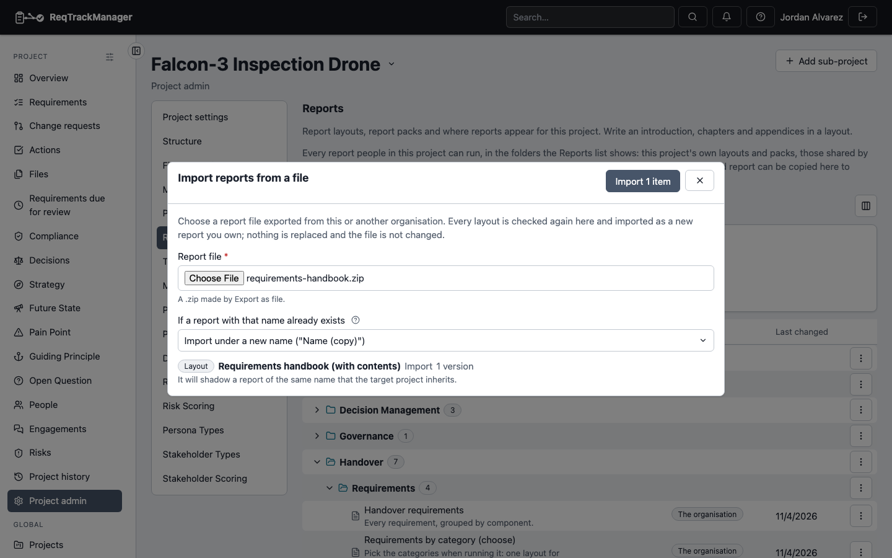

# Sharing reports as a file

Export layouts and packs as one **`.zip` report file** to keep, send or attach, and import it into another project, another organisation or another installation. To move reports between projects of the **same** organisation, [copying to another project](./copying-between-projects.md) is quicker; the file is for everything else.

You need to be able to manage report layouts where the file comes from (to export) and where it goes (to import). A person who can only run reports does not see the actions.

## Export

1. In **Reports**, open a row's menu and choose **Export as file…** (the designer's menu has it too), or choose **Export several as file…**, tick layouts and packs (a folder's box covers what is in it) and choose **Export file…**.
2. Choose whether to **include earlier versions**. Without it each report is exported as its current published version only; a draft is never exported.
3. When a pack is chosen, **include the layouts the packs use** (on by default) puts the layouts a pack names into the file, so the pack works where it lands.
4. Choose **Export**. The browser saves the file under the report's name (or after the project or organisation, such as "Apollo reports", for several).

| The export dialog, opened from a report's row menu: what the file holds and a switch for earlier versions |
| --- |
|  |

The file holds the layouts and packs, the pictures the layouts use and a pack's saved sets. It holds **no author names or emails, ids, placements, favourites or who may run a report**: those belong to wherever the file is imported.

## Import

1. In **Reports**, choose **New**, then **Import from file…**, and pick the file.
2. Choose what happens when a report with the same name already exists: **import under a new name** ("Name (copy)") or **skip it**. Nothing is ever replaced.
3. Choose **Preview**. Each layout and pack is listed with what will happen, its number of versions and warnings: a pack that names a layout neither in the file nor here, a module that is off in the project, pictures that will be added to the library. A layout with no version that is valid here (for example it names a colour your organisation's scheme does not have) is listed as **Cannot be imported**, with the first problem.
4. Choose **Import**. The reports are new, owned by this project (or the organisation, when imported on the organisation's page) and authored by you; the dialog says how many were imported and how many left out. Choose **OK** to close it.

| The import dialog after choosing a file: the preview lists what will be imported and how a clashing name is handled, before anything is changed |
| --- |
|  |

| Part | Behaviour |
| --- | --- |
| Checks | The file is untrusted: every layout is validated again here, every picture is re-checked (an SVG is cleaned) and the file's size and contents are bounded. |
| Versions | The current version becomes version 1. With history, every published version is imported and numbered afresh. |
| Pictures | Stored in this project's library (or the organisation's, on the organisation's page) as its own, so the layout never points into another organisation's library. A picture the organisation already has is reused. |
| Packs | Follow a renamed layout. Their saved sets come with them. |
| Names | A name that matches a report only inherited from above is allowed and warned about: the import then shadows it in this project. |
