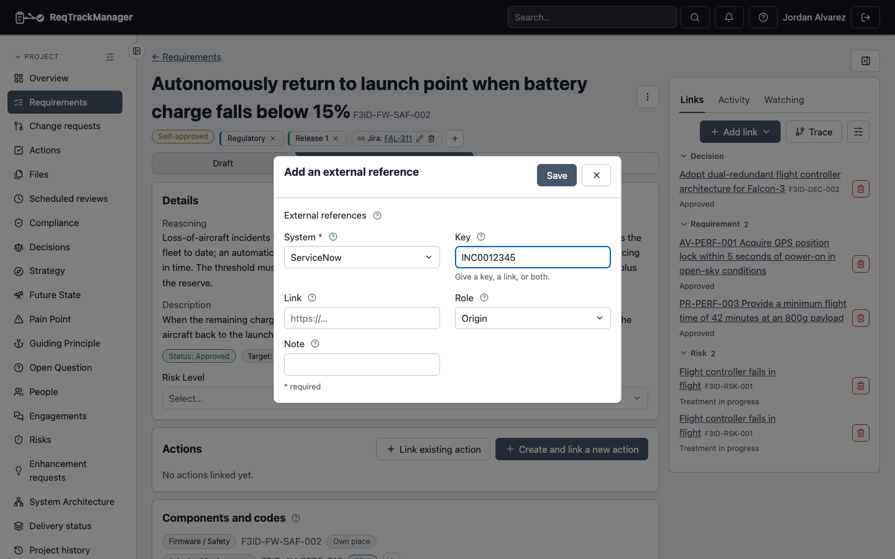
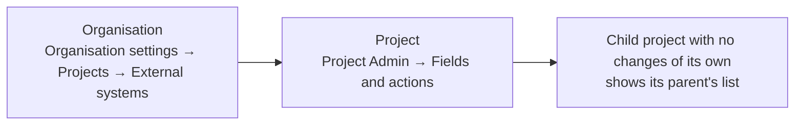
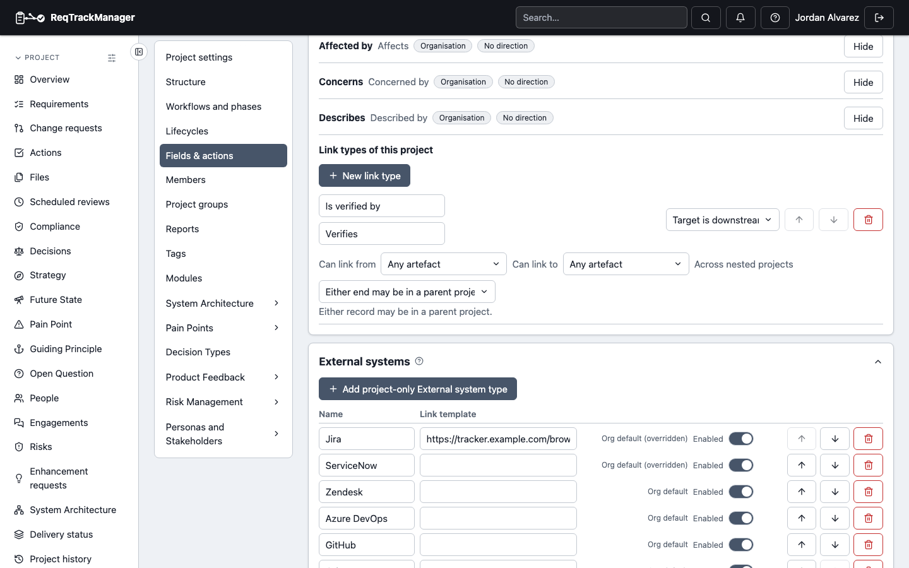

# External references

An **external reference** records where a record lives, or came from, in another tool: the Jira ticket a requirement was raised from, the ServiceNow incident a risk relates to, the DOORS item a decision supersedes. Every record type carries them the same way, so delivery can stay in your own tracker while ReqTrackManager keeps the pointer.

## What a reference holds

| Field | Meaning |
| --- | --- |
| **System** | The outside tool, chosen from the list of external systems (Jira, ServiceNow, GitHub and your own). |
| **Key** | The item's identifier, such as `PROJ-123`. |
| **Link** | The item's address. Only `http` and `https` addresses are accepted, and a link opens in a new tab. Give a key, a link, or both. |
| **Role** | Optional: **Came from** (the item the record arose from) or **Delivered in** (where it is being built). |
| **Note** | Optional text of up to 500 characters. |

A record carries up to 50 references. A reference is not part of the record's content, so it can be added to an approved requirement without a change request; it is changed on its own and audited without creating a new version. The audit trail records the system, the role and whether there is a link, never the key, the link or the note.

## Adding a reference

Under a record's title, the row of tags and components also shows its references as chips. If you may tag that kind of record, the row ends with a **+** button; choose **Add external reference**, pick a system, give a key or a link, and save. The same field is on every create form, beside **Tags**, and applies the references when the record is saved. Select a chip to edit it and use its **×** to remove it; removing a reference never changes the item in the outside system. See [Tags](./tags.md#tagging-a-record) for the shared **+** menu.

| Add an external reference: system, key, link, role and note |
| --- |
|  |

## Keys that become links

A system can have a **link template**, an address with `{key}` in it, for example `https://tracker.example/browse/{key}`. A reference that has only a key then opens the item. The key is encoded when it is placed in the address, and a template that is not an `http` or `https` address is never turned into a link.

## The list of systems

| A project's external systems, with link templates |
| --- |
|  |

- An **organisation administrator** keeps the organisation's list. Every project offers it.
- A project can add its own systems, hide the organisation's systems it does not use and restore them. References that already use a hidden system are kept. A child project that has made no change of its own shows its nearest parent project's list; its first change makes the list its own.
- A system a reference uses is disabled, not deleted. A project's link template, when it sets one, replaces the organisation's for that project.
- A record the organisation itself owns (an organisation persona or strategy, for example) uses the organisation's systems.

## Finding records by reference

- **Filter.** Every record list's filter panel has an **External system** and an **External key** field (a name and part of a key); either alone is enough.
- **Column.** A list can show an **External references** column. In an export it is written as `SYSTEM:KEY; SYSTEM:KEY`. An import keeps a reference already there with the same system and key, removes the others and adds the missing ones with the key only, so a round trip through a spreadsheet never loses a link, role or note.
- **Search.** The [global search](./global-search.md) can include a record's references (a key or a system name, never a note or link) by adding the field; it is off by default.
- **Reports.** A record-list report can include the **External references** field.
- **Look-up.** The API and AI assistants can find the record for a key you were handed (`find_artefacts_by_external_reference`); only records the caller may read are returned.

## Bundles and templates

References travel with their records in a [project export](./zip-export-import.md), and the systems travel with the project and the organisation. A system the destination lacks becomes one of the project's own, with a warning, so no reference is dropped.

## Product Feedback

Product Feedback requests use this same mechanism; see [External references and channels](../modules/product-feedback-module/external-references-and-channels.md). The `external_references` sub-component of that module still switches the references of requests on and off.

## For API clients and AI assistants

The MCP tools are `list_external_systems`, `list_organization_external_systems`, `get_artefact_external_references`, `add_artefact_external_reference`, `update_artefact_external_reference`, `remove_artefact_external_reference` and `find_artefacts_by_external_reference`. See [Tracking a product being built](../api-integrations/ai-assistants-mcp/tracking-a-product-being-built.md).

## Where this fits

See [Links and traceability](./links-and-traceability.md) for links between records inside ReqTrackManager; an external reference points outside it.
