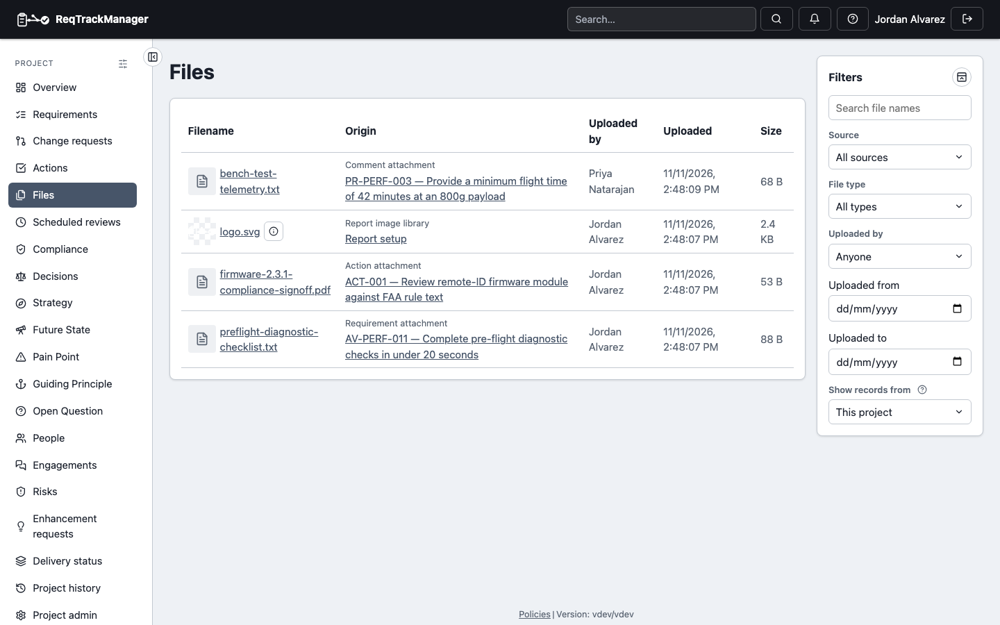
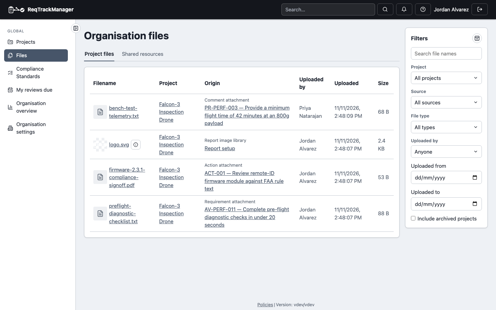

# File attachments and shared resources

## Attachments on requirements

Use the file picker at the bottom of a requirement's Attachments card to upload a supporting document; click a filename to download it, or the trash icon to remove it. Once a requirement is locked, this direct upload is no longer available — a file can still be attached at that point via an approved [change request](./change-requests.md), or informally via a discussion comment.

## Attachments in discussion

Discussion comments support file attachments too, via the paperclip icon — attach one while writing a new comment, or add/remove attachments while editing an existing comment. There's no way to attach a file to someone else's comment, or to an already-posted comment that isn't being edited. This works even on a locked requirement, since a discussion comment isn't part of the requirement's governed content.

## Project files

A project's **Files** page lists every file the project holds in one place: files attached to requirements, change requests and actions, discussion attachments, and the pictures in the project's **report image library** (the pictures its report layouts use). Each row shows a small preview for a picture, the file name, its source, who uploaded it and when, and a link to where it belongs: the record, or **Report setup** for a library picture. The organisation's own picture library is not listed here.

| Project files |
| --- |
| Every file the project holds, with previews and a filter panel |
|  |

The filter panel on the right narrows the list; the filters are held in the address, so a filtered list can be bookmarked and keeps its place when you come back from a record.

- **File name** matches part of a name, ignoring case. Only names are searched, never a file's contents.
- **Source** limits the list to one kind of attachment, or to the report image library.
- **File type** is *image*, *document* or *other*.
- **Uploaded by** lists the people who uploaded files in this project.
- **Uploaded from** and **to** are calendar days in your own time zone, both included.
- On a project with parent or child projects, the usual project scope filter widens the list; a row from another project says so and opens there.

A picture you cannot read shows an icon in place of its preview. A *confidential* library picture is still listed for the project's members; the mark only stops a report from printing it.

## Organisation files

The **Files** entry in the navigation rail, directly below **Projects**, opens the organisation's **Files** page (a list of your organisations first, if you belong to several); so does the **Organisation files** icon beside the title of the organisation overview. The page which lists the files of every project you can open in one list. It shows exactly what you could already reach by visiting each project's Files page: an administrator of the organisation sees a project's files only with a role in that project. Each row names its project and links to it, and the filters are those of the project page plus:

- **Project** limits the list to one project.
- **Include archived projects** adds the files of archived projects, which are left out by default.

| Organisation files |
| --- |
| Files of every project you can open, with the project and origin of each |
|  |

Organisation shared resources have their own list and are not repeated here. If you can open more than 250 projects the page covers the first 250 by name and says so; choose a project to see the rest.

## Picture details

Beside the name of a picture (JPEG, PNG, GIF, WebP or SVG) in any file list, an **i** button opens its details: its size in pixels (an SVG's declared size) and, for a photograph, when it was taken (on the camera's own clock, as the camera wrote it), the camera, any description saved in the file and the position where it was taken. Use them to tell photographs apart when their file names say nothing. The button appears in a requirement's or action's attachments, on discussion attachments, on the project's **Files** page and in an organisation's shared resources, and anyone who can download a file can see its details. Other files have no button.

## Organisation-wide shared resources

Beyond per-item attachments, an organisation has **shared resources**: files that aren't specific to one requirement or change request, such as a standards document or a reference spec. They are on the organisation's **Files** page, on the **Shared resources** tab. Every member of the organisation can list and download them; the tab shows who uploaded each one, when, its size and how many requirements link it.

Only people who manage shared resources see **Upload shared resource** and a delete button on each row. Organisation administrators manage them, and an administrator can give the right to a person or an organisation group through a [custom role](./role-management.md#the-shared-resource-permission) holding the `manage_org_resources` permission. Deleting a resource asks for confirmation; a resource that requirements link names how many, removes those links with it, and asks for the file name to be typed.

A shared resource can be linked to requirements in any project in the organisation, and is available to append as an extra section on a generated report. A shared resource can be linked to requirements in any project in the organisation, and is available to append as an extra section on a generated report — see [Reports and export](./reports-and-export.md).

## When uploads are disabled

A server administrator can disable file uploads for the whole deployment (see [Server administration](../workflows/server-administration.md#server-management)). Every upload control then stays visible but unavailable, with a tooltip saying that uploads are disabled on this deployment. Files already attached stay readable and can still be deleted.

The platform operator can also disable uploads for one organisation, or give it a storage limit (see [Organisation storage](../workflows/server-administration.md#organisation-storage)). With the organisation's switch off, the controls are unavailable with a tooltip naming the organisation; at the limit, an upload is refused with a message that names the limit and who to ask. Deleting files frees space.

## Where this fits

See [Workflows → Files, comments, and history](../workflows/files-comments-and-history.md) for the end-to-end task walkthrough.
