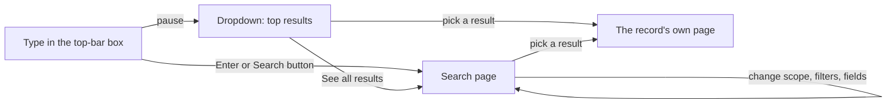

# Global search

Find a record without knowing which project or module page it lives on. The search box sits in the top bar, left of the notification bell, on every page.

## What it looks in

By default a search matches a record's **ID** (its code, with or without the project code: `REQ-001` or `ACME-REQ-001`), its **Title** and its **Tags**. A tag is a short curated label (a theme, a release, a regulation), so a tag hit is usually what you meant. Words are matched in any order and ignore case; choose **Exact phrase** on the search page to require the words together.

To look in more, pick fields from the **Search in** list on the search page (Description, Rationale, Mitigation and so on). **Comments** are in that list too, flagged *slower*: they read every discussion, so they are chosen for one search at a time and are never part of the default, nor offered in **Preferences → Search**. The list has its own filter box because it is long, and shows only fields of record types you can open. That choice applies to that search only. To change your own default for every search, use **Preferences → Search**; ID and Title are always included.

## Where it looks

The top-bar box has no scope control. It searches the narrowest place that fits the page you are on:

| You are on | The box searches |
|------------|------------------|
| A page inside a project | **This project** |
| A page of a Compliance standard | **This standard** |
| Anywhere else | **All projects** you can open |

The dropdown's last line names the place, for example *See all results for ‘valve’ in This project*. On the search page the **Scope** filter lists every place that fits where you started, plus **All projects**; changing it runs the search again. If you belong to more than one organisation, an **Organisation** filter appears as well.

## The dropdown

After you pause typing (at least two characters) the dropdown shows the top eight results grouped by record type, each with its code, title, type, status and project. It never goes blank between keystrokes: the previous results stay on screen, slightly dimmed, until the new ones arrive, and "No results" appears only after a search for what is currently typed has finished.

- **Up / Down** move through the results, **Enter** opens the highlighted one; with nothing highlighted, Enter opens the search page.
- **Esc** closes the dropdown; pressing it again clears the box.
- **/** moves focus to the box from anywhere that is not a text field.
- On a narrow window the box collapses to a search icon that opens it full width.

## The search page

The page keeps everything in its address, so a search can be bookmarked, shared with a colleague who has the same access, and reached with the browser's Back button. Besides **Scope**, **Organisation** and **Search in** it can filter by **Record type** (with the number of matches per type), **Project**, **Status**, **Updated** dates, and whether to include archived and retired records. Results can be sorted by relevance (an exact code first, then a code that starts with your text, then a title match) or by most recently updated. Each result shows a snippet of the first other field that matched, with the match highlighted, and links to the record's page; a research finding opens its engagement.

If a type has none of the fields you selected, the page says so ("Not searched: Risk (no selected field)") instead of leaving it out silently. Requests are rate limited per person to guard against scripts, far above what typing allows (the dropdown's requests count; about 120 a minute sustained, with a reserve of 60 for bursts); past that the search asks you to wait a few seconds. Only the first 500 results can be reached; the page says when more matched, and narrowing the search (a record type, a project, a date range) reaches the rest.

## What you will and will not find

- Only records you could open anyway. A project you have no role in, a module switched off for a project, and record types your permissions do not cover are left out entirely, including from the counts, so a search cannot tell you that a hidden record exists.
- An organisation-owned record (a shared persona, say) is found through a project that shows it; a project that hides it does not.
- **Projects** are results too, found by name or code. People and groups are not searched; use the directory in Organisation admin.
- An organisation-level record (a Strategy, Future State or Guiding Principle your organisation owns) is found by every member of the organisation and opens at its organisation page. A search of one project includes them too, because they are relevant to every project, unless that project has the feature switched off; untick **Include organisation records** on the search page for one search, or change your default in **Preferences → Search**.
- Contact details and files and attachments are not searched; comments only when you choose them.
- Archived and retired records need **Include archived and retired**.

## Privacy

The text you search for is sent in the body of a request, not in an address, and is never written to the application log, the audit trail or traces. The page address (which holds the text so it can be shared) is not recorded by the web server's access log either. Your own browser history and any reverse proxy in front of the product are outside that.

## For AI assistants

The MCP server has a `search_records` tool with the same scope, fields and access rules; see [AI assistants (MCP)](../api-integrations/ai-assistants-mcp/overview.md).
