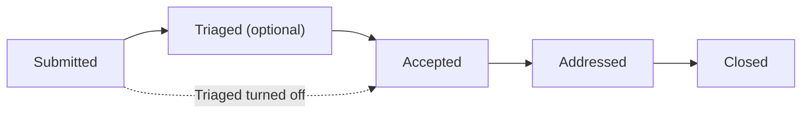
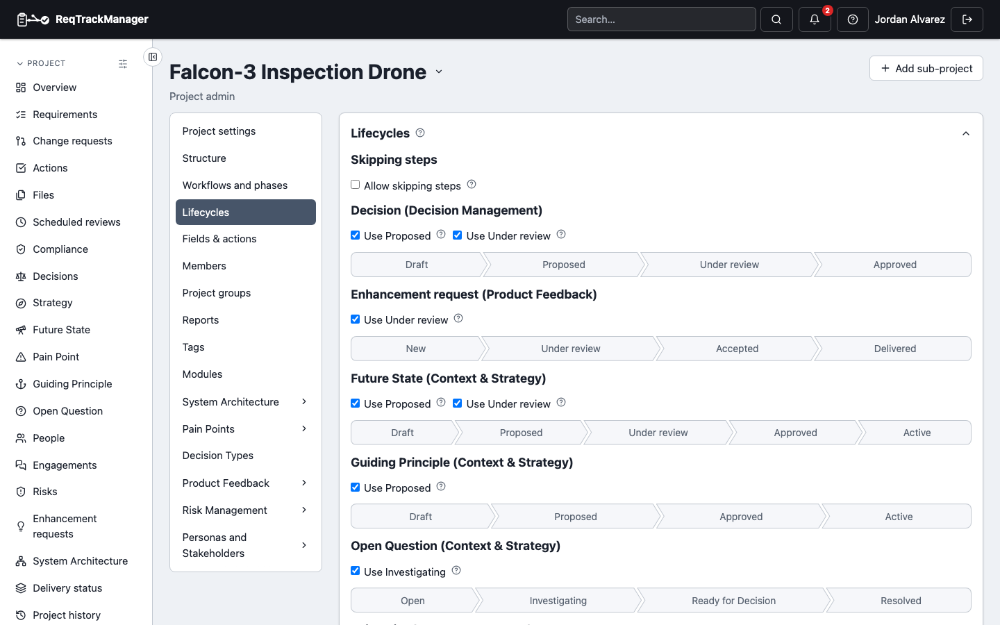
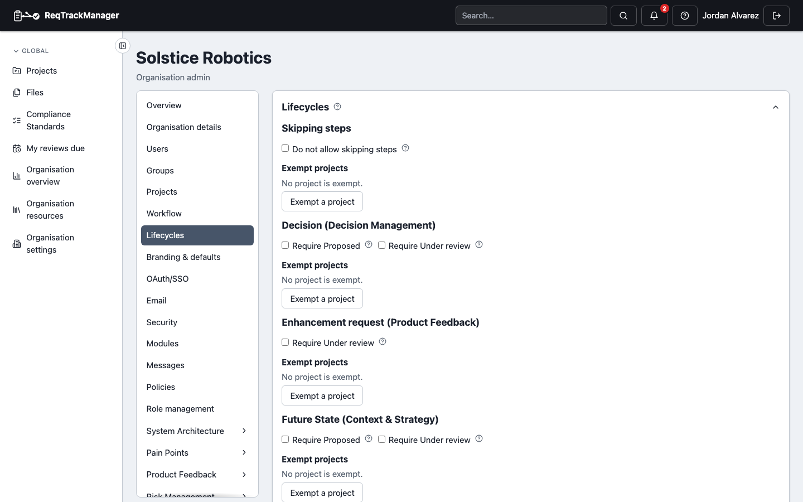
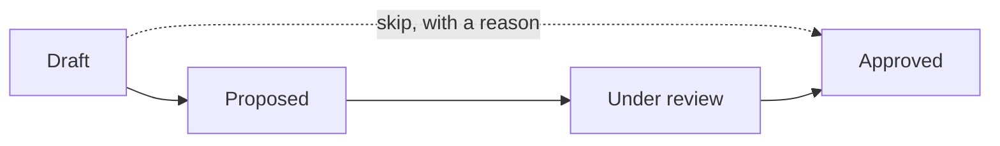

# Lifecycles

Records such as Pain Points, Decisions, Strategies and Risks move through **states**: a Pain Point is Submitted, Triaged, Accepted, Addressed and Closed. A project can turn off the **optional** states it does not use, and an organisation can **require** states so no project turns them off.

## What can be turned off

| Record type | Optional states |
|---|---|
| Pain Point | Triaged |
| Open Question | Investigating |
| Decision | Proposed, Under review |
| Strategy, Future State | Proposed, Under review |
| Guiding Principle | Proposed |
| Risk | Treatment planned, Treatment in progress |
| Enhancement request | Under review |

A start state, an end state, a state outside the main path (Rejected, Withdrawn, Retired) and an **approval** state (Approved) are never optional. With the review steps of a Decision turned off, it goes from Draft to Approved through the same approval dialog, and only a person who holds the approval permission can do it.

## Turning a state off in a project

A project administrator opens **Project administration, Lifecycles**. Each record type lists its optional states with a checkbox; clear one and the record moves past it. The track under the type shows the path that results.

| Project Admin → Lifecycles: optional states per record type, each with its track |
| --- |
|  |

- A record that already sits in a state you turn off can still be opened, edited and moved on. Turning the state back on restores it.
- **Risks:** a step that is passed over still applies its checks. Moving a risk from Assessed to Mitigated with Treatment planned turned off still needs an owner and a treatment strategy.
- A nested project that has no choice of its own uses its parent project's choice and says so. Its first change becomes its own choice.

## Requiring a state in an organisation

An organisation administrator opens **Organisation administration, Lifecycles** and selects **Require** beside a state. No project of the organisation can turn it off, and a project that had turned it off uses it again from then on; its records are not changed. The project's row shows **Required by the organisation** and cannot be edited.

| Organisation administration → Lifecycles |
| --- |
|  |

To let one project keep its own choice, select **Exempt a project** under the type, choose the project and, if its nested projects are exempt too, **Include nested projects**. Removing the exemption makes the requirement bind the project again.

## Skipping steps on one record

Sometimes one record needs to move past steps the project keeps on, without changing the project's settings. Skipping is **off by default**.

1. A project administrator selects **Allow skipping steps** under **Project administration, Lifecycles**.
2. On the record, open the actions menu and select **Skip steps…**, choose the later step (each option names the steps it passes over) and give a **Reason**.

- You can skip a step only if you could carry out that move yourself, and you still need the permission and comment of the step you move to. For example, you can move a Decision to **Approved** only if you hold the approval permission.
- A skip never passes an **approval** step or a step the **organisation requires**. An approval step can be the destination, never a step passed over.
- The history names the steps skipped and shows the reason. The MCP server does not skip steps; a refused move lists the steps that are allowed.
- An organisation administrator can select **Do not allow skipping steps** under **Organisation administration, Lifecycles**, which locks every project's switch ("Not allowed by the organisation"). **Exempt a project** lets a project, and optionally its nested projects, skip steps again.

## Who may approve: the creator or another person

Some steps need an approval: a change request, a requirement, a Decision, a Risk acceptance, and a Strategy, Future State or Guiding Principle. By default the person who created a record may approve it if they hold the approval permission, so a team of one can work. The record then shows a **Self-approved** badge, and the history records the approval as made by its creator.

A project administrator can change this under **Project administration, Lifecycles, Approval**. Each record type with an approval step has three choices:

| Choice | Meaning |
|---|---|
| Default | The creator may approve without a comment. A nested project follows its parent project. |
| Submitter may approve, with a comment | The creator may approve, and each such approval needs a comment. |
| Separate approver required | The creator cannot approve. Another person who holds the approval permission must approve, and the next step shows a lock with the reason. |

An organisation administrator can select **Required for every project** under **Organisation administration, Lifecycles, Approval**. No project can relax it, and the project's row shows **Required by the organisation**. **Exempt a project** lets one project (and optionally its nested projects) choose again. A project's own choice is kept while the requirement applies and returns when it is removed.

- The rule applies to the application, the API and the MCP server alike.
- Turning on a separate approver does not change approvals that were already given.
- Approving several requirements together through a stage baseline applies the rule to each requirement. If one was created by the person baselining and a separate approver is required, the baseline is refused.

## Permissions

| Action | Permission |
|---|---|
| See a project's lifecycles | Any project member |
| Change a project's choice, including who may approve | **Manage project lifecycles** (project administrators and managers, organisation administrators) |
| Require a state or a separate approver, add an exemption | **Manage organisation lifecycles** (organisation administrators) |

Every change is recorded in the project's history (record type and state names only).

## Moving a record

A move the project does not allow is refused with the states that are allowed. The same rule applies to the application, the API and the MCP server.
