# Links and traceability

Any two records in a project can be linked, whatever their kind: a requirement to a decision, a pain point to a strategy, an action to a persona. A link has a **link type** that says what the relationship means ("Derives from", "Addresses", "Is addressed by"), and it can be read from either end with the wording that fits that end.

## Link types

Organisation admins manage link types under **Admin → Projects & workflow → Link types**. Each has a name for both directions and a [direction](requirements-management.md#traceability-links) (upstream, downstream or none) that traceability views and AI assistants use to answer "where does this come from?" and "what depends on it?". Modules that ship their own vocabulary add link types for it when they are enabled (the Decision Management module adds "Addresses" for a decision and the pain point it addresses, for example); an admin can rename, reclassify or restrict any of them, and your edits are never overwritten.

### Restrict what a link type can join

Out of the box a link type can join any two kinds of record. Under each link type, **Can link from** and **Can link to** limit the kinds of record it may start from and point at, read with the forward name: "Addresses" from *Decision* to *Pain point*. Leave both on **Any artefact** for no restriction.

### Restrict which link types a kind of record can use

The **By artefact type** tab does the opposite: it limits the link types one kind of record may use, for example a Requirement may only be linked with "Derives from" and "Implements". A kind of record with no rule can use any link type. Turning a rule on starts with every link type ticked, so nothing changes until you untick one, and a rule must keep at least one. **Allow any link type** removes it.

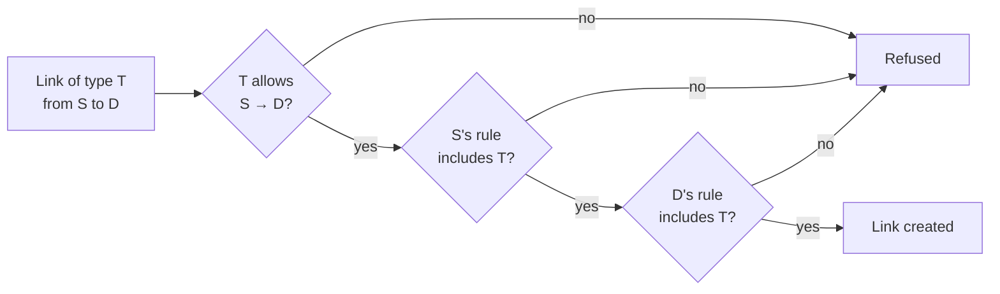

Either side can say no, and the message names which rule refused. Restrictions and rules apply **when a link is made**: changing one never deletes or changes a link that already exists. Links that supersede (a decision superseding another) have a fixed meaning and their own action, so they are never offered as a general link and are not affected by rules.

## Link types for one project

A project admin can give their project link types of its own and hide the organisation's ones it never uses, under **Project admin → Fields & actions → Link types**. The organisation's link types and any a parent project defined are listed first, each saying where it comes from; the project's own are below them and are edited exactly like the organisation's (names, direction, **Can link from** and **Can link to**).

- **Own link types** are available in the project and in every project nested under it, in addition to the organisation's. A name that the organisation or a parent project already provides can't be reused; if a parent later adds a name a nested project already uses, the parent's wins and the nested project's is marked *Not offered* (its existing links keep reading as before).
- **Hide** takes a link type out of this project's link pickers, and out of those of the projects nested under it, unless one of them shows it again. It never removes anything: links that already use a hidden type keep showing.
- **By artefact type** works the same way per project. A rule set on a project replaces the organisation's rule for that kind of record entirely (so it can allow more as well as less), and a nested project uses its nearest parent's rule until it sets its own. The pill names where each rule comes from and **Use inherited rule** drops the project's own.

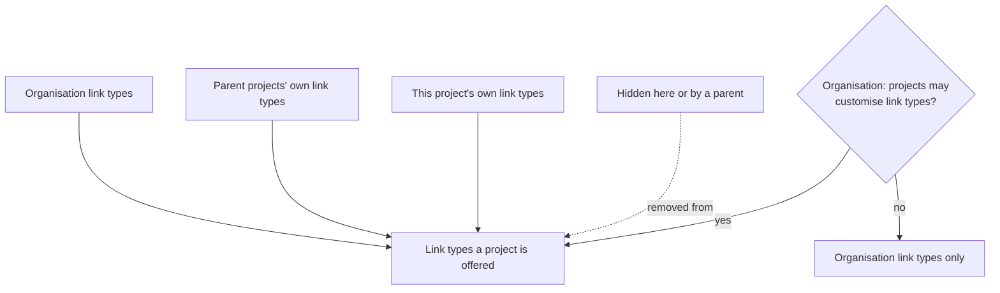

### One shared set for the whole organisation

An organisation that wants every project on the same vocabulary can switch off **Let projects add their own link types and hide the organisation's** (Admin → Projects & workflow → Link types). Asking first, it shows how many project-level link types it affects. Nothing is deleted: project link types, hiding and rules stop applying, project admins see the list read-only, and everything comes back if you switch it on again. Links already made keep showing either way.

## Linking across nested projects

When projects are nested, a record can be linked to one in a **parent or child project**, for example a pain point taken in at product level traced to the requirements below it. Each link type decides whether, and in which direction, that is allowed, with the **Across nested projects** setting under each link type (organisation admins under **Admin → Projects & workflow → Link types**, project admins for their project's own types):

| Setting | Meaning |
|---------|---------|
| **Same project only** | Both records must be in one project. Turns cross-project linking off for this type. |
| **Upstream end may be in a parent project** | Follows the link type's direction: the upstream record (for example a pain point for "Addresses") may be in the same or a parent project, never below. Needs a direction on the link type. |
| **Either end may be in a parent project** | Either record may be in the parent. The default, and the only choice that fits a link type with no direction such as "Related to". |

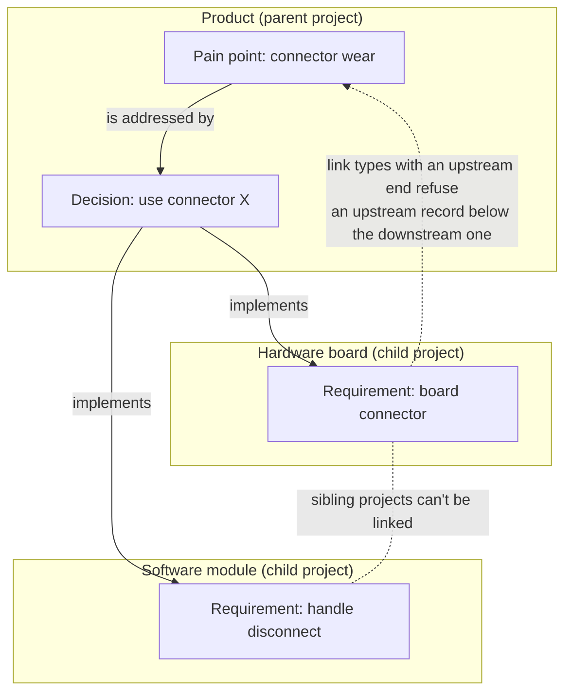

| A link across nested projects |
| --- |
| An Avionics sub-project Decision that addresses a Pain Point in its parent, Falcon-3; the badge names the parent project |
| 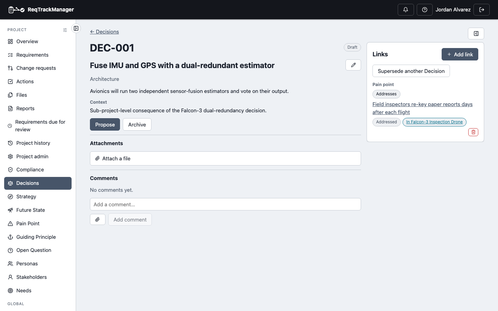 |

- Only a project and its parents or children can be linked; siblings and unrelated projects can't, even through a shared parent. A record in a sibling never shows up in a project's link graph.
- You need a role on **both** projects. A record in a project you can't open is reported as not found, and its project's name is never shown.
- Each end follows its own project's rules: whether that kind of record is enabled there, your permissions there, the link types and rules that project offers, and the [change request rule for links](requirements-management.md#traceability-links).
- A link type a child project defined can't be used on a link whose other end is in the parent. The parent's types and the organisation's can.
- Narrowing a link type's setting never deletes a link already made: those links stay, marked as no longer permitted by their link type, and the admin is told how many first. If a project is moved so that the two projects are no longer parent and child, the link is hidden until they are again.
- A project export doesn't include these links (it would carry another project's content), and says how many it left out. A requirement's links to compliance clauses are included, and re-created on import when the target organisation has the same standard version.

## The Links panel

Every record's page shows a **Links** panel beside its content: requirements, actions, pain points, strategies, future states, guiding principles, open questions, decisions, personas, stakeholders and stakeholder needs, and the compliance records inside the Compliance workspace. It lists the record's links grouped by the kind of record at the other end, each read with the wording that fits this end ("Is implemented by" on the requirement, "Implements" on the decision), with the linked record's status and, for a record in another project, the project's name.

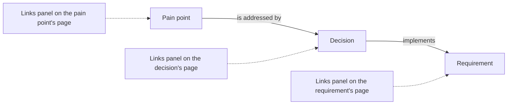

| A requirement's Links panel |
| --- |
| AV-PERF-001's links grouped by kind of record, each read from its own end, with the linked record's status; the Compliance section sits beneath |
| 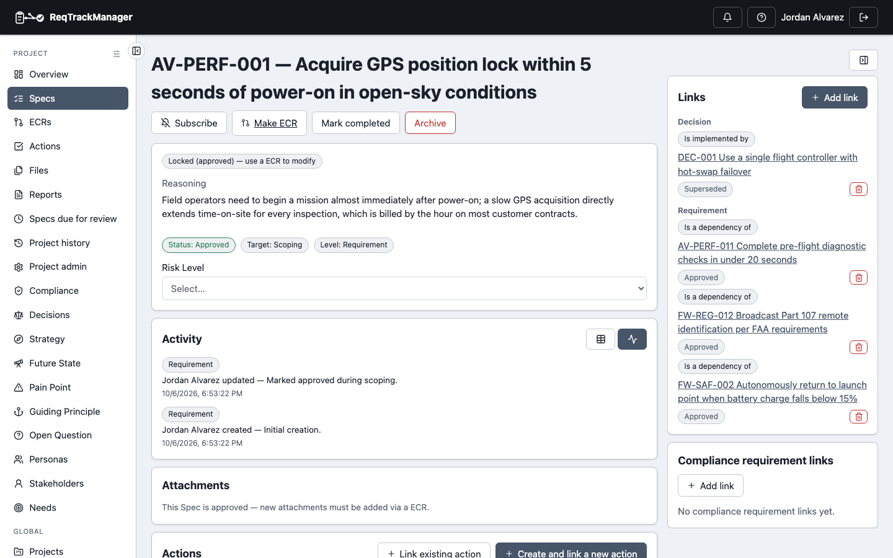 |

The same link reads correctly from all three pages, and any of them can add or remove it. On a narrow screen the panel moves below the page; on a wide one it sits to the right and can be collapsed (the choice is remembered for you).

- **Add link** opens a dialog. When the project has a parent or child project, a **project** choice lets you link across them. Then find the record with one finder: a **Search** box over a scope that narrows step by step.
  - With nothing chosen, typing two or more characters searches **every kind of record** you can link to; each result is named with its kind.
  - Choose a **kind of record** ("Link to") to search only that kind, or to list its records.
  - Each kind can then be narrowed by its own steps, every one optional: a compliance clause by **Standard**, then **Version**, then **Requirement**; a requirement by **Component**, then **Category**; most others by a status or type. Changing an earlier step clears the later ones, and a long list of options has its own filter box.

  Pick the **record**, then the **relationship**: only link types that can join these two kinds of record are offered, after any restrictions, rules, hiding and the nested-project setting, and "Related to" is preselected when it fits.
| The Add a link dialog |
| --- |
| Choose the project, find the record (search, or narrow by kind and step), then the relationship |
| 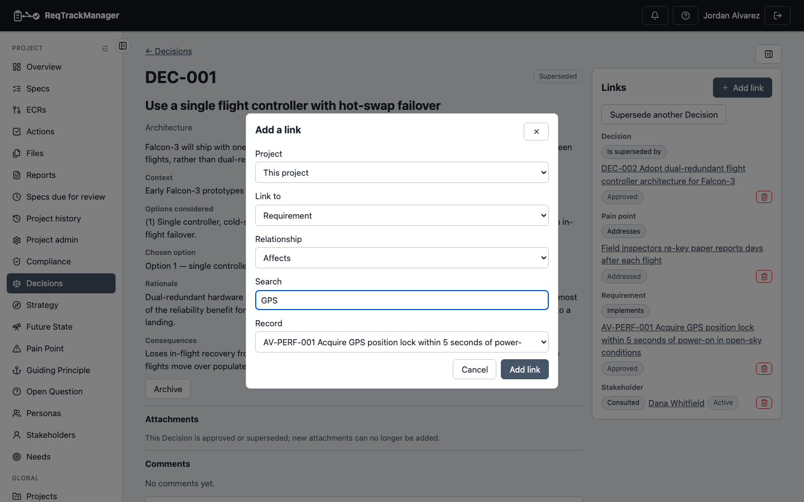 |

- **Remove** asks for confirmation and removes only the link.
- Links whose link type no longer permits them are kept and marked. Links with their own action (a decision *superseding* another, made with **Supersede another Decision** next to **Add link**) are shown but can't be removed here; an action's membership of a requirement is shown on the action's page and managed from the requirement's Actions section.
- Links you can't see (a record you have no permission on, in a module that is off, or in a project you can't open) are not shown; the panel says how many were left out.
- An approved requirement in a project that [requires a change request for links](requirements-management.md#traceability-links) shows the same panel, but adding or removing a link asks for a reason and creates a change request. An added link can be any record the panel can link to; it is created only when a manager [approves and merges it](change-requests.md#proposing-links).
- A record that belongs to the organisation rather than a project (an organisation strategy, say) shows the panel with a note instead: links are made from within a project.
- A requirement's links to **compliance standard clauses** are ordinary links: they appear in the panel under **Compliance standard clause** (when the Compliance module is on), are found with the finder above (search the standard, version or clause text, or narrow Standard > Version > Requirement), and follow the same rules as any other link. A clause belongs to the organisation, so it can be linked from a project but not reached through a parent project. Opening one goes to the Standards page.

You need to view the record you link to, and one of these on the record you link from:

- the **Link** or **Manage** permission on that kind of record, which works in any state, approved included. **Link** is a narrow grant that allows nothing but adding and removing links (see [Role Management](role-management.md#the-link-editor-role));
- or, for a requirement or action, the **stakeholder**, **project administrator** or **project manager** role, which works only while no requirement involved is approved. For an approved requirement they [propose the link in a change request](change-requests.md#proposing-links) instead.

The panel shows its add and remove controls only to people who may use them on that record. Other kinds of record (a decision, a pain point, …) need the Link or Manage permission. API clients and AI assistants use the same rules through one general endpoint that works from either end for any pair of records (the MCP tools `list_artefact_link_types`, `search_artefact_link_candidates`, `list_artefact_link_browse`, `create_artefact_link` and `delete_artefact_link`, in [write mode](../api-integrations/ai-assistants-mcp/overview.md)). A link between a record and an approved requirement follows the project's [change request rule for links](requirements-management.md#traceability-links) if one is set. A pair already linked the same way is refused, and so is the mirror image of a two-way link type such as "Related to".

## Tracing where a record comes from

The Links panel shows a record's direct links. When a record has any, **Trace** (beside **Add link**) opens a larger window that follows them further, in two views.

| Opening the trace |
| --- |
| **Trace** sits beside **Add link** at the top of a record's Links panel; it appears once the record has at least one link |
| 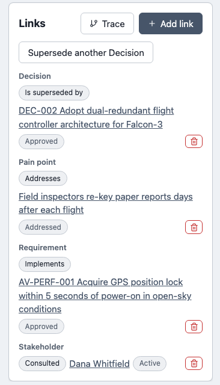 |

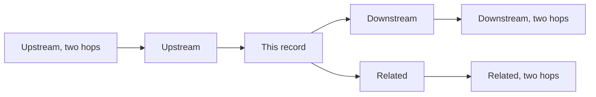

- **Tree** lists the record's links in three groups: **Upstream** (where it comes from), **Downstream** (what depends on it) and **Related** (linked without a direction). Open any record's arrow to read what it is linked to in turn, as deep as you like; nothing deeper is loaded until you open it. A branch keeps its direction: following upstream goes further upstream, never back down through where you came from, and a record already on the path is not repeated.
- **Map** draws the same records as a diagram on tinted lanes: upstream on the left, the record in the centre, downstream on the right, related in a band below. Arrows point downstream. Click a record to open it, or hover it to light up its own links. The **Key** button opens a small pop-over explaining the marks (a dashed border for a record in another project, a faded one for an archived record). It starts two hops out for upstream and downstream, but only one hop for related records, since there can be many; a record at the edge has a **Show more** pill that reads its own links and adds them, so the map grows as far as you take it (a record with nothing further says **No more links**). Scroll to move around. A very large map shows the nearest 60 records and says how many are left. The Tree tab is the text version of the same information.

| The Tree view |
| --- |
| A decision's links in three groups, with its related stakeholder opened to show what that record is linked to in turn |
| 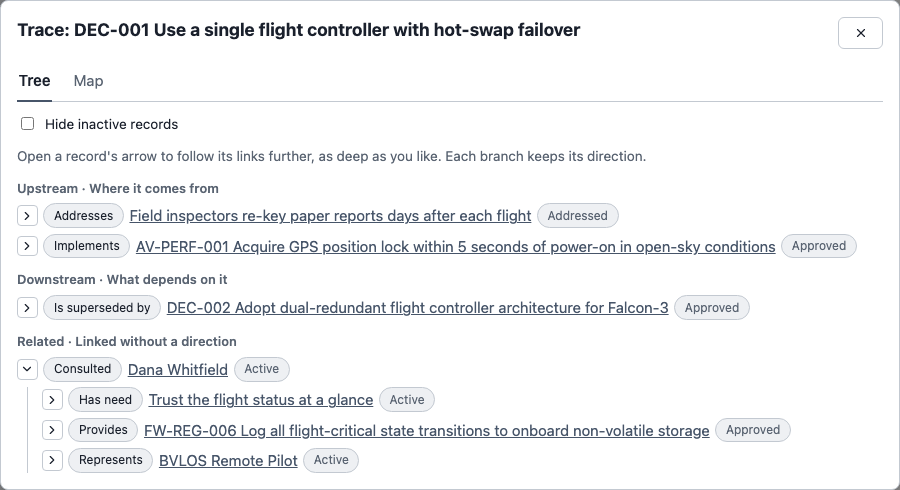 |

| The Map view |
| --- |
| The same decision drawn by direction on tinted lanes, with a **Key** button for the marks; a related record shows one hop until you click its Show more pill |
| 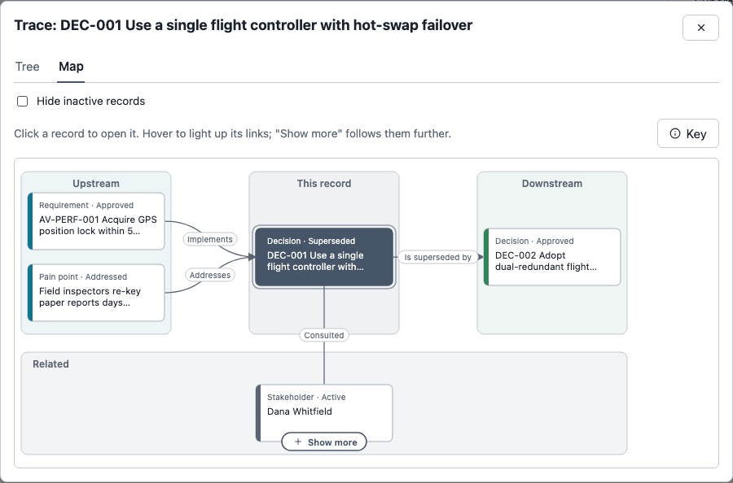 |

**Hide inactive records** (a tick box under the tabs, shared by both views) skips records that are no longer live: archived ones, and those that are superseded, retired, rejected, withdrawn, closed or marked as a duplicate. What a skipped record linked to is joined straight to the record in front of it, so tracing a decision that supersedes an older one shows the older decision's requirements and pain points directly, marked "via" the record they came through (a dashed line on the map). The record you are tracing is never hidden, even if it is itself superseded.

Both views follow the same rules as the panel: records you can't see, or that are in a module that is off, are left out and never followed through, and following a record's link takes you to its page.

Direction comes from the link type. A link type with no direction (an organisation admin sets one under **Admin → Projects & workflow → Link types**) always lands in **Related**, so if most of a record's links are undirected the views say so.

## Deleting a link type that is in use

Deleting a link type that links still use opens a dialog that says what depends on it: how many links in how many projects, any pending change requests that propose it, links involving approved requirements in projects that normally require a change request, and the artefact-type rules that name it. You can then:

- **Move the links to another link type.** A replacement that cannot take every link (its own restriction, or an artefact-type rule) is shown but disabled, with the reason. Choosing one whose direction differs warns that this changes what the links mean. A moved link that would duplicate an existing link is merged into it, and the Toast reports how many were moved and merged. Pending change requests proposing the old type are updated to the new one, and rules naming it name the replacement.
- **Delete the links too.** This asks you to type the link type's name, and is unavailable while pending change requests propose the type or when it would leave an artefact type's rule with no link type.

Every link moved, merged or removed is recorded in the audit log.

### Keep it for the projects that use it

When other projects use the link type (a parent's own type used in nested projects, or an organisation link type used by projects), the dialog offers **Keep this link type in the N other projects that use it**, ticked by default. Each branch of projects then keeps a copy of the link type (in its top-most project that uses it, inherited by the projects below), and its links are switched to that copy, so what those projects see doesn't change. If a project already has a link type with the same name, the copy is called "Name (copy)" and the Toast says so. Keeping never needs permission over the other projects; moving or removing links in projects you can't manage is refused (the message gives a count, not names), so keeping is the way to delete such a type. Only the links in the project you are deleting from, or all of them if you untick the box, are moved or removed.
