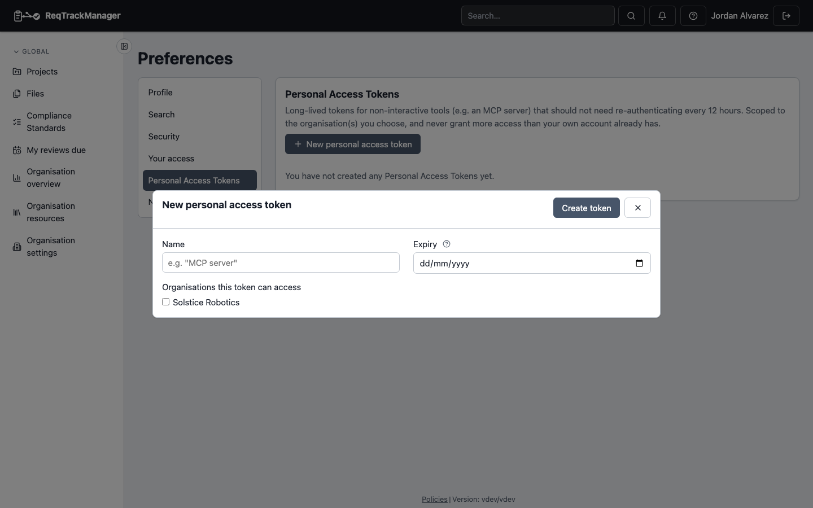
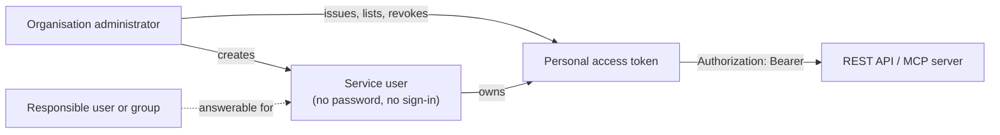

# Personal access tokens

## What a PAT is for

A personal access token (PAT) is a long-lived credential for non-interactive tools — a script calling the REST API directly, or an MCP server — that shouldn't need to re-authenticate every 12 hours the way an interactive browser session does. A PAT never grants more access than the account that created it already has.

## Creating a token

From **Preferences → Personal Access Tokens**, click **New personal access token**: give it a name, choose which organisation(s) it can access, optionally narrow it to specific projects within them (leave every project unchecked for a token that follows the account's full organisation-level access), and pick an expiry — the picker warns if a chosen lifetime exceeds what the server allows.

| Creating a token |
| --- |
| Scoping a new token to an organisation, optionally narrowed to specific projects |
|  |

The token's value is shown once, at creation — it isn't retrievable again afterward, only revoked and replaced with a new one.

## Using and revoking a token

Pass the token as `Authorization: Bearer <token>` on API requests. From the same Personal Access Tokens page, an existing token can be revoked at any time, immediately invalidating it.

A token is a scoped, headless credential, so it cannot manage credentials or access: creating, listing or revoking tokens, changing the password, enrolling or disabling two-factor authentication, granting or revoking any role, creating an account with a chosen password, issuing the SCIM token, changing single sign-on or the organisation's advanced settings, and leaving an organisation all need an interactive sign-in (the API answers 403 to a token). The lists it can read (projects, organisations, memberships, reviews due, notifications) show only the organisations and projects it is limited to. A token is revoked automatically when a password is reset through the emailed link and when two-factor authentication is switched off, but not by a routine password change. Otherwise a token limited to one project could mint one with everything its owner can reach. A token also cannot ride in a URL; to download a file from a script, send the token in the `Authorization` header.

## Service users

An integration should not run as a named person: the account would need a password, someone to sign in once to create its token, and it would stop working when that person left. A **service user** is an account of one organisation with no password and no sign-in. An organisation administrator creates it and issues its tokens; everything it does is recorded under its own name.

- **Create:** in the organisation settings, open **People**, then **Service users**, and choose **New service user**. Give it a name and say what it is for. The **Responsible** field names a user or an organisation group that answers for it (the access review flags a service user with no one responsible). The optional notification address receives notifications only: it never signs in, and when it is left blank the service user receives no email at all.
- **Roles:** a service user holds ordinary roles, granted like any member's, and the access review flags one that holds administrator rights. It belongs to its organisation only and cannot be added to another.
- **Issue a token:** open the service user and choose **Issue token**. The token is limited to the organisation and can be narrowed to projects the service user can reach. Its value is shown once; the lifetime cap of the organisation applies. The list shows who issued each token and when it was last used.
- **Revoke or stop:** revoking a token takes effect at once. **Deactivate** ends every token of the service user immediately; **Reactivate** allows new tokens to be issued (revoked tokens stay revoked); **Archive** hides a deactivated service user while keeping its history.
- **What it cannot do:** it cannot sign in, reset a password, accept an invitation or use single sign-on, and it is never a server administrator. Because it has no sign-in, an organisation's two-factor requirement and the acceptance of required policies do not apply to it; the policy status view lists service users separately as not applicable.

## Where this fits

See [API & Integrations → Authenticating](../api-integrations/authenticating.md) for how a PAT is used to call the REST API or connect an MCP client, and [Workflows → Preferences and help](../workflows/preferences-and-help.md) for the end-to-end task walkthrough.
