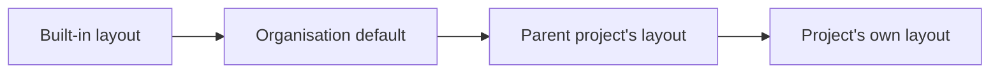

# Project overview

A project's **Overview** is a page of widgets. Every member sees the same overview; a project manager or administrator arranges it with **Customise overview**, at the right-hand end of the project name's row. A new project shows the built-in layout: five key tiles in one row, the widgets that enabled modules contribute (Compliance shows a tile for each assigned standard), the **Total records** chart, requirements by status, change requests by outcome, stage progress and recent activity.

## Widgets

| Widget | Shows |
| --- | --- |
| Metric tile | One figure from the metric catalogue, linked to the list it summarises |
| Gauge | One figure on a dial between a minimum and a maximum, turning to warning and critical colours at the levels you set |
| Chart | A breakdown (requirements by status, change requests by outcome, records by type) as a pie or a bar chart |
| Stage progress | How complete each stage is |
| Record totals | How many records of each type the project holds |
| Activity | The latest changes, from 1 to 25 entries |
| Text | A note for the people who open the overview, written in markdown |
| Module widgets | Any widget an enabled module contributes, such as Compliance's tile for each assigned standard |

A module's widgets are ordinary widgets: any widget can go anywhere, be resized, hidden or removed. A module enabled after you saved a layout is added from **Add widget**. An overview holds up to 24 widgets.

## Metrics

A metric is a defined count or percentage, never a free query, so an overview cannot show anything a person is not allowed to see. The catalogue holds the core figures, the figures each enabled module contributes, and a **Record count**: how many records of any type you can read match filters the type's own list offers. A record count can be narrowed by tags (any or all), components, categories (matched by prefix, so the setting also works in a project created from this one) and the type's other list filters, for example a status.

A figure you may not read, for example a record type whose module is off, is shown as unavailable and never as zero. A figure that takes too long or fails says so without hiding the rest of the page.

## Projects in scope

Where projects are nested, an overview can read its figures across related projects. The **Show records from** setting in the editor bar applies to the whole overview (this project; with its parents; with its children; or both), and any widget can override it in its own settings, so one overview can show a project's own count beside a roll-up of its children. A figure read beyond this project is marked ("With children · 3 projects"). Only projects you can open are included.

## Customising an overview

Read left to right: each layout overrides the one before it. A project follows its own layout if it has one, otherwise its nearest parent project's, otherwise the organisation's default, otherwise the built-in layout.

Choosing **Customise overview** turns the page into the editor, with the figures live, so you see each change as you make it:

- **Move** a widget by dragging its handle (top right) to a new place, or focus the handle and use the arrow keys.
- **Resize** a widget by dragging its bottom-right corner, or focus the corner and use the arrow keys. A widget is 1 to 12 columns wide and at least 1 to 12 rows tall; a row grows if the content needs more room.
- The other buttons open the widget's **settings** (title, width and height, scope, and what its type needs), **hide** or show it (a hidden widget stays in place, dimmed, and loads no data) and **remove** it.
- **Add widget** in the bar above the page adds one of the types in the table; its settings open at once.
- **Save** gives the project its own layout and **Cancel** leaves (asking first when there are changes). **Restore default** appears once the project has its own layout and removes it, so the project follows what it would otherwise inherit.

The overview adapts to the screen: twelve columns on a laptop, six on a tablet, and two on a phone, where the small tiles sit two to a row and every other widget takes the full width. Dragging the corner is available on a laptop-sized screen; the width and height boxes in a widget's settings work everywhere.

An organisation administrator sets the organisation default under **Projects & workflow → Default overview**, with the same editor (each widget is a labelled block, since a default has no project to read figures from). The layout travels in the project and organisation exports and is copied when a project is created from a template.

## Text widgets

A text widget supports headings (`# Title`), bullet and numbered lists, **bold**, *italic*, `code`, quotes (`> text`), rules (`---`) and links in the form `[text](https://example.com)`. Raw HTML and images are not shown, and only `http` and `https` links are links.
