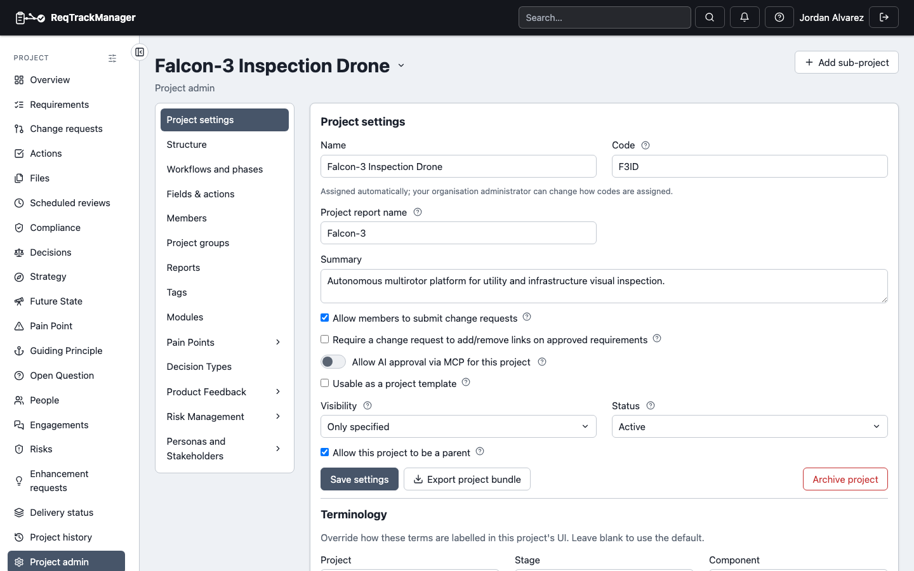
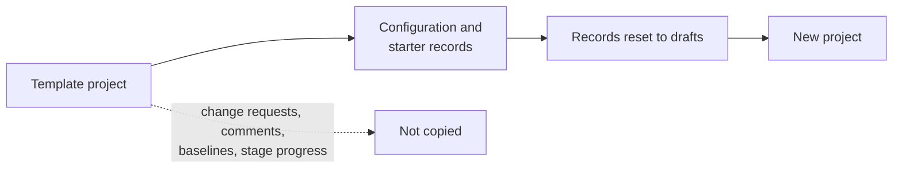

# Project templates

## Marking a project as a template

A project marked **"Usable as a project template"** (**Project Admin → Project settings**) can be used as the starting point for new projects.

| Project settings |
| --- |
| The "Usable as a project template" checkbox, alongside a project's other settings |
|  |

## What a template carries over

Creating a new project **from a template** copies the template's configuration and starter content into the new project, so a team's established structure does not need rebuilding each time a project starts.

| Copied | Details |
| --- | --- |
| Structure | Components, categories, custom field definitions, action types, groups and group memberships, direct role grants, terminology, navigation names, the overview layout, the stage workflows the template defines and the AI approvals setting |
| Settings | Review reminder lead days, the tag vocabulary and mode, component phases settings, and report setup (layouts, packs, snippets, folders) |
| Modules | Which modules and sub-components the template has on or off (within what the organisation allows) |
| Module configuration | Each module's types, hidden organisation defaults, scoring definitions, submission policies, external systems and channels |
| Starter records | Requirements (with their codes and the links between them), and each module's records (Decisions, Risks, Pain Points, Strategies, Future States, Guiding Principles, Open Questions, Enhancement Requests, Personas, Stakeholders and Needs) as fresh drafts, with Engagements as logged and Compliance assignments, assessments and evidence with approvals reset, and the links between all of them |

Starter records start as new drafts: the initial status, with the person creating the project as creator, and with no comments, reviews, votes, scores, approvals or history. Records of modules are numbered afresh; requirements keep the template's codes. Archived records are not copied. What a template should not give to its projects should not be kept in the template. A requirement owned by one of the template's project groups is owned by that group's copy in the new project; one owned by a user or an organisation group keeps that owner.

**Not copied:** change requests, comments, baselines and stage progress. A new project always starts at its own first stage and in the organisation's default project status.

Read left to right: the template's configuration and starter records are copied, records are returned to drafts, and the template's own history, people and assessments stay behind.

## Who can change a template

While a project is marked as a template, only project managers, project administrators and organisation administrators can change it. Everyone else, including people who can see it through organisation-wide visibility or hold a module role on it, can read it but cannot add or change anything, whatever the project's other settings. This keeps a template stable as the starting point for new projects. Clear the template setting to let the team work in it again.

A project manager can make a project a template (for the team, or for nested projects) or make it visible to the whole organisation, but not both. A template that everyone in the organisation can see needs the **Publish organization templates** permission, which organisation administrators hold and can give to others through a custom role.

To create a project from a template you must be able to view it: a team-only template is available to its own team and to organisation administrators, and an organisation-wide template (a template with organisation-wide visibility) is available to everyone in the organisation who can create projects.

## Finding templates

Templates are left out of the project list so everyday work is not mixed with them. Tick **Show templates** in the list's filter panel to include them; each carries a **Template** badge. The **New project** form lists templates in **Create from template**; choose **None** to create a blank project even when the organisation has a default template.

## Organisation default template

An organisation administrator can set any template in the organisation as the **default template** (**Organisation admin → Projects & workflow**), including one they hold no role in. It is offered by default whenever someone in that organisation creates a new project, and every person who can create projects may use it, whether or not they can otherwise see it — the administrator has chosen it as the starting point for everyone. Any other template remains available as an alternative to those who can view it.

## Where this fits

See [Custom fields, terminology, and templates](../concepts/custom-fields-terminology-and-templates.md) for why this exists, and [Workflows → Organisations and projects](../workflows/organisations-and-projects.md) for the end-to-end task walkthrough of creating a project from a template.
