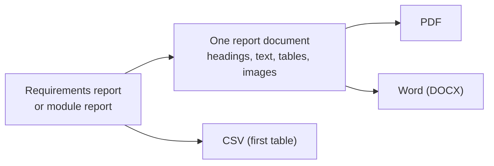

# Reports and export

## Generating a report

A project's **Reports** page generates a PDF, Word (DOCX) or CSV export of its requirements, filtered by component, category, status, or keyword, with the organisation's shared resource files appended as extra sections. **Generate PDF** is the main button; **More formats** offers the Word file and CSV. A PDF or Word export can use one of the organisation's **report templates** — an accent colour, an optional cover page, footer text, and its own default introduction/chapters/appendices — for consistent, on-brand output across projects.

| Reports |
| --- |
| Filtered PDF/Word/CSV export with a selectable organisation branding template |
|  |

A project's Reports page can also offer reports from enabled modules (for example [Context & Strategy's](../modules/context-strategy-module/reports.md) and [Decision Management's](../modules/decision-management-module/reports.md)) in the same **Report** picker, with *Requirements report* listed first. When no module report applies, the picker is hidden and the page is the requirements report alone.

## Word (DOCX) export

Every report downloads as an editable Word file with the same content, order and branding as its PDF, so it can be edited after download. Both formats are built from one shared document, so they cannot drift apart.

- **Editable structure:** real Word heading styles (insert a table of contents from them), real tables with a shaded header row that repeats on each page, bullet lists, and a footer with page numbers. A branding template's accent colour, cover page, logo and footer text apply. Module reports use landscape pages; the requirements report is portrait.
- **Text is shown as written:** Markdown headings, paragraphs, bullet lists and own-line images are laid out; inline formatting such as `**bold**` is not interpreted in either format. Characters Word cannot store (control characters) are dropped.
- **Images** are the organisation's shared images only, as in the PDF.
- **Document properties** carry the title and "ReqTrackManager" as author, never a person's name.

## Report content

**Project Admin → Report Setup** sets the report's introduction and body/appendix chapters, in Markdown or a WYSIWYG rich-text editor — saved per project and reused on every report generated for it, rather than typed fresh each time. A project that leaves any of these blank falls back to that field's organisation-wide default (**Organisation admin → Templates & reports → Report Defaults**), field by field; the Report Setup tab shows "(organisation default)" wherever that's happening. Every one of these editors — including a report template's own content — has an **Insert image** button: pick from the organisation's already-uploaded images, or upload a new one on the spot, and it's included in the generated PDF or Word file as its own paragraph.

## CSV export and import

The same Reports page exports requirements as CSV — every field, including custom field values and target stage — and the Requirements page's **Import CSV** wizard reverses the trip, mapping a spreadsheet's columns back onto a project's fields. See [Requirements management](./requirements-management.md#csv-import-and-export) for the import side.

## Where this fits

See [Workflows → Reporting and CSV import/export](../workflows/reporting-and-csv-import-export.md) for the end-to-end task walkthrough, and [Project templates](./project-templates.md) for how report content carries into a newly created project.
