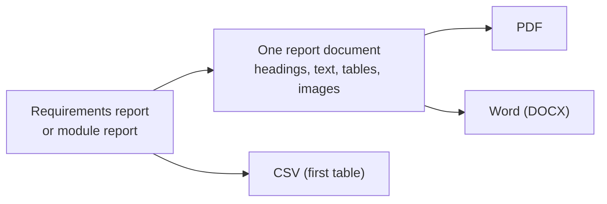
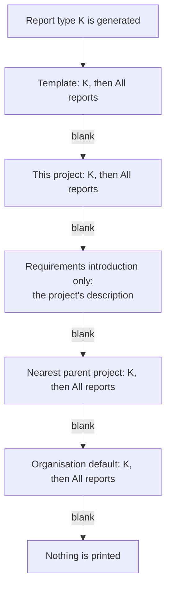
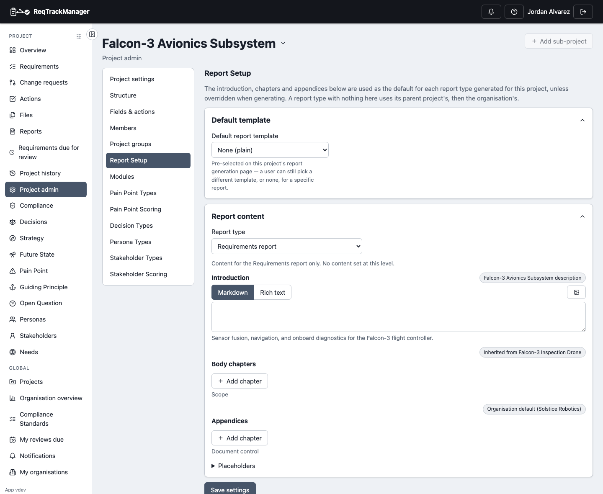
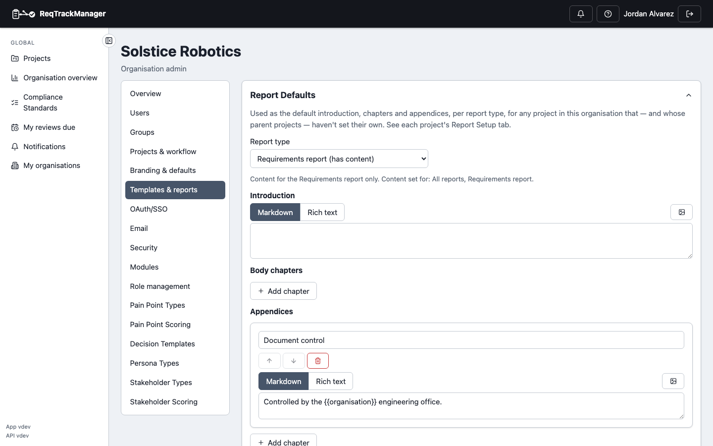

# Reports and export

## Generating a report

A project's **Reports** page generates a PDF, Word (DOCX) or CSV export of its requirements, filtered by component, category, status, or keyword, with the organisation's shared resource files appended as extra sections. **Generate PDF** is the main button; **More formats** offers the Word file and CSV. A PDF or Word export can use one of the organisation's **report templates** — an accent colour, an optional cover page, footer text, and its own default introduction/chapters/appendices — for consistent, on-brand output across projects.

| Reports |
| --- |
| Filtered PDF/Word/CSV export with a selectable organisation branding template |
|  |

A project's Reports page can also offer reports from enabled modules (for example [Context & Strategy's](../modules/context-strategy-module/reports.md) and [Decision Management's](../modules/decision-management-module/reports.md)) in the same **Report** picker, with *Requirements report* listed first. When no module report applies, the picker is hidden and the page is the requirements report alone.

## Word (DOCX) export

Every report downloads as an editable Word file with the same content, order and branding as its PDF, so it can be edited after download. Both formats are built from one shared document, so they cannot drift apart.

- **Editable structure:** real Word heading styles (insert a table of contents from them), real tables with a shaded header row that repeats on each page, bullet lists, and a footer with page numbers. A branding template's accent colour, cover page, logo and footer text apply. Module reports use landscape pages; the requirements report is portrait.
- **Text is shown as written:** Markdown headings, paragraphs, bullet lists and own-line images are laid out; inline formatting such as `**bold**` is not interpreted in either format. Characters Word cannot store (control characters) are dropped.
- **Images** are the organisation's shared images only, as in the PDF.
- **Document properties** carry the title and "ReqTrackManager" as author, never a person's name.

## Report content

Each report type has its own **introduction**, **body chapters** and **appendices**: a requirements report and a decision log need different openings, so content is written per report type rather than once for everything. A PDF or Word file prints the introduction and chapters first, then the report itself, then the appendices. CSV and on-screen (JSON) output carry none of it.

Content can be written at three levels, each with a **Report type** drop-down (the requirements report, then each enabled module's reports) led by **All reports**, the content used by any report type that has none of its own at that level:

| Level | Where | Applies to |
|-------|-------|-----------|
| Report template | Organisation admin → Templates & reports → Report templates | Any report generated with that template |
| Project | Project Admin → Report Setup | Reports generated for that project |
| Organisation default | Organisation admin → Templates & reports → Report Defaults | Any project that, with its parent projects, sets none |

Introduction, chapters and appendices resolve independently. Each takes the first non-blank value in this order, so a template's content wins over a project's, and so on down:

| Report Setup | Report Defaults |
| --- | --- |
| Blank fields name their source: the project's description, its parent project, the organisation | Organisation defaults, written separately for each report type |
|  |  |

A child project that sets nothing for a report type therefore uses its parent project's (then the grandparent's, and so on), then the organisation's. In **Report Setup**, each blank field names where its content comes from (for example "Inherited from *Parent programme*" or "Organisation default (*Acme*)") and previews it; once a project writes its own, **Use inherited** gives it back. The generation page fills its editors with the content that applies and lets you change it for that one report.

Every editor has an **Insert image** button: pick from the organisation's already-uploaded images, or upload a new one on the spot, and it's included in the generated PDF or Word file as its own paragraph. Images used by report content travel with an organisation or project export.

### Placeholders

These can be typed in any introduction, chapter title or body, or appendix, and are replaced when the report is generated:

| Placeholder | Becomes |
|-------------|---------|
| `{{project_name}}` | The project's name (the organisation's name for an organisation-wide report) |
| `{{report_title}}` | The title printed on the report |
| `{{generated_on}}` | The generation date, `YYYY-MM-DD` |
| `{{organisation}}` | The organisation's name |

Anything else in double braces is printed as written. Placeholders are plain text replacement, not a template language: the replaced value is shown as ordinary text and cannot add formatting.

## CSV export and import

The same Reports page exports requirements as CSV — every field, including custom field values and target stage — and the Requirements page's **Import CSV** wizard reverses the trip, mapping a spreadsheet's columns back onto a project's fields. See [Requirements management](./requirements-management.md#csv-import-and-export) for the import side.

## Where this fits

See [Workflows → Reporting and CSV import/export](../workflows/reporting-and-csv-import-export.md) for the end-to-end task walkthrough, and [Project templates](./project-templates.md) for how report content carries into a newly created project.
