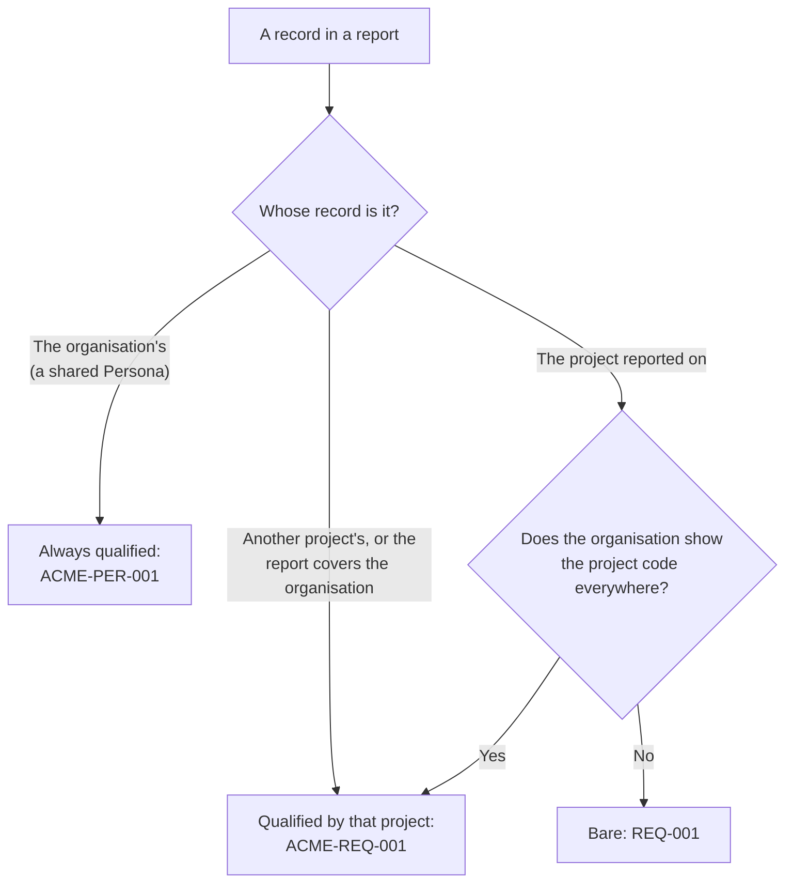
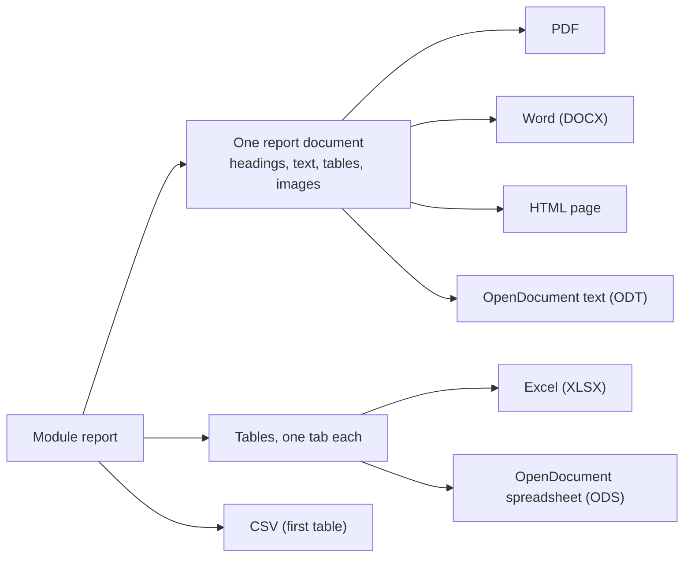
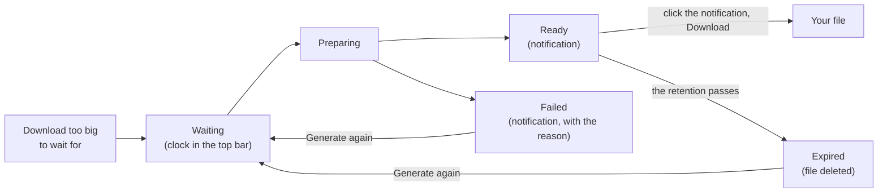

# Reports and export

## Generating a report

A project's **Reports** button (at the top of the project overview) opens a dialog that generates a PDF, Word (DOCX) or CSV export of its requirements, with the organisation's shared resource files appended as extra sections. **Generate PDF** is the main button; **More formats** offers the Word file and CSV. To export only some requirements (one component, a range of target versions, a status or tag), filter the **Requirements** list and use its **Export** or **Download report**, which carry the list's filters. A PDF or Word export is branded with one of the organisation's **report templates** — an accent colour, an optional cover page, logo and footer text — for consistent, on-brand output across projects.

**Which template is used.** You do not choose one when downloading. A report layout's own template applies (set in **Layout details → Branding template**, available when editing a layout); otherwise the organisation's **default template** (tick **Default template** on a report template; only one template can be the default); otherwise none. Reports from modules and the requirements report use the organisation's default template.

| Reports |
| --- |
| PDF/Word/CSV export of the requirements, branded with the organisation's default template |
|  |

The same dialog can also offer reports from enabled modules (for example [Context & Strategy's](../modules/context-strategy-module/reports.md) and [Decision Management's](../modules/decision-management-module/reports.md)) in the same **Report** picker, a dialog with search, folders and favourites (see [Finding and organising reports](./custom-reports/organising-reports.md)). A module report is offered only while its module, and the sub-component it belongs to, is on for the project. When no module report applies, the picker is hidden and the page is the requirements report alone.

## How reports name records

Every report row that names a record leads with its [record code](../reference/glossary.md#record-code) and ends with the record's [tags](./tags.md), in the PDF, Word file, CSV and on screen alike, so a printed page or a spreadsheet can say *which* `PER-001` it means.

On screen, a long report table shows its first 50 rows with a "Showing 50 of n rows" count and a **Load more** button; the PDF, Word and CSV downloads always contain every row.

A report never follows your personal *Show the project code* preference, so a report that is saved, scheduled or shared reads the same for everyone. Notifications also carry the qualified code, because the notification list is read outside any project. The requirement CSV used for [import and export](./requirements-management.md#csv-import-and-export) keeps its plain `unique_code` column, which an import ignores.

## Word (DOCX) export

Every report downloads as an editable Word file with the same content, order and branding as its PDF, so it can be edited after download. All the document formats are built from one shared document, so they cannot drift apart.

Every report in the project's catalogue (every module report, and the **Record list** report) offers the same formats in its **Export** menu: PDF, Word, HTML page, OpenDocument text (ODT), CSV, Excel (XLSX) and OpenDocument spreadsheet (ODS). The documents carry the whole report and the organisation's branding template; **CSV** is the first table only, and **Excel** and **OpenDocument spreadsheet** hold every table as its own tab, titled by the table's heading, with no branding. The requirements report in the Reports dialog keeps PDF, Word and CSV.

- **Colour carries over:** a cell the screen colours as a badge (a status, a rating band, a matrix cell) is filled in the same colour in the PDF and Word file, and the word stays in the cell so a black-and-white print still reads. The text colour is chosen for contrast: white on a dark fill, black on a light one. The same applies to the header row, and a cover-page title in a very light accent colour is darkened so it stays readable on white paper, whatever accent colour your report template uses. The CSV is text only.
- **Editable structure:** real Word heading styles (insert a table of contents from them), real tables with a shaded header row that repeats on each page, bullet lists, and a footer with page numbers. A branding template's accent colour, cover page, logo and footer text apply. Module reports use landscape pages; the requirements report is portrait.
- **Text formatting:** in a layout's text, `**bold**`, `*italic*` and `` `code` `` are drawn as bold, italic and monospaced text, and bullet lists (`- item`), numbered lists (`1. item`), `#` headings and own-line images are laid out, in PDF, Word, OpenDocument text and HTML alike. **Links** are written `[the words](address)` and are clickable in all four formats: a web address (`https://…`), an email address (`mailto:name@example.org`) or a section of the same report (`#overview`, the heading's words in lower case with hyphens: the heading "Scope & Goals" is `#scope-goals`, and a second heading called Overview is `#overview-2`). In a layout the address may use a value, such as `[the spec]({{record.url}})`; the address is checked once the value is filled in, and a link whose address is not allowed (a `javascript:` address, a relative path, an address with a space) or that points at a heading that is not in the report is printed as plain words, with a warning in a layout. A bare web address, a `<…>` address, raw HTML and entities are printed as written, and so is a `*` or `_` that does not open and close a word (write `\*` for a literal asterisk, and `\[` for a bracket that would otherwise start a link). A value filled in from a record is never read as formatting. Characters Word cannot store (control characters) are dropped.
- **Languages in the PDF:** Latin, Latin Extended (for example Polish), Cyrillic and Greek print correctly. Arabic and Indic scripts are not shaped and Chinese, Japanese and Korean have no font in the PDF, so use the Word file for those; the Word file stores the text as written.
- **Images** are the organisation's shared images only, as in the PDF.
- **Document properties** carry the title and "ReqTrackManager" as author, never a person's name.

## Introductions, chapters and appendices

A report has no stored introduction, chapters or appendices of its own. Write them in a [report layout](./custom-reports/overview.md): the **Requirements by Component** starter layout is the requirements report with an *Introduction* and *Appendices* section ready to edit, and a layout can wrap any [module report widget](./custom-reports/designing-a-layout.md) the same way. The requirements report on this page (and each module report) prints its own data, then any resource sections you select.

### Placeholders

These can be typed in a [layout's](./custom-reports/designing-a-layout.md) text and headings, and are replaced when the report is generated:

| Placeholder | Becomes |
|-------------|---------|
| `{{project_name}}` | The project's name (the organisation's name for an organisation-wide report) |
| `{{report_title}}` | The title printed on the report |
| `{{generated_on}}` | The generation date, `YYYY-MM-DD` |
| `{{organisation}}` | The organisation's name |

A layout can also use `{{project_code}}` and `{{project_description}}` (the project's summary).

Anything else in double braces is printed as written. Placeholders are plain text replacement, not a template language: the replaced value is shown as ordinary text and cannot add formatting.

## Record list report

For any other kind of record, the **Reports** picker offers **Record list**: choose a **Record type** (Requirements, Actions and every other list that has a table), optionally a **Tag**, and, on a project with parent or child projects, which **Projects** to include. The page shows the table, with the record's code first, and **Export** downloads it as a PDF, Word, HTML, OpenDocument or Excel file or as CSV. The same files are in each list's own **Export** menu, where they carry that list's current filters. A status or rating that is coloured on screen is coloured in the PDF and Word file too, and also written out in words. Columns holding personal data appear only when your organisation's policy and your role allow it, and the report says when some were left out. A document (PDF, Word, HTML or OpenDocument text) covers up to 5,000 records; for more, download a spreadsheet format or CSV, or narrow the filters.

## Custom reports

A **custom report** is a report layout somebody designed in the organisation's or a project's **Report layouts**: a document or a set of tables, run for the project (or each project you can read) and downloaded as PDF, Word, OpenDocument, HTML, Excel or CSV. A **report pack** downloads several reports as one zip. They have their own section:

- [Custom reports](./custom-reports/overview.md): what they are, the starter layouts, running and formats, provenance
- [Designing a layout](./custom-reports/designing-a-layout.md): the text and block views, page setup, preview, versions
- [Blocks, report components and variables](./custom-reports/blocks-widgets-and-variables.md)
- [Report packs](./custom-reports/report-packs.md)
- [Finding and organising reports](./custom-reports/organising-reports.md): the report picker, folders, favourites and arranging the list

## Large reports are prepared in the background

When you download a file that is too big to produce while you wait, the dialog says so ("It is being prepared in the background and you will be notified when it is ready"). The server works through the queue, allows a bigger report than a download you wait for, and **notifies you** (in the app, and by email if your notification settings send it) when the file is ready or could not be produced. While it is being prepared, a **clock with a count** appears in the top bar beside the notification bell; click it to see which reports are still being prepared.

**Click the notification** to open the report in a dialog and **Download** it. If the file has been removed, or the report failed, the same dialog says why and offers **Generate again**.

- **Only you can download it.** The file belongs to the person who asked for it; nobody else, including administrators, can fetch it. It is produced with your access at that moment, and downloading it re-checks that you still have access to what it covers.
- **It is kept for a limited time.** An organisation administrator sets how many days a file is kept in **Org Admin → Templates & reports → Background reports**, up to a maximum the platform sets; leave it blank to use the platform default (7 days). When the time passes the file is deleted. The record of the run (which layout and version, when, how many records) stays, as for any run.
- **Generate again is a fresh run, not the old file.** It runs the report's current version with today's data and your access at that moment, using the format and values of the earlier run, and notifies you again. The dialog tells you when the report was edited since the earlier run. It is refused if the report no longer exists or you can no longer run it.
- At most five of your reports can be waiting or being prepared at once.
- A report that is too large even for the background (or whose access you lose before it runs) shows as **Failed** with the reason.

## CSV export and import

A record list can also offer the reports that use its records: open the list's **List actions** menu (the ⋮ button beside **New**) and choose **Download report**. Only reports (and report packs) that read that kind of record are listed, in the same folders as the Reports dialog; choose one (step 1), then set it up and download it (step 2), which names the project the report will run for. A pack asks for its choices and downloads as one zip. The report is not shown in the dialog, and a report meant to be read on screen, such as the Context & Strategy summary, is not listed; open it with the **Reports** button on the project overview instead.

The Reports dialog exports requirements as CSV — every field, including custom field values and target stage — and the Requirements page's **List actions** menu (CSV that re-imports and updates records by code) reverse the trip, mapping a spreadsheet's columns back onto a project's fields. See [Requirements management](./requirements-management.md#csv-import-and-export) for the import side.

## Where this fits

See [Workflows → Reporting and CSV import/export](../workflows/reporting-and-csv-import-export.md) for the end-to-end task walkthrough, and [Project templates](./project-templates.md) for starting a new project from an existing one.
