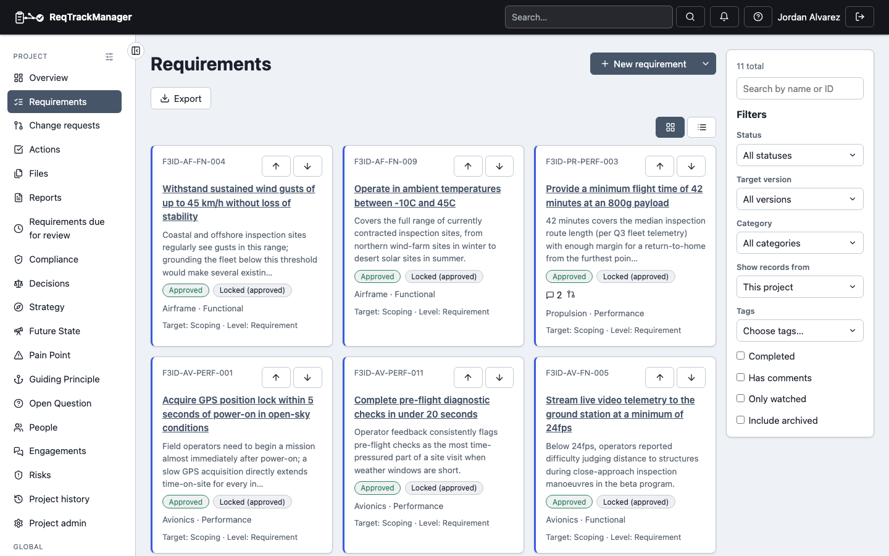
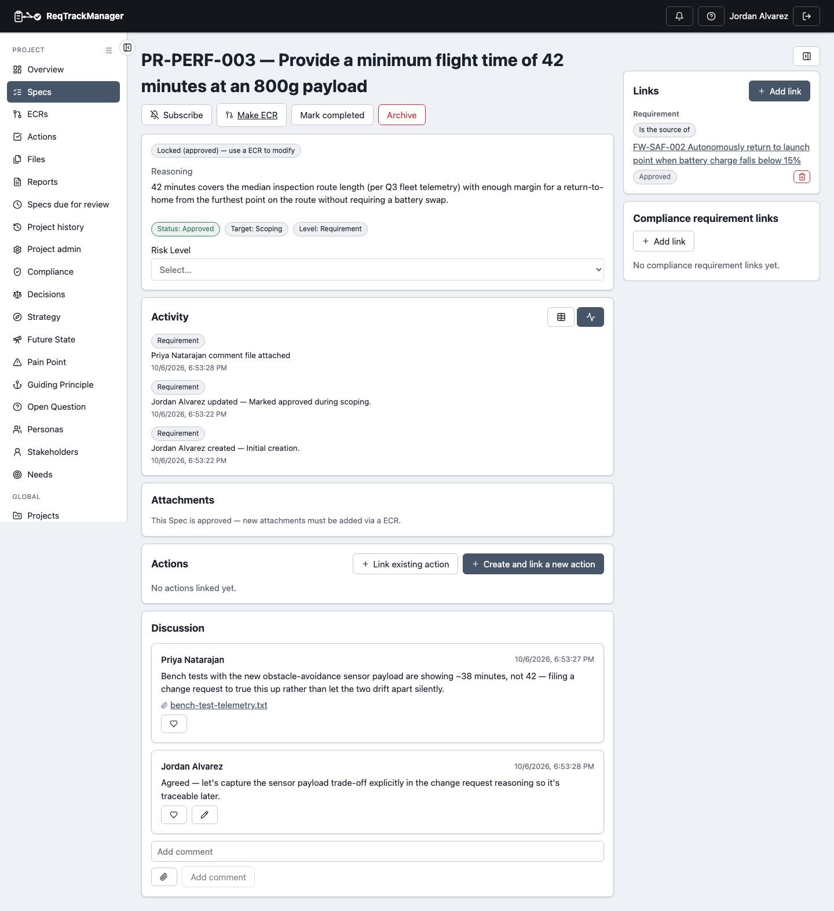
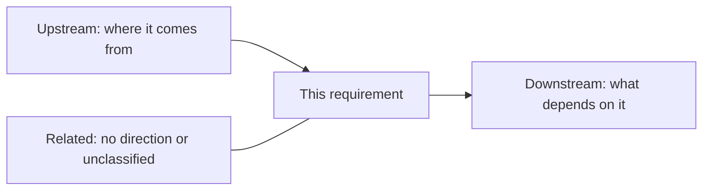
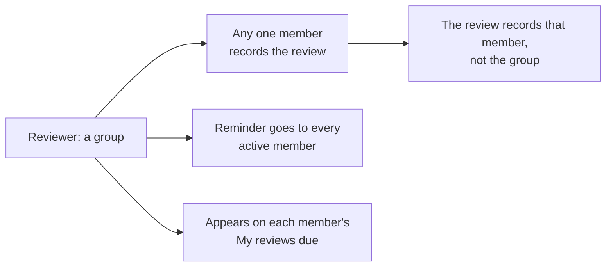

# Requirements management

## Creating and organising requirements

Open a project's **Requirements** page (or click **New requirement** on the project overview). Pick a component, then a category belonging to that component — categories live under a single component, so the category list narrows to match whichever component is picked and resets if it changes — and the two prefixes combine into the requirement's identifier, e.g. `SW-PERF-014`. Every requirement needs a **target version** (the create form pre-fills the project's first stage rather than leaving it blank) and a **level** (Requirement, Recommended, or Optional), plus a name and, optionally, reasoning, a free-text description, and any project-specific custom fields.

| Requirements list |
| --- |
| Status, target version, and category filters; click a status badge to filter, click again to clear |
|  |

While the project's current stage is still in scoping, requirements within a component/category can be **reordered** with up/down arrows.

## The requirement detail page

Opening a requirement shows its full detail: name, reasoning, clarification, description, custom field values, an editable form (disabled once locked), its **Versions** table — including who made each change — a discussion thread, file attachments, and, beside the content, the Links and Activity tabs (see [One record's timeline](../workflows/files-comments-and-history.md#one-records-timeline)).

| Requirement detail |
| --- |
| Editable fields, activity, actions and a discussion thread for one requirement, with its links in the Links panel |
|  |

Once a requirement is locked (Approved or Completed), the edit form disables itself with a "Locked" badge, and further changes go through a [change request](./change-requests.md) instead — see [Requirements, versions, and the lifecycle](../concepts/requirements-versions-and-lifecycle.md) for why.

## Keywords are tags

A requirement's **keywords** are its [tags](tags.md): add them from the **Tags** box under the requirement's title, filter the list by them, and change many requirements at once with **Tag selected**. Because they are shared with every other kind of record, a keyword keeps the capital letters it was typed with (older keywords were all lower case), and a project can limit new ones to a list its administrators keep.

## Traceability links

Links are shown and edited in the **Links** panel beside a requirement's page (see [Links and traceability](links-and-traceability.md#the-links-panel)). Requirements can be linked to each other with a typed, bidirectional relationship — e.g. "Derives from" / "Is the source of" — for real traceability between requirements, beyond the 12 seeded default link types (an organisation can define more from its admin page). A link between two approved requirements can itself be made to require a change request to add or remove, via a per-project setting, for teams that want link changes reviewed the same way content changes are.

Beyond requirements, any two records of a project can be linked, and an organisation can limit which kinds of record each link type may join and which link types each kind of record may use — see [Links and traceability](links-and-traceability.md).

Each link type also has a **direction**, set by an organisation admin under **Admin → Projects & workflow → Link types**. Read with the forward name, "Target is upstream" means the target is where the source comes from ("Derives from"), "Target is downstream" means the target depends on the source ("Is implemented by"), and "No direction" suits symmetric types ("Related to"). Directions let traceability views and AI assistants (the `get_artefact_link_graph` tool) answer "where does this come from?" and "what depends on it?" instead of showing every link as merely related. The seeded types come pre-classified for new organisations where the direction is clear; existing organisations and any type you add start as "No direction" until you set one, and an unclassified type is still shown, just as related.

If the [Decision Management module](../modules/decision-management-module/overview.md) is enabled, a requirement can also be linked to a Decision ("Implements"/"Affects") — see [Decision Management → Relationships and templates](../modules/decision-management-module/relationships-and-templates.md) — recording which formal decision produced or affects a given requirement, separately from requirement-to-requirement traceability above.

If the [Context & Strategy module](../modules/context-strategy-module/overview.md) is enabled, a requirement can similarly be linked back to the Strategy that drives it, the Pain Point that motivated it, or the Guiding Principle it's informed by — see [Context & Strategy → Relationships and types](../modules/context-strategy-module/relationships-and-types.md) — giving a requirement's own reasoning an upstream trail beyond its own `reasoning` field.

If the [Stakeholders & Personas module](../modules/stakeholders-personas-module/overview.md) is enabled, a requirement can be linked to the Stakeholders and Personas who provide it or are affected by it, and traced back through a Stakeholder Need to the wording of what someone actually asked for — see [Stakeholders & Personas → Stakeholder Need](../modules/stakeholders-personas-module/stakeholder-need.md) and [Relationships](../modules/stakeholders-personas-module/relationships.md).

If the [Risk Management module](../modules/risk-management-module/overview.md) is enabled, a requirement can be recorded as mitigating a Risk, and the Risk's owner can judge whether it actually reduces that Risk — see [Risk Management → Treatment and relationships](../modules/risk-management-module/treatment-and-relationships.md). Editing such a requirement flags that judgement for reassessment.

## Owners, reviewers and groups

Every requirement has an **owner**, defaulting to whoever created it, and may have an assigned **reviewer**. Either can be a user, an organisation group or one of the project's groups, so a team stays accountable when one person leaves. The page shows a group's name, its kind (Org group or Project group) and how many people it stands for, and the version history records who owned each version. An owner is required, so a requirement can never be left without one.

A group confers no extra right. It only stands in where the requirement asks for "the owner" or "the reviewer"; editing a requirement still needs an editing role on the project.

## Review scheduling and completion

A requirement can carry a review date and an assigned reviewer. Once the date passes, it appears on the assigned reviewer's **My reviews due** page (for a group reviewer, on every member's page) and the project's own reviews-due page until someone records an outcome — met, or failed with a required comment explaining why — from the requirement's detail page. When the reviewer is a group, any one member can record the outcome, and the review keeps the name of the member who did. The reviews-due page can be narrowed to one reviewer (a user or a group) or to reviews assigned to you or your groups; the reminder goes to every active member of a reviewer group, or to the project managers when the group has no one to tell.

Separately from approval, a project manager can mark an approved requirement **Completed** (and uncomplete it to correct a mistake), tracking which approved requirements have actually been delivered and verified rather than just baselined.

## CSV import and export

Click **Import** on the Requirements page, choose a file, then map its columns to the requirement's fields (name, component and category — matched by prefix within that component — plus optional reasoning, level, target version, owner, reviewer, tags and custom fields). **Preview** shows what would be created, what would change (before and after) and which rows have errors before anything is written; **Apply** then runs the valid rows through the same rules as editing by hand. A row with a code (`SW-PERF-014`) updates that requirement and a row without one creates a new one. **Export** downloads the list as currently filtered in the same format, so requirements round-trip to and from a spreadsheet: edit a cell, import the file and the preview shows exactly what will change. Owners and reviewers are one column each: an email address for a person, or `Name (Org group)` / `Name (Project group)` for a group. **Export → Download import template** gives a starter CSV with the project's own column names.

## Where this fits

See [Change requests](./change-requests.md) for how a locked requirement is modified, [Stages and baselining](./stages-and-baselining.md) for how locking itself is triggered, and [Workflows → Authoring and reviewing requirements](../workflows/authoring-and-reviewing-requirements.md) for the end-to-end task walkthrough.
