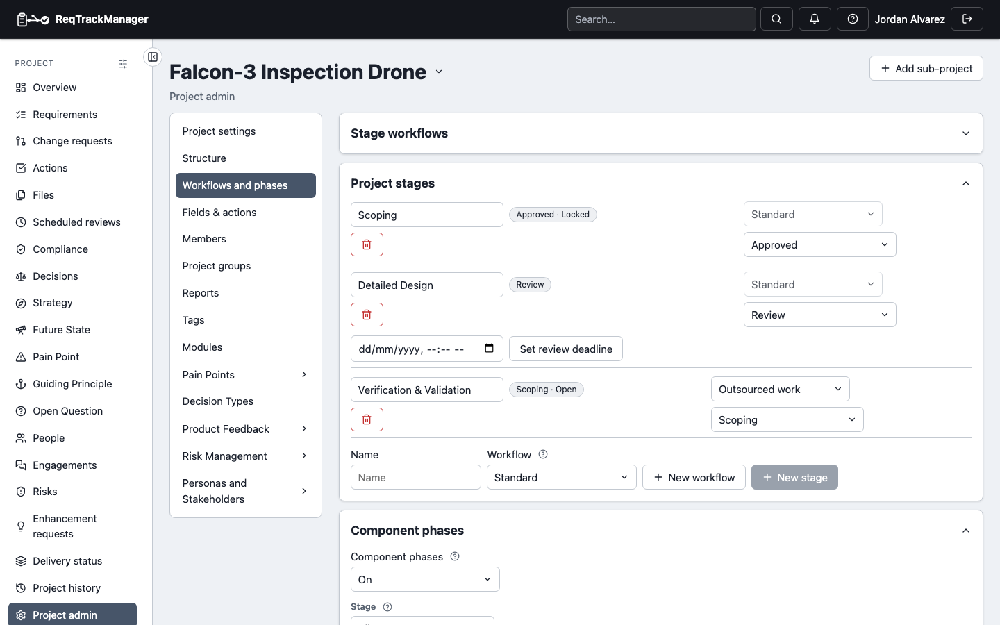
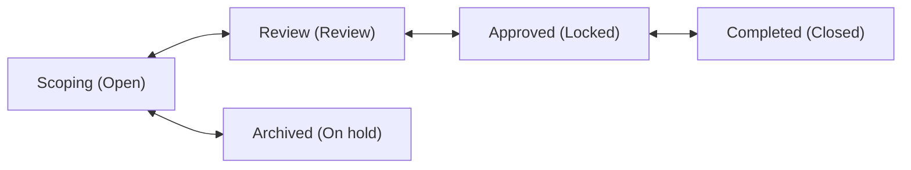
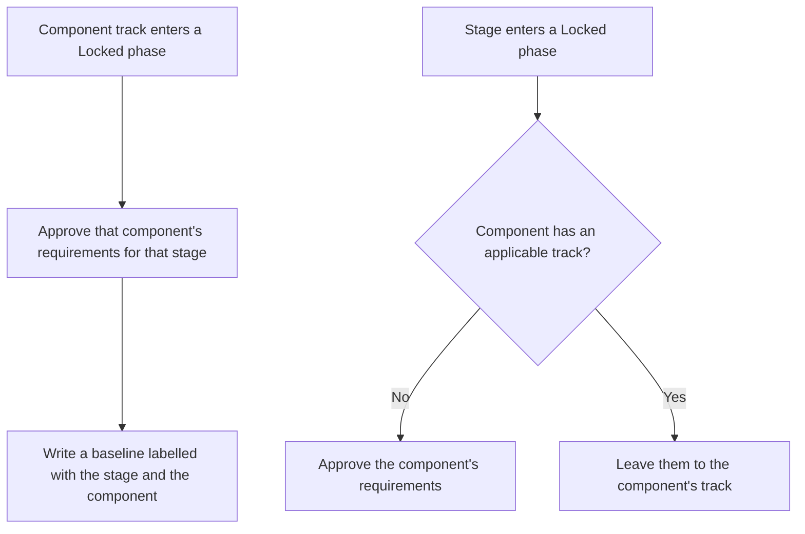
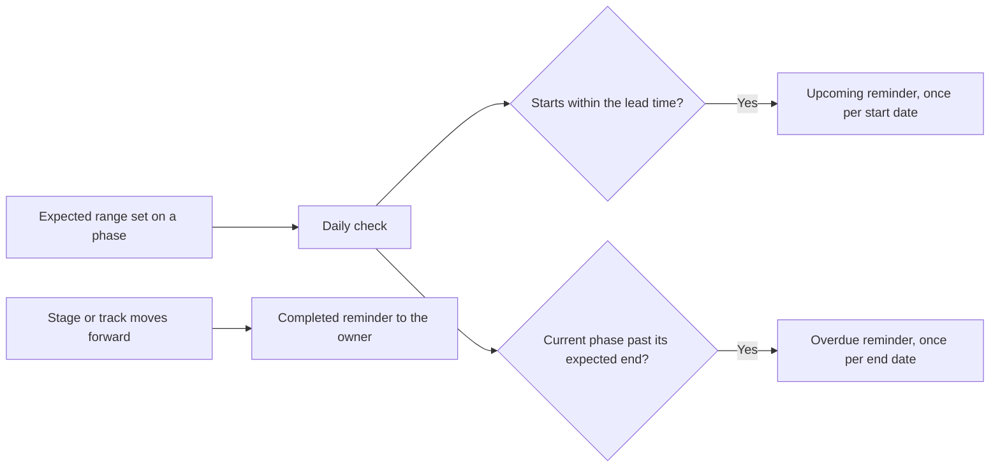
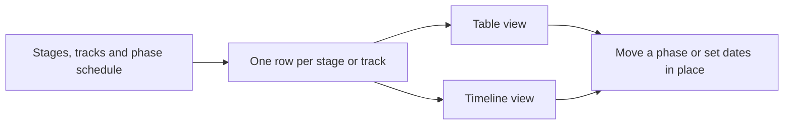

# Stages and baselining

**Project Admin → Structure** shows a project's stage sequence (e.g. Scoping → Development → Hardening). Each stage follows a **workflow**: an ordered list of named **phases**. Entering a phase of kind **Locked** (the standard workflow's "Approved"):

- **Baselines** every non-archived requirement still in draft or reviewed status, snapshotting its current version.
- **Locks** those requirements — from this point, they can only change via a [change request](./change-requests.md).

| Project stages |
| --- |
| A project's stage sequence, with review/approve actions per stage |
|  |

## Workflows and phases

A phase has a free-text name and a **kind**; the kind, never the name, decides what the phase does.

| Kind | Effect |
| --- | --- |
| Open | Requirements can be edited and reordered. |
| Review | A review deadline and stakeholder responses apply. |
| Locked | Entering writes the baseline and locks the requirements. |
| On hold | Paused or archived, with no special rules. |
| Closed | The stage is complete. |

Every organisation starts with the **Standard** workflow above. A stage can move to any phase of its workflow, in either direction; entering or leaving a Locked phase needs the project manager role, because leaving one unlocks the requirements outside the change-request process.

Organisation administrators define more workflows under **Organisation Admin → Projects & workflow → Stage workflows** (for example Scoping, Technical scoping, Review board, Tendering, Awarded, In progress, Completion for outsourced work). Project managers add workflows of their own under **Project Admin → Workflows and phases → Workflows**, and can hide an organisation workflow in the project and add it back later. A stage changes workflow only while it is in an Open phase with no baseline. A workflow a stage follows cannot be deleted, and a phase a stage is in can be renamed but not removed or given another kind.

## Component phases

By default one phase governs the whole stage. A project manager can turn on **Project Admin → Workflows and phases → Component phases** so that each component follows its own workflow for each stage (for example an outsourced component through Tendering and Awarded while an in-house component goes straight from Scoping to Done). The setting is **Off**, **On**, or **Follow the parent project**; a project with no setting is Off.

With the setting on:

- Every component has a track per stage, starting in the first phase of the stage's workflow. A project manager can choose another workflow for the track, mark the stage **Not applicable** to the component, and name an owner (a user or a group).
- Moving a track into a Locked phase approves and baselines only that component's requirements that target the stage; its other requirements and every other component stay editable. Moving into a Closed phase completes the track and, if chosen, those requirements.
- The stage's own Locked phase approves the requirements of components that have no applicable track for the stage; the others are left to their tracks.
- A project manager or the track's owner can move a track, including into or out of a Locked phase. Anyone else sees the track read-only. The project's **Delivery status** page in the navigation (see [Delivery status](#delivery-status)) lists every stage and every component's track, with a filter for the tracks you may move, so an owner who cannot open project administration moves their own track there.
- Progression is advisory: a track can start the next stage at any time, and a badge shows when the previous stage has closed for the component.

Turning the setting Off leaves stored tracks in place but ignores them, so the stage governs again.

## Phase schedule and reminders

A phase can carry an **expected range** (an expected start and an expected end, both calendar dates) under **Project Admin → Workflows and phases → Schedule**. Each stage lists the phases of its workflow; with component phases on, a chosen component's own track can be scheduled the same way. The table also shows the actual start and completion of each phase and, for a completed phase, whether it finished on time, early or late. Moving a stage (or a track) forward out of a phase, or into a Closed phase, records that phase as completed; moving back to a phase reopens it.

Reminders are sent once per date, by a daily check:

- **Upcoming:** a phase not yet reached whose expected start falls within the **Reminder lead time** (default 7 days; set on the project or follow the parent project).
- **Overdue:** the current phase whose expected end has passed everywhere.
- **Completed:** sent as soon as a phase that had a range is completed, never to the person who moved it.

The recipient is the stage's **owner** (a user, or every member of a group) or, for a component's track, the track's owner first; with no owner, the project managers. Each type can be switched off per person under **Preferences**. Changing a date sends its reminder again.

Requirement reports can include the expected end and the start of the target stage's current phase.

## Delivery status

The **Delivery status** page in the project's navigation (shown only once the project has at least one stage) helps people keep statuses up to date. It is a status view, not a planning tool: anyone who can see the project sees, under **Project stages** and, only while component phases are on, **By component**:

- the **Current phase** it is in;
- its **Progress**: the step it has reached in its workflow ("Step 2 of 5", with a small bar; "Completed" once it is in a Closed phase);
- the **Expected** range, from the earliest expected start to the latest expected end set in its phase schedule, or **No dates set** (nothing is inferred for a row without dates);
- an **Overdue** badge when the current phase is not closed and its expected end is before your own day.

Two views of the same rows are offered and the choice is remembered for you: a **table** and a **timeline** (one bar per row on a shared date axis with today marked, the filled part showing progress and a thin line beneath the recorded start to completion). The table is the accessible alternative and carries the same information in words.

Statuses are changed in place, by the same rules as in project administration:

| Who | What they can do on the page |
| --- | --- |
| Project manager | Move a stage or any track; set the expected range of a stage's or a track's current phase |
| Track owner (not a manager) | Move their own track |
| Any other member | Read only |

## Renaming and deleting stages

Anyone who can create a stage can also rename it inline or delete it. Deleting a stage requires picking another existing stage to reassign everything currently targeting it to — every requirement (and its full history, not just its current version) and every pending change request proposing that stage moves to the one picked. A stage with an approved baseline can't be deleted at all, since that would rewrite a permanent record of what was approved; if it's the project's only stage, there's nothing to reassign to either, so deletion is blocked either way.

## Review deadlines and stage completion

A stage in a Review phase can be given a **review deadline**: stakeholders record an explicit approve/reject response before it passes, and if the deadline passes with no rejection, the stage moves to the workflow's next Locked phase — silence is treated as approval. An explicit rejection blocks it and leaves it for a manager to resolve manually. A workflow with no Locked phase is left alone.

Once a stage's work is delivered, a project manager moves it to a Closed phase, optionally marking every approved requirement targeting it as completed.

## Where this fits

See [Change requests and baselines](../concepts/change-requests-and-baselines.md) for what a baseline is and why it exists, and [Workflows → Stages, baselining, and reviews](../workflows/stages-baselining-and-reviews.md) for the end-to-end task walkthrough.
