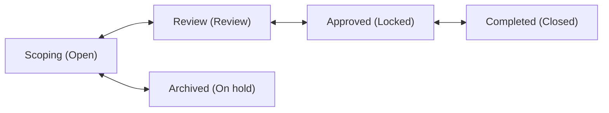

# Stages and baselining

**Project Admin → Structure** shows a project's stage sequence (e.g. Scoping → Development → Hardening). Each stage follows a **workflow**: an ordered list of named **phases**. Entering a phase of kind **Locked** (the standard workflow's "Approved"):

- **Baselines** every non-archived requirement still in draft or reviewed status, snapshotting its current version.
- **Locks** those requirements — from this point, they can only change via a [change request](./change-requests.md).

| Project stages |
| --- |
| A project's stage sequence, with review/approve actions per stage |
|  |

## Workflows and phases

A phase has a free-text name and a **kind**; the kind, never the name, decides what the phase does.

| Kind | Effect |
| --- | --- |
| Open | Requirements can be edited and reordered. |
| Review | A review deadline and stakeholder responses apply. |
| Locked | Entering writes the baseline and locks the requirements. |
| On hold | Paused or archived, with no special rules. |
| Closed | The stage is complete. |

Every organisation starts with the **Standard** workflow above. A stage can move to any phase of its workflow, in either direction; entering or leaving a Locked phase needs the project manager role, because leaving one unlocks the requirements outside the change-request process.

Organisation administrators define more workflows under **Organisation Admin → Projects & workflow → Stage workflows** (for example Scoping, Technical scoping, Review board, Tendering, Awarded, In progress, Completion for outsourced work). Project managers add workflows of their own under **Project Admin → Structure → Stage workflows**, and can hide an organisation workflow in the project and add it back later. A stage changes workflow only while it is in an Open phase with no baseline. A workflow a stage follows cannot be deleted, and a phase a stage is in can be renamed but not removed or given another kind.

## Renaming and deleting stages

Anyone who can create a stage can also rename it inline or delete it. Deleting a stage requires picking another existing stage to reassign everything currently targeting it to — every requirement (and its full history, not just its current version) and every pending change request proposing that stage moves to the one picked. A stage with an approved baseline can't be deleted at all, since that would rewrite a permanent record of what was approved; if it's the project's only stage, there's nothing to reassign to either, so deletion is blocked either way.

## Review deadlines and stage completion

A stage in a Review phase can be given a **review deadline**: stakeholders record an explicit approve/reject response before it passes, and if the deadline passes with no rejection, the stage moves to the workflow's next Locked phase — silence is treated as approval. An explicit rejection blocks it and leaves it for a manager to resolve manually. A workflow with no Locked phase is left alone.

Once a stage's work is delivered, a project manager moves it to a Closed phase, optionally marking every approved requirement targeting it as completed.

## Where this fits

See [Change requests and baselines](../concepts/change-requests-and-baselines.md) for what a baseline is and why it exists, and [Workflows → Stages, baselining, and reviews](../workflows/stages-baselining-and-reviews.md) for the end-to-end task walkthrough.
