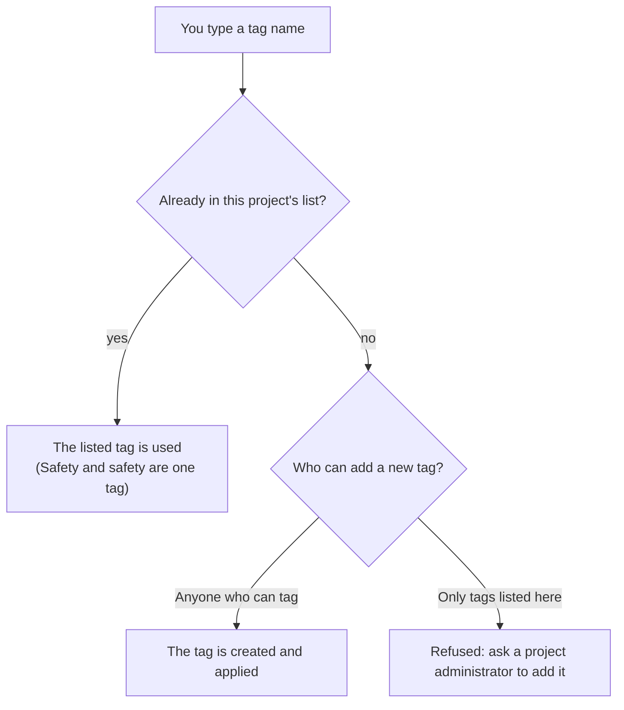
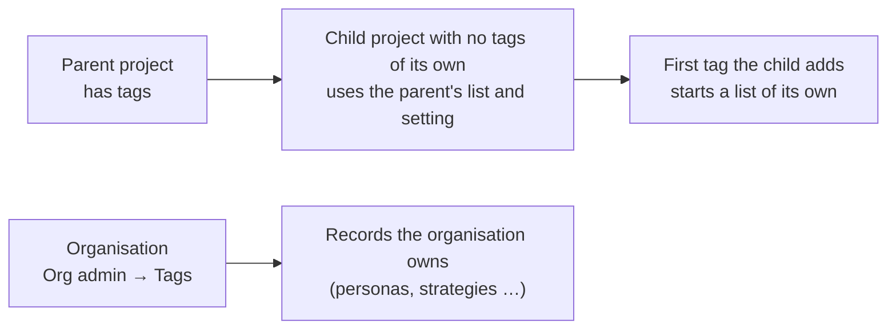

# Tags

A **tag** is a short label (a theme, a release, a regulation) that you put on any record: a requirement, an action, a decision, a risk, a persona, a pain point, a compliance item, whatever the kind. Tags cut across the fixed fields, so they answer questions no single field can: "what is safety-critical?", "what is in Release 2?", "what does this regulation touch?".

A requirement's **keywords** are its tags: the same labels, the same list.

## Tagging a record

Open a record. Under its title is the **Tags** box, if you may tag that kind of record (the same people who may edit it; a decision or a risk needs the **Manage** permission on it, see [Role Management](role-management.md)).

- Type to see the project's tags and pick one, or press **Enter** (or type a comma) to add what you typed. Remove a tag with the **×** on its chip.
- A change is saved at once, and appears in the record's **Activity** tab ("Alex added the tag Safety").
- Tags are not part of a record's content, so you can tag an approved requirement without a change request.
- A person who may only read a record sees its tags but no box.

A tag name is 1 to 40 characters and cannot contain a comma or semicolon. Capital letters are kept as first typed, but `Safety`, `safety` and ` SAFETY ` are one tag. A record can carry up to 50 tags.

## Tags on the create form

The form that creates a record has a **Tags** field too (next to **Link to**): choose tags and they are applied when the record is saved. If a tag is refused (a restricted project and a name not on its list), the record is still saved and a message says so; add the tag from the record. A change request has no such field, and an organisation's own records are tagged from within a project.

## Finding records by tag

- Every list has a **Tags** filter in its filter panel: tick one or more tags, and when you tick two or more choose **Any of these** or **All of these**. The filter appears once the project has tags.
- On the Requirements list, select rows and choose **Tag selected** to add or remove tags on all of them at once (a preview shows the count first).
- AI assistants can use `find_artefacts_by_tag`, which finds records of every kind that carry some tags.

## Keeping the list tidy (Project Admin → Tags)

Project managers open **Project admin → Tags** to look after the project's tags.

| Task | How |
| --- | --- |
| Who may add a new tag | **Anyone who can tag a record** (a free list) or **Only tags listed here** (a restricted list: people pick from the list and an administrator adds to it) |
| Add, rename, colour | The **New tag** box; the **⋮** menu on a tag renames it; **Change colour** on the same menu opens a picker: choose a swatch, pick any colour on the colour wheel, or type a hex code such as `#2b6cb0` or `#0a8`. **No colour** clears it. The colour marks the chip's edge. Renaming changes every record that carries it |
| Merge two tags | **⋮ → Merge … into another tag**. Records get the other tag, and the first is deleted |
| Change many records | **⋮ → Reclassify records tagged …**: add or remove other tags, optionally for one kind of record only. **Preview** shows the count; **Apply** makes the change |
| Delete a tag | **⋮ → Delete …**. You type the tag's name to confirm, and the dialog says how many records lose it |
| See how tags are used | One table per kind of record: each tag, how many records of that kind carry it, and when it was last used. Tick a tag to hide it from the tables while you review the others; the box above a table filters it |

Every change is recorded in the audit trail, and a bulk change also appears in each affected record's Activity tab.

## Child projects and the organisation

- A child project that has no tags of its own uses its nearest parent project's tags and setting. The parent manages that list; the child sees it read-only. The first tag the child itself adds starts a list of its own; records keep the parent's tags they already carry. A project's own setting (or **Follow the parent project**) overrides the parent's.
- Records the **organisation** owns (an organisation persona, stakeholder, strategy and so on) use the organisation's tags, kept under **Org admin → Tags**, not a project's. Organisation admins have the same tools there, and a setting for who may add a new tag. You tag such a record from any project that shows it.

## Moving tags between projects

A project [export and import](zip-export-import.md) carries the project's tags, colours and setting, and the tags on its requirements, personas, stakeholders, needs, engagements, research findings and risks. They are restored even if the new project is restricted.

## For API clients and AI assistants

The tags API works on any record type through one general endpoint (`/projects/{id}/artefacts/{type}/{id}/tags`), and the lists take `tag` and `tag_mode` parameters. The MCP tools `list_tags`, `get_artefact_tags`, `find_artefacts_by_tag` and, in [write mode](../api-integrations/ai-assistants-mcp/overview.md), `set_artefact_tags`, `add_artefact_tag` and `remove_artefact_tag` use the same rules. A tag name a restricted project refuses is a rule, not a glitch.

## What tags do not do

- Tags have no hierarchy, no per-tag permissions and trigger nothing.
- Reports and CSV exports other than the requirements export do not yet include a tags column.
- A record's tags are visible to anyone who can open the record, and a tag's name is visible to the project's members: do not put anything confidential in a tag name.
