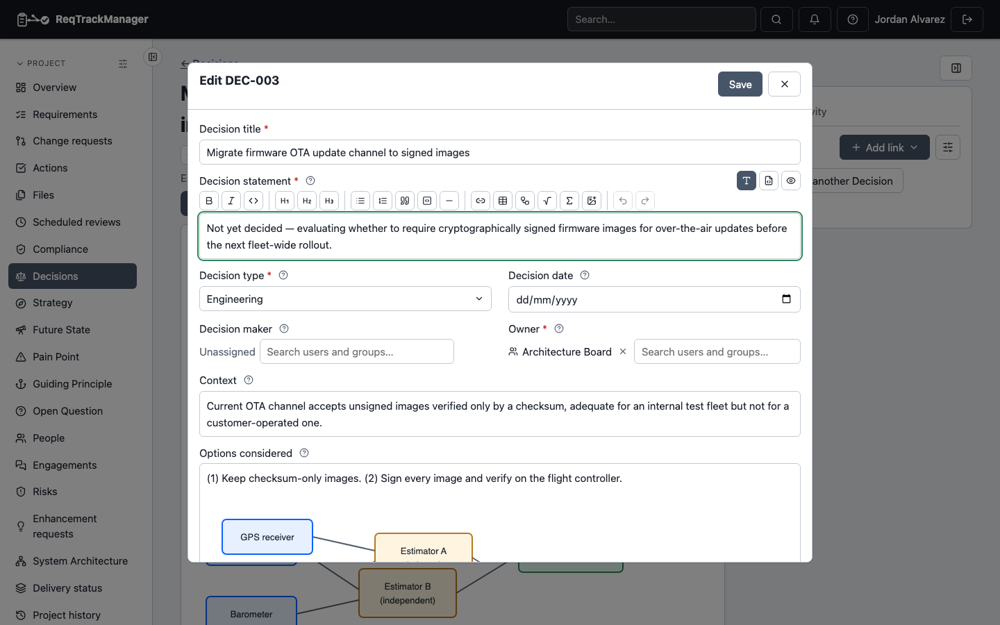
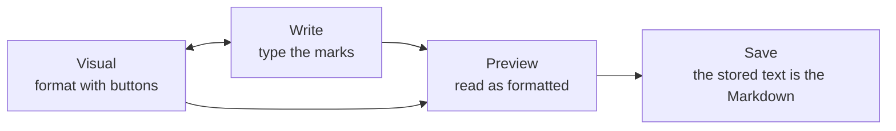
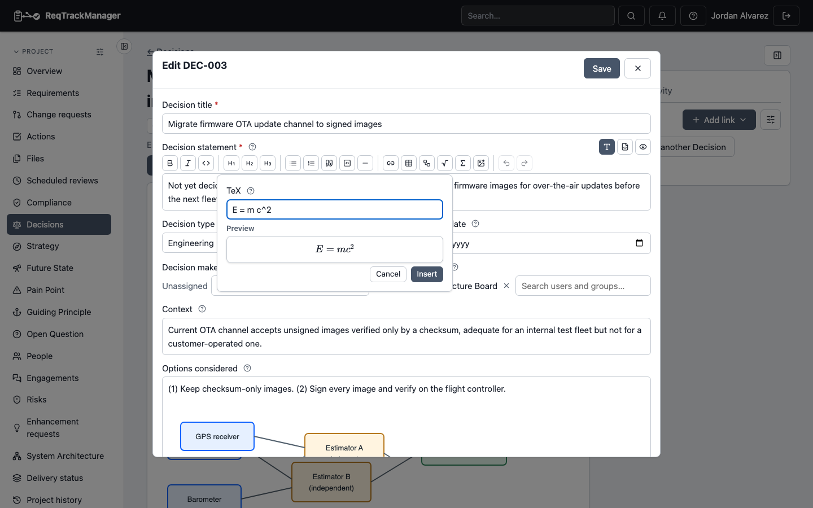
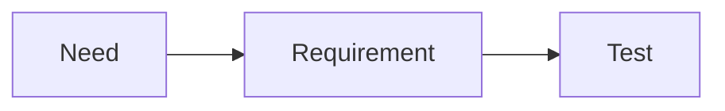
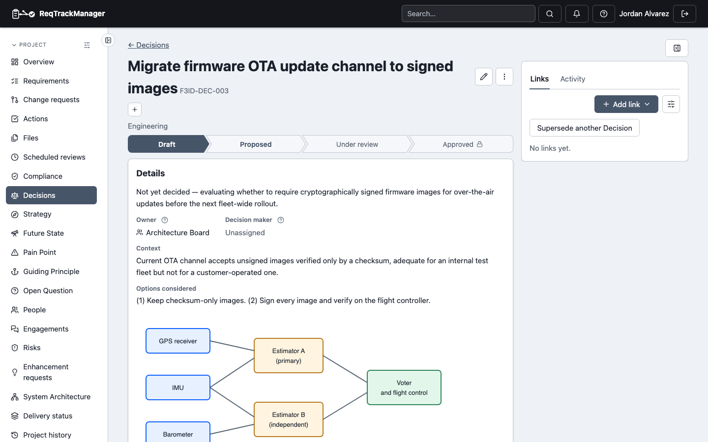

# Writing with Markdown, equations and diagrams

Every long text in ReqTrackManager (a requirement's description, a change request's reason, a decision's rationale, a risk's mitigation notes, a comment) is written in **Markdown**: plain text with a few marks that give it headings, lists, tables, links, equations and diagrams. You can type the marks, or format the text with buttons and not see the marks at all.

## Three views of one field

A text field has three views of the same text. The switch is at the far end of the field's caption line and appears while you are working in the field.

| View | Shows | Use it to |
| --- | --- | --- |
| **Visual** | The formatted text, editable directly | Write without learning the marks. This is the default; the last view you chose is remembered in this browser. |
| **Write** | The text with its marks | Type or paste Markdown, or edit what Visual cannot show faithfully |
| **Preview** | The text as readers see it, not editable | Check the result before saving |

| The Visual view with its formatting buttons and the Visual, Write and Preview switch |
| --- |
|  |

The formatting buttons (bold, italic, heading, lists, quotation, code, link, table, picture, diagram and equations) are also shown only while the field is in use, so a page with several fields shows fewer controls. A comment box has **Write** and **Preview** only, with fewer buttons.

- **A text Visual cannot hold** is opened in **Write**, with the reason stated (raw HTML, task lists and footnotes are examples), so opening a field never rewrites it. Saving a field you did not change leaves its text exactly as stored.
- **Pasting.** Pasting plain text that looks like Markdown into **Visual** offers **Convert to formatting** or **Keep as typed**.



## The marks

| You type | You get |
| --- | --- |
| `**bold**`, `*italic*` | **bold**, *italic* |
| `# Heading`, `## Smaller heading` | Headings |
| `- item` or `1. item` | A bulleted or numbered list |
| `> quotation` | A quotation |
| `` `code` `` or a fenced block of three backticks | Code |
| `[text](https://example.com)` | A link |
| Rows with `\|` between cells, and a `---` row under the first | A table |

A single line break stays a line break. Text written before Markdown was available reads the same unless it started a line with `*`, `-`, `#` or `1.`, which now formats. The field in **Write** always shows exactly what is stored.

## Equations

A field that holds mathematics (a requirement's description, reasoning and clarification, a change request's reason and proposed text, and the text fields of Decisions, Product Feedback requests, Open Questions and Pain Points) has two equation buttons, **Inline equation** and **Equation block**. Each opens a panel with a TeX field, the equation drawn as you type, and the reason when a formula is refused. In the text, an inline equation is `\( x^2 \)` and a display equation is `$$ x^2 $$`; a lone `$` is never an equation. Equations are drawn in all three views.

| Inline equation: the TeX field and the equation drawn as typed |
| --- |
|  |

Reports print the same equations. A list row or tile shows a field as plain words and draws its equations, so the Specs tiles read as the requirement's description without marks. A notification, a search result and a tooltip show the equation as its TeX source.

## Diagrams

A fenced block whose first line is `mermaid` is drawn as a diagram: a flowchart, sequence, class, state, entity-relationship, journey, Gantt, pie, mind map, timeline or any other type [Mermaid](https://mermaid.js.org/) supports. The **Diagram** button inserts a starting block, and Visual and Preview draw it while you edit the source.

````text

````

| A Mermaid diagram drawn in a Decision's Options considered |
| --- |
|  |

- A diagram is shown as an image, so it can never run script. An invalid diagram shows its error and keeps its source.
- **Limits:** a diagram's source is at most 20,000 characters, 300 connections and 4,000 drawn elements, and a field holds at most 20 diagrams; a drawing that takes more than 10 seconds is stopped.
- **Reports and exports** (PDF, Word, OpenDocument and HTML) draw the same diagram on the server with the same Mermaid version and the same font, so a printed diagram reads as it does on the screen; sizes can differ by a fraction of a pixel.

## Pictures

A picture is one of the record's own attachments placed in the text; see [Pictures in text](./file-attachments-and-shared-resources.md#pictures-in-text).

## What is not drawn

For safety, Markdown never changes the page itself:

- Raw HTML in the text is shown as text, never as markup.
- A link must be `https`, `http` or `mailto`; any other address stays as the text typed.
- A web address is never drawn as a picture, so opening a record never contacts another site.

## Limits and plain-text fields

A field holds up to 50,000 characters; a comment or a short note, 20,000; and a Decision's **Document**, 200,000. A text over its limit is refused with a message naming the field. In CSV and Word or PDF cells a list export shows the words without marks, while the CSV keeps the Markdown so it imports back unchanged.

A few texts stay plain on purpose, because they are drawn inside a shape or a fixed layout or are read as one line: a project's summary, a version's one-line change note, text inside a diagram shape or state, descriptions of roles, scoring levels and vocabularies, report footers and notification messages.

## Where this fits

See [Reports and export](./reports-and-export.md) for how Markdown prints, [Decision Management](../modules/decision-management-module/overview.md) for the Decision **Document**, and [Creating records](../workflows/creating-records.md) for the form conventions.
