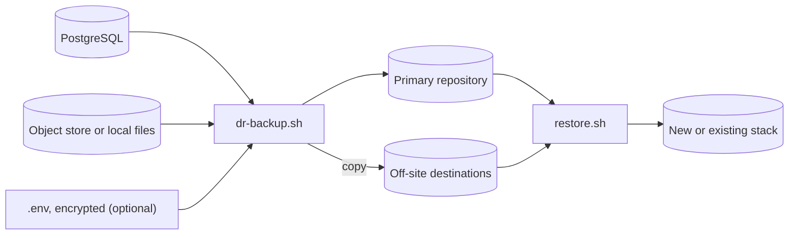
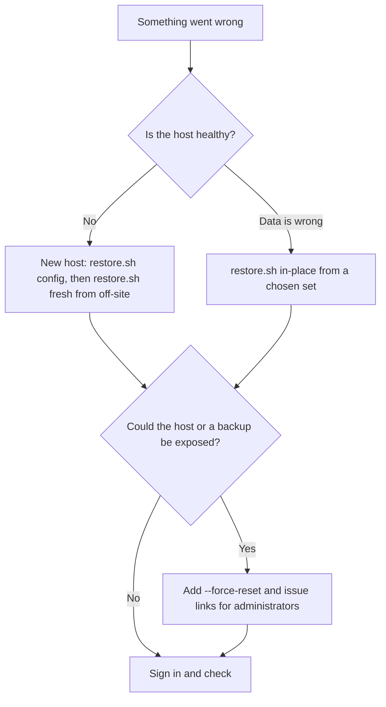

# Backup and disaster recovery

ReqTrackManager ships a whole-platform backup, a restore with guardrails, and a restore test that proves the latest backup brings back a working platform. They suit recovering a lost host, a corrupted volume or a bad deploy.

| | |
|---|---|
| **Recovery point** | The interval between backups: 24 hours with a nightly schedule, less if you schedule it more often. There is no point-in-time recovery between backups |
| **Recovery time** | Install Docker, fetch the repository and `.env`, run one restore command. It grows with the amount of attachment data |
| **Proof** | A weekly restore test compares every table count with the backup's manifest |

## What is backed up

| Component | How |
|-----------|-----|
| PostgreSQL | `pg_dump` from one consistent snapshot |
| Attachments | An incremental copy of the object store (the bundled SeaweedFS or any S3-compatible bucket), or the local-files volume |
| Configuration | Your `.env`, encrypted to a key only you hold (optional) |
| Manifest | App version, schema revision and the table and record counts a restore is checked against |

Each run is one encrypted, deduplicated [restic](https://restic.net) snapshot, copied to every destination you configure (S3-compatible, SFTP, a local or NFS path, Azure Blob), then pruned to a retention policy (default 7 daily, 4 weekly, 12 monthly) and sampled for integrity. Images, telemetry and the stateless services are not backed up: images are pulled by the tag the manifest records.



## Take and schedule a backup

```bash
export BACKUP_REPO_PASSWORD_FILE=/secure/location/restic-password
export BACKUP_DESTINATIONS=sftp:backup@host:/srv/reqtrack    # at least one copy off this host
./scripts/dr-backup.sh
```

The default repository is a volume on the same host, which does not survive losing the host, so always set an off-site destination. To run it on a schedule choose **one** of:

| Way | Backup | Restore test |
|-----|--------|--------------|
| Compose `backup-scheduler` service (`BACKUP_SCHEDULE=02:30`, `BACKUP_SCHEDULE_TIMEZONE=Australia/Sydney`) | Yes | No |
| systemd timers (`scripts/schedule/reqtrack-*.timer`, recommended on Linux) | Yes | Yes |
| cron (`scripts/schedule/crontab.example`) | Yes | Yes |

The restore test drives Docker, so it is always scheduled from the host (weekly by default). Failures and silence both raise [Prometheus alerts](./observability.md#backup-and-restore-test-monitoring).

## Keep the keys safe

| Secret | If you lose it |
|--------|----------------|
| Repository password | Every backup is unreadable |
| age private key for the `.env` | Supply the `.env` values from wherever you keep them |
| `APP_SECRET_ENCRYPTION_KEY` | Users with two-factor authentication re-enrol and organisations re-enter their SMTP and SSO secrets |
| `JWT_SECRET` | Everyone signs in again |

Keep each in a place that survives losing the host, reachable by two people, with one copy offline. `BACKUP_SECRETS_MODE=none` keeps the keys out of the backup entirely.

## Restore



```bash
./scripts/restore.sh list                                   # the sets available
./scripts/restore.sh config --age-identity identity.txt --output .env   # new host: recover the .env
./scripts/restore.sh fresh --repository <off-site> --start  # new host: empty stack
./scripts/restore.sh in-place --yes --start                 # replace the live database
```

A restore never writes into the live database. It restores into a scratch database, checks that every count equals the manifest, and only then renames it into place; an in-place restore keeps the replaced database under a new name so you can roll back. It refuses an image other than the one the set was taken with, a non-empty target for `fresh`, and a mismatched storage backend, and changes nothing when it refuses. Add `--dry-run` to see the plan.

After an incident that may have exposed the host or a backup, restore with `--force-reset` so every local account must choose a new password, then print a single-use link for each administrator with `python -m app.cli.credentials issue-link --server-admins`. See [Password resets and credential recovery](../workflows/password-reset-and-credential-recovery.md).

## Prove it works

```bash
./scripts/restore-test.sh --repository-volume reqtrack_backup_repo --source-env /secure/location/.env
```

On a throwaway Compose project with its own volumes, no published ports and email disabled, it restores the latest set, starts the application and checks the migration state, every table count, every stored file, that encrypted values decrypt, and an API walk-through. It exits non-zero on any difference and removes the scratch stack afterwards. Point it at the off-site repository for the honest test.

Everything is documented step by step, with every setting and a troubleshooting table, in the repository's [disaster-recovery runbook](https://github.com/ballardr/reqtrackmanager/blob/main/docs/disaster-recovery.md).

## Next steps

- [Storage, database, and migrations](./storage-database-and-migrations.md)
- [Observability](./observability.md)
