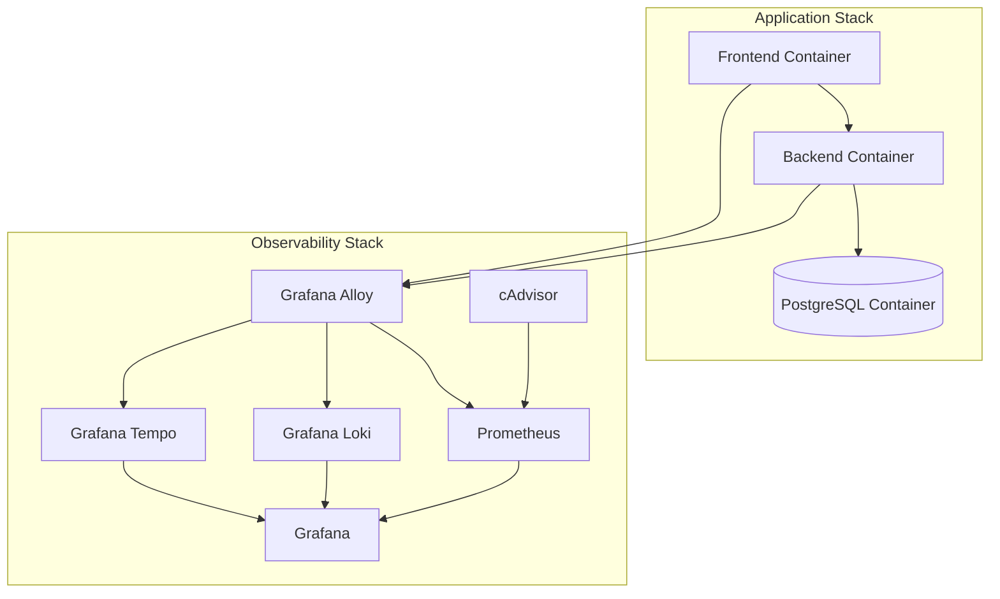
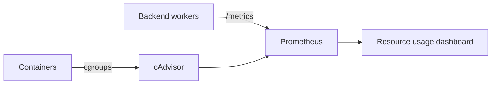
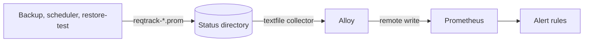

# Observability

ReqTrackManager includes an optional observability stack — Prometheus for metrics, Loki for log aggregation, Tempo for distributed tracing, Grafana Alloy for shipping all three, and Grafana for dashboards.

The measured memory and CPU of each service under load, and how to repeat the measurements, are in [Sizing and performance](./sizing-and-performance.mdx) and [Performance testing method](../reference/performance-testing-method.md).

```bash
docker compose --profile observability up -d
```



This adds Prometheus (http://localhost:9090), Loki, Tempo, Grafana Alloy, cAdvisor and Grafana (http://localhost:3300). Every port is published on the loopback address only, anonymous access is off, and Grafana will not start until `GRAFANA_ADMIN_PASSWORD` is set (for example `GRAFANA_ADMIN_PASSWORD=… docker compose --profile observability up -d`). Put it behind your own authentication before widening access in production.

## Health checks and metrics

Every container in both Compose stacks has a Docker health check, so `docker compose ps` reports each service's actual liveness rather than just "running." The backend additionally exposes:

- `GET /health` — HTTP 200 with `{"status": "ok", "database": "ok"}` when the app and its database connection are both healthy. When the database is unreachable (or does not answer within 3 seconds) it returns HTTP 503 with `{"status": "degraded", "database": "unreachable"}`, so `curl -f` and load balancers see the failure.
- `GET /metrics` — Prometheus-format metrics, pre-scraped by the bundled Prometheus configuration when the observability profile is enabled.

Container probes address `127.0.0.1` (not `localhost`) and have a start period, so a slow first boot or an IPv6-first host does not report a working service as unhealthy.

### Request rate and database activity

Two counters answer "how busy is the API and database". Ask for the window you want at query time; the counters themselves have no window.

| Question | PromQL |
|----------|--------|
| API requests per minute | `sum(rate(http_requests_total[1m])) * 60` |
| API errors per minute (5xx) | `sum(rate(http_requests_total{status_code=~"5.."}[1m])) * 60` |
| Database reads in the last 15 minutes | `sum(increase(db_statements_total{operation="select"}[15m]))` |
| Database writes in the last 15 minutes | `sum(increase(db_statements_total{operation!="select",operation!="other"}[15m]))` |
| Writes per operation, last 15 minutes | `sum by (operation) (increase(db_statements_total{operation!="select",operation!="other"}[15m]))` |

`db_statements_total` counts statements the backend sends to PostgreSQL, labelled only by `operation` (`select`, `insert`, `update`, `delete`, `other`). It carries no table names, ids or SQL text, so it is safe on the unauthenticated `/metrics` endpoint. One bulk statement counts once whatever its row count, and the backend's own `/health` probe lands in `other`. Each backend replica exposes its own counters, so sum across targets as the queries above do.

### Demonstration usage metrics

A demonstration stack (`scripts/demo.sh`) starts its own Prometheus that scrapes only the backend and the HTTPS proxy (request counts by status code) and keeps 30 days of samples across the daily reset. `scripts/demo.sh --export-metrics` writes them to a `.tar.gz` for a developer to review: a Prometheus snapshot, one series per line in `series.jsonl`, and a manifest with the reset times. `scripts/demo.sh --view-metrics <bundle>` opens it again.

| Metric | What it shows |
|--------|---------------|
| `http_requests_total`, `http_request_duration_seconds` | Which routes are used (the route template, never an identifier), how often, how long they take and how they end |
| `login_attempts_total` | Sign-in outcomes |
| `requirements_*_total`, `change_requests_*_total` | Lifecycle transitions |
| `db_statements_total`, `db_pool_connections`, `worker_resident_memory_bytes` | Database activity and worker load |

These metrics show how the product is used and how the server behaves. They do not show who did something or why: no metric carries a person, a record, a title or search text, and the export refuses to write a series with any other label. Session recordings (Microsoft Clarity, optional) give the on-screen behaviour and are lined up with the metrics by time only. See the [demonstration reference](https://github.com/ballardr/reqtrackmanager/blob/main/docs/demo.md#usage-metrics).

## Resource usage (memory and CPU)

Grafana's **ReqTrackManager → Resource usage** dashboard answers "how much does each service use over time?". It combines two sources:



| Panel | Source | Use it to |
|-------|--------|-----------|
| Memory working set, memory RSS, CPU per container | cAdvisor | Size `mem_limit` and the host; the working set is what the kernel counts against a limit |
| Backend RSS per worker, total and worker count | `worker_resident_memory_bytes{pid}` | See what each `BACKEND_WORKERS` process holds; equal large workers suggest duplicated imports |
| Database pool connections | `db_pool_connections{state}` | Check workers × (pool size + overflow) stays under PostgreSQL's `max_connections` |
| Container restarts and OOM kills (last hour) | cAdvisor | Spot a service that is crash-looping or too big for its limit |

Things to know:

- cAdvisor reports **every** container the Docker daemon runs, not only this stack; the legend shows `project/service` so two stacks on one host stay apart.
- It mounts the Docker socket and `/sys` read-only and needs the `SYSLOG` capability to read OOM kills from the kernel log. It publishes no port. Leave it out (do not enable the profile) on a host where that is not acceptable.
- On Docker Desktop (macOS, Windows) the figures describe the Linux VM the containers run in, and the VM's size caps everything.
- `worker_resident_memory_bytes` counts shared pages in every worker, so the sum of workers overstates real use; the container working set is the true total.

## Logs and traces

Grafana Alloy ships container logs to Loki, and exposes an OTLP receiver on port `4317` ready to forward traces to Tempo once the backend is instrumented with OpenTelemetry — this instrumentation is not yet done (see [Architecture overview → Known limitations](../reference/architecture-overview.md#known-limitations)), so the tracing pipeline is wired and ready but currently receives no application traces. Prometheus is pre-configured with a scrape target for the backend's `/metrics` endpoint. Grafana starts with Prometheus and the **Resource usage** dashboard provisioned (below). Add Loki and Tempo under **Connections → Data sources** yourself, then use the queries above in Explore or your own dashboards.

The repo's `observability/` directory holds the raw configuration this profile runs from (`prometheus.yml`, `alloy.river`, `tempo.yaml`, `grafana/` for the provisioned data source and dashboard, and `alerts/` for the backup alert rules), if you want to see or adapt exactly what's being scraped and shipped.

## Backup and restore-test monitoring

The backup tool, its optional in-container scheduler and the restore-test each write a small Prometheus metrics file (`reqtrack-*.prom`) next to their `status.json`, in the backup status directory. With the `observability` profile, Alloy reads that directory and forwards the metrics to Prometheus, which loads alert rules for them from `observability/alerts/`.



| Alert | Fires when |
|-------|-----------|
| `ReqTrackBackupFailed` | The last backup failed |
| `ReqTrackBackupStale` | No successful backup for 1.5 times its scheduled interval |
| `ReqTrackBackupDestinationDown` | The copy to an off-site destination failed |
| `ReqTrackBackupSchedulerDown` | The in-container scheduler stopped reporting |
| `ReqTrackRestoreTestFailed` / `ReqTrackRestoreTestStale` | The last restore-test failed, or none has passed for the weekly schedule plus a day |
| `ReqTrackBackupMetricsMissing` | Nothing reports a backup run, so none may be scheduled |

The bundled stack has no Alertmanager: the alerts show in Prometheus and Grafana, and you add an `alerting:` section to `observability/prometheus.yml` to be paged. The staleness thresholds follow the interval each tool publishes, so changing a backup schedule needs no rule edits. How to schedule backups and the weekly restore-test (a Compose service, systemd timers or cron) is in [Backup and disaster recovery](./backup-and-disaster-recovery.md).

## Next steps

- [Scaling and adding modules](./scaling-and-modules.md)
- [Troubleshooting](./troubleshooting.md)
