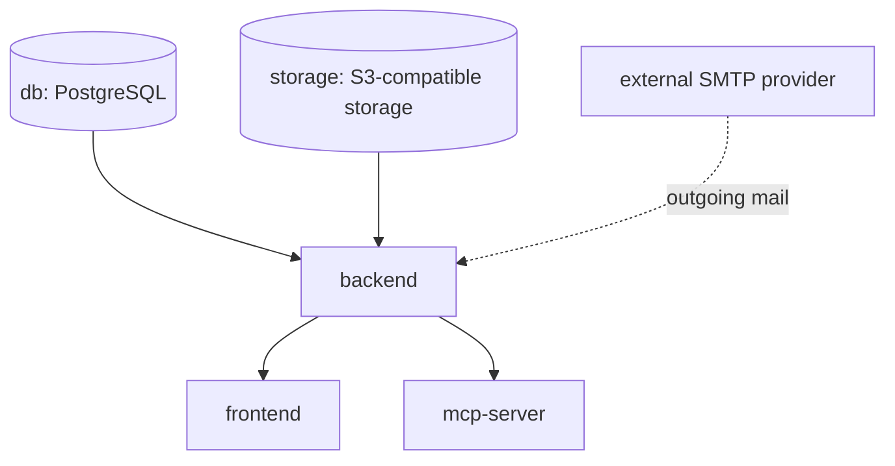
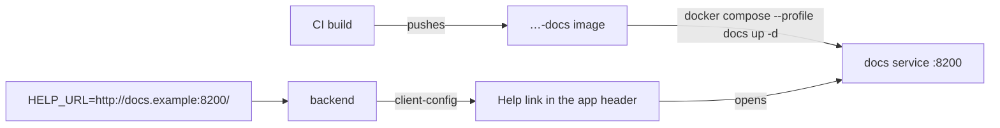
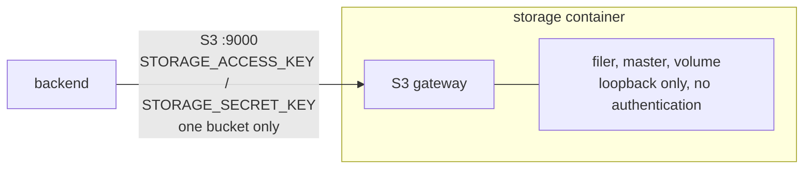

# Production deployment

Production deployment uses the root `docker-compose.yml` and the same container images used for local development — the difference is entirely in configuration, and the compose file itself enforces the important parts of it: `docker compose up` fails immediately with a clear error naming the missing variable if any required secret isn't set, rather than silently starting with an insecure default.

## Minimum `.env`

Create a `.env` file next to `docker-compose.yml` (Docker Compose loads it automatically) and set at minimum:

```bash
# Secrets — generate strong random values, do not reuse the defaults
JWT_SECRET=<random 32+ byte secret>
APP_SECRET_ENCRYPTION_KEY=<random 32+ byte secret>  # distinct from JWT_SECRET — see Configuration reference
SERVER_ADMIN_PASSWORD=<strong password>
POSTGRES_PASSWORD=<strong password>
STORAGE_SECRET_KEY=<strong password>           # S3 secret for the bundled storage (STORAGE_ACCESS_KEY optional)

# Networking
CORS_ORIGINS=https://your-domain.example
PUBLIC_API_BASE_URL=https://api.your-domain.example

# Outgoing email — point at a real SMTP provider instead of MailHog
SMTP_HOST=smtp.your-provider.example
SMTP_PORT=587
SMTP_USE_TLS=true
SMTP_USERNAME=<smtp username>
SMTP_PASSWORD=<smtp password>
SMTP_FROM_ADDRESS=noreply@your-domain.example

# Operational alerting
DEPLOYMENT_NOTIFICATION_EMAIL=ops@your-domain.example
```

```bash
docker compose up --build -d
```

The full list of backend environment variables — with defaults and which are actually required — is on the [Configuration reference](./configuration-reference.md) page.

## Beyond the two obvious containers

- **The bundled storage service** ([SeaweedFS](https://github.com/seaweedfs/seaweedfs)) is the default file-storage backend (`STORAGE_BACKEND=s3`) — an S3-compatible object store so file attachments and shared resources work out of the box. Point `STORAGE_S3_ENDPOINT_URL` at real AWS S3 (or another S3-compatible provider) instead if you'd rather not self-host it, or set `STORAGE_BACKEND=local` to use the backend container's own filesystem — see [Storage, database, and migrations](./storage-database-and-migrations.md).
- **OAuth/OIDC SSO** is per-organisation, not global: each organisation configures its own identity provider (issuer URL, client ID/secret) under its admin settings, so a single deployment can serve organisations with completely different IdPs — or none at all, staying on native email/password login. There's no bundled identity provider in the production stack; the dev/eval stack's Keycloak instance exists purely so SSO login can be tested end-to-end and should never be pointed at from a real deployment.
- **The MCP server** (`mcp-server`, port 8100) is optional but on by default — it holds no credentials of its own and does no authorization itself, only forwarding whatever access token the calling AI assistant already has. Leave it running (nothing reaches it without a valid token) or stop the container if you don't want to expose it at all.



## Obtaining container images

CI builds the production `backend`, `backup`, `frontend`, `mcp-server`, and `docs` images on every change, for both `linux/amd64` and `linux/arm64`, and, once tests pass on a push to `main`, pushes all five to `ghcr.io/<owner>/<repo>-{backend,backup,frontend,mcp-server,docs}`. Pull requests still build every image on both architectures, proving the Dockerfiles work, but never push — only a merge to `main` publishes.

Each image is tagged three ways:

- **`latest`** — always the most recent build from `main`. What `IMAGE_TAG` defaults to.
- **`<git sha>`** — the exact commit it was built from, for pinning to a specific build without needing a release version.
- **a SemVer** (e.g. `1.4.0`) — computed automatically from the commit graph by [GitVersion](https://gitversion.net/): every merge to `main` is a release, so the version increments without anyone pushing a git tag by hand.

`docker-compose.yml` declares both `image:` (pointing at these published tags) and `build:` (a local Dockerfile build) for `backend`/`frontend`/`mcp-server`, so:

- **First run, or `docker compose up --build -d`**: builds locally — nothing requires ever touching `ghcr.io`.
- **To deploy an already-published image instead of building**: set `IMAGE_TAG` in your `.env` (a SemVer to pin a specific release, a commit SHA, or leave it unset/`latest` to track the newest `main` build), then `docker compose pull && docker compose up -d`. This is the faster path for upgrading an existing deployment — no build step, no source checkout needed on the host at all.

If your images live in a different registry/namespace (e.g. a private mirror), override `GHCR_IMAGE_PREFIX` in your `.env` instead of editing `docker-compose.yml`.

**Checking what's actually deployed.** The same SemVer/commit SHA used to tag an image is baked into it at build time, so a running instance can report its own build identity without shell access to the host: the signed-in nav rail shows both the frontend's and the backend's version, fetched from `GET /api/v1/system/version`. A local `docker compose build` with no build args (the default for both paths above) reports placeholder `dev`/`unknown` values instead of failing — only images built by CI carry a real version.

### Supported platforms

Each tag is a multi-arch manifest, so `docker compose pull` fetches the right image for the host with no configuration.

| Host | Architecture | Notes |
|------|--------------|-------|
| x86-64 Linux, Docker Desktop on Intel | `linux/amd64` | Fully tested (unit, backend and end-to-end suites). |
| Apple silicon, arm64 Linux servers, Raspberry Pi 4/5 | `linux/arm64` | Built natively and smoke tested in CI: the backend starts, migrates and answers authenticated requests. The full test suites are not run on arm. A Raspberry Pi needs a **64-bit** OS (64-bit Raspberry Pi OS or Ubuntu); 32-bit images are not published. Minimum RAM for a Pi has not been measured yet. |

A Raspberry Pi 5 uses 16 KB memory pages and CI runners use 4 KB, which some native libraries mishandle and CI cannot catch. After a first start on a Pi, check `docker compose ps` and the backend logs.

## Hosting the documentation internally

The header **Help** link opens the public documentation site by default. That shows the latest docs, not the version you run, and does not work without internet access. To host the docs yourself, run the `docs` image and point `HELP_URL` at it:



Read left to right: CI publishes a docs image tagged with the same version as the app, you run it, and the backend tells the UI where it is.

- The image is the same static site as the public one, served by unprivileged nginx on port 8080 (`docker-compose.yml` publishes it on 8200 under the `docs` profile). It is built for the root of its own host; to serve it under a sub-path such as `/docs/` behind your reverse proxy, set `DOCS_BASE_URL=/docs/` (and `DOCS_URL`) in your `.env` and build it with `docker compose --profile docs build docs`. The base path is baked in at build time, so a pulled image keeps its published `/`.
- `HELP_URL` must be reachable from users' browsers, not just from the backend.
- No internal mirror and no wish for an external link? Set `HELP_ENABLED=false` to remove the Help link.

## Storage credential scope

The bundled storage service (SeaweedFS) accepts **one** S3 identity, defined by plain configuration: `STORAGE_ACCESS_KEY` and `STORAGE_SECRET_KEY`. The backend uses the same pair. The identity may act on the application bucket (`STORAGE_S3_BUCKET`) only, so a leaked backend credential cannot read or write any other bucket, list buckets, or change storage configuration.



Read left to right: the S3 gateway is the only port reachable on the Compose network. SeaweedFS's filer and master APIs carry no authentication, so they listen on loopback inside the container and the backend cannot reach them.

| Variable | Default | Purpose |
|----------|---------|---------|
| `STORAGE_ACCESS_KEY` | `minioadmin` (or `STORAGE_ROOT_USER`) | Access key of the identity. Change it to something unguessable |
| `STORAGE_SECRET_KEY` | required (or `STORAGE_ROOT_PASSWORD`) | Secret of the identity. Compose refuses to start without it. It is needed even with `STORAGE_BACKEND=local` or an external provider (set any value then, or your provider's secret) |

- `STORAGE_ROOT_USER` / `STORAGE_ROOT_PASSWORD` from earlier releases still work as the access key and secret, so no `.env` change is needed to upgrade (see below). The pair is no longer an administrator, so the name is historical.
- Values must not contain quotes or backslashes (the identity file is JSON; SeaweedFS refuses to start on an invalid one rather than running open).
- To rotate, change both values and run `docker compose up -d storage backend`.
- To use a different bucket, set `STORAGE_S3_BUCKET`; the identity follows it.

### Hardening the bundled storage further

What is already in place: a single bucket-scoped identity, no published ports, and loopback-only internal APIs. Beyond that, in rough order of value:

1. **Use an external S3 provider with its own IAM** if you can. Set `STORAGE_S3_ENDPOINT_URL`, and put a credential limited to your bucket in `STORAGE_ACCESS_KEY` / `STORAGE_SECRET_KEY`. Scoping, auditing, encryption at rest and TLS are then the provider's.
2. **Choose a random access key and a long secret.** The defaults are only there so existing setups keep working.
3. **Add identities for other users or tools** instead of sharing the backend's. Replace the identity file in a `docker-compose.override.yml`:

   ```yaml
   configs:
     storage_identity: !override   # replaces the inline content (needs Docker Compose 2.24 or newer)
       file: ./s3-identities.json
   ```

   ```json
   {"identities": [
     {"name": "app",     "credentials": [{"accessKey": "APP_KEY",    "secretKey": "APP_SECRET"}],
      "actions": ["Admin:reqtrackmanager", "Read:reqtrackmanager", "Write:reqtrackmanager", "List:reqtrackmanager"]},
     {"name": "auditor", "credentials": [{"accessKey": "AUDIT_KEY",  "secretKey": "AUDIT_SECRET"}],
      "actions": ["Read:reqtrackmanager", "List:reqtrackmanager"]},
     {"name": "operator","credentials": [{"accessKey": "OPS_KEY",    "secretKey": "OPS_SECRET"}],
      "actions": ["Admin", "Read", "Write", "List", "Tagging"]}
   ]}
   ```

   An action without `:bucket` applies to every bucket, so reserve it for an operator who needs it. `STORAGE_ACCESS_KEY` / `STORAGE_SECRET_KEY` must still match the `app` identity, because the backend reads them.
4. **Remove the right to create or delete the bucket.** `Admin:<bucket>` is what lets the backend create its bucket on first start. Create it yourself once (`docker exec -it reqtrack-storage weed shell`, then `s3.bucket.create -name reqtrackmanager`), then drop `Admin:` from the app identity's actions.
5. **Inspect without any S3 login:** `docker exec -it reqtrack-storage weed shell`, then `s3.bucket.list` or `fs.ls /buckets/reqtrackmanager`.
6. **Keep the secret out of version control and shell history.** Use a `.env` file readable by the deploy user only, or your orchestrator's secret store. The secret also appears in the storage container's identity file and in `docker compose config` output, so restrict who can run Docker on the host.
7. **Transport and rest.** Traffic between `backend` and `storage` is plain HTTP on the Compose network; if they are ever on different hosts, put TLS in front or use an external provider. Encrypt the `reqtrack_storage_data` volume at the host or disk level.
8. **Do not publish storage ports** or remove the loopback flags (`-ip.bind=127.0.0.1`) from the `storage` command; the filer and master have no authentication.

## Upgrading to the bucket-scoped credential

**No `.env` change is required.** An existing `.env` with `STORAGE_ROOT_PASSWORD` (and optionally `STORAGE_ROOT_USER`) keeps working: those values become the access key and secret. Tested by writing a file under the previous setup and reading it back with the same credential after upgrading. What changes is what that credential can do:

- It can no longer administer storage: listing buckets, creating or touching other buckets, or `aws s3 mb` now fail with `AccessDenied`. Use `weed shell` (hardening step 5) or add an operator identity (step 3).
- The filer, master and volume ports are no longer reachable from other containers. Tooling that called `storage:8888` or `storage:9333` across the network must run inside the container instead.
- `storage` can take up to 30 seconds to report healthy after a restart.

Steps: back up (`./scripts/dr-backup.sh`, which covers the database and the stored files; see [Backup and disaster recovery](./backup-and-disaster-recovery.md)); **replace your `docker-compose.yml` with the new one** (`git pull`, or copy it; `docker compose pull` fetches images only, and the storage configuration lives in this file, so pulling alone leaves the old, unscoped setup running; re-apply any local edits you made to the file); then `docker compose pull && docker compose up -d`. This needs Docker Compose 2.23.1 or newer (`docker compose version`), for inline `configs`. Check that `docker compose ps` shows `storage` and `backend` healthy and that an existing attachment opens. Optionally rename `STORAGE_ROOT_USER` / `STORAGE_ROOT_PASSWORD` to `STORAGE_ACCESS_KEY` / `STORAGE_SECRET_KEY`.

| Symptom | Cause and fix |
|---------|---------------|
| `configs.storage_identity` is not valid, or an unknown `content` attribute | Docker Compose is older than 2.23.1; upgrade it |
| `required variable ... STORAGE_SECRET_KEY` | Neither `STORAGE_SECRET_KEY` nor `STORAGE_ROOT_PASSWORD` is set |
| `storage` exits with `unmarshal error` in its log | A value contains a quote or backslash (fine before this release, not now); change it |
| Uploads fail with `AccessDenied` | The bucket name differs from `STORAGE_S3_BUCKET`, or the credential in use is not the one `storage` was started with; run `docker compose up -d storage backend` |

**Rolling back:** restore the previous `docker-compose.yml` and image tag and run `docker compose up -d`. Data is untouched and the same variables are read.

**Development and test stack (`tests/container`):** no `.env` change; run `docker compose up -d` there so `storage` and `backend` are recreated.

## Next steps

- [Configuration reference](./configuration-reference.md) for the full environment-variable table.
- [TLS, reverse proxy, and same-origin deployment](./tls-and-reverse-proxy.md) — required reading before exposing this to real users, since ReqTrackManager does not terminate TLS itself.
- [Observability](./observability.md) to wire up metrics, logs, and traces.
