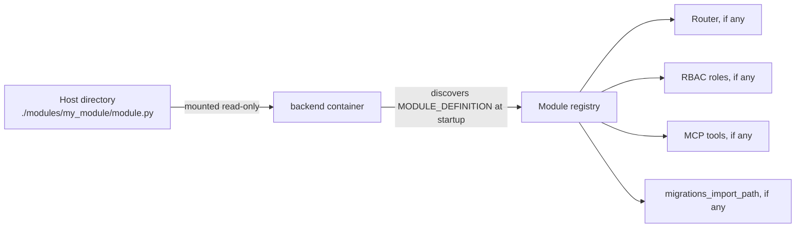
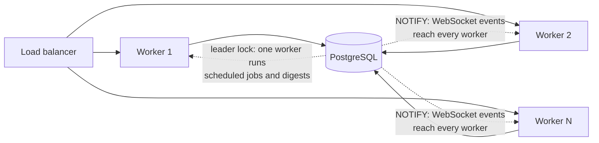

# Scaling and adding modules

## Adding an external module by mounting a directory

The [modular feature system](../modules/overview.md) can load a module from a plain directory mounted into the `backend` container — no rebuild of the backend image required. This is **off by default** and must be deliberately opted into, since it lets code the deployment operator supplies run inside the backend's own process with the backend's own database credentials.



1. Build the module directory on the host, e.g. `./modules/my_module/module.py` exposing a module-level `MODULE_DEFINITION`. If the module has its own database tables, it can also declare `migrations_import_path` pointing at a sibling module exposing an idempotent `run_migrations(connection) -> None`.
2. Mount that directory into the backend container and point `EXTRA_MODULES_PATH` at it, and set `ALLOW_EXTERNAL_MODULES=true`:

   ```yaml
   backend:
     environment:
       ALLOW_EXTERNAL_MODULES: "true"
       EXTRA_MODULES_PATH: /extra-modules
     volumes:
       - ./modules:/extra-modules:ro
   ```
3. `docker compose up -d backend` (or restart the container). At startup the backend discovers `MODULE_DEFINITION`, mounts its router (if any), registers its RBAC roles/MCP tools (if any), imports its models into the schema-comparison metadata, and — because `ALLOW_EXTERNAL_MODULES` is on — automatically applies its own `migrations_import_path` migration if it declares one. No edit to any core ReqTrackManager file is needed for any of this.

A first-party module shipped inside the backend's own image (e.g. the [Compliance module](../modules/compliance-module/overview.md)) is unaffected by any of this — it always loads regardless of `ALLOW_EXTERNAL_MODULES`, and its own schema changes always ship as a reviewed Alembic migration in the core image, never via `migrations_import_path`.

## Adding a Tier C (federated) frontend module

The modular feature system's frontend half also supports a genuinely third-party module with **no rebuild of either the backend or frontend image** — Tier C / Module Federation. See [Third-party and federated modules](../modules/third-party-and-federated-modules.md) for the full module-author/operator contract; this section is the operator's side of it.

:::caution Read this before enabling it
A Tier C module runs with **no sandbox at all** — same origin, same DOM, same cookies, same live component tree as the rest of this app. The trust falls entirely to you, the deployment operator, to review and vet the module before enabling it.
:::

1. Get the module's frontend bundle and `module.py` from its author.
2. Register the backend half exactly like any other external module — place `module.py` under a directory pointed at by `EXTRA_MODULES_PATH`, and set `ALLOW_EXTERNAL_MODULES=true` (same as step 2 above).
3. Mount the frontend bundle into the frontend container's reserved `/usr/share/nginx/external-modules/` directory, served same-origin at `/external-modules/...`, so the module's declared `remote_entry_url` (e.g. `/external-modules/my-module/remoteEntry.js`) resolves:

   ```yaml
   frontend:
     volumes:
       - ./external-modules:/usr/share/nginx/external-modules:ro
   ```

   If you'd rather host the bundle somewhere else entirely — your own CDN, another origin — skip this mount and have the module's `remote_entry_url` point at that absolute URL instead.
4. `docker compose up -d backend frontend` (or restart both containers) — no rebuild of either image.
5. Enable the module for an organisation via the Modules admin UI, exactly like any other module.

## Scaling the backend

Each backend container runs several worker processes — set `BACKEND_WORKERS` (default `4`) to the number of CPU cores the API should use. You can also run more backend replicas behind a load balancer. Workers and replicas share the database and coordinate through it, so nothing else is needed:



- Scheduled jobs, notification digests and the disk-usage monitor run on exactly one elected worker; if it stops, another takes over within about 30 seconds.
- Live-update WebSocket events reach clients whichever worker they're connected to.
- `/metrics` combines all workers in a container; scrape each replica separately.

Keep `BACKEND_WORKERS × replicas × (DB_POOL_SIZE + DB_MAX_OVERFLOW + 2)` (17 per worker by default) below PostgreSQL's `max_connections` (100 by default, 3 reserved), and see [Memory limits and sizing](#memory-limits-and-sizing) for memory per worker. Set `BACKEND_WORKERS=1` to run a single process.

:::note PgBouncer is untested
A connection pooler such as PgBouncer is the usual way past PostgreSQL's connection limit when you add workers, but it has not been tried with this application and is not yet supported: each worker keeps two connections that need a session (the live-update `LISTEN` and a startup lock), which a transaction-mode pooler would break. Until a direct connection setting for those two exists, lower `DB_POOL_SIZE` / `DB_MAX_OVERFLOW` or raise PostgreSQL's `max_connections` instead.
:::

Each worker serves at most `MAX_CONCURRENT_REQUESTS` requests at once (by default as many as it has database connections, 15); further requests wait, up to `REQUEST_QUEUE_TIMEOUT_SECONDS` (30), and are then refused with `503` and `Retry-After`. Watch the `requests_shed_total` metric: a steady rise means the deployment needs more workers or replicas.

### Memory limits and sizing

Every always-on service has a memory limit in `docker-compose.yml`, set from measured peaks and overridable from `.env` (`0` removes a limit). A service over its limit is killed and restarted, so raise a limit before the load that needs it.

| Service | Variable | Default | Measured |
|---------|----------|---------|----------|
| Backend | `BACKEND_MEM_LIMIT` | `3500m` | 4 workers: 1.6 GiB idle, 1.8-2.4 GiB under load on projects up to 1,000 requirements, 4.0-4.5 GiB when every worker runs a report, export or bundle import on a 5,000-requirement project |
| Database | `DB_MEM_LIMIT` | `2g` | 0.14-0.65 GiB with four workers, about 1 GiB at six |
| Object storage | `STORAGE_MEM_LIMIT` | `512m` | 30-143 MiB |
| Frontend / MCP server | `FRONTEND_MEM_LIMIT` / `MCP_MEM_LIMIT` | `128m` / `256m` | about 11 / 57 MiB |

Backend memory follows the worker count and the project size, not the number of users: roughly **0.1 GiB + 0.55 GiB × workers + 0.5 GiB × the number of reports, exports or bundle imports of 5,000-requirement-plus projects that can run at once**. Memory stayed flat over a 30-minute soak at every project size. See the [deployment guide](https://github.com/ballardr/reqtrackmanager/blob/main/docs/deployment.md#sizing-and-memory-limits) for the decision flow.

## Next steps

- [Troubleshooting](./troubleshooting.md)
