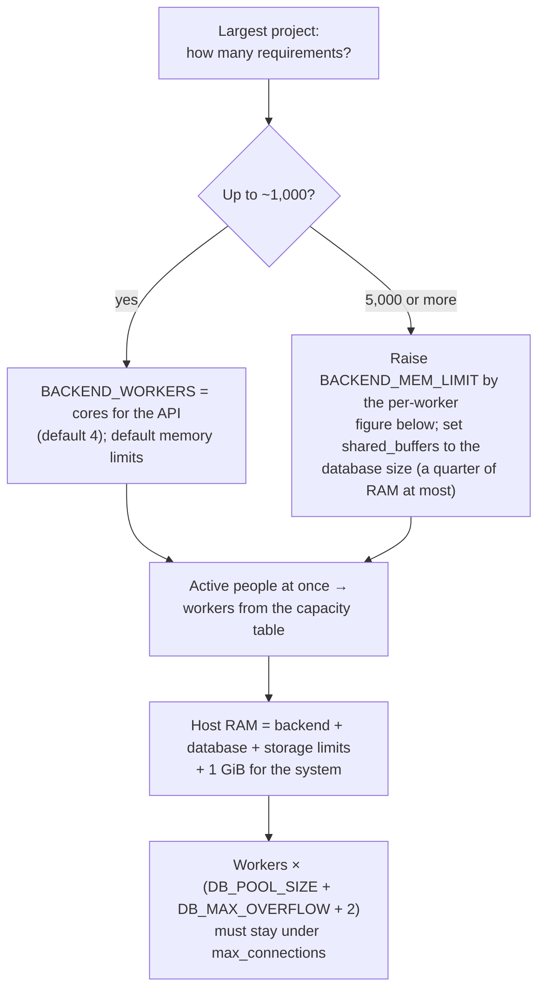

import PerformanceFigure from '@site/src/components/PerformanceFigure';

# Sizing and performance

How much a deployment needs depends on three things: how many **workers** the backend runs, how big the **largest project** is, and how many people are **active at once**. The figures below were measured with the repeatable profile described in [Performance testing method](../reference/performance-testing-method.md); every number is stamped with its commit and host, and the full tables and findings are in [`docs/performance.md`](https://github.com/ballardr/reqtrackmanager/blob/main/docs/performance.md).

:::note What was measured
Synthetic data (every record type, linked, with history and comments), not a real deployment: real text, link graphs and edit histories are clumpier. The tiers bound the cost; they do not predict a specific installation. Capacity runs: 2026-10-28, commits `38efb504` (Linux server, Raspberry Pi) and `874d93b9` (Dell, a later commit that differs in documentation only). Memory sweep: 2026-10-29, commit `f93d8abb`. One-worker host comparison: 2026-10-31, commit `f299c390`.
:::

## Minimum requirements

The smallest configuration that was measured, and not a floor below which it is known to fail: `BACKEND_WORKERS=1` on a Raspberry Pi 5 (4 cores, 8 GiB, NVMe) with the stack held to **2 cores and 2.7 GiB**, running projects from 30 to 20,000 requirements without a failed request (the backend peaked at 1.4 GiB at 20,000 requirements).

| | Minimum | Why |
|---|---|---|
| Processor | 2 cores, 64-bit (amd64 or arm64) | One worker is about one core of the API; the database, storage and frontend share the rest |
| Memory | 4 GiB | The stack idles at about 0.7 GiB with one worker (backend 0.42, database about 0.12, storage 0.06, frontend and MCP server 0.07); a project of up to 1,000 requirements takes the worker to 0.6-0.9 GiB on a heavy request, and the operating system needs about 1 GiB |
| Disk | 10 GiB free, SSD or NVMe | About 2 GiB of images; the database was 0.07 GiB at 1,000 requirements, 0.2 GiB at 5,000 and 0.7 GiB at 20,000 (test data, one project); attachments and backups are extra. The x86 servers measured here ran on hard disks as detected; the Pi on NVMe |
| Software | Docker with Compose 2.23.1 or newer | The stack is Compose-based; images are published for amd64 and arm64 |

A Raspberry Pi 5 with one worker serves about 40-80 people active at once on small projects. Below 4 GiB, below 2 cores, and four workers on a Pi were not measured.

## How many people? Choosing a size

Size by how many people are **active at once**, not how many have accounts. The table assumes a third of the people who can sign in are active at any moment, and that an active person makes a request every 5-10 seconds (a page view fires a few requests together and the person then reads). Both are guesses: replace the third with your own usage. It uses a conservative **30 requests per second per worker**, the rate measured with the other record types and links in the mix (about 45-60 for browsing alone).

| People with accounts | Active at once | Requests per second | Workers | Cores | Memory | Notes |
|----------------------|----------------|---------------------|---------|-------|--------|-------|
| Up to 100 | about 35 | 3-7 | 1 | 2 | 4 GiB | A Raspberry Pi 5 (8 GiB) is enough for light use |
| Up to 300 | about 100 | 10-20 | 1-2 | 4 | 8 GiB | Two workers for headroom and for one heavy request at a time |
| Up to 1,000 | about 330 | 33-67 | 4 (default) | 8 | 8-16 GiB | The default configuration |
| Up to 3,000 | about 1,000 | 100-200 | 6 | 12 | 16 GiB | Six workers, three cores for the database; near the most one stack delivered |
| More than 5,000 | 1,700 or more | 170-340 | More than one stack | | | Beyond what was measured: several backend replicas against a larger database |

- **Cores** are the workers, plus about half as many for the database, plus one for the frontend and the system. **Memory** is the backend limit from the formula below, plus the database (0.4-0.9 GiB), storage (up to 0.9 GiB with attachments), the frontend and MCP server (about 0.1 GiB) and about 1 GiB for the system, rounded up. These are planning figures built from the measurements, not separately measured configurations.
- **Bigger projects need the next row.** At 5,000 requirements per project a stack delivers about 40% fewer requests per second and each worker needs about 1.3 GiB instead of 0.8; at 20,000 each needs 2.4 GiB or more and the database 2-3 GiB.
- **Heavy work** (a report, a project or organisation export, a bundle import) takes one worker for seconds, so a deployment that runs several at once needs spare workers.
- **People per request interval:** if your people click faster than every 5 seconds, or run many exports, size one row up.

## Hosts measured and what each had available

| | Linux server | Dell workstation | Raspberry Pi 5 |
|---|---|---|---|
| Processor | AMD, 16 cores | Intel, 16 cores | Arm Cortex-A76, 4 cores |
| Memory | 30.4 GiB | 31.1 GiB visible to Docker | 7.8 GiB |
| Storage (as detected) | hard disk | hard disk | NVMe |
| Operating system | Linux | Windows, Docker Desktop (WSL2 virtual machine) | 64-bit Ubuntu 24 |
| Other load | Shared with a production stack | Dedicated to the run | Dedicated to the run |
| Capacity runs: the stack's budget | 12 cores, 7.6 GiB (backend 6 cores and 4.4 GiB, database 3 cores and 1.9 GiB) | 12 cores, 26.4 GiB (backend 6 cores and 15.3 GiB, database 3 cores and 6.6 GiB) | **2 cores, 2.7 GiB** (backend 1 core and 1.1 GiB, database half a core) |
| Memory sweep (4 and 6 workers) | 12 cores, 16 GiB (backend 6 cores and 9.3 GiB, database 3 cores and 4 GiB) | not run | not run |
| One-worker comparison | 8 cores, 7.6 GiB (backend 4 cores and 4.4 GiB, database 2 cores and 1.9 GiB) | not run | 4 cores, 4 GiB (backend 2 cores and 2.3 GiB, database 1 core and 1 GiB) |

- **The budgets are caps the test put on the stack, not what the host could give.** A cap that is not reached does not shape a result: none of the runs shown here reached its memory cap except at 20,000 requirements, where the backend stopped at the 9.3 GiB cap (the figures say so).
- **The Raspberry Pi's capacity figure understates the board.** Its capacity run was held to half of it (2 of 4 cores), so about 8 requests per second is for that budget; the later one-worker comparison used all four cores with a 4 GiB budget but measured latency, not capacity.
- **The Linux server was shared with a production stack**, so its latencies are, if anything, pessimistic.
- The Dell workstation's CPU time per request is about 1.4 times the Linux server's, and it scales worse past four workers: a property of that host and of WSL2, not of the application.

## Headline sizing

Throughput is **CPU-bound**: a worker is about one core of Python. On a 16-core Linux server giving the stack six cores for the API and three for the database, with projects of up to 1,000 requirements:

| Workers | Cores for the API | Backend memory limit (formula) | Measured backend peak | Active people at the usable level |
|---------|-------------------|--------------------------------|-----------------------|-----------------------------------|
| 1 | 1 | 0.9 GiB | 0.6 GiB (light mix only) | 310-620 (62 req/s) |
| 2 | 2 | 1.7 GiB | not measured on the full mix | 315-630 (63 req/s) |
| 4 (default) | 4 | 3.3 GiB | 3.2 GiB | 625-1,250 (125 req/s) |
| 6 | 6 | 4.9 GiB | 4.2 GiB | 940-1,880 (188 req/s) |

*Usable* means the highest load that delivered at least 90% of the requests offered, with a 95th-percentile latency under one second and under 1% failures. People are estimated at one request every 5-10 seconds. With the other record types and links in the mix, the usable level is about half (six workers: 124 req/s). Add the database (0.4-0.9 GiB at 1,000 requirements), object storage (up to 0.9 GiB with attachments), and about 1 GiB for the operating system when choosing a host.

## Memory

A backend worker starts at 0.42 GiB and **keeps the memory of the heaviest request it has served** (an organisation export, a bundle, a report): it does not hand it back, and every worker eventually serves a heavy request. So backend memory is roughly `0.1 GiB + workers × the per-worker high-water`, and the per-worker high-water grows with the project: about 0.8 GiB up to 1,000 requirements, 1.3 GiB around 5,000, and 2.4 GiB or more at 20,000.

<PerformanceFigure
  name="memory-by-project-size"
  alt="Two line charts against project size from 30 to 20,000 requirements. Left: the backend container's peak memory for 4 and 6 workers, rising from about 2.2 and 3.3 GiB to the 9.3 GiB test cap at 20,000 requirements. Right: the largest single worker, rising from 0.6 GiB to 2.4 and 3.2 GiB."
  caption="Backend memory by project size, 4 and 6 workers (Linux server, commit f93d8abb, 22 scenarios). At 20,000 requirements both counts reached the 9.3 GiB cap the test allowed, so that point is a floor, not the need."
/>

| Service (default limit) | 30 requirements | 1,000 | 5,000 | 20,000 |
|-------------------------|-----------------|-------|-------|--------|
| Backend, 4 workers (5 GiB) | 2.2 GiB | 3.2 | 5.0 | 9.5 or more |
| Backend, 6 workers | 3.3 | 4.2 | 6.6 | 9.5 or more |
| One worker, the largest | 0.60 | 0.91 | 1.50 | 2.4 (4 workers), 3.2 (6) |
| Database (3 GiB) | 0.35-0.39 | 0.73-0.93 | 0.86-0.88 | 2.1-2.7 |
| Object storage (2 GiB) | 0.85 | 0.74-0.77 | 0.53-0.69 | 0.26-0.39 |

The limits in `docker-compose.yml` are set from these peaks and are settable from `.env` (`BACKEND_MEM_LIMIT`, `DB_MEM_LIMIT`, `STORAGE_MEM_LIMIT`; see [Scaling](./scaling-and-modules.md#memory-limits-and-sizing)). A service over its limit is killed and restarted, so raise a limit before the load that needs it.

<PerformanceFigure
  name="backend-memory-soak"
  alt="Three nearly flat lines of backend memory over a 32-minute soak, at about 2.9 GiB for 1,000 requirements, 4.4 GiB for 5,000 and 6.0 GiB for 20,000, each labelled with its trend per hour."
  caption="The backend's memory over the 30-minute soak (4 workers): flat at every size, trends within -235 to +6 MiB per hour. A limit is a ceiling for load, not a leak guard."
/>

## Workers and throughput

<PerformanceFigure
  name="throughput-by-workers"
  alt="Two line charts of the most requests per second delivered against 1, 2, 4 and 6 backend workers for three hosts. The Linux server rises from 63 to 233 requests per second in the browsing mix and from 37 to 163 with the other record types; the Dell workstation peaks at 139 with four workers; the Raspberry Pi shows one point at about 14."
  caption="Peak throughput by worker count (T2, ten projects of 1,000 requirements). On the Linux server it scales to about four workers and then flattens as the backend and database cores are used up; the Dell does worse past four."
/>

| Host | 1 worker | 2 | 4 | 6 |
|------|----------|---|---|---|
| Linux server, usable / peak req/s | 62 / 63 | 63 / 124 | 125 / 202 | 188 / 233 |
| Linux, with the other record types | 31 / 37 | 31 / 58 | 62 / 121 | 124 / 163 |
| Dell workstation (WSL2), usable / peak | 31 / 50 | 62 / 91 | 63 / 139 | 63 / 120 |
| Raspberry Pi 5, usable / peak | 8 / 15 | | | |

- **One worker per core the API may use** is the starting rule, at about 45-60 requests per second per core. Past four workers on this server the database (three cores) and the 97 connections PostgreSQL allows clients become the limit; each worker holds up to 17 (16 with the smaller pool the six-worker runs used).
- **More workers than the connection limit allows** needs a smaller per-worker pool (`DB_POOL_SIZE`, `DB_MAX_OVERFLOW`) or a higher `max_connections`; a connection pooler such as PgBouncer is untested and not yet supported.
- The Dell workstation spends about 1.4 times as much CPU per request as the Linux server and gets worse with more workers: a host-specific result, not a statement about the application.
- Overload shows as queueing (a lower delivered rate and slower responses), not as errors: no request failed at any level.

## Project size

<PerformanceFigure
  name="latency-by-project-size"
  alt="Three log-log line charts of mean latency for one user against project size from 30 to 20,000 requirements, for the Linux server and the Raspberry Pi, with a 300 millisecond budget line. The single requirement stays flat at about 12 and 37 milliseconds; the page of 50 and the dashboard rise gently to about 61 and 185 milliseconds at 20,000 requirements."
  caption="One worker, one user, on the Linux server and the Raspberry Pi 5 (commit f299c390). Single-record requests are flat from 30 to 20,000 requirements; the page of 50 and the dashboard grow with the project; the Pi is about three times slower at every size."
/>

| Request, mean ms, 1 user (Linux / Pi) | 30 requirements | 1,000 | 5,000 | 20,000 |
|---------------------------------------|-----------------|-------|-------|--------|
| Page of 50 requirements | 18 / 56 | 23 / 70 | 36 / 96 | 61 / 185 |
| One requirement | 12 / 37 | 12 / 47 | 12 / 37 | 12 / 39 |
| Project dashboard | 36 / 120 | 37 / 120 | 43 / 138 | 69 / 196 |
| A requirement's links | 12 / 37 | 12 / 36 | 11 / 35 | 11 / 35 |

- Looking up one record, its links and its comments does not slow down as projects grow. The page of a requirement list and the dashboard do, because ordering a page reads the whole project: at 5,000 requirements per project a six-worker stack delivers about 40% fewer requests per second than at 1,000.
- **Memory per worker is the same on arm64 and amd64**: 523 and 528 MiB at 30 requirements, 785 and 781 at 5,000 (Pi and Linux).
- **A Raspberry Pi 5 (8 GiB)** serves about 8 requests a second with one worker (about 40-80 active people) and ran one worker up to 20,000 requirements in 1.4 GiB. Boards with less RAM, and four workers on a Pi, were not measured. Use a 64-bit operating system.

## What the database spends time on

<PerformanceFigure
  name="costliest-statements"
  alt="A bar chart of the eight costliest database statements over a six-worker capacity run. The list of requirements is the largest at 109 seconds, then the project list at 41 seconds, then counts over requirement versions and requirements."
  caption="The costliest statements under load (six workers, T2, Linux server): the requirement list's page query dominates, which is why a larger project costs more per page."
/>

## Limits of these numbers

- **Synthetic, deterministic data.** Real projects differ; use the tiers to bound a deployment, not predict it.
- **One server was shared with production** (its latency is pessimistic) and the Pi and Dell were dedicated; the Dell was run at a later commit that differs in documentation only.
- **20,000 requirements is a floor for memory**: both worker counts reached the 9.5 GiB cap used in the test.
- **Not measured:** a Raspberry Pi with four workers, boards under 8 GiB, the frontend and MCP server containers under load (they use about 11 and 57 MiB idle), and organisation-owned records and attachments in the generated data.
- **A reports rebuild is in progress**, so report generation memory is not covered here.

## Re-measure when

A new module or record type, a change to a list, report, export or search path, a migration touching a large table, a Python, PostgreSQL or uvicorn major version, or a change to the worker model or pool settings. Anything that changes a measured number should rerun the affected scenario at the 1,000- and 5,000-requirement tiers. How to repeat the measurements, and compare a run with the last one, is in [Performance testing method](../reference/performance-testing-method.md).
