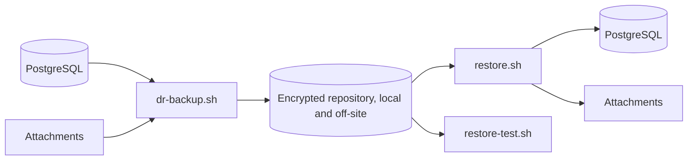

# Storage, database, and migrations

## Storage backend

- **`STORAGE_BACKEND=local`** (default outside Compose) stores files on the backend container's own filesystem, at `STORAGE_LOCAL_DIR`. The root `docker-compose.yml` mounts this as the named volume `reqtrack_local_files` so files survive container recreation; if you run the backend outside this Compose file, mount an equivalent persistent volume yourself. The built-in disk-usage monitor only runs for this backend, emailing `DEPLOYMENT_NOTIFICATION_EMAIL` when usage crosses `DISK_USAGE_WARNING_THRESHOLD_PERCENT`.
- **`STORAGE_BACKEND=s3`** (the Compose default) stores files in any S3-compatible bucket — the bundled SeaweedFS service, a self-hosted SeaweedFS/MinIO cluster, or real AWS S3. Set `STORAGE_S3_ENDPOINT_URL` to your provider (omit it, or point it at AWS's endpoint, for real S3), and set `STORAGE_S3_BUCKET`/`STORAGE_S3_ACCESS_KEY`/`STORAGE_S3_SECRET_KEY`/`STORAGE_S3_REGION` accordingly. This is the recommended choice for any deployment with more than one backend replica, since local disk storage doesn't get shared across replicas.
- **Storage health.** Every `STORAGE_HEALTH_CHECK_INTERVAL_SECONDS` (default 300) the elected leader writes, reads back and deletes a tiny probe object through the configured backend (any backend, including S3-compatible ones whose free space the app cannot read). A failing probe is logged at ERROR on every check, sets the Prometheus gauge `storage_write_healthy` to `0` (alert on it), and notifies every server admin in-app (and by email per their preferences, plus the `DEPLOYMENT_NOTIFICATION_EMAIL` address if set) once per outage, with a second notification on recovery. For local storage the disk-percentage warning (`DISK_USAGE_WARNING_THRESHOLD_PERCENT`) also notifies server admins. Each probe is one write, one read and one delete, which a metered S3 provider bills; set `STORAGE_HEALTH_CHECK_ENABLED=false` to turn the periodic probe off, or raise the interval. A server admin can still probe on demand with `GET /api/v1/system/storage-health`.

## Database

PostgreSQL and the stored files are not backed up unless you schedule it. The supported tool is the whole-platform backup: one command captures the database, the attachments (the bundled SeaweedFS, any S3-compatible bucket, or the local-files volume) and, optionally, the encrypted `.env`, with a manifest, off-site copies, retention and an integrity check. Its matching restore and a restore test that proves the latest backup works are described in [Backup and disaster recovery](./backup-and-disaster-recovery.md).

```bash
./scripts/dr-backup.sh                  # take a backup
./scripts/restore.sh fresh|in-place     # restore, verified against the manifest before anything is replaced
./scripts/restore-test.sh ...           # prove the latest backup restores
```



The older `./scripts/backup.sh` (a plain `pg_dump`, and the local-files volume only when `STORAGE_BACKEND=local`) is kept for one-off dumps; it does not cover SeaweedFS objects or the `.env`, so do not rely on it for recovery. `./scripts/restore.sh FILE` still restores its output into an empty database.

## Migrations

The backend runs `alembic upgrade head` automatically on every startup. Upgrading to a new ReqTrackManager version is therefore just: pull the new image, `docker compose up -d backend` — no manual migration step is required. Because the migration runs immediately and automatically on container start, **always take a backup (`./scripts/dr-backup.sh`) before upgrading**.

## Next steps

- [Backup and disaster recovery](./backup-and-disaster-recovery.md)
- [TLS, reverse proxy, and same-origin deployment](./tls-and-reverse-proxy.md)
- [Scaling and adding modules](./scaling-and-modules.md)
