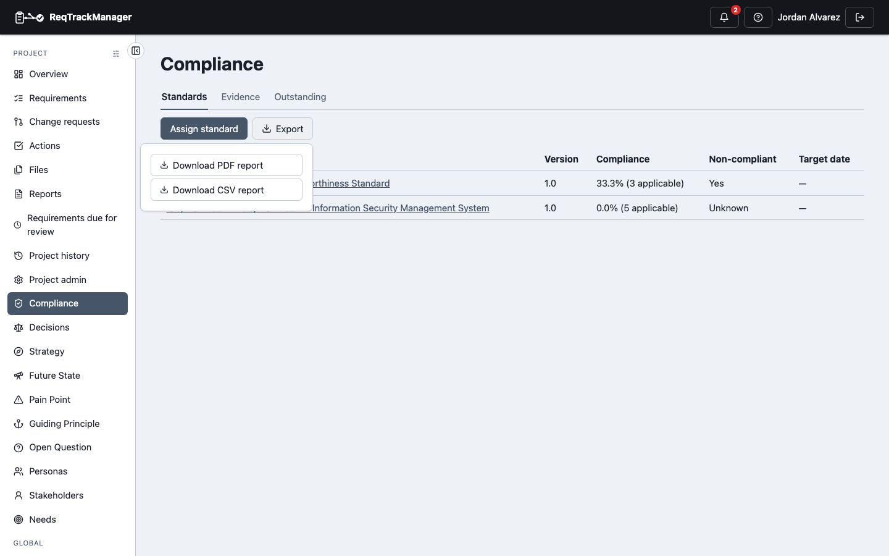

# Reporting and export

## Reports

Both a project's compliance and an organisation's cross-project compliance can be exported in every file format the platform produces, suitable for internal review and audit preparation. The document formats (PDF, Word, ODT and HTML) carry the fuller, multi-section report (main table plus evidence/review/mapping appendices); the table formats (CSV, Excel and ODS) carry the flat, one-row-per-requirement (or, at organisation scope, one-row-per-assignment) table. Choose the format from the **Export** control, which offers *Download PDF report*, *Word*, *ODT*, *HTML*, *CSV*, *Excel* and *ODS*.

| Exporting a report |
| --- |
| A project's Compliance page offers an export of its full assessment in every format |
|  |

A **project's** report covers every requirement's applicability, compliance status, approval state and history, required actions, linked evidence (with validity/expiry), review history, and any cross-standard mappings touching its assigned standards — available to anyone who can view the project's compliance.

An **organisation's** report rolls up across every project (one row per project/assigned-standard-version pair), plus appendices for non-compliant requirements, pending approvals, and expiring/expired evidence across every project — restricted to Compliance Managers.

Evidence is named by its code in both reports (`EVD-001 Test certificate`, with the project code in front in the organisation's report), and the evidence register and expiring-evidence appendix list its tags. A compliance requirement keeps the standard's own reference and has no code of its own.

| Report scope | Format | Contents |
| --- | --- | --- |
| Project | PDF, Word, ODT, HTML | Main requirement table, plus evidence/review/mapping appendices |
| Project | CSV, Excel, ODS | One row per requirement |
| Organisation | PDF, Word, ODT, HTML | One row per project/assigned-standard-version, plus non-compliant/pending-approval/expiring-evidence appendices across every project |
| Organisation | CSV, Excel, ODS | One row per project/assigned-standard-version pair |

In the Word, ODT and HTML versions a requirement is one cell: its section path in italics, its title in bold, then each of reasoning, clarification, justification and notes behind a bold label, separated by dots. The PDF shows the same text on separate lines in the cell.

## Export/import bundles

Compliance content is included in ReqTrackManager's existing project/organisation export-and-import bundles, at the level the data actually belongs to:

- An **organisation** bundle carries every compliance standard it owns — with its full version/requirement/required-action tree, its action-type and mapping-relationship-type vocabularies, and its cross-standard requirement mappings — since a standard is an organisation-level, reusable resource.
- A **project** bundle carries that project's own compliance *assessment*: which standards it's assigned to, its per-requirement applicability/status/approval state, its required-action assessments, its evidence (with files and revalidation history), and its own project-level review history. It does not re-embed the standard itself; on import, the assignment is resolved against a standard/version of the same reference and version label already present in the target organisation, and is skipped (with a warning, never silently fabricated) if no match exists there.

Both directions round-trip: exporting and re-importing a project or organisation reproduces its compliance data intact.

## Standard-level import/export

A single standard can also be exported and re-imported on its own, distinct from the whole-organisation bundle above — useful for backing up or transferring just one standard, e.g. into a different organisation or deployment. Every version is always re-created as draft on import, regardless of its original published/retired status — an imported standard must be reviewed and re-published locally before it governs any project, never silently live.

## Where this fits

See [Assessing a project](./assessing-a-project.md) for what generates the data these reports summarise, and [AI assistant (MCP) integration](./mcp-integration.md) for pulling the same kind of information programmatically instead of via a report download.
