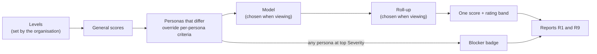
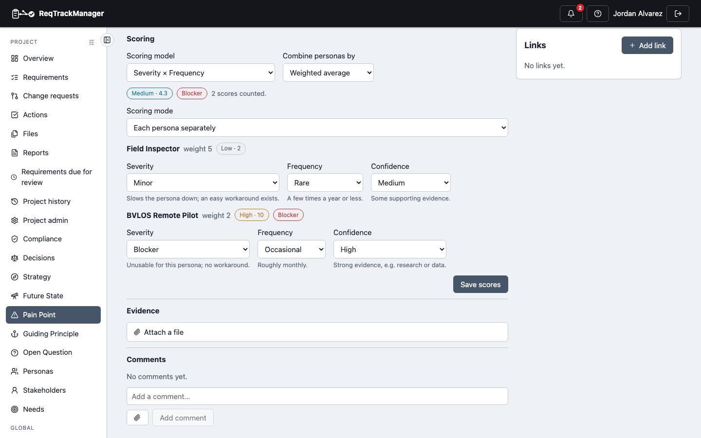
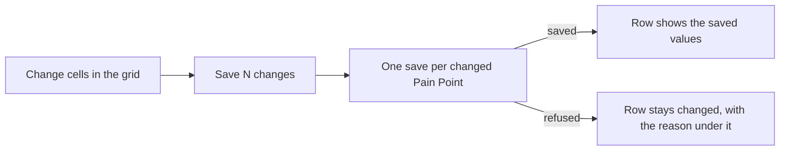
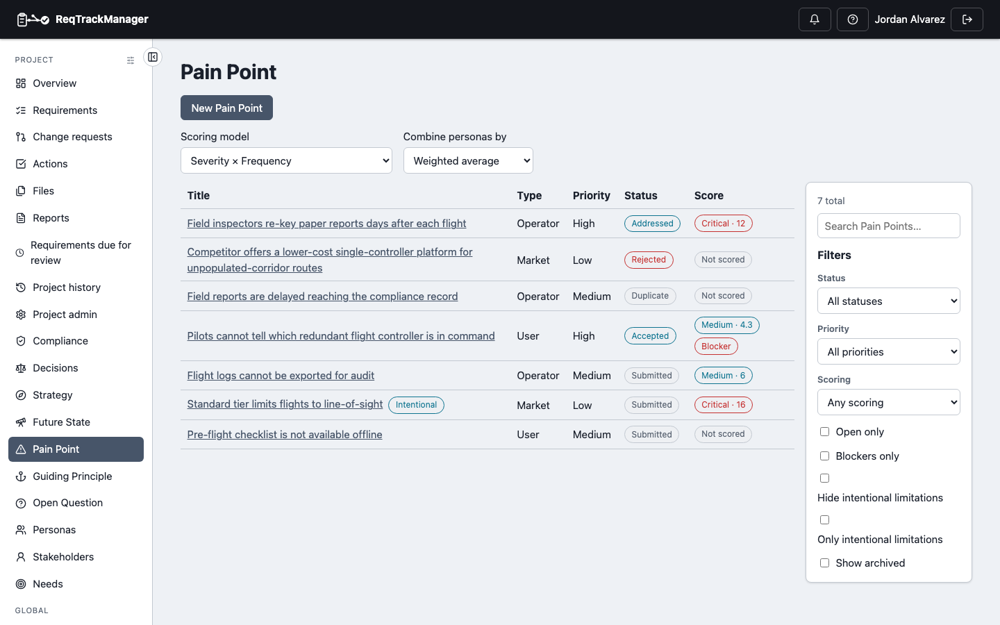
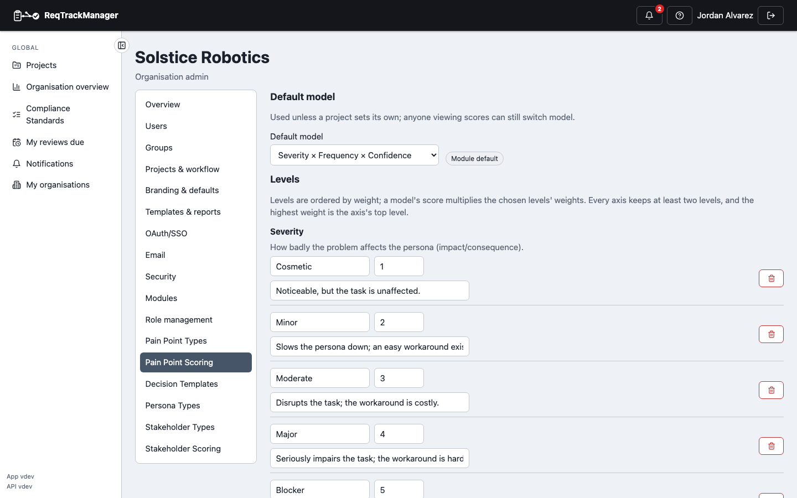
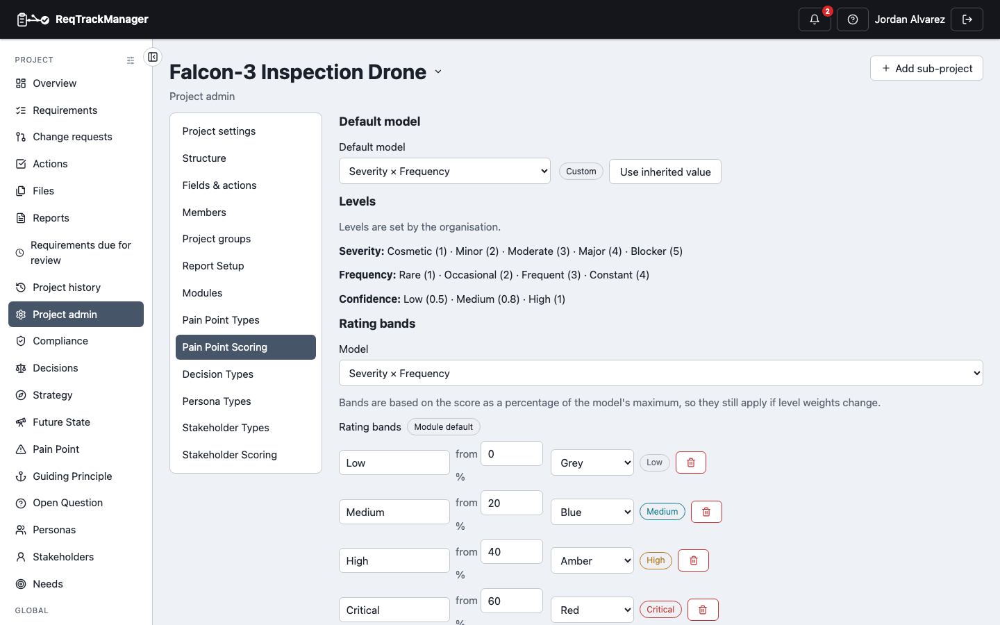
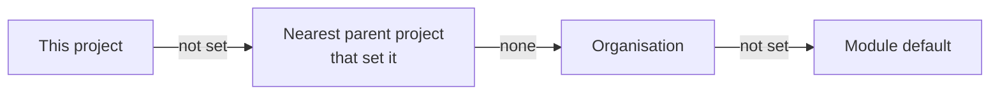

# Pain Point scoring

A Low/Medium/High priority can't rank thirty "High" Pain Points, and a problem that is trivial for one persona can make the product unusable for another. Scoring ranks Pain Points on a set of criteria, scored for the whole Pain Point (**General**) and **per persona** where a persona differs, and keeps any problem that blocks a persona visible however the numbers are averaged.

## The criteria

Each criterion is scored either **per persona** or **for the whole Pain Point**. The built-in criteria are:

| Criterion | Asks | Scored | Default levels (weight) |
| --- | --- | --- | --- |
| **Severity** | How badly does the problem affect this persona? | Per persona | Cosmetic (1) · Minor (2) · Moderate (3) · Major (4) · **Blocker** (5): unusable for this persona, no workaround |
| **Frequency** | How often do they hit it? | Per persona | Rare (1) · Occasional (2) · Frequent (3) · Constant (4) |
| **Confidence** | How sure are we of the other two? | Per persona | Low (0.5) · Medium (0.8) · High (1) |
| **User/business value** | How much is solving it worth? | Per persona | Minimal (1) · Low (2) · Moderate (3) · Substantial (5) · High (8) · Very high (13) · Exceptional (20) |
| **Time criticality** | How quickly does waiting cost more? | Whole Pain Point | No deadline (1) … Immediate (20), on the same scale |
| **Risk reduction / opportunity enablement** | Does solving it remove a risk or open an opportunity? | Whole Pain Point | None (1) … Exceptional (20), on the same scale |
| **Job size** | How large is the work? | Whole Pain Point | Tiny (1) … Epic (20), on the same scale |

Each level carries short guidance that appears beside the control when you score, so everyone reads "Major" the same way. The organisation can rename, re-weight, add, or remove levels, and define criteria of its own (see [Configuring scoring](#configuring-scoring)).

A **scoring model** combines the chosen levels' weights:

| Model | Combines | Highest possible (defaults) |
| --- | --- | --- |
| Severity × Frequency | Severity × Frequency | 20 |
| Severity × Confidence | Severity × Confidence | 5 |
| Severity × Frequency × Confidence | all three, multiplied | 20 |
| **Cost of Delay** | User/business value + Time criticality + Risk reduction, added with equal importance | 100% |
| **WSJF** (Weighted Shortest Job First) | Cost of Delay ÷ Job size | 100% of Cost of Delay at the smallest job |

With the default weights Confidence only ever discounts a score: a Low-confidence "Blocker" scores less than a High-confidence one. Under WSJF a larger job lowers the score, so a small piece of work with the same value ranks higher.

Scores are shown two ways: the raw product on the Pain Point and in the list (for example **Critical · 12**), and as a 0–100 figure in the [reports](./report-reference.md) (the raw score as a percentage of the model's highest possible score).

## Scoring a Pain Point

Open a Pain Point and use the **Scoring** section. Saving scores is for the **Pain Point Manager** role; anyone who can see the Pain Point can read them. A Pain Point Manager can also score while creating one: the **New Pain Point** form has an optional **Scoring** section with the same controls, and members without the role do not see it.

| The Scoring section of a Pain Point |
| --- |
| Two personas scored separately: the Field Inspector (weight 5) rates it Minor, the BVLOS Remote Pilot (weight 2) rates it a Blocker |
|  |

1. Set the **General** scores: a level for each criterion. General holds the criteria scored for the whole Pain Point (such as Job size), and is the default for the criteria scored per persona (such as Severity). Leave any criterion blank if you don't know it.
2. If a persona is affected differently, choose it under **Add a persona that differs**. Its group holds the per-persona criteria only; a level left blank there takes General's. This option needs the [Stakeholders & Personas](../stakeholders-personas-module/overview.md) module, and offers the project's personas. The grid never lists every persona, so it stays short however many the project has. Remove a persona's group to return it to General.
3. Select **Save scores**.

A persona's score uses its own level where it has one and General's otherwise, so a persona group that overrides only Severity still scores on General's Frequency and Confidence. A criterion scored for the whole Pain Point can be set under General only.

### Scoring many Pain Points in the grid

A Pain Point Manager sees a **Grid view** button (the table icon) above the Pain Point list. The grid shows the same rows and filters as the list, with **Type**, **Priority**, **Intentional** and the three **Severity**, **Frequency** and **Confidence** levels as cells, so a backlog can be scored without opening each Pain Point.

Read left to right: each changed Pain Point is saved on its own, so one refusal never stops the others.

- Changed cells are tinted and counted on the **Save N changes** button. The undo button discards the changes and puts the saved values back. The grid has no Reload button; refresh the page to read the list again.
- Switching to the grid leaves the filter panel as it was. Collapse it to give the table the full width; the **Filters** button beside the list actions menu brings it back, and collapsing never clears a filter. Every list page's filter panel has a round collapse button in its header.
- The **Editing** column says whether each row can be edited (**Editable**, **Partly editable** or **Read-only**) with the reason on hover, next to the Pain Point's **Status**. The **Columns** button (table icon), the undo button and **Save** sit on the same row as the List and Grid buttons, before them. The **Columns** button opens a menu that chooses which columns show, including read-only ones such as Source or Impact; your choice is remembered.
- The grid edits the **General** scores of every criterion the project offers; persona overrides are set on the Pain Point and are left as they are when a General cell is saved. A Pain Point at a terminal outcome is read-only, with the reason on hover.
- If someone else changed a cell after you loaded the grid, that row is not saved: its message says what the value is now, and your change stays in place until you reload or discard it.
- **Enter** moves to the same column in the next row (**Shift+Enter** goes back); **Tab** moves along the row. After saving, a result such as "3 saved, 1 failed" appears.

## How personas combine

The **Scoring model** and **Combine personas by** selectors sit above the score on the Pain Point and in report R1. On the list they are behind the small gear beside the **Score** column heading (its tooltip names the model and roll-up in use, and the gear is outlined when either is not the default); selecting the gear opens them, and the list re-ranks as you change them without sorting by Score. They only change what you *see*; nothing is stored, so you can compare rankings freely.

| Combine personas by | Result |
| --- | --- |
| **Weighted average** (default) | Each scored persona's score, weighted by the persona's importance (its **weight**; equal if none is set). |
| **Worst case** | The highest persona score. |
| **Plain average** | Every scored persona counts the same. |

### Worked example

"Pilots cannot tell which redundant flight controller is in command", under **Severity × Frequency** (highest possible 20):

| Persona (each differs from General) | Weight | Severity | Frequency | Raw score | 0–100 |
| --- | --- | --- | --- | --- | --- |
| Field Inspector | 5 | Minor (2) | Rare (1) | 2 | 10 |
| BVLOS Remote Pilot | 2 | **Blocker** (5) | Occasional (2) | 10 | 50 |

| Roll-up | Working | Raw score | 0–100 | Band |
| --- | --- | --- | --- | --- |
| Weighted average | (2 × 5 + 10 × 2) ÷ (5 + 2) | 4.3 | 21 | Medium |
| Worst case | the pilot's score | 10 | 50 | High |
| Plain average | (2 + 10) ÷ 2 | 6 | 30 | Medium |

The three roll-ups rank this Pain Point differently, because the inspectors outweigh the pilots. That is the point of choosing when viewing: the weighted figure says "overall, a modest problem", the worst-case figure says "one persona is badly hurt". The **Blocker** badge appears under all three.

## Blockers

A **Blocker** badge shows whenever any counted persona rates Severity at the axis's top level, whatever model or roll-up is chosen. One blocked persona can't be averaged away. The badge names the persona in the reports (**Blocker: BVLOS Remote Pilot**).

## Reading scores in the list

| The Pain Point list with the Score column |
| --- |
| Switching the model or roll-up re-ranks the list; the filters narrow it to open items, Blockers, scored or not scored, and in or out intentional limitations |
|  |

- The filter panel can narrow the list to **Open only**, **Blockers only**, **Scoring** (scored or not scored), and **Hide** or **Only intentional limitations**. [Report figures](./reports.md#following-a-figure) open the list with these already applied.
- **Not scored** means no persona has every input the chosen model needs. It is a gap, not a low priority: switch to a model whose inputs you have, or score it.
- **Unscored personas are left out, not counted as zero.** If only one of five personas is scored, the Pain Point shows that persona's score. With no persona groups, or only retired ones, the General score is the score.
- A persona missing an input the chosen model needs is "Not scored" under that model only.

## Intentional limitations

Some Pain Points are deliberate: a restriction in a lower product tier that exists to drive an upgrade. Switch on **Intentional limitation** when you create or edit the Pain Point.

- They are **still scored**, per persona, like any other.
- They are listed apart from the fix ranking in [R1](./report-reference.md#r1-pain-point-prioritisation), so they aren't "fixed" by mistake.
- [R9 Upgrade drivers](./report-reference.md#r9-upgrade-drivers) reports on them: one that blocks a persona is a **churn risk** rather than an upsell lever.
- Linking an intentional limitation to the product tier it belongs to isn't available yet ([Known limitations](./known-limitations.md)).

## When personas change

| What happened to the persona | Effect on scores |
| --- | --- |
| **Retired** | Still shown, but not counted in the roll-up or the Blocker flag. |
| **Deleted, hidden from the project, or the Personas module turned off** | Its scores still count, without a name or weight, and the page and reports say the personas are unavailable. |

The page never fails on a missing persona.

## Configuring scoring

Levels belong to the organisation (a project can edit the levels of a criterion it defined itself); a project can also change the default model, the models offered, the rating bands and the cell ratings.

| Setting | Organisation (**Org Management → Pain Points → Pain Point Scoring**) | Project (**Project Admin → Pain Points → Pain Point Scoring**) |
| --- | --- | --- |
| Levels per criterion (name, weight, guidance) | Edit, add, delete (at least two per criterion; deleting an in-use level asks where to move its scores) | Read-only, except a criterion the project defined |
| Models offered | Choose which models appear when scoring and viewing (the default is always offered) | Override, or use the inherited value |
| Criteria and models of your own | Add, edit, delete; hide a built-in one and restore it | Add, edit, delete for the project and the projects below it; hide a built-in or inherited one in this project |
| Default model | Set, or reset to the module default | Override, or use the inherited value |
| Rating bands per model | Set, or reset to the module defaults | Override, or use the inherited value |
| Cell ratings per two-axis model | Pin cells to a band, or reset | Override, or use the inherited value |

| Organisation scoring settings | Project scoring settings |
| --- | --- |
|  |  |

### Your own criteria and models

Under **Criteria**, **Add axis** defines a criterion with its own levels and chooses how it is **Scored**: once for the whole record, or separately for each persona. That choice is fixed when the criterion is added, because scores already stored depend on it. **Add model** combines criteria as a product (multiplied, or divided by an axis), or as a weighted sum by importance (totalling 100%) that can also be divided by an axis, as WSJF divides by Job size. A built-in criterion or model can be hidden and restored, never deleted; a level already stored on a hidden criterion is kept and ignored until it is restored. Deleting a criterion that scores use asks whether to drop those scores.

**Rating bands** (Low, Medium, High, Critical by default) label a score by where it sits as a percentage of the model's highest possible score, so they keep working when you change level weights. The module's starting points differ by model:

| Model | Medium from | High from | Critical from |
| --- | --- | --- | --- |
| Severity × Frequency | 20% | 40% | 60% |
| Severity × Confidence | 30% | 50% | 80% |
| Severity × Frequency × Confidence | 15% | 30% | 50% |
| Cost of Delay | 30% | 50% | 75% |
| WSJF | 6% | 15% | 35% |

**Cell ratings** let you set the band of individual cells in a two-axis model's grid, for when thresholds on the score don't match how your organisation rates risk. For example, a Blocker that happens Rarely scores 25% (Medium), but you may rate it High. Under **Rating bands**, choose a two-axis model (Severity × Frequency or Severity × Confidence), pick a band in a cell's list, and select **Save cell ratings**. Cells left on **Thresholds** keep the band their score earns.

- A cell can only use a band that exists, so save band changes first, and a band that cells still use can't be removed or renamed.
- A cell rating changes the band only, never the score.
- A Pain Point's own score uses its cell's rating. A figure that blends several personas (a weighted or plain average) isn't one cell, so it uses the threshold bands; **Worst case** and a single scored persona keep the cell's rating.
- The three-axis model has no single grid, so it uses thresholds only.

A project that hasn't overridden a setting inherits it, and the page says where from:

| Who | Can |
| --- | --- |
| Anyone who can see a Pain Point | Read its scores and switch the model and roll-up. |
| Pain Point Manager (project) | Save a Pain Point's scores. |
| Pain Point Type Admin (organisation) or organisation admin | Edit levels, default model and bands for the organisation. |
| Project manager or administrator, or organisation admin | Override the default model and bands for a project. |

## Automation

An AI assistant or script can read and set scores: see the three scoring tools in [AI assistant (MCP) integration](./mcp-integration.md). Over REST, `GET .../pain-points/{id}/scores` returns a Pain Point's General and per-persona scores and roll-up, and `PUT` replaces them; each entry is `{target_id, levels}`, where `target_id` is a persona (or null for General) and `levels` maps a criterion key to a level ID. `GET .../pain-point-scores` ranks every Pain Point under a model and roll-up. Criterion keys and level IDs come from the project's `pain_point` scoring scheme, which also says which criteria are scored per persona.

## Where this fits

Scores feed [R1 Pain Point prioritisation and R9 Upgrade drivers](./report-reference.md). See [Pain Point](./pain-point.md) for the rest of the Pain Point record and its lifecycle, and [Reports](./reports.md) for finding and exporting reports.
